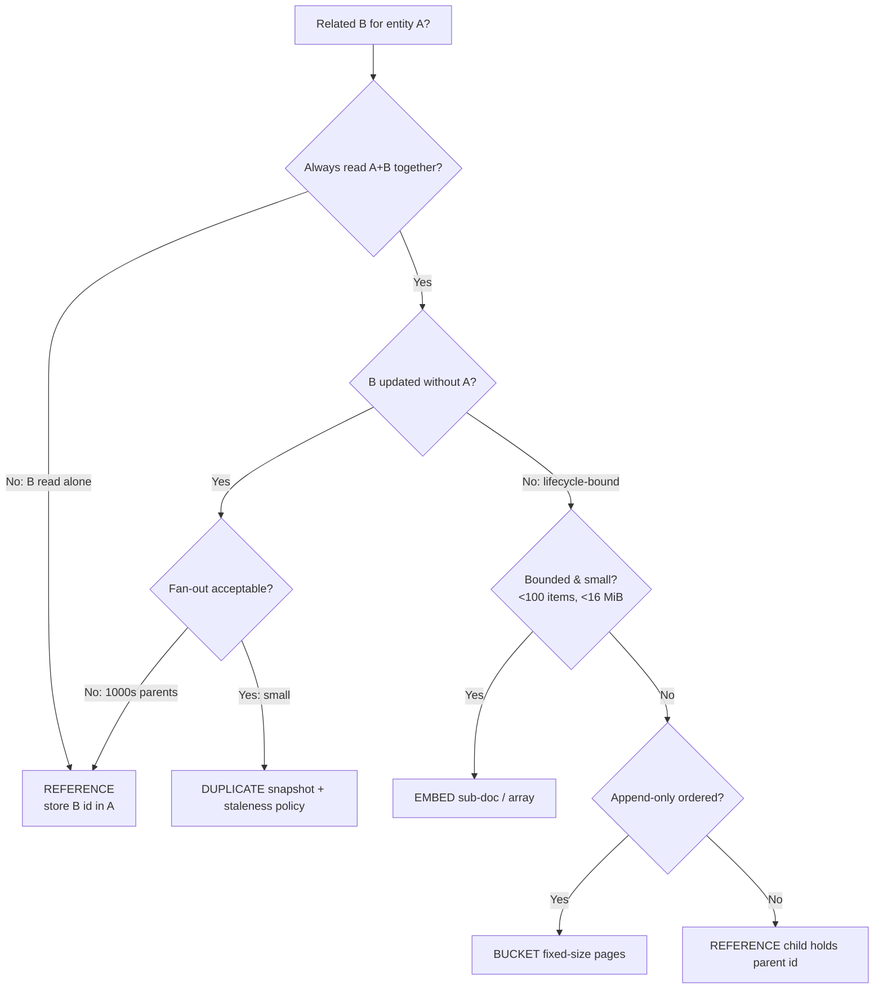
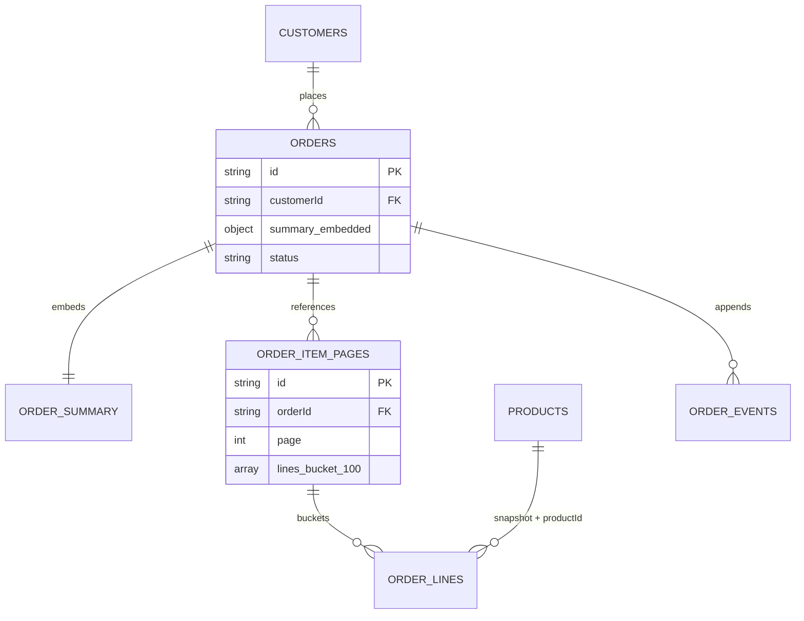

# 006 — Data Modeling & Schema Design (Boot 4.1.0 + Java 25)

> Design MongoDB schemas **queries-first**: embed vs reference, cardinality patterns (1-1 / 1-many / 1-squillions / many-many / tree), denormalization, buckets, validation, migrations, tenancy, retention — on `customers`, `orders`, `products`, `users`, `posts`.
>
> **Stack:** Spring Boot **4.1.0** · Java **25** · Spring Data MongoDB 5.x · MongoDB **7.x/8.x** (16 MiB limit, `$jsonSchema`, TTL, time-series, change streams).
>
> Companion guides: [002 — Document Mapping](./002-document-mapping.md) · [008 — Indexing & Query Performance](./008-indexing-query-performance.md) · [015 — System Design Scenarios](./015-system-design-scenarios.md) · [MongoDB Introduction](./mongodb.md).

## Table of Contents

- [1. Access-Pattern-Driven Design (Queries First)](#1-access-pattern-driven-design-queries-first-then-schema)
- [2. Embed vs Reference Decision Framework](#2-embed-vs-reference-decision-framework)
- [3. 1–1: User + Profile (Embed)](#3-1-1-user--profile-embed)
- [4. 1–Many: Product + Reviews](#4-1-many-product--reviews-embed-if-few-vs-bucket-vs-reference)
- [5. 1–Squillions: Order + 1000s Items](#5-1-squillions-order--1000s-items-summary-embed--item-pages-reference)
- [6. Many–Many: Students / Courses, Users / Roles](#6-many-many-studentscourses-usersroles-both-side-arrays--join-docs)
- [7. Parent–Child: Categories Tree](#7-parent-child-categories-tree-materialized-path)
- [8. Denormalization & Duplication](#8-denormalizationduplication-product-snapshot-in-order-item--staleness-policy)
- [9. 16 MiB Limit + Unbounded Arrays](#9-16-mib-limit--unbounded-arrays-bucket-pattern)
- [10. Read-Heavy vs Write-Heavy](#10-read-heavy-vs-write-heavy-models)
- [11. Aggregate Boundaries](#11-aggregate-boundaries)
- [12. Audit Logs (Append-Only)](#12-audit-logs-append-only)
- [13. Event Histories (Capped / Time-Series)](#13-event-histories-cappedtime-series)
- [14. Polymorphism (Discriminator)](#14-polymorphism-discriminator-_type)
- [15. Validation ($jsonSchema)](#15-validation-jsonschema)
- [16. Migrations (Version + Lazy + Mongock)](#16-migrations-version-field--lazy--mongock-note)
- [17. Multi-Tenant](#17-multi-tenant-tenant-field--compound-index-vs-db-per-tenant)
- [18. Soft Delete](#18-soft-delete-active-flag--partial-index)
- [19. Retention (TTL)](#19-retention-ttl)
- [20. Domain Verdicts](#20-domain-verdicts-embed-vs-ref-verdict--sample-json--notes)
- [21. Pitfalls (GOLD)](#21-pitfalls-gold)
- [22. Interview Q&A](#22-interview-qa)
- [23. Resources](#23-resources)

> **Convention:** `com.commercemesh.*.document`, `Instant` timestamps (UTC), `schemaVersion int` on every aggregate. Snippets mirror repo style, **not compiled**.

---

## 1. Access-Pattern-Driven Design (Queries First, Then Schema)

Relational modelling asks *"what entities exist?"* MongoDB asks *"what queries must be fast?"* Design in order:

1. **List queries + writes with SLOs.** Each read: filter, sort, projection, QPS, p95 budget. Each write: frequency, atomicity scope, staleness tolerance.
2. **Group by access-together.** Always fetched A+B together → embed candidate. A without B (or reverse) → reference candidate.
3. **Size the working set.** Doc size, array growth/week, rewrite cost. Unbounded → bucket/paginate by design (§9).
4. **Draw aggregate boundaries (§11).** One transaction = one document if possible; cross-document needs transactions or async repair.
5. **Pick embed / reference / duplicate (§2)**, then add indexes ([008](./008-indexing-query-performance.md)), validation (§15), migration plan (§16).
6. **Load-test hot path** with `explain("executionStats")` + prod-size fixtures; revisit when QPS × doc-size doubles.

```java
// Capture patterns BEFORE classes — order detail example:
// Q1 getOrderById (200 QPS, p95<40ms, header + items page 1) | Q2 listOrdersByCustomer (80 QPS, sort createdAt desc)
// W1 placeOrder (20 QPS, atomic stock + order) | W2 appendOrderEvent (60 QPS, status only)
// Verdict: header + summary + page-0 embedded; overflow pages referenced (§5).
```

**Anti-pattern:** normalised `Customer`/`Order`/`Product` with `@DBRef` everywhere + `$lookup` per read. Recreates the join problem: extra round-trips, no FK enforcement, N+1 in Spring Data ([002 §11](./002-document-mapping.md)).

---

## 2. Embed vs Reference Decision Framework

Four questions decide everything:

| Question | Embed if… | Reference if… |
|---|---|---|
| **Access-together?** | Child always read with parent (address+customer, line+order) — 1 read, no join | Child read standalone (product without order, user without roles) |
| **Update-together?** | Child changes only via parent lifecycle — single atomic write | Child changes independently (price 50×/day × 10k embedding orders = 10k rewrites) |
| **Size?** | Bounded + small (≤ ~100 sub-docs, < hundreds of KB) | Large/unbounded (reviews, comments, events, B2B lines) |
| **Cardinality?** | 1–1, 1–few, 1–many-stable | 1–many-growing, 1–squillions, many–many with independent lifecycles |



Rules of thumb: **embed** = `List<Address>` in `Customer` (one `save()`, atomic); **reference** = plain `String productId` (never `@DBRef` at scale — batch via `findAllById`/`$lookup`); **duplicate** = snapshot (`name`, `unitPrice` at purchase) + live id + staleness policy (§8).

```java
@Document(collection = "customers")
public class Customer {
    @MongoId private String id;
    private List<Address> addresses = new ArrayList<>(); // EMBED: 1-few, lifecycle-bound
    private int schemaVersion = 1;
    public record Address(String label, String line1, String city, String postalCode, String countryCode, boolean isDefault) {}
}
@Document(collection = "orders")
public class OrderRef {
    @MongoId private String id;
    private String customerId; // REFERENCE: plain id, no @DBRef on hot path
    private int schemaVersion = 1;
}
```

---

## 3. 1–1: User + Profile (Embed)

**Verdict: EMBED.** Profile + 1–3 addresses fetched on every login, updated with the user, bounded (< 16 KB), never queried standalone.

```json
{"_id":"cust_9f21","schemaVersion":1,"email":"amina@example.com","name":"Amina Yusuf",
"profile":{"avatarUrl":"https://cdn.example/a.png","locale":"en-GB","marketingOptIn":true},
"addresses":[{"label":"home","line1":"14 Alder Rd","city":"Leeds","postalCode":"LS1 4BR","countryCode":"GB","isDefault":true}]}
```

```java
@Document(collection = "customers")
public class Customer {
    @MongoId private String id;
    @Indexed(unique = true) private String email;
    private Profile profile; // 1-1 embed
    private List<Address> addresses = new ArrayList<>(); // 1-few embed, cap 5 via $jsonSchema
    private int schemaVersion = 1;
    @CreatedDate private Instant createdAt; @LastModifiedDate private Instant updatedAt;
    public record Profile(String avatarUrl, String locale, boolean marketingOptIn) {}
    public record Address(String label, String line1, String city, String postalCode, String countryCode, boolean isDefault) {}
}
```

Frequency: `findByEmail` highest QPS, address piggybacks free. Update: single-doc `$set`/positional `$`. Size ~1–4 KB. Consistency: strong in-doc. Index: unique `email`. **Split** only if profile > 100 KB, separate ACL (PII vault), or divergent write rate (telemetry 1000×/day) → `customer_profiles{customerId}`.

---

## 4. 1–Many: Product + Reviews (Embed-if-Few vs Bucket vs Reference)

Attributes/images/tags → embed. Reviews → choose by count:

| Strategy | When | Shape |
|---|---|---|
| **Embed-if-few** | ≤ ~50, PDP always shows top reviews | `topReviews[5]` + `reviewCount` + `averageRating` counters in `products` |
| **Bucket** | 100s–1000s, paginated | `review_buckets{productId, page, reviews[50]}` |
| **Reference** | Standalone queries (moderation, by-author), write-heavy | `reviews{productId, authorId, rating, text}` + `(productId, createdAt)` index |

```json
{"_id":"prod_aurora_hp","schemaVersion":2,"sku":"AUR-HP-001","name":"Aurora Wireless Headphones",
"price":{"$numberDecimal":"199.99"},"averageRating":4.6,"reviewCount":128,
"topReviews":[{"reviewId":"rev_101","rating":5,"title":"Superb ANC","author":"Amina"}]}
{"_id":"prod_aurora_hp#page_0003","productId":"prod_aurora_hp","page":3,"count":50,
"reviews":[{"reviewId":"rev_312","rating":4,"text":"Great battery","authorId":"u_77"}]}
```

```java
@Document(collection = "reviews")
@CompoundIndex(name = "product_created", def = "{'productId': 1, 'createdAt': -1}")
public class Review {
    @MongoId private String id;
    @Indexed private String productId; // child-side reference, queryable both ways
    private String authorId; private int rating; private String text;
    private int schemaVersion = 1; @CreatedDate private Instant createdAt;
}
```

Frequency: product reads 100× review writes → denormalised counters serve PDP. Update: `insertOne` + `$inc` + `$push`/`$slice` top-N; never unbounded `$push` into `products`. Consistency: counters eventual ≤ 60s via change stream (or replica-set transaction). Index: `(productId, createdAt)`, buckets `(productId, page)` unique, text on `products(name, description)`.

---

## 5. 1–Squillions: Order + 1000s Items (Summary Embed + Item Pages Reference)

B2B orders with 1000s of lines break naive embedding (16 MiB, slow rewrites). Pattern: **summary embed + item pages reference**.



```json
{"_id":"ord_2026_88121","schemaVersion":3,"customerId":"cust_9f21","status":"CONFIRMED",
"summary":{"lineCount":2400,"totalQty":18500,"grandTotal":{"$numberDecimal":"41280.00"},"currency":"USD"},
"shippingAddress":{"line1":"14 Alder Rd","city":"Leeds","countryCode":"GB"},
"firstLines":[{"productId":"prod_aurora_hp","sku":"AUR-HP-001","nameSnapshot":"Aurora Wireless Headphones","unitPrice":{"$numberDecimal":"199.99"},"qty":4}],
"pageCount":24}
```

```java
@Document(collection = "orders")
@CompoundIndex(name = "customer_created", def = "{'customerId': 1, 'createdAt': -1}")
public class Order {
    @MongoId private String id; @Indexed private String customerId; private String status;
    private OrderSummary summary; // embedded rollup
    private AddressSnapshot shippingAddress; // denormalised copy (§8)
    private List<OrderLine> firstLines = new ArrayList<>(); // page 0 inline → 1-fetch detail
    private int pageCount; private int schemaVersion = 3; @CreatedDate private Instant createdAt;
    public record OrderSummary(int lineCount, long totalQty, BigDecimal grandTotal, String currency) {}
    public record OrderLine(String productId, String sku, String nameSnapshot, BigDecimal unitPrice, int qty) {}
}
@Document(collection = "order_item_pages")
@CompoundIndex(name = "order_page_unique", def = "{'orderId': 1, 'page': 1}", unique = true)
public class OrderItemPage {
    @MongoId private String id; // orderId + "#page_" + zero-padded page
    @Indexed private String orderId; private int page; private List<Order.OrderLine> lines = new ArrayList<>();
}
```

Frequency: detail page 1 fetch (header + page 0), deep pages lazy-load by `page`. Update: lines immutable after `CONFIRMED`; status via small `$set`. Size: header < 32 KB, pages ~50–100 KB. Consistency: placement in multi-doc transaction; then append-only events. Index: `(customerId, createdAt)`, `(orderId, page)` unique; range-paginate, never deep `skip()` ([008](./008-indexing-query-performance.md)).

---

## 6. Many–Many: Students/Courses, Users/Roles (Both-Side Arrays + Join Docs)

Covers users↔roles, students↔courses, products↔categories (non-tree):

| Option | Shape | Use when |
|---|---|---|
| **A. Both-side arrays** | `users.roleIds[]` + `roles.userIds[]` | Both directions queried, sets < ~200, stable |
| **B. One-side array** (default for roles) | `users.roleIds[]` only | One direction dominates (`user→roles` per request); reverse via multikey index |
| **C. Join collection** | `enrollments{studentId, courseId, enrolledAt, grade}` | Relationship has attributes, unbounded, or needs history/pagination |

```json
{"_id":"u_77","schemaVersion":1,"email":"sam@example.com","roleIds":["role_admin","role_catalog_editor"]}
{"_id":"role_admin","schemaVersion":1,"name":"ADMIN","permissions":["catalog:write","order:refund"]}
{"_id":"enr_s12_c204","schemaVersion":1,"studentId":"s_12","courseId":"c_204","enrolledAt":{"$date":"2026-09-01T09:00:00Z"},"grade":null}
```

```java
@Document(collection = "users")
public class AppUser {
    @MongoId private String id; @Indexed(unique = true) private String email;
    private Set<String> roleIds = new HashSet<>(); private int schemaVersion = 1;
}
@Document(collection = "enrollments")
@CompoundIndex(name = "student_course_unique", def = "{'studentId': 1, 'courseId': 1}", unique = true)
@CompoundIndex(name = "course_student", def = "{'courseId': 1, 'studentId': 1}")
public class Enrollment {
    @MongoId private String id; private String studentId; private String courseId;
    private Instant enrolledAt; private String grade; private int schemaVersion = 1;
}
```

Frequency: `user→roles` per request (optionally duplicate `permissions` into JWT); `course→students` paginated via join index. Update: `$addToSet`/`$pull` idempotent; both-side arrays need 2 writes → transaction or async repair. Size: `roleIds` tiny; 50k-student course must never embed `studentIds[]`. Consistency: read-your-write on auth path; enrolment history eventual. Index both join directions.

---

## 7. Parent–Child: Categories Tree (Materialized Path)

Needs: children of X, ancestors (breadcrumb), subtree of X.

| Strategy | Shape | Reads | Writes |
|---|---|---|---|
| **Materialized path** ✅ | `path:"/electronics/audio/headphones"` | Prefix `^/electronics/audio`, one index, one query | Subtree rewrite on move (rare) |
| Parent ref | `parentId` | Recursive / `$graphLookup` | Cheap moves |
| Ancestors array | `ancestorIds:[…]` | `$in`, easy crumbs | Update descendants on move |
| Nested sets | `lft, rgt` | Fast subtree | Expensive inserts |

```json
{"_id":"cat_headphones","schemaVersion":1,"name":"Headphones","slug":"headphones",
"path":"/electronics/audio/headphones","depth":3,"parentId":"cat_audio"}
```

```java
@Document(collection = "categories")
public class Category {
    @MongoId private String id; @Indexed(unique = true) private String slug;
    private String name; private String path; private int depth; private String parentId;
    private int schemaVersion = 1;
}
List<Category> findByPathStartingWith(String prefix); // subtree — left-anchored ^ prefix uses index
List<Category> findByParentId(String parentId);       // direct children
```

Frequency: subtree + breadcrumb per PLP — split `path` client-side for crumbs. Update: moves < 1/week → transactional subtree `$set`; products store leaf `categoryId` only (no fan-out). Index: `path` prefix + unique `slug`; regex must be left-anchored ([008](./008-indexing-query-performance.md)). Cap depth 5–7 in validation.

---

## 8. Denormalization/Duplication (Product Snapshot in Order Item + Staleness Policy)

Duplication = deliberate bounded inconsistency for read speed. Every duplicate needs a written staleness policy:

| Duplicate | Policy | Sync |
|---|---|---|
| Order-line snapshot (`sku`, `name`, `unitPrice`, `snapshotAt`) | **Immutable** — invoice truth, never refreshed | None (by design) |
| `products.averageRating` / `topReviews` | **Eventual ≤ 60s** | Change stream on `reviews` → `$inc` + `$push`/`$slice` |
| `customer.name` in `orders` (optional) | **Eventual ≤ 5 min** or omit | Outbox → async update |
| `role.permissions` in JWT | **TTL-bound (15 min)** | Short expiry, not DB sync |

```java
public record ProductSnapshot(String productId, String sku, String nameSnapshot, BigDecimal unitPrice, Instant snapshotAt) {}
// Mutable-duplicate refresh from a change-stream listener:
mongoTemplate.updateFirst(Query.query(Criteria.where("_id").is(review.getProductId())),
    new Update().inc("reviewCount", 1).inc("ratingSum", review.getRating()), Product.class);
```

Rules: duplicate only hot-read fields (not whole product); store `snapshotAt`; never duplicate fast-churn fields (stock) — link instead.

---

## 9. 16 MiB Limit + Unbounded Arrays (Bucket Pattern)

BSON docs cap at **16 MiB**. Per-action arrays (reviews, comments, events, lines) eventually throw `BSONObjectTooLarge`; earlier they inflate every read/write and replication oplog. Watch for p95 creep on `findById` + `avgObjSize > 200 KB` in `db.collection.stats()`.

**Bucket pattern:** fixed-N containers keyed `(ownerId, seq)`:

```java
@Document(collection = "post_comment_buckets")
@CompoundIndex(name = "post_seq_unique", def = "{'postId': 1, 'seq': 1}", unique = true)
public class CommentBucket {
    public static final int BUCKET_SIZE = 50;
    @MongoId private String id; // postId + "#seq_" + seq
    @Indexed private String postId; private int seq; private int count;
    private List<Comment> comments = new ArrayList<>(BUCKET_SIZE);
    public record Comment(String commentId, String authorId, String text, Instant createdAt) {}
}
// Append: latest non-full bucket, else seq+1 — bounded indexed writes. Paginate by seq, never deep skip().
```

Sizing: **count-based 50–200** (comments/reviews/lines — predictable pages); **time-based hour/day** (`{deviceId, hour}` telemetry, pairs with §13); **size-based ~256 KB–1 MB target** (stays far under 16 MiB). Project slices (`fields().include("summary")`).

---

## 10. Read-Heavy vs Write-Heavy Models

| | Read-heavy (catalog, PDP, order detail) | Write-heavy (events, telemetry, comments) |
|---|---|---|
| Goal | 1-fetch pages, p95 < 50ms | Cheap appends, no contention |
| Shape | Embed + snapshots + counters | Reference + buckets + append-only |
| Example | `products{averageRating, topReviews[5]}` | `reviews`, `order_events`, `comment_buckets` |
| Indexes | Listing/sort (`categoryId, price`, text) | Append lookup (`(postId, seq)`, `(orderId, at)`) + TTL |
| Java | Projections/DTO slices | `insertOne` / `$push` latest bucket; no read-modify-write |

```java
public interface ProductView { String getName(); BigDecimal getPrice(); double getAverageRating(); }
List<ProductView> findByCategoryIdAndIsActiveTrue(String categoryId, Pageable p); // read-heavy slice
mongoTemplate.insert(new OrderEvent(orderId, "SHIPPED", Instant.now()));          // write-heavy append
mongoTemplate.updateFirst(Query.query(Criteria.where("_id").is(orderId)),
    Update.update("status", "SHIPPED").set("updatedAt", Instant.now()), Order.class);
```

Litmus: reads:writes > 50:1 → optimise reads (embed/duplicate); < 5:1 or bursty → optimise writes (reference/bucket); between → hybrid (§5).

---

## 11. Aggregate Boundaries

An **aggregate** = consistency boundary: one aggregate per document (or bucket group); transactions cross aggregates only when unavoidable.

| Root | Embeds | References by id | Invariant (atomic) |
|---|---|---|---|
| `Customer` | profile, addresses | order ids (never) | ≤ 5 addresses, one default |
| `Order` | summary, shipping snapshot, `firstLines` | `customerId`, `productId`s, overflow pages | totals = Σ lines; immutable once confirmed |
| `Product` | attributes, counters | `categoryId`, review buckets | price ≥ 0; sku unique |
| `Post` | body, tags | comment buckets, `authorId` | slug unique per author |

```java
public void confirm() { // behaviour on the root, not setters
    if (summary.lineCount() == 0) throw new IllegalStateException("empty order");
    if (!"DRAFT".equals(status)) throw new IllegalStateException("status=" + status);
    this.status = "CONFIRMED"; // lines frozen
}
```

Reference across aggregates by id; one aggregate per transaction by default; multi-doc transactions (replica-set+) only for placement/payment sagas with idempotency keys; cross-aggregate sync via domain events.

---

## 12. Audit Logs (Append-Only)

Who-changed-what-when for compliance. **Never update/delete** audit docs from app code — one immutable insert per change.

```json
{"_id":"aud_2026_000991","schemaVersion":1,"tenantId":"t_acme","entityType":"ORDER","entityId":"ord_2026_88121",
"action":"REFUND","actorId":"u_ops_04","before":{"status":"CONFIRMED"},"after":{"status":"REFUNDED"},"at":{"$date":"2026-09-02T11:00:00Z"}}
```

```java
@Document(collection = "audit_logs")
@CompoundIndex(name = "entity_at", def = "{'entityType': 1, 'entityId': 1, 'at': -1}")
public class AuditLog {
    @MongoId private String id; private String tenantId; private String entityType;
    @Indexed private String entityId; private String action; private String actorId;
    private Map<String, Object> before = new HashMap<>(); private Map<String, Object> after = new HashMap<>();
    private Instant at = Instant.now(); private int schemaVersion = 1;
}
```

Writes = mutation rate, reads rare → optimise inserts. Same-transaction insert when proof matters, else outbox + async. Indexes `(entityType, entityId, at)`, `(actorId, at)`. Retention via TTL/archive (§19); enforce by revoking app `update`/`remove` roles on this collection.

---

## 13. Event Histories (Capped/Time-Series)

Ordered appends queried by time range (status trails, telemetry) → **capped** or **time-series**, not growing arrays.

```java
// Capped ring buffer (recent N events, insertion-ordered, tail-able):
mongoTemplate.createCollection(OrderEvent.class,
    CollectionOptions.empty().capped().size(256 * 1024 * 1024).maxDocuments(500_000));
// Time-series (5.0+): telemetry with automatic time index + columnar compression:
mongoTemplate.createCollection(DeviceReading.class,
    CollectionOptions.timeSeries("timestamp", "deviceId", Granularity.SECONDS));
```

| | Capped | Time-series |
|---|---|---|
| Use | Recent events, job logs, ops tail feed | Metrics range scans + rollups |
| Limits | No growing updates; no deletes (drop only) | Immutable measurements; `timeField` + metadata required |
| Spring | Tailable cursor via `ReactiveMongoTemplate.tail()` | Repositories + `$densify`/`$fill` |

Both keep parents small, avoid single-array contention, and make retention collection-level.

---

## 14. Polymorphism (Discriminator `_type`)

`Book`/`Headphones`/`WarrantyBundle` share `products` but differ by fields — discriminate instead of parallel collections:

```json
{"_id":"p1","_class":"book","kind":"BOOK","isbn":"978-0-13-468599-1","pages":464}
{"_id":"p2","_class":"headphones","kind":"AUDIO","ancDb":35,"batteryHrs":40}
```

```java
@Document(collection = "products")
@TypeAlias("product") // stable _class value across renames
public abstract class Product {
    @MongoId protected String id; protected String kind; protected int schemaVersion = 1;
}
@TypeAlias("book") public class Book extends Product { private String isbn; private int pages; }
@TypeAlias("headphones") public class Headphones extends Product { private int ancDb; private int batteryHrs; }
List<Product> findByKind(String kind); // indexed discriminator, no scan
```

One collection keeps cross-type listings on one index; per-type fields sparse. `kind` set once (type change = new doc). Index `kind` + listing fields; sparse indexes on type-specific fields. Alternative: single class + `Map<String,String> attributes` ([002](./002-document-mapping.md)) for spec-only variance.

---

## 15. Validation ($jsonSchema)

Flexible ≠ unvalidated — enforce invariants at the DB so every client complies:

```javascript
db.runCommand({ collMod: "customers", validator: { $jsonSchema: {
  bsonType: "object", required: ["email", "schemaVersion"],
  properties: {
    email: { bsonType: "string", pattern: "^[^@]+@[^@]+$" },
    schemaVersion: { bsonType: "int", minimum: 1 },
    addresses: { bsonType: "array", maxItems: 5,
      items: { bsonType: "object", required: ["line1", "city", "countryCode"],
        properties: { countryCode: { bsonType: "string", minLength: 2, maxLength: 2 } } } } } },
  validationLevel: "moderate", validationAction: "error" });
```

`moderate` tolerates legacy docs during rollout (backfill → `strict`); `warn` measures blast radius before `error` blocks. Apply via `MongoTemplate.executeCommand` / Mongock changelog, not annotations. Enforce the incident-causing five: email shape, `addresses ≤ 5`, `price ≥ 0`, `status` enum, `countryCode` length. Allow unknown fields so shapes can evolve (§16).

---

## 16. Migrations (Version Field + Lazy + Mongock Note)

`schemaVersion` on every doc. Tolerant readers + new-shape writers + background backfill:

```java
@Document(collection = "products")
public class Product {
    @MongoId private String id; private int schemaVersion = 2; // bump on shape change
    private String name; private String categoryId; // v2: replaced embedded category{…} with plain id
}
// Lazy read-upgrade covers stragglers:
public Product readAndUpgrade(String id) {
    Document raw = mongoTemplate.findById(id, Document.class, "products");
    if (raw.getInteger("schemaVersion", 1) == 1) {
        raw.put("categoryId", ((Document) raw.get("category")).getString("id"));
        raw.remove("category"); raw.put("schemaVersion", 2); mongoTemplate.save(raw, "products");
    }
    return mongoTemplate.getConverter().read(Product.class, raw);
}
```

| Strategy | When |
|---|---|
| Lazy read-upgrade | Large collections, low-risk renames; spreads cost |
| Batched backfill | `updateMany` `$set`/`$unset` in 1–5k off-peak batches |
| **Mongock** | Versioned auditable changelogs for indexes/validators/multi-step rewrites |

> **Mongock note:** `mongock-springboot-v3` + `mongodb-springdata-v4`; `@ChangeUnit(id, order, author)` with `@Execution`/`@RollbackExecution`, run before traffic (init container). Idempotent changeunits (`schemaVersion` filter) so restarts are safe. Sequence: tolerant reader → changelog (`moderate`) → backfill → `strict` → drop aliases ([002 §21](./002-document-mapping.md)).

---

## 17. Multi-Tenant (Tenant Field + Compound Index vs Db-Per-Tenant)

| Strategy | Shape | Pros | Cons |
|---|---|---|---|
| **Shared + `tenantId`** ✅ | Every doc `{tenantId,…}`, indexes prefixed `(tenantId,…)` | One codebase, cheap onboarding, pooled conns | Noisy neighbours; filter mandatory |
| Collection-per-tenant | `orders_acme` | Physical isolation, per-tenant TTL | Explosion, hard analytics |
| Db-per-tenant | `acme.orders` | Isolation, per-tenant backup/residency | Conn/config overhead, migration fan-out |

```java
@Document(collection = "orders")
@CompoundIndex(name = "tenant_customer_created", def = "{'tenantId': 1, 'customerId': 1, 'createdAt': -1}")
public class Order {
    @MongoId private String id; @Indexed private String tenantId; // ALWAYS first in filter + index
    private String customerId;
}
List<Order> findByTenantIdAndCustomerIdOrderByCreatedAtDesc(String tenantId, String customerId, Pageable p);
```

Missing `tenantId` = data-leak incident: enforce via `TenantAware` base repo/AOP + isolation tests. **Every** index starts with `tenantId`; uniques become compound (`{tenantId:1, sku:1}`); shard key includes `tenantId` (`{tenantId:1, _id:1}`). Start shared; move regulated tenants to dedicated DBs behind `tenantId → datasource` routing.

---

## 18. Soft Delete (Active Flag + Partial Index)

Hard deletes break history/audit/analytics — flag + filtered indexes instead:

```java
@Document(collection = "products")
public class Product {
    @MongoId private String id; private boolean isActive = true; private Instant deletedAt; private int schemaVersion = 1;
}
// Live-only uniqueness; trash ignored:
mongoTemplate.indexOps(Product.class).ensureIndex(new Index().on("sku", Sort.Direction.ASC).unique()
    .partial(IndexPartialFilterCriteria.where("isActive").is(true)).named("sku_live_unique"));
List<Product> findByIsActiveTrueAndCategoryId(String categoryId, Pageable p); // default live filter
```

Reads add one covered predicate; deletes become `$set`s. Uniques must be **partial** or re-creating a deleted `sku` fails. Purge `isActive:false AND deletedAt < -90d` via job/TTL (§19). Soft delete ≠ GDPR erasure (needs `$unset`/crypto-shredding flow).

---

## 19. Retention (TTL)

Expire sessions/OTPs/ephemeral events/trash without cron:

```java
@Document(collection = "sessions")
public class Session {
    @MongoId private String id; private String userId;
    @Indexed(expireAfter = "30m") private Instant expiresAt; // sweeper ~every 60s
}
// Shell equivalents:
db.sessions.createIndex({ "expiresAt": 1 }, { expireAfterSeconds: 0 });
db.audit_logs.createIndex({ "at": 1 }, { expireAfterSeconds: 365 * 24 * 3600 });
```

Rules: TTL = date field + index; `expireAfterSeconds:0` expires at the timestamp; sweep is best-effort (~60s) — re-check `expiresAt` on security reads; one TTL index per collection (two lifetimes → two collections); archive to cold storage via change-stream/job before expiry when compliance needs history.

---

## 20. Domain Verdicts (Embed-vs-Ref Verdict + Sample JSON + Notes)

**20.1 Customers + Addresses — ✅ EMBED.** `{"_id":"cust_9f21","email":"amina@example.com","addresses":[{"label":"home","line1":"14 Alder Rd","city":"Leeds","countryCode":"GB","isDefault":true}]}` — Frequency: very high (auth/session/checkout), never standalone. Update: low, atomic `$set`. Size ~2 KB, bounded. Consistency: strong in-doc. Index: unique `email`.

**20.2 Orders + Items — ✅ SUMMARY EMBED + PAGES REFERENCE.** `{"_id":"ord_2026_88121","customerId":"cust_9f21","status":"CONFIRMED","summary":{"lineCount":24,"grandTotal":{"$numberDecimal":"1840.50"}},"firstLines":[{"productId":"prod_aurora_hp","unitPrice":{"$numberDecimal":"199.99"},"qty":2}]}` — Frequency: detail (1 fetch) > list-by-customer > deep pages. Update: immutable post-confirm, `$set` status only. Size: header < 32 KB + 100-line pages. Consistency: transactional placement, immutable snapshots. Index: `(customerId, createdAt)`, `(orderId, page)` unique, `(status, createdAt)` for fulfilment.

**20.3 Products + Categories — ✅ REFERENCE (leaf `categoryId`).** `{"_id":"prod_aurora_hp","sku":"AUR-HP-001","price":{"$numberDecimal":"199.99"},"categoryId":"cat_headphones","averageRating":4.6,"reviewCount":128}` — Frequency: highest (PDP/PLP/search). Update: price/stock independent (never embedded). Size ~4–8 KB. Consistency: strong price, eventual rollups ≤ 60s. Index: unique `sku`, `(categoryId, price)`, text `(name, description)` ([008](./008-indexing-query-performance.md)).

**20.4 Users + Roles — ✅ ONE-SIDE ARRAY.** `{"_id":"u_77","email":"sam@example.com","roleIds":["role_admin","role_catalog_editor"]}` — Frequency: auth per request; reverse rare. Update: low, `$addToSet`/`$pull`. Size < 1 KB. Consistency: read-your-write login, JWT caches permissions 15 min. Index: unique `email`, multikey `roleIds` only for reverse queries.

**20.5 Posts + Comments — ✅ BUCKET.** `{"_id":"post_501","authorId":"u_77","slug":"mongo-schema-design","commentCount":342}` + `{"_id":"post_501#seq_0006","postId":"post_501","seq":6,"count":50,"comments":[{"commentId":"c_9001","text":"Great guide!"}]}` — Frequency: reads ≫ writes, paginated by `seq`. Update: append-only to latest bucket + `$inc`. Size: post ~3 KB, buckets ~30–60 KB. Consistency: eventual count. Index: `(postId, seq)` unique, `posts(slug)` unique, `(authorId, createdAt)`.

---

## 21. Pitfalls (GOLD)

1. **`@DBRef` on hot path** → N+1 pointer fetches, no server join. Fix: plain id + `findAllById`/`$lookup` ([002](./002-document-mapping.md)).
2. **Unbounded `$push`** (`reviews[]`, `lines[]`) → `BSONObjectTooLarge` in prod. Fix: buckets from day one (§9).
3. **Embedding fast-churn fields** (price/stock) in 1000s of parents → rewrite storms. Fix: immutable snapshot + live link (§8).
4. **Missing `tenantId`** in filter/index → leak or scan. Fix: `TenantAware` base repo, `tenantId`-first indexes, isolation tests (§17).
5. **Multikey explosion** — two arrays in one compound index rejected; big arrays bloat indexes. Fix: index queried array only, prefer bucket keys ([008](./008-indexing-query-performance.md)).
6. **Deep `skip()`** on history/buckets scans everything skipped. Fix: range pagination on `(postId, seq)` / `(customerId, createdAt)` ([008](./008-indexing-query-performance.md), [015](./015-system-design-scenarios.md)).
7. **No `schemaVersion` / mixed `_id` types** → orphan docs, empty `$lookup`s. Fix: version everywhere, `moderate → strict`, one id type (§15–§16).
8. **Soft delete without partial indexes** → unique conflicts, trash scans. Fix: partial uniques + `findByIsActiveTrue*` + purge (§18–§19).
9. **TTL as precise** — sweeper ~60s; OTP/auth holes. Fix: re-check on read, one lifetime per collection (§19).
10. **Modelling without top queries written down** → 4-`$lookup` pages. Fix: queries first (§1), verify with `explain()` ([008](./008-indexing-query-performance.md)).

---

## 22. Interview Q&A

**Q1. Embed vs reference — what decides it?**
A: Four questions: (1) access-together? (2) update-together? (3) size/bounded? (4) cardinality? Embed when read-together + lifecycle-bound + small + low-cardinality (address in customer); reference when read-alone, independently updated, or unbounded/many–many (reviews, enrolments). Middle ground = duplicate with staleness policy (order snapshot immutable; rating rollup ≤ 60s).

**Q2. Order with 2,400 lines — avoid 16 MiB?**
A: Summary-embed + pages-reference: `orders` holds header, totals, shipping snapshot, page 0 (`firstLines`) for 1-fetch detail; `order_item_pages(orderId, page)` buckets hold 100 lines each, unique `(orderId, page)`. Header < 32 KB, deep pages range-paginated, placement transactional, lines immutable after confirm.

**Q3. Reviews grow forever, PDP must stay < 50ms?**
A: Never `$push` into `products`. Keep `reviewCount`/`averageRating`/`topReviews[5]` in the product, full history in `reviews` reference docs or 50-per-bucket `review_buckets`. Write = insert + `$inc` + `$push`/`$slice`, synced via change stream (≤ 60s). Indexes `(productId, createdAt)` + product text index.

**Q4. Categories: breadcrumbs + subtree in one query?**
A: Materialized path (`path:"/electronics/audio/headphones"`, `depth`, `parentId`): subtree = left-anchored `findByPathStartingWith("/electronics/audio")` on a `path` index; breadcrumb = client-side split. Moves rare → transactional subtree rewrite; products store leaf `categoryId` only. Beats parent-ref (`$graphLookup` recursion) and nested sets (write-hostile) for read-heavy catalogs.

**Q5. Zero-downtime migration adding a required field to 10M products?**
A: Tolerant reader + `schemaVersion` + Mongock + `moderate → strict`: deploy v1/v2 reader (defaults/aliases) → Mongock `@ChangeUnit` (validator `moderate`, indexes, 1–5k batched backfill on `schemaVersion:1`) → lazy read-upgrade for stragglers → flip `strict` → drop aliases. Idempotent changeunits; old/new shapes coexist, no downtime.

---

## 23. Resources

**This track (read in order):**

- [002 — Document Mapping](./002-document-mapping.md) — `@Document`/`@MongoId`/`@DBRef` mechanics, auditing, converters, the `products` shape modelled here.
- [008 — Indexing & Query Performance](./008-indexing-query-performance.md) — multikey/text/partial/TTL indexes, `explain()`, sort + pagination for these patterns.
- [015 — System Design Scenarios](./015-system-design-scenarios.md) — checkout/search/feed walkthroughs composing these schemas under load.
- [MongoDB Introduction](./mongodb.md) — BSON, 16 MiB limit, replica sets, sharding behind bucketing and tenancy.

**Official docs:** [Data Modeling](https://www.mongodb.com/docs/manual/core/data-modeling-introduction/) · [Model Relationships](https://www.mongodb.com/docs/manual/applications/data-models-relationships/) · [Bucket Pattern](https://www.mongodb.com/blog/post/building-with-patterns-the-bucket-pattern) · [$jsonSchema](https://www.mongodb.com/docs/manual/core/schema-validation/) · [TTL Indexes](https://www.mongodb.com/docs/manual/core/index-ttl/) · [Time-Series](https://www.mongodb.com/docs/manual/core/timeseries-collections/) · [Capped Collections](https://www.mongodb.com/docs/manual/core/capped-collections/) · [Spring Data MongoDB Mapping](https://docs.spring.io/spring-data-mongodb/reference/mongodb/mapping.html) · [Mongock](https://docs.mongock.io/)

---
*Next: [008 — Indexing & Query Performance](./008-indexing-query-performance.md).*
