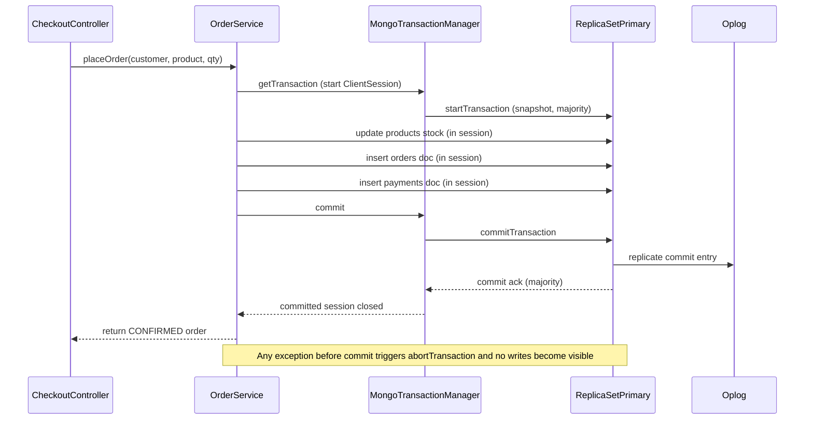

# 009 — Transactions & Concurrency (Boot 4.1.0 + Java 25)

> Multi-document ACID on the `orders` + `products` + `payments` domain: single-doc atomicity, replica-set transactions, `MongoTransactionManager`, `@Transactional` placement, `TransactionTemplate`, `ClientSession`, concerns, retryable writes, `@Version` optimistic locking, idempotency, costs, and when to redesign instead.
>
> **Stack:** Spring Boot **4.1.0** · Java **25** · Spring Data MongoDB 5.x · MongoDB **7.x/8.x** (replica set minimum; sharded TX needs 5.0+ patterns).
>
> Companion guides: [004 — MongoTemplate CRUD](./004-mongotemplate-crud.md) · [006 — Data Modeling](./006-data-modeling-schema-design.md) · [011 — Transaction Manager Hierarchy](../spring-transactions/011-transaction-manager-hierarchy.md) · [MongoDB Introduction](./mongodb.md).

## Table of Contents

- [1. Mental Model: One Document vs Many](#1-mental-model-one-document-vs-many)
- [2. Single-Document Atomicity](#2-single-document-atomicity-operators-are-atomic-findandmodify)
- [3. When You Need a Multi-Document Transaction](#3-when-you-need-a-multi-document-transaction-placeorder)
- [4. Topology Prerequisite: Replica Set Required](#4-topology-prerequisite-replica-set-required-standalone-fails)
- [5. Shell Session: Multi-Document TX in mongosh](#5-shell-session-multi-document-tx-in-mongosh)
- [6. MongoTransactionManager Bean](#6-mongotransactionmanager-bean-with-imports)
- [7. @Transactional Service: placeOrder](#7-transactional-service-placeorder-decrement-stock--create-order)
- [8. Propagation and Rollback Semantics](#8-propagation-and-rollback-semantics)
- [9. TransactionTemplate (Programmatic)](#9-transactiontemplate-programmatic)
- [10. ClientSession Manual Control](#10-clientsession-manual-control)
- [11. readConcern, writeConcern, readPreference](#11-readconcern-writeconcern-readpreference)
- [12. Retryable Writes and Transient Errors](#12-retryable-writes-and-transient-errors)
- [13. Optimistic Locking with @Version](#13-optimistic-locking-with-version-lost-update-demo)
- [14. Idempotency Keys](#14-idempotency-keys-retry-safe-placeorder)
- [15. Transaction Costs and Limits](#15-transaction-costs-and-limits-60s-oplog-perf)
- [16. TX vs Redesign Decision Table](#16-tx-vs-redesign-decision-table-embed-vs-tx-verdict)
- [17. TX Lifecycle (Sequence Diagram)](#17-tx-lifecycle-sequence-diagram)
- [18. Testing Transactions](#18-testing-transactions)
- [19. Pitfalls (GOLD)](#19-pitfalls-gold)
- [20. Interview Q&A](#20-interview-qa)
- [21. Resources](#21-resources)

> **Convention:** `com.commercemesh.orders.*`, `Instant` timestamps (UTC), `Money` as `BigDecimal` + `Decimal128`. Order/payment domain throughout: `products(stock)`, `orders`, `payments`, `idempotency_keys`. Snippets mirror repo style, **not compiled**.

---

## 1. Mental Model: One Document vs Many

MongoDB draws a hard line:

1. **One document = always atomic.** Every write to a single document — even touching nested arrays — either fully applies or does not. No partial documents, no torn writes.
2. **Many documents = atomic only inside a transaction.** Two collections (`products` + `orders`), or two documents in one collection, need an explicit multi-document transaction. Otherwise a crash between writes leaves `stock decremented, order missing`.
3. **Design goal: need transactions rarely.** Each transaction costs latency, oplog, and retry logic. If every `placeOrder` needs one, first ask whether the schema can collapse the boundary ([006](./006-data-modeling-schema-design.md) §2, §11; §16 here).

```java
// Rule of thumb for the order/payment domain:
// products.stock -= qty  +  orders.insertOne  +  payments.insertOne
// = 3 documents, 3 collections -> multi-doc TX *unless* redesigned.
// Counter decrement alone (stock--) = single-doc atomic, no TX.
```

---

## 2. Single-Document Atomicity (Operators Are Atomic, findAndModify)

Update operators (`$inc`, `$set`, `$push`, `$addToSet`, `$pull`, `$min`/`$max`) apply atomically to one document. `findAndModify` (`findOneAndUpdate`) adds **read + write atomically** — the primitive for queues, counters, reservations, and compare-and-set.

```java
package com.commercemesh.orders.document;

import java.math.BigDecimal;
import java.time.Instant;
import org.springframework.data.annotation.Id;
import org.springframework.data.mongodb.core.mapping.Document;

@Document(collection = "products")
public class Product {
    @Id private String id;
    private String sku;
    private BigDecimal price;
    private int stock;
    private Instant updatedAt;
    // getters / setters omitted
}
```

```java
package com.commercemesh.orders.repo;

import com.commercemesh.orders.document.Product;
import org.springframework.data.mongodb.core.FindAndModifyOptions;
import org.springframework.data.mongodb.core.MongoTemplate;
import org.springframework.data.mongodb.core.query.Criteria;
import org.springframework.data.mongodb.core.query.Query;
import org.springframework.data.mongodb.core.query.Update;
import org.springframework.stereotype.Repository;

@Repository
public class StockRepository {

    private final MongoTemplate mongoTemplate;

    public StockRepository(MongoTemplate mongoTemplate) {
        this.mongoTemplate = mongoTemplate;
    }

    // Atomic reservation: only succeeds if enough stock remains.
    // Returns updated doc, or null when insufficient stock.
    public Product reserveStock(String productId, int qty) {
        Query query = Query.query(Criteria.where("_id").is(productId)
                .and("stock").gte(qty));
        Update update = new Update()
                .inc("stock", -qty)
                .set("updatedAt", java.time.Instant.now());
        return mongoTemplate.findAndModify(
                query, update,
                FindAndModifyOptions.options().returnNew(true),
                Product.class);
    }

    // Plain atomic increments need no transaction:
    // db.products.updateOne({ _id: "prod_aurora_hp" }, { $inc: { stock: -2 } })
    public void restock(String productId, int qty) {
        mongoTemplate.updateFirst(
                Query.query(Criteria.where("_id").is(productId)),
                new Update().inc("stock", qty),
                Product.class);
    }
}
```

Shell equivalents ([004](./004-mongotemplate-crud.md) §findAndModify):

```javascript
// Atomic decrement, guarded:
db.products.updateOne(
  { _id: "prod_aurora_hp", stock: { $gte: 2 } },
  { $inc: { stock: -2 }, $set: { updatedAt: new Date() } }
);

// Read + write atomically — returns the reserved document:
db.products.findOneAndUpdate(
  { _id: "prod_aurora_hp", stock: { $gte: 2 } },
  { $inc: { stock: -2 } },
  { returnDocument: "after" }
);
```

**Limits:** atomicity does not mean isolation from your own bad pattern. Two concurrent `read-then-write` sequences without a guard (`stock >= qty` in the filter, or `@Version` in §13) still lost-update. Operators are atomic; application check-then-set is not unless it lives in the same `findAndModify`.

---

## 3. When You Need a Multi-Document Transaction (placeOrder)

Use a transaction when **all-or-nothing spans documents**:

| Operation | Documents touched | Needs TX? |
|---|---|---|
| Decrement stock only | 1 × `products` | No — `$inc` / `findAndModify` (§2) |
| Append order event | 1 × `orders` (`$set` status) | No |
| `placeOrder`: stock + order | 1 × `products` + 1 × `orders` | **Yes** |
| `placeOrder` + payment intent | `products` + `orders` + `payments` | **Yes** |
| Fulfilment fan-out to 200 lines | 200 docs | Prefer redesign (§16), TX as last resort |

The canonical example for this guide:

```text
placeOrder(customerId, productId, qty):
  1. products.stock -= qty   (guard qty available)
  2. orders.insertOne(CONFIRMED order with price snapshot)
  3. payments.insertOne(AUTHORIZED intent, idempotencyKey)
  All three commit, or none do — rollback on InsufficientStockException.
```

Without a TX, a crash after step 1 oversells inventory with no order to fulfil. With a TX, the three writes share one snapshot and one commit/rollback (§17).

---

## 4. Topology Prerequisite: Replica Set Required (Standalone FAILS)

Multi-document transactions **require a replica set** (or sharded cluster). A standalone `mongod` has no oplog, so every commit fails.

```javascript
// On a STANDALONE mongod this fails:
session = db.getMongo().startSession();
session.startTransaction();
// => MongoServerError: Transaction numbers are only allowed on a replica set member or mongos
```

What to run where:

| Topology | Multi-doc TX? | Notes |
|---|---|---|
| Standalone `mongod` | **No — always fails** | No oplog, no `startTransaction`. Dev-only storage, never for TX tests. |
| Single-node replica set | Yes | Minimum for local dev: `mongod --replSet rs0` + `rs.initiate()`. `MongoTransactionManager` works. |
| Multi-node replica set | Yes (production baseline) | Majority commit, automatic failover, snapshot reads. |
| Sharded cluster < 5.0 | Partially / avoid | Cross-shard TX fragile, chunk-migration conflicts. Upgrade first. |
| Sharded cluster 5.0+ | Yes with patterns | Keep TX on one shard when possible (shard key = `customerId`/`orderId`); cross-shard TX allowed but slower, higher abort rate. |

Docker Compose minimum for this track:

```yaml
services:
  mongo:
    image: mongo:8.0
    command: ["--replSet", "rs0", "--bind_ip_all"]
    ports: ["27017:27017"]
    healthcheck:
      test: ["CMD", "mongosh", "--quiet", "--eval", "db.adminCommand('ping')"]
      interval: 5s
      retries: 20
  rs-init:
    image: mongo:8.0
    depends_on:
      mongo:
        condition: service_healthy
    command: >
      mongosh --host mongo:27017 --eval
      "try { rs.initiate({ _id: 'rs0', members: [{ _id: 0, host: 'mongo:27017' }] }) } catch (e) { print(e.codeName) }"
```

```bash
mongosh --host localhost:27017 --eval "rs.status().ok"
# Expect: 1. If 0 / "not running with --replSet", transactions will fail.
```

Spring connection string needs the replica-set name so the driver discovers the primary:

```properties
spring.data.mongodb.uri=mongodb://localhost:27017/commercemesh?replicaSet=rs0&retryWrites=true
```

Sharded 5.0+ pattern: shard `orders` and `payments` by `customerId` (or `orderId`), route each `placeOrder` TX through one shard key value, and never include cross-shard `$lookup`/DDL inside the TX.

---

## 5. Shell Session: Multi-Document TX in mongosh

Full lifecycle — start, write with session, commit, verify, plus abort path. Run against the replica set from §4.

```javascript
// 0. Prep (outside TX): product with 10 units.
use commersemesh;
db.products.insertOne({ _id: "prod_aurora_hp", sku: "AUR-HP-001", stock: 10 });
db.orders.deleteMany({});
db.payments.deleteMany({});

// 1. Start a session and transaction with explicit concerns.
const session = db.getMongo().startSession();
session.startTransaction({
  readConcern: { level: "snapshot" },
  writeConcern: { w: "majority" },
  readPreference: { mode: "primary" }
});

try {
  const orders = session.getDatabase("commersemesh").getCollection("orders");
  const products = session.getDatabase("commersemesh").getCollection("products");
  const payments = session.getDatabase("commersemesh").getCollection("payments");

  // 2. All reads/writes MUST pass { session }.
  const prod = products.findOne({ _id: "prod_aurora_hp" }, { session });
  assert(prod.stock >= 2, "insufficient stock");

  products.updateOne(
    { _id: "prod_aurora_hp", stock: { $gte: 2 } },
    { $inc: { stock: -2 } },
    { session }
  );
  orders.insertOne({
    _id: "ord_2026_88121", customerId: "cust_9f21",
    productId: "prod_aurora_hp", qty: 2, status: "CONFIRMED",
    createdAt: new Date()
  }, { session });
  payments.insertOne({
    _id: "pay_2026_88121", orderId: "ord_2026_88121",
    amount: NumberDecimal("399.98"), status: "AUTHORIZED",
    createdAt: new Date()
  }, { session });

  // 3. Commit — all three become visible atomically.
  session.commitTransaction();
  print("COMMITTED");
} catch (e) {
  // 4. Anything throws -> abort, nothing is visible.
  print("ABORTING: " + e);
  session.abortTransaction();
} finally {
  session.endSession();
}

// 5. Verify outside the TX:
db.products.findOne({ _id: "prod_aurora_hp" }); // stock: 8 after one run
db.orders.findOne({ _id: "ord_2026_88121" });
```

Abort demo (run twice, second aborts):

```javascript
const s2 = db.getMongo().startSession();
s2.startTransaction({ readConcern: { level: "snapshot" }, writeConcern: { w: "majority" } });
try {
  s2.getDatabase("commersemesh").getCollection("products").updateOne(
    { _id: "prod_aurora_hp", stock: { $gte: 9999 } },
    { $inc: { stock: -9999 } }, { session: s2 }
  );
  // Simulate business-rule failure:
  throw new Error("InsufficientStock: need 9999, have " +
    s2.getDatabase("commersemesh").getCollection("products").findOne({ _id: "prod_aurora_hp" }).stock);
} catch (e) {
  print("Expected abort: " + e.message);
  s2.abortTransaction();
} finally { s2.endSession(); }
```

**Gotchas:** forgetting `{ session }` on one operation silently excludes it from the TX; `commitTransaction` can throw `TransientTransactionError` — retry the whole TX (§12); keep the TX under 60 seconds (§15).

---

## 6. MongoTransactionManager Bean (With Imports)

Spring Data MongoDB ships exactly one manager: `MongoTransactionManager`. Declare it from the `MongoDatabaseFactory` that Boot auto-configures.

```java
package com.commercemesh.orders.config;

import org.springframework.context.annotation.Bean;
import org.springframework.context.annotation.Configuration;
import org.springframework.data.mongodb.MongoDatabaseFactory;
import org.springframework.data.mongodb.MongoTransactionManager;
import org.springframework.transaction.annotation.EnableTransactionManagement;

@Configuration
// @EnableTransactionManagement: registers the @Transactional interceptor.
// Spring Boot 4.x auto-enables it when spring-tx is on the classpath,
// but declaring it explicitly documents intent and lets you tune
// proxyTargetClass / mode (proxy vs AspectJ). See hierarchy note below.
@EnableTransactionManagement
public class MongoTxConfig {

    @Bean
    MongoTransactionManager transactionManager(MongoDatabaseFactory dbFactory) {
        return new MongoTransactionManager(dbFactory);
    }
}
```

Notes:

- **One manager per database factory.** Multi-database apps need one `MongoTransactionManager` per `MongoDatabaseFactory` + `@Transactional("otherTxManager")` qualifier. Cross-database atomicity is not supported — use saga/idempotency (§14).
- **Hierarchy context:** `MongoTransactionManager extends AbstractPlatformTransactionManager` and binds a `ClientSession` to the thread, exactly like `JpaTransactionManager` binds an `EntityManager`. Full hierarchy in [011 — Transaction Manager Hierarchy](../spring-transactions/011-transaction-manager-hierarchy.md).
- **Boot 4.1:** `MongoAutoConfiguration` still creates the `MongoDatabaseFactory`; defining the manager bean yourself is the documented hook. Do not define a `DataSourceTransactionManager` or `JtaTransactionManager` alongside it unless you run mixed Mongo + JDBC with Chained/JTA semantics (see 011).
- **Reactive:** for `ReactiveMongoTemplate`, use `ReactiveMongoTransactionManager` instead — same factory pattern, `TransactionalOperator` instead of `TransactionTemplate`.

Verify at startup:

```java
package com.commercemesh.orders.config;

import org.springframework.boot.ApplicationRunner;
import org.springframework.context.annotation.Bean;
import org.springframework.context.annotation.Configuration;
import org.springframework.data.mongodb.MongoDatabaseFactory;

@Configuration
public class TxVerifyConfig {

    @Bean
    ApplicationRunner verifyReplicaSet(MongoDatabaseFactory factory) {
        return args -> {
            // Fails fast on standalone mongod: hello.isWritablePrimary without setName.
            var hello = factory.getMongoDatabase()
                    .runCommand(new org.bson.Document("hello", 1));
            if (hello.getString("setName") == null) {
                throw new IllegalStateException(
                        "MongoDB is not a replica set (setName missing) — transactions will fail. "
                        + "Restart with --replSet rs0 and rs.initiate().");
            }
        };
    }
}
```

---

## 7. @Transactional Service: placeOrder (Decrement Stock + Create Order)

The happy path: one annotation spans `products`, `orders`, `payments`. Any unchecked exception rolls everything back.

```java
package com.commercemesh.orders.document;

import java.math.BigDecimal;
import java.time.Instant;
import org.springframework.data.annotation.Id;
import org.springframework.data.mongodb.core.mapping.Document;

@Document(collection = "orders")
public class Order {
    @Id private String id;
    private String customerId;
    private String productId;
    private int qty;
    private BigDecimal total;
    private String status;
    private String idempotencyKey;
    private Instant createdAt;
    // getters / setters omitted
}
```

```java
package com.commercemesh.orders.document;

import java.math.BigDecimal;
import java.time.Instant;
import org.springframework.data.annotation.Id;
import org.springframework.data.mongodb.core.mapping.Document;

@Document(collection = "payments")
public class Payment {
    @Id private String id;
    private String orderId;
    private BigDecimal amount;
    private String status;
    private Instant createdAt;
    // getters / setters omitted
}
```

```java
package com.commercemesh.orders.service;

import com.commercemesh.orders.document.Order;
import com.commercemesh.orders.document.Payment;
import com.commercemesh.orders.document.Product;
import java.math.BigDecimal;
import java.time.Instant;
import org.springframework.data.mongodb.core.MongoTemplate;
import org.springframework.data.mongodb.core.query.Criteria;
import org.springframework.data.mongodb.core.query.Query;
import org.springframework.data.mongodb.core.query.Update;
import org.springframework.stereotype.Service;
import org.springframework.transaction.annotation.Transactional;

@Service
public class OrderService {

    private final MongoTemplate mongoTemplate;

    public OrderService(MongoTemplate mongoTemplate) {
        this.mongoTemplate = mongoTemplate;
    }

    // Single TX: stock decrement + order insert + payment intent.
    // InsufficientStockException (unchecked) -> rollback of ALL three.
    @Transactional(rollbackFor = InsufficientStockException.class)
    public Order placeOrder(String customerId, String productId, int qty,
                            BigDecimal unitPrice, String idempotencyKey) {
        var updated = mongoTemplate.updateFirst(
                Query.query(Criteria.where("_id").is(productId).and("stock").gte(qty)),
                new Update().inc("stock", -qty).set("updatedAt", Instant.now()),
                Product.class);
        if (updated.getModifiedCount() == 0) {
            throw new InsufficientStockException(productId, qty);
        }

        var order = new Order();
        order.setId("ord_" + java.util.UUID.randomUUID());
        order.setCustomerId(customerId);
        order.setProductId(productId);
        order.setQty(qty);
        order.setTotal(unitPrice.multiply(BigDecimal.valueOf(qty)));
        order.setStatus("CONFIRMED");
        order.setIdempotencyKey(idempotencyKey);
        order.setCreatedAt(Instant.now());
        mongoTemplate.insert(order);

        var payment = new Payment();
        payment.setId("pay_" + order.getId());
        payment.setOrderId(order.getId());
        payment.setAmount(order.getTotal());
        payment.setStatus("AUTHORIZED");
        payment.setCreatedAt(Instant.now());
        mongoTemplate.insert(payment);

        return order;
    }
}
```

```java
package com.commercemesh.orders.service;

public class InsufficientStockException extends RuntimeException {
    public InsufficientStockException(String productId, int qty) {
        super("Insufficient stock for " + productId + ", qty=" + qty);
    }
}
```

Rollback demo (test-style, uses the same bean):

```java
package com.commercemesh.orders.service;

import java.math.BigDecimal;
import org.junit.jupiter.api.Assertions;
import org.junit.jupiter.api.Test;
import org.springframework.beans.factory.annotation.Autowired;
import org.springframework.boot.test.context.SpringBootTest;
import org.springframework.data.mongodb.core.MongoTemplate;
import org.springframework.data.mongodb.core.query.Criteria;
import org.springframework.data.mongodb.core.query.Query;

@SpringBootTest
class OrderServiceTxTest {

    @Autowired OrderService orderService;
    @Autowired MongoTemplate mongoTemplate;

    @Test
    void insufficientStockRollsBackOrderAndPayment() {
        String pid = "prod_aurora_hp";
        long ordersBefore = mongoTemplate.count(new Query(), "orders");

        Assertions.assertThrows(InsufficientStockException.class, () ->
                orderService.placeOrder("cust_9f21", pid, 9999,
                        new BigDecimal("199.99"), "idem-test-1"));

        // Stock guard failed -> TX rolled back -> no order/payment leaked.
        Assertions.assertEquals(ordersBefore, mongoTemplate.count(new Query(), "orders"));
        Assertions.assertEquals(0, mongoTemplate.count(
                Query.query(Criteria.where("orderId").regex(".*")), "payments"));
    }
}
```

Rules that bite: `@Transactional` only works on **public methods called through the proxy** — self-invocation (`this.placeOrder(...)`) skips the TX silently. Keep TX methods in their own bean, keep them short, and never do HTTP/SMTP inside (§15, §19).

---

## 8. Propagation and Rollback Semantics

`MongoTransactionManager` follows standard Spring semantics (same vocabulary as JDBC/JPA — see [011](../spring-transactions/011-transaction-manager-hierarchy.md)):

| Aspect | MongoDB behaviour |
|---|---|
| `REQUIRED` (default) | Join existing TX, else start one. Nested service calls share the same `ClientSession`. |
| `REQUIRES_NEW` | Suspend outer, start a fresh session/TX. Audit writes that must survive order rollback use this — sparingly (doubles sessions). |
| `SUPPORTS` / `NOT_SUPPORTED` / `NEVER` | Read-only fast paths, health checks, reporting queries that must not start a TX. |
| `MANDATORY` | Fail unless a TX exists. Guard for DAO methods that must never run unwrapped. |
| `NESTED` | **Not supported** — MongoDB has no savepoints. Use `REQUIRES_NEW` or restructure. |
| `readOnly = true` | Hint only; still routes through the session but skips dirty-checking overhead. Use for snapshot reads. |
| Rollback on unchecked | Default: `RuntimeException` + `Error` roll back; checked exceptions **commit** unless `rollbackFor` lists them. |
| `rollbackFor` / `noRollbackFor` | `placeOrder` uses `rollbackFor = InsufficientStockException.class` (unchecked anyway — explicit for documentation). Payment-declined (checked) needs `rollbackFor = PaymentDeclinedException.class`. |

```java
package com.commercemesh.orders.service;

import org.springframework.stereotype.Service;
import org.springframework.transaction.annotation.Propagation;
import org.springframework.transaction.annotation.Transactional;

@Service
public class FulfilmentService {

    private final OrderService orderService;
    private final AuditService auditService;

    public FulfilmentService(OrderService orderService, AuditService auditService) {
        this.orderService = orderService;
        this.auditService = auditService;
    }

    // Outer TX joins OrderService (REQUIRED); audit survives via REQUIRES_NEW.
    @Transactional
    public void placeAndAudit(String customerId, String productId, int qty,
                              java.math.BigDecimal price, String idemKey) {
        try {
            orderService.placeOrder(customerId, productId, qty, price, idemKey);
        } finally {
            // Runs in its own TX even when placeOrder rolls back.
            auditService.recordAttempt(customerId, productId, qty);
        }
    }
}
```

```java
package com.commercemesh.orders.service;

import java.time.Instant;
import org.springframework.data.mongodb.core.MongoTemplate;
import org.springframework.stereotype.Service;
import org.springframework.transaction.annotation.Propagation;
import org.springframework.transaction.annotation.Transactional;

@Service
public class AuditService {

    private final MongoTemplate mongoTemplate;

    public AuditService(MongoTemplate mongoTemplate) {
        this.mongoTemplate = mongoTemplate;
    }

    @Transactional(propagation = Propagation.REQUIRES_NEW)
    public void recordAttempt(String customerId, String productId, int qty) {
        var doc = new org.bson.Document("customerId", customerId)
                .append("productId", productId)
                .append("qty", qty)
                .append("at", Instant.now());
        mongoTemplate.insert(doc, "order_attempts");
    }
}
```

Timeout hint: `@Transactional(timeout = 10)` maps to lock-acquisition timeout, **not** the 60-second server lifetime (§15). Enforce short TX by code review, not annotation arithmetic.

---

## 9. TransactionTemplate (Programmatic)

Use when the boundary is conditional, the return type is awkward for proxies, or you call from non-Spring code (schedulers, message listeners).

```java
package com.commercemesh.orders.service;

import com.commercemesh.orders.document.Order;
import java.math.BigDecimal;
import org.springframework.stereotype.Service;
import org.springframework.transaction.support.TransactionTemplate;

@Service
public class BulkOrderService {

    private final TransactionTemplate txTemplate;
    private final OrderService orderService;

    public BulkOrderService(TransactionTemplate txTemplate, OrderService orderService) {
        this.txTemplate = txTemplate;
        this.orderService = orderService;
    }

    // Each line commits independently: one failure does not undo prior lines.
    // Move txTemplate.execute INSIDE the loop for per-line atomicity,
    // OUTSIDE for all-or-nothing batches (watch the 60s limit in §15).
    public void placeLines(String customerId, java.util.List<Line> lines, String idemBase) {
        for (var line : lines) {
            Order placed = txTemplate.execute(status -> {
                try {
                    return orderService.placeOrder(customerId, line.productId(),
                            line.qty(), line.unitPrice(), idemBase + ":" + line.productId());
                } catch (InsufficientStockException e) {
                    status.setRollbackOnly(); // programmatic rollback marker
                    throw e;
                }
            });
            // publish event per committed line (afterCommit hook preferred)
            System.out.println("Placed " + placed.getId());
        }
    }

    public record Line(String productId, int qty, BigDecimal unitPrice) {}
}
```

```java
package com.commercemesh.orders.config;

import org.springframework.context.annotation.Bean;
import org.springframework.context.annotation.Configuration;
import org.springframework.data.mongodb.MongoTransactionManager;
import org.springframework.transaction.support.TransactionTemplate;

@Configuration
public class TxTemplateConfig {

    @Bean
    TransactionTemplate txTemplate(MongoTransactionManager txManager) {
        TransactionTemplate t = new TransactionTemplate(txManager);
        t.setTimeout(10); // seconds: lock-acquire budget, not server lifetime
        return t;
    }
}
```

Prefer `TransactionTemplate` over manual `PlatformTransactionManager.getTransaction/commit/rollback` — same power, no leaked `TransactionStatus` handling.

---

## 10. ClientSession Manual Control

Drop to `ClientSession` when you need cross-method session passing, explicit `withTransaction` retry, or non-`MongoTemplate` drivers (raw `MongoClient`). Every operation must receive the session.

```java
package com.commercemesh.orders.service;

import com.mongodb.ReadConcern;
import com.mongodb.WriteConcern;
import com.mongodb.client.ClientSession;
import com.mongodb.client.MongoClient;
import org.bson.Document;
import org.springframework.stereotype.Service;

@Service
public class ManualTxService {

    private final MongoClient mongoClient;

    public ManualTxService(MongoClient mongoClient) {
        this.mongoClient = mongoClient;
    }

    public void placeOrderManual(String productId, int qty, Document order, Document payment) {
        // try-with-resources closes the session; startTransaction/commit mirror the shell.
        try (ClientSession session = mongoClient.startSession()) {
            session.startTransaction(com.mongodb.TransactionOptions.builder()
                    .readConcern(ReadConcern.SNAPSHOT)
                    .writeConcern(WriteConcern.MAJORITY)
                    .readPreference(com.mongodb.ReadPreference.primary())
                    .build());
            try {
                var db = mongoClient.getDatabase("commersemesh");
                var products = db.getCollection("products");
                var orders = db.getCollection("orders");
                var payments = db.getCollection("payments");

                var res = products.updateOne(session,
                        new Document("_id", productId)
                                .append("stock", new Document("$gte", qty)),
                        new Document("$inc", new Document("stock", -qty)));
                if (res.getModifiedCount() == 0) {
                    throw new InsufficientStockException(productId, qty);
                }
                orders.insertOne(session, order);
                payments.insertOne(session, payment);

                session.commitTransaction(); // mirrors shell commitTransaction()
            } catch (Exception e) {
                try { session.abortTransaction(); } catch (Exception ignored) {}
                throw e instanceof RuntimeException re ? re : new IllegalStateException(e);
            }
        }
    }
}
```

`MongoTemplate` variant — session-bound callback:

```java
package com.commercemesh.orders.service;

import com.mongodb.client.ClientSession;
import org.springframework.data.mongodb.core.MongoTemplate;
import org.springframework.data.mongodb.core.SessionCallback;
import org.springframework.stereotype.Service;

@Service
public class SessionTemplateService {

    private final MongoTemplate mongoTemplate;

    public SessionTemplateService(MongoTemplate mongoTemplate) {
        this.mongoTemplate = mongoTemplate;
    }

    public Object placeInSession(Object orderDoc) {
        return mongoTemplate.execute(new SessionCallback<Object>() {
            @Override
            public Object execute(ClientSession session) {
                // All template calls inside here share `session`.
                session.startTransaction();
                try {
                    mongoTemplate.insert(orderDoc, "orders");
                    session.commitTransaction();
                    return orderDoc;
                } catch (Exception e) {
                    session.abortTransaction();
                    throw e;
                }
            }
        });
    }
}
```

Manual sessions are verbose — that is the point. If `@Transactional` or `TransactionTemplate` covers the case, do not hand-roll (§19.7).

---

## 11. readConcern, writeConcern, readPreference

Defaults are safe but slow; know each knob before turning it.

| Concern | Levels | Meaning for order/payment TX |
|---|---|---|
| `readConcern` | `local` / `majority` / `snapshot` | **TX default should be `snapshot`**: all reads in the TX see one consistent snapshot. `majority` = committed-by-majority data only; `local` = fastest, may return rolled-back data — never for money. |
| `writeConcern` | `1` / `majority` / `all` | **TX default `majority`**: commit survives primary failover. `w:1` acknowledges the primary only — faster, loses data on failover; acceptable for `order_attempts`, never for `payments`. |
| `readPreference` | `primary` / `secondary` / `nearest` | **Inside a TX: `primary` only.** Transactions pin to the primary; `secondary` reads are rejected in-TX. Use `secondary`/`nearest` for analytics outside the TX. |

```java
package com.commercemesh.orders.config;

import com.mongodb.ReadConcern;
import com.mongodb.ReadPreference;
import com.mongodb.TransactionOptions;
import com.mongodb.WriteConcern;
import org.springframework.context.annotation.Bean;
import org.springframework.context.annotation.Configuration;
import org.springframework.data.mongodb.MongoTransactionManager;

@Configuration
public class TxOptionsConfig {

    // Opinionated defaults for money paths: snapshot + majority + primary.
    @Bean
    MongoTransactionManager txManagerWithConcerns(
            org.springframework.data.mongodb.MongoDatabaseFactory factory) {
        MongoTransactionManager manager = new MongoTransactionManager(factory);
        manager.setOptions(TransactionOptions.builder()
                .readConcern(ReadConcern.SNAPSHOT)
                .writeConcern(WriteConcern.MAJORITY)
                .readPreference(ReadPreference.primary())
                .build());
        return manager;
    }
}
```

Shell form (same knobs as §5):

```javascript
session.startTransaction({
  readConcern: { level: "snapshot" },   // try "majority" vs "local" in staging
  writeConcern: { w: "majority", j: true },
  readPreference: { mode: "primary" }
});
```

Precedence: operation-level concern > TX-level > collection/database defaults. Set once at the manager/TX level; override per-operation only for the audit/analytics split.

---

## 12. Retryable Writes and Transient Errors

Two layers protect `placeOrder` from blips:

1. **Retryable writes** (`retryWrites=true`) — the driver transparently retries a single idempotent write (`insertOne`, `updateOne` with full filter) after a network hiccup or primary step-down. Enabled in the URI from §4.
2. **Whole-TX retry** — `commitTransaction` may throw `TransientTransactionError` (failover) or `UnknownTransactionCommitResult` (commit ambiguous). Retry the **entire transaction body**, never just the commit.

```java
package com.commercemesh.orders.service;

import com.mongodb.MongoException;
import org.springframework.stereotype.Service;

@Service
public class RetryableOrderService {

    private final OrderService orderService;

    public RetryableOrderService(OrderService orderService) {
        this.orderService = orderService;
    }

    public com.commercemesh.orders.document.Order placeWithRetry(
            String customerId, String productId, int qty,
            java.math.BigDecimal price, String idemKey) {
        int attempts = 0;
        while (true) {
            attempts++;
            try {
                return orderService.placeOrder(customerId, productId, qty, price, idemKey);
            } catch (InsufficientStockException | IllegalArgumentException e) {
                throw e; // business errors: never retry
            } catch (MongoException e) {
                boolean transientTx = e.hasErrorLabel(MongoException.TRANSIENT_TRANSACTION_ERROR_LABEL)
                        || e.hasErrorLabel(MongoException.UNKNOWN_TRANSACTION_COMMIT_RESULT_LABEL);
                if (!transientTx || attempts >= 3) throw e;
                // backoff before full-body retry; idempotency key (§14) makes it safe
                try { Thread.sleep(100L * attempts); } catch (InterruptedException ie) {
                    Thread.currentThread().interrupt();
                    throw e;
                }
            }
        }
    }
}
```

Label cheat-sheet: `TransientTransactionError` → retry whole TX; `UnknownTransactionCommitResult` → retry commit / re-check by idempotency key (commit may have succeeded); anything else → abort and surface. Combine with §14 so retries never double-charge.

---

## 13. Optimistic Locking with @Version (Lost-Update Demo)

`@Version` adds a compare-and-swap guard to read-modify-write flows that cannot use a single operator: load doc (v=3) → mutate → save with `version == 3`. A concurrent saver bumps to v=4 first, so the second save matches 0 docs and Spring Data throws `OptimisticLockingFailureException`.

```java
package com.commercemesh.orders.document;

import java.math.BigDecimal;
import org.springframework.data.annotation.Id;
import org.springframework.data.annotation.Version;
import org.springframework.data.mongodb.core.mapping.Document;

@Document(collection = "products")
public class PricedProduct {
    @Id private String id;
    private String sku;
    private BigDecimal price;
    private int stock;
    @Version private Long version; // <-- guard field, auto-incremented
    // getters / setters omitted
}
```

```java
package com.commercemesh.orders.repo;

import com.commercemesh.orders.document.PricedProduct;
import org.springframework.data.mongodb.repository.MongoRepository;

public interface PricedProductRepository extends MongoRepository<PricedProduct, String> {
}
```

Lost-update demo — two threads, one winner:

```java
package com.commercemesh.orders.service;

import com.commercemesh.orders.repo.PricedProductRepository;
import java.math.BigDecimal;
import java.util.concurrent.CountDownLatch;
import java.util.concurrent.ExecutorService;
import java.util.concurrent.Executors;
import org.springframework.dao.OptimisticLockingFailureException;
import org.springframework.stereotype.Service;

@Service
public class PriceUpdateDemo {

    private final PricedProductRepository repo;

    public PriceUpdateDemo(PricedProductRepository repo) {
        this.repo = repo;
    }

    public void demoLostUpdate(String productId) throws InterruptedException {
        CountDownLatch bothLoaded = new CountDownLatch(2);
        CountDownLatch go = new CountDownLatch(1);
        ExecutorService pool = Executors.newFixedThreadPool(2);

        Runnable task = () -> {
            var p = repo.findById(productId).orElseThrow();
            bothLoaded.countDown();
            try { go.await(); } catch (InterruptedException ie) {
                Thread.currentThread().interrupt();
                return;
            }
            // Both threads read version=0, both add £10 — last writer would silently win without @Version.
            p.setPrice(p.getPrice().add(new BigDecimal("10.00")));
            try {
                repo.save(p);
                System.out.println(Thread.currentThread().getName() + " SAVED v=" + p.getVersion());
            } catch (OptimisticLockingFailureException e) {
                // Expected for exactly one thread: version mismatch (expected 0, found 1).
                System.out.println(Thread.currentThread().getName() + " CONFLICT -> retry: " + e.getMessage());
                retryOnce(productId);
            }
        };
        pool.submit(task);
        pool.submit(task);
        bothLoaded.await();
        go.countDown(); // release both at once for a real race
        pool.shutdown();
        pool.awaitTermination(10, java.util.concurrent.TimeUnit.SECONDS);
    }

    // Standard fix: reload + reapply + save, bounded attempts.
    public void updatePriceWithRetry(String productId, BigDecimal delta, int maxAttempts) {
        for (int attempt = 1; attempt <= maxAttempts; attempt++) {
            try {
                var p = repo.findById(productId).orElseThrow();
                p.setPrice(p.getPrice().add(delta));
                repo.save(p);
                return;
            } catch (OptimisticLockingFailureException e) {
                if (attempt == maxAttempts) throw e;
            }
        }
    }

    private void retryOnce(String productId) {
        updatePriceWithRetry(productId, new BigDecimal("10.00"), 3);
    }
}
```

When to use what: operator guards (`stock >= qty` in `findAndModify`, §2) for counters; `@Version` for multi-field edits (price + description + images); full TX (§7) when the edit spans documents. `@Version` works outside transactions; inside a TX a version conflict aborts the TX instead — catch, retry the whole body (§12).

---

## 14. Idempotency Keys (Retry-Safe placeOrder)

Retries (§12) and client double-clicks must not create two orders. Pattern: unique `idempotency_keys(key)` + store the result reference; check-then-insert inside the same TX.

```java
package com.commercemesh.orders.document;

import java.time.Instant;
import org.springframework.data.annotation.Id;
import org.springframework.data.mongodb.core.index.Indexed;
import org.springframework.data.mongodb.core.mapping.Document;

@Document(collection = "idempotency_keys")
public class IdempotencyKey {
    @Id private String id;
    @Indexed(unique = true) private String key; // client-supplied UUID per checkout attempt
    private String orderId;                       // filled on success
    private String status;                        // IN_PROGRESS | COMPLETED
    private Instant createdAt;
    private Instant expiresAt;                    // TTL 24h
    // getters / setters omitted
}
```

```java
package com.commercemesh.orders.service;

import com.commercemesh.orders.document.IdempotencyKey;
import com.commercemesh.orders.document.Order;
import java.math.BigDecimal;
import java.time.Instant;
import org.springframework.dao.DuplicateKeyException;
import org.springframework.data.mongodb.core.MongoTemplate;
import org.springframework.data.mongodb.core.query.Criteria;
import org.springframework.data.mongodb.core.query.Query;
import org.springframework.stereotype.Service;
import org.springframework.transaction.annotation.Transactional;

@Service
public class IdempotentOrderService {

    private final MongoTemplate mongoTemplate;
    private final OrderService orderService;

    public IdempotentOrderService(MongoTemplate mongoTemplate, OrderService orderService) {
        this.mongoTemplate = mongoTemplate;
        this.orderService = orderService;
    }

    @Transactional
    public Order placeOrderIdempotent(String customerId, String productId, int qty,
                                      BigDecimal unitPrice, String idemKey) {
        // 1. Fast path: key already completed -> return the original order.
        var existing = mongoTemplate.findOne(
                Query.query(Criteria.where("key").is(idemKey)), IdempotencyKey.class);
        if (existing != null && "COMPLETED".equals(existing.getStatus())) {
            return mongoTemplate.findById(existing.getOrderId(), Order.class);
        }
        // 2. Claim the key. DuplicateKeyException = concurrent retry -> re-read.
        try {
            var claim = new IdempotencyKey();
            claim.setKey(idemKey);
            claim.setStatus("IN_PROGRESS");
            claim.setCreatedAt(Instant.now());
            claim.setExpiresAt(Instant.now().plusSeconds(24 * 3600));
            mongoTemplate.insert(claim);
        } catch (DuplicateKeyException e) {
            var raced = mongoTemplate.findOne(
                    Query.query(Criteria.where("key").is(idemKey)), IdempotencyKey.class);
            if (raced != null && raced.getOrderId() != null) {
                return mongoTemplate.findById(raced.getOrderId(), Order.class);
            }
            throw new IllegalStateException("Order in progress for key " + idemKey, e);
        }
        // 3. Same TX: place order, then point the key at it.
        Order order = orderService.placeOrder(customerId, productId, qty, unitPrice, idemKey);
        mongoTemplate.updateFirst(
                Query.query(Criteria.where("key").is(idemKey)),
                new org.springframework.data.mongodb.core.query.Update()
                        .set("orderId", order.getId()).set("status", "COMPLETED"),
                IdempotencyKey.class);
        return order;
    }
}
```

Shell index (TTL + unique):

```javascript
db.idempotency_keys.createIndex({ key: 1 }, { unique: true });
db.idempotency_keys.createIndex({ expiresAt: 1 }, { expireAfterSeconds: 0 });
```

Client contract: generate one UUID per checkout click, send as `Idempotency-Key` header, reuse it across retries. Server contract: same key → same order, never a second charge.

---

## 15. Transaction Costs and Limits (60s, Oplog, Perf)

Transactions are not free. Budget for all three:

1. **60-second lifetime.** `transactionLifetimeLimitSeconds` defaults to 60 s — the server aborts longer TX. Combined with lock-yield behaviour, practical guidance is **commit in milliseconds, never seconds**: no HTTP, no SMTP, no user input, no unbounded loops inside (§7–§8).
2. **Oplog pressure.** Every TX write is staged then flushed to the oplog at commit. A 500-document fulfilment TX writes 500 oplog entries at once — replication lag spikes, secondaries strain, chunk migrations stall on sharded collections. Paginate bulk work into per-document TX (§9 loop) or async jobs.
3. **Performance shape.** Expect ~2–5× single-write latency per TX (snapshot acquisition + coordination + majority commit), lower throughput per connection (session pinned to primary), and abort-rate growth with contention. Hot-product flash sales abort most when every TX touches the same `stock` doc — prefer `findAndModify` reservation (§2) + TX only for the order/payment pair.

```javascript
// Inspect the limit and recent aborts:
db.adminCommand({ getParameter: 1, transactionLifetimeLimitSeconds: 1 });
// mongod log filter: "abort" + "Transaction" + "lock request timeout"
// Atlas Profiler: filter { "txnNumber": { $exists: true } } for TX-shaped slow queries.
```

| Practice | Why |
|---|---|
| Keep TX to 2–10 docs, < 100 ms | Fits snapshot + majority commit comfortably; retries stay cheap |
| Touch hot docs last, briefly | Shortens the conflict window on `products.stock` |
| `w: majority, j: true` for money, `w: 1` for attempts/audit | Durability where it matters, speed elsewhere (§11) |
| Never `db.collection.createIndex` / DDL in-TX | DDL aborts transactions; migrate outside |
| Monitor `transactions.totalCommitted`, `totalAborted` serverStatus | Alert when abort rate > 1–2% sustained |

---

## 16. TX vs Redesign Decision Table (Embed vs TX Verdict per Case)

Default to schema before transactions ([006](./006-data-modeling-schema-design.md) §2). Each row: verdict first.

| Case | Verdict | Rationale |
|---|---|---|
| Customer + addresses | **Embed — no TX** | Lifecycle-bound, read-together, bounded. One `$set` is atomic (§2). |
| Order header + items (≤ 100 lines) | **Embed — no TX** | Single `orders` insert is atomic; immutable after confirm. |
| Order + 1,000s lines | **Bucket pages + TX for header only** | Header insert + first page in one short TX; overflow pages async. Avoids 60s mega-TX (§15). |
| `placeOrder`: stock + order | **TX (short)** | Two collections, genuine all-or-nothing. Guard with `$gte` + retry (§7, §12). |
| `placeOrder` + payment intent | **TX + idempotency key** | Money path: snapshot + majority + unique key (§11, §14). |
| Product price update fan-out to 10k orders | **Never TX — snapshot + duplicate** | Immutable price snapshot in each order at placement; live price stays in `products` ([006](./006-data-modeling-schema-design.md) §8). |
| Review submit + product rollup | **No TX — async repair** | Insert review + `$inc` count outside TX; change stream reconciles averages ≤ 60 s. |
| Seat/hotel reservation hold | **Single-doc `findAndModify` — no TX** | Expiry via TTL; TX adds nothing over atomic guard (§2). |
| Transfer between two wallets | **TX** | Classic multi-doc invariant (debit + credit = 0). Keep under 10 docs. |
| Bulk import of 100k products | **No TX — batched inserts** | One TX would exceed 60 s and oplog (§15). `ordered:false` batches + resume token. |
| Audit trail of order attempts | **REQUIRES_NEW, not joined** | Must survive order rollback; separate tiny TX (§8). |

---

## 17. TX Lifecycle (Sequence Diagram)



Read it as: session binds the three writes to one snapshot; commit makes them visible together; abort discards all staged writes. Retry handling (§12) wraps the whole diagram, idempotency (§14) makes the wrap safe.

---

## 18. Testing Transactions

Three tiers, cheapest first:

```java
package com.commercemesh.orders;

import com.commercemesh.orders.service.InsufficientStockException;
import com.commercemesh.orders.service.OrderService;
import java.math.BigDecimal;
import org.junit.jupiter.api.Assertions;
import org.junit.jupiter.api.Test;
import org.springframework.beans.factory.annotation.Autowired;
import org.springframework.boot.test.context.SpringBootTest;
import org.springframework.data.mongodb.core.MongoTemplate;
import org.springframework.data.mongodb.core.query.Query;
import org.springframework.test.context.DynamicPropertyRegistry;
import org.springframework.test.context.DynamicPropertySource;
import org.testcontainers.containers.MongoDBContainer;
import org.testcontainers.junit.jupiter.Container;
import org.testcontainers.junit.jupiter.Testcontainers;

@Testcontainers
@SpringBootTest
class OrderTxIT {

    // Testcontainers MongoDB must run with --replSet for TX tests.
    @Container
    static MongoDBContainer mongo = new MongoDBContainer("mongo:8.0")
            .withCommand("--replSet", "rs0");

    @DynamicPropertySource
    static void mongoProps(DynamicPropertyRegistry r) {
        r.add("spring.data.mongodb.uri", mongo::getReplicaSetUrl);
    }

    @Autowired OrderService orders;
    @Autowired MongoTemplate mongoTemplate;

    @Test
    void commitPersistsAllThreeDocs() {
        var order = orders.placeOrder("cust_9f21", "prod_aurora_hp", 1,
                new BigDecimal("199.99"), "idem-it-" + System.nanoTime());
        Assertions.assertNotNull(mongoTemplate.findById(order.getId(), com.commercemesh.orders.document.Order.class));
    }

    @Test
    void rollbackLeavesNoOrphans() {
        long before = mongoTemplate.count(new Query(), "orders");
        Assertions.assertThrows(InsufficientStockException.class, () ->
                orders.placeOrder("cust_9f21", "prod_aurora_hp", 999_999,
                        new BigDecimal("199.99"), "idem-it-" + System.nanoTime()));
        Assertions.assertEquals(before, mongoTemplate.count(new Query(), "orders"));
    }
}
```

Guidance: unit-test guards (`stock >= qty`) with embedded `MongoTemplate` fakes; integration-test commit/rollback against a replica-set Testcontainer (standalone image gives false green then prod-red — §4); load-test the hot-stock race with 32 threads × `placeOrder` and assert `totalSold <= initialStock` plus abort-rate metrics (§15).

---

## 19. Pitfalls (GOLD)

1. **`@Transactional` on standalone `mongod` fails at runtime** — `Transaction numbers are only allowed on a replica set member or mongos`. Fix: `--replSet rs0` + `rs.initiate()` everywhere including CI (§4), plus the `setName` startup check (§6).
2. **Missing `{ session }` / unwrapped call excludes a write** — shell op without `{ session }` or self-invoked `this.placeOrder()` commits outside the TX. Fix: pass session explicitly; call TX methods through the proxy (§5, §7).
3. **Checked exception silently commits** — payment-declined (checked) commits stock+order by default. Fix: `rollbackFor = PaymentDeclinedException.class` (§8).
4. **Read-then-write without guard lost-updates** — two `find` + `save` interleave, last writer wins. Fix: `findAndModify` guard (§2) or `@Version` + bounded retry (§13).
5. **`NESTED` / savepoints assumed** — MongoDB has none; deployment fails or semantics surprise. Fix: `REQUIRES_NEW` or restructure (§8).
6. **Hand-rolled `ClientSession` leaking** — unclosed sessions pin connections. Fix: try-with-resources + prefer `@Transactional`/`TransactionTemplate` (§10).
7. **Retrying only the commit** — `TransientTransactionError` needs whole-body retry; commit-only retry double-applies non-idempotent bodies. Fix: retry loop + idempotency key (§12, §14).
8. **`secondary` reads inside TX rejected** — TX pins to primary. Fix: `primary` in-TX, `secondary`/`nearest` for analytics outside (§11).
9. **60-second mega-TX** — bulk loop + HTTP inside aborts mid-batch with partial oplog pressure. Fix: per-line TX, no I/O inside, paginate (§15–§16).
10. **DDL or cross-shard fan-out in-TX** — index builds and cross-shard writes abort or crawl. Fix: migrate outside; shard by `customerId`/`orderId`, keep TX single-shard (§4, §15).

---

## 20. Interview Q&A

**Q1. What happens when `@Transactional` runs against a standalone `mongod`, and how do you prove the fix?**
A: Every commit throws `MongoServerError: Transaction numbers are only allowed on a replica set member or mongos` because standalone has no oplog. Fix: restart with `mongod --replSet rs0`, run `rs.initiate()`, connect with `?replicaSet=rs0`, and assert `hello.setName != null` at startup (§6). CI must use a replica-set Testcontainer — standalone gives false confidence (§4, §18).

**Q2. How do you prevent lost updates when two threads edit the same product price?**
A: Three layers by shape: (a) single-counter → guarded `findAndModify` (`stock >= qty` in the filter, §2); (b) multi-field edit → `@Version` compare-and-swap so the second saver gets `OptimisticLockingFailureException` and retries with reload + bounded attempts (§13 demo); (c) cross-document invariant → short multi-doc TX with snapshot reads (§7). Never bare read-modify-write.

**Q3. `@Transactional` rolls back on `RuntimeException` but committed on your payment failure — why?**
A: Spring rolls back on unchecked exceptions only; a checked `PaymentDeclinedException` commits by default. Declare `@Transactional(rollbackFor = PaymentDeclinedException.class)` (or make it unchecked deliberately). Same rule applies to `TransactionTemplate`: mark `status.setRollbackOnly()` for programmatic paths (§8–§9).

**Q4. `commitTransaction` threw `UnknownTransactionCommitResult` — did the order commit?**
A: Unknown — the commit may have succeeded before the network broke. Never blindly retry the body (risks double order/charge). Re-check by idempotency key (§14): key `COMPLETED` → return existing order; absent → safe to retry the whole TX. `TransientTransactionError` is the contrast: nothing committed, retry the whole body (§12).

**Q5. Checkout needs stock + order + payment atomically, but TX abort rate spikes during flash sales — redesign or persist?**
A: Shrink the TX, then split the boundary: reserve stock with single-doc `findAndModify` (§2), keep a short TX for order + payment + idempotency key (§7, §14), move rollups/audit to async change streams ([006](./006-data-modeling-schema-design.md) §8; §16). Keep TX to 2–10 docs under 100 ms with snapshot + majority (§11, §15); fan-out and bulk imports never belong in a TX.

---

## 21. Resources

**This track (read in order):**

- [004 — MongoTemplate CRUD](./004-mongotemplate-crud.md) — `findAndModify`, `updateFirst`, session-bound template calls used in §2 and §7.
- [006 — Data Modeling & Schema Design](./006-data-modeling-schema-design.md) — embed vs reference, aggregate boundaries, and the redesign-first alternatives to §16.
- [011 — Transaction Manager Hierarchy](../spring-transactions/011-transaction-manager-hierarchy.md) — where `MongoTransactionManager` sits among JDBC/JPA/JTA managers, proxy semantics, and mixed-store patterns.
- [MongoDB Introduction](./mongodb.md) — BSON, replica sets, oplog, and sharding fundamentals behind §4 and §15.

**Official docs:** [MongoDB Transactions](https://www.mongodb.com/docs/manual/core/transactions/) · [Replica Sets](https://www.mongodb.com/docs/manual/replication/) · [Sharded Cluster Transactions](https://www.mongodb.com/docs/manual/core/sharded-cluster-transactions/) · [readConcern](https://www.mongodb.com/docs/manual/reference/read-concern/) · [writeConcern](https://www.mongodb.com/docs/manual/reference/write-concern/) · [Retryable Writes](https://www.mongodb.com/docs/manual/core/retryable-writes/) · [Spring Data MongoDB Transactions](https://docs.spring.io/spring-data-mongodb/reference/mongodb/transactions.html) · [Spring @Transactional](https://docs.spring.io/spring-framework/reference/data-access/transaction/declarative.html)

---
*Next: [010 — Replication, Sharding, Advanced Features](./010-replication-sharding-advanced.md).*
