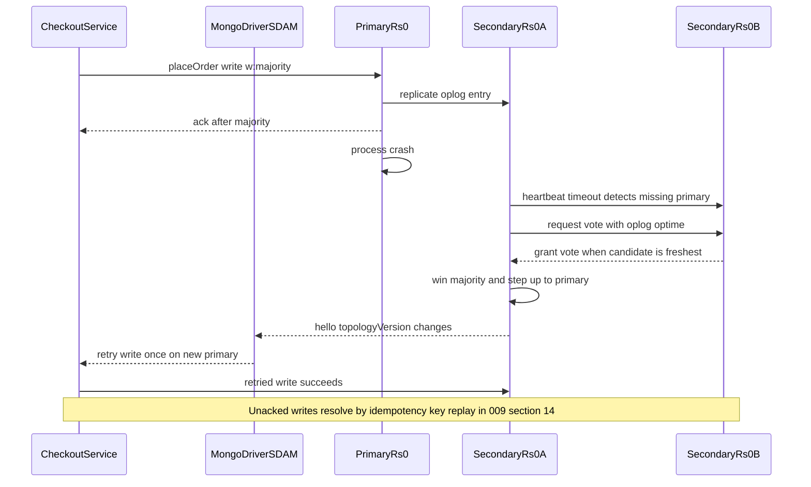
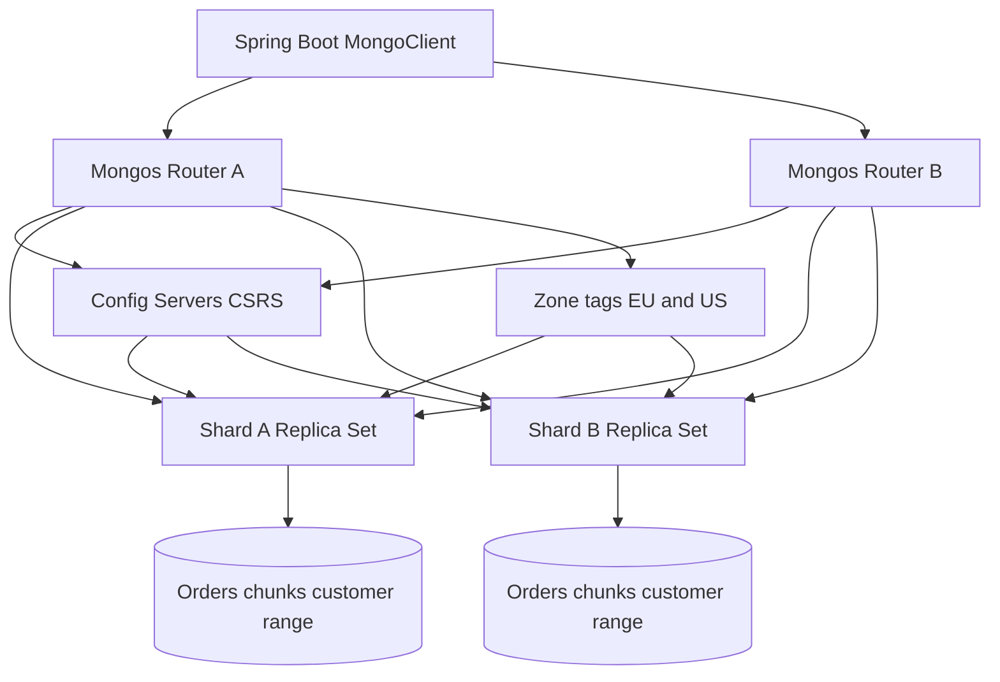

# 010 — Replication, Sharding & Advanced Operations (Boot 4.1.0 + Java 25, MongoDB 8)

> Survival guide for `orders` + `products` + `payments`: replica sets, sharding, change streams, TTL/capped/time-series/GridFS, validation, collations, bulk, pooling, profiling, backups.
>
> **Stack:** Spring Boot **4.1.0** · Java **25** · Spring Data MongoDB 5.x · MongoDB **8.x** (replica set minimum for most features; sharding needs `mongos` + CSRS).
>
> Companion guides: [009 — Transactions & Concurrency](./009-transactions-concurrency.md) · [012 — Production Readiness](./012-production-readiness.md) · [MongoDB Introduction](./mongodb.md).

## Table of Contents

- [1. Scope Map](#1-scope-map-standalone--replicaset--sharded)
- [2. Replica-Set Members](#2-replica-set-members--replicaset)
- [3. Oplog + Lag](#3-oplog--lag--replicaset)
- [4. Elections + Failover](#4-elections-priority-votes--failover--replicaset)
- [5. ReadPreference + Spring](#5-readpreference-primarysecondarynearest--spring--replicaset-sharded)
- [6. WriteConcern + Journal](#6-writeconcern-majority1--journal--standalone--replicaset--sharded)
- [7. ReadConcern + Causal Sessions](#7-readconcern--causal-sessions--replicaset--sharded)
- [8. When NOT to Shard](#8-when-not-to-shard--sharded)
- [9. Shard Keys](#9-shard-keys-ranged-vs-hashed-vs-compound--sharded)
- [10. Hot Shards, Jumbo Chunks, Balancer](#10-hot-shards-jumbo-chunks-balancer--migration--sharded)
- [11. mongos + CSRS, Targeted vs Scatter-Gather, Zones](#11-mongos--csrs-targeted-vs-scatter-gather-zones--sharded)
- [12. Change Streams + Spring Reactive](#12-change-streams-watch--resume-tokens--spring-reactive--replicaset--sharded)
- [13. TTL / Capped / Time-Series / GridFS](#13-ttl--capped--time-series--gridfs--standalone--replicaset--sharded)
- [14. Schema Validation](#14-schema-validation-jsonschema-moderate-to-strict--standalone--replicaset--sharded)
- [15. Collations](#15-collations-case-insensitive-queries--standalone--replicaset--sharded)
- [16. Bulk Writes](#16-bulk-writes--standalone--replicaset--sharded)
- [17. Connection Pooling](#17-connection-pooling-minmax-pool--spring-props--standalone--replicaset--sharded)
- [18. Profiling](#18-profiling-level--systemprofile--standalone--replicaset--sharded)
- [19. Backup: dump, PITR, RPO/RTO](#19-backup-mongodumprestore-pitr-rporto--replicaset--sharded)
- [20. Pitfalls (GOLD)](#20-pitfalls-gold)
- [21. Interview Q&A](#21-interview-qa)
- [22. Resources](#22-resources)

> **Convention:** `com.commercemesh.orders.*`, `Instant` UTC, `BigDecimal` + `Decimal128`. Snippets mirror repo style, **not compiled**.

---

## 1. Scope Map — [Standalone] / [ReplicaSet] / [Sharded]

Standalone `mongod` has no oplog: transactions, change streams, causal sessions all need a replica set (each shard is one). Run 3-node `rs0` even on a laptop ([009](./009-transactions-concurrency.md) §4).

| Feature | Standalone | ReplicaSet | Sharded | Verdict |
|---|---|---|---|---|
| Members, oplog, elections (§2–§4) | — | Required | Inherited | 3 data nodes, 3 AZs |
| ReadPreference (§5) | N/A | Yes | Yes via `mongos` | `primary` money, `nearest` catalog |
| WriteConcern (§6) | `w:1` only | `majority`+`j` | `majority`+`j` | Money `majority,j:true`; attempts `w:1` |
| ReadConcern + causal (§7) | — | Yes | Yes | `majority`/`snapshot` + same session |
| Sharding (§8–§11) | — | — | Required | Not below ~500 GB / ~10k ops/s |
| Change streams (§12) | — | Yes | Yes | Persist resume token per batch |
| TTL/capped/ts/GridFS (§13) | Yes | Yes | Yes, capped unsharded | Expiry vs FIFO vs metrics vs >16 MB |
| Validation (§14) | Yes | Yes | Yes | `moderate`+`warn` → `strict`+`error` |
| Collations (§15) | Yes | Yes | Key collation fixed at shard time | `strength: 2`, index = query |
| Bulk (§16) | Yes | Yes | Yes, prefer shard-local | `ordered:false`, 500–1k batches |
| Pooling (§17) | Yes | Yes | Yes | `minPoolSize` 5–10, `maxPoolSize` 50–100 |
| Profiling (§18) | Yes | Per node | Per `mongos` + shard | L1 + 50–100 ms prod; L2 briefly |
| Backup (§19) | `mongodump` | + PITR | + coordinated PITR | RPO/RTO first, then tool |

---

## 2. Replica-Set Members — [ReplicaSet]

One **primary** (writes), **secondaries** (async replicate, serve reads), **arbiter** (votes, no data). Max 50 members, 7 voters. Hidden/delayed nodes (1 h lag) give a fat-finger window.

```javascript
mongod --replSet rs0 --port 27017 --dbpath /data/rs0a
mongod --replSet rs0 --port 27018 --dbpath /data/rs0b
mongod --replSet rs0 --port 27019 --dbpath /data/rs0c
mongosh --port 27017
rs.initiate({ _id: "rs0", members: [
  { _id: 0, host: "localhost:27017" },
  { _id: 1, host: "localhost:27018" },
  { _id: 2, host: "localhost:27019" }] });
rs.status(); // 1 = PRIMARY, 2 = SECONDARY, 7 = ARBITER
rs.add({ host: "localhost:27021", priority: 0, hidden: true, secondaryDelaySecs: 3600 });
```

Prefer 3 data-bearing nodes. `2 data + arbiter` breaks `majority` math when one data node is down — cost-saving only for self-hosted sets.

---

## 3. Oplog + Lag — [ReplicaSet]

Oplog (`local.oplog.rs`) is a capped, ordered log of idempotent writes. **Lag** = primary optime − secondary optime.

```javascript
db.getReplicationInfo(); // logSizeMB, timeDiffHours — window must cover peak + replay
rs.printSecondaryReplicationInfo(); // per-secondary lag in secs
```

Default ~5% disk (990 MB–50 GB). Raise `oplogSizeMB` at init for flash-sale `$inc` storms; shrinking needs resync. Alert lag > 10 s, page > 60 s. With `w:MAJORITY` lag is checkout latency; with `w:1` it hides until failover loses the write (§6).

---

## 4. Elections, Priority, Votes + Failover — [ReplicaSet]

Heartbeats every 2 s; missing primary ~10 s (`electionTimeoutMillis`) triggers election. Freshest optime + highest `priority` wins a **majority of votes**. `priority:0` never leads; `votes:0` drops a node from majority math.

```javascript
cfg = rs.conf();
cfg.members[0].priority = 2; // preferred primary, main AZ
cfg.members[2].priority = 0; // analytics node: reads only
rs.reconfig(cfg);
rs.stepDown(60, 30); // staging drill: §5 reads must ride through
```



Driver (`SDAM` + `hello`) rediscovers topology and replays one retryable write; unacked writes resolve via [009](./009-transactions-concurrency.md) §14.

---

## 5. ReadPreference: primary/secondary/nearest + Spring — [ReplicaSet] [Sharded]

| Mode | Routes to | Use | Danger |
|---|---|---|---|
| `primary` (default) | Primary | `placeOrder`, stock, payments | Hot primary |
| `primaryPreferred` | Primary, else secondary | Money reads tolerating fallback | Stale fallback |
| `secondary` | Secondary only | Catalog, reports | Fails with no secondary; lag-stale |
| `nearest` | Lowest latency | Geo catalog reads | May hit lagging node; set `maxStalenessSeconds: 90` |

In-TX reads pin to `primary` ([009](./009-transactions-concurrency.md) §11). Refine with tag sets (`{ dc: "east" }`).

```java
package com.commercemesh.orders.config;

import com.mongodb.ReadPreference;
import org.springframework.boot.autoconfigure.mongo.MongoClientSettingsBuilderCustomizer;
import org.springframework.context.annotation.Bean;
import org.springframework.context.annotation.Configuration;

@Configuration
public class ReadPreferenceConfig {
    @Bean
    MongoClientSettingsBuilderCustomizer readPreferenceCustomizer() {
        // Catalog default; money paths override per-operation with primary().
        return builder -> builder.readPreference(
                ReadPreference.secondaryPreferred());
    }
}
```

```properties
spring.data.mongodb.uri=mongodb://rs0a:27017,rs0b:27018,rs0c:27019/commercemesh?replicaSet=rs0&retryWrites=true&readPreference=nearest&maxStalenessSeconds=90
```

```java
// Stale catalog fine, stale balance not:
var payment = mongoTemplate.getCollection("payments")
        .withReadPreference(ReadPreference.primary())
        .find(new org.bson.Document("_id", paymentId)).first();
```

---

## 6. WriteConcern: majority/1 + Journal — [Standalone] [ReplicaSet] [Sharded]

| Concern | Ack when | Survives crash | Use |
|---|---|---|---|
| `w:1` | Primary in memory | No | `order_attempts`, clickstream |
| `w:majority` | Majority has oplog entry | Yes | `orders`, `payments`, idempotency keys |
| `j:true` | Journal flush on acking nodes | Power loss too | Add to `majority` for money |
| `wtimeout: 3000` | Bounds the wait | Throws; retry by key | Always with `majority` |

```java
@Bean
WriteConcern moneyWriteConcern() {
    return new WriteConcern("majority").withJournal(true)
            .withWTimeout(3000, java.util.concurrent.TimeUnit.MILLISECONDS);
}
```

```javascript
db.orders.insertOne({ _id: "ORD-1001", status: "PLACED" }, { writeConcern: { w: "majority", j: true } });
db.order_attempts.insertOne({ at: new Date() }, { writeConcern: { w: 1 } });
```

`[Standalone]` has only `w:1` — `majority` errors. Another reason CI runs `--replSet` ([009](./009-transactions-concurrency.md) §4).

---

## 7. ReadConcern + Causal Sessions — [ReplicaSet] [Sharded]

| Level | Sees | Use |
|---|---|---|
| `local` / `available` | Newest on node, may roll back | Counters; sharded reads that must not stall |
| `majority` | Committed-by-majority | Post-payment balance checks |
| `snapshot` | One TX-wide snapshot | Multi-doc TX default ([009](./009-transactions-concurrency.md) §11) |
| `linearizable` | Newest + consensus, primary-only | Leader checks; slowest, rare |

**Causal sessions** (default on) chain `clusterTime` so a client reads its own writes even on a lagging secondary — same session for write then read.

```java
try (ClientSession session = mongoClient.startSession()) {
    mongoClient.getDatabase("commercemesh").getCollection("orders").insertOne(session, order);
    return mongoClient.getDatabase("commercemesh").getCollection("orders")
            .withReadConcern(ReadConcern.MAJORITY)
            .find(session, new Document("_id", orderId)).first();
} // dropping the session drops the guarantee
```

Rule: money read-after-write = same session + `majority`; analytics = sessionless `local` + `secondary`/`nearest`.

---

## 8. When NOT to Shard — [Sharded]

`shardCollection` key choice is near-irreversible (8.0 resharding copies the collection). Do **not** shard when: (1) data < ~500 GB–1 TB or < ~10k ops/s — scale vertically / add secondaries / fix indexes; (2) working set fits RAM; (3) every TX spans shards (2–5× cost, [009](./009-transactions-concurrency.md) §15); (4) collections tiny (`payments` 2 GB — balancer churn for nothing); (5) no sharding on-call (balancer, jumbo, orphans, CSRS quorum need [012](./012-production-readiness.md) runbooks).

```javascript
sh.enableSharding("commercemesh");
sh.shardCollection("commercemesh.orders", { customerId: "hashed" });
sh.status(); // chunk counts per shard converge after balancer rounds
```

---

## 9. Shard Keys: Ranged vs Hashed vs Compound — [Sharded]

| Strategy | Partition | Range queries | Spread | Example |
|---|---|---|---|---|
| Ranged | Key order → contiguous chunks | Fast, targeted | Hot if monotonic | `{ customerId: 1 }` |
| Hashed | `hash(key)` → even | Scatter (order destroyed) | Excellent | `{ _id: "hashed" }` |
| Compound | `{ customerId: 1, _id: 1 }` | Targeted on prefix | Good if prefix non-monotonic | Order timeline + uniqueness |

Test on prod-shaped data: **cardinality** (distinct values — `status` with 5 strands 5 chunks), **frequency** (evenness — one flash-sale `productId` at 40% still hots), **monotonicity** (ever-increasing `ObjectId`/`createdAt` lands all writes on last chunk — hash it or compound with `customerId`). Key must be present and immutable — never `$set` it.

```javascript
sh.shardCollection("commercemesh.orders", { customerId: 1, _id: 1 }); // timeline
sh.shardCollection("commercemesh.products", { categoryId: 1, sku: 1 }); // ranged catalog
sh.shardCollection("commercemesh.payments", { _id: "hashed" }); // spread over range
```

---

## 10. Hot Shards, Jumbo Chunks, Balancer + Migration — [Sharded]

**Hot shard:** one shard takes most ops (monotonic key, celebrity SKU, missing key prefix). Moving chunks moves heat — fix key (§9) or zone it (§11). **Jumbo chunk:** > ~128 MB unsplittable (all docs share one key value); balancer **never moves** it (`config.chunks jumbo:true`). **Balancer** (CSRS primary) splits + migrates to equalize; stalls on jumbo, active TX, exhausted oplog (§3).

```javascript
sh.status();
db.getSiblingDB("config").chunks.find({ jumbo: true }).limit(5);
sh.stopBalancer(); // pause for bulk loads; pre-split hashed, then restart
sh.startBalancer();
sh.splitFind("commercemesh.orders", { customerId: "cust_hot_001" }); // manual split post-fix
```

Alert on `jumbo:true count > 0` and zero-migration balancer rounds > 24 h.

---

## 11. mongos + CSRS, Targeted vs Scatter-Gather, Zones — [Sharded]

`mongos` routers are stateless planners; **CSRS** (3-node config replica set) holds `config.*` metadata. Each shard is a replica set (§2). Apps connect to `mongos`, never shards.



```javascript
// TARGETED (shard prefix): one shard.
db.orders.find({ customerId: "cust_9f21", status: "PLACED" }).explain().queryPlanner.winningPlan;
// SCATTER-GATHER (no prefix): broadcast + mongos merge — slow at scale.
db.orders.find({ status: "PLACED" }).explain().queryPlanner.winningPlan;
// Zones: pin ranges to hardware (residency, hot/cold tiers).
sh.addShardTag("shardA", "EU"); sh.addShardTag("shardB", "US");
sh.addTagRange("commercemesh.orders", { customerId: MinKey }, { customerId: "m" }, "EU");
sh.addTagRange("commercemesh.orders", { customerId: "m" }, { customerId: MaxKey }, "US");
```

URI lists `mongos` hosts with `readPreference=nearest`; `explain()` on `mongos` proves targeted plans.

---

## 12. Change Streams: watch + Resume Tokens + Spring Reactive — [ReplicaSet] [Sharded]

`watch()` tails the oplog per collection/db/deployment. Each event's `_id` is the **resume token** — persist per batch; reopen with `resumeAfter` (`startAfter` post-invalidation), never from `now`. Needs replica set / sharded, `majority` for durability; `fullDocument:"updateLookup"` costs a read; `drop`/`rename` invalidates — reopen fresh.

```javascript
cursor = db.orders.watch([{ $match: { operationType: "insert" } }], { fullDocument: "updateLookup" });
e = cursor.next(); printjson({ token: e._id, id: e.documentKey._id });
db.orders.watch(pipeline, { resumeAfter: savedToken }); // after crash
```

```java
package com.commercemesh.orders.streams;

import com.mongodb.client.model.changestream.ChangeStreamDocument;
import jakarta.annotation.PostConstruct;
import jakarta.annotation.PreDestroy;
import org.bson.BsonDocument;
import org.bson.Document;
import org.springframework.data.mongodb.core.ReactiveMongoTemplate;
import org.springframework.data.mongodb.core.aggregation.Aggregation;
import static org.springframework.data.mongodb.core.aggregation.Aggregation.match;
import org.springframework.data.mongodb.core.query.Criteria;
import org.springframework.stereotype.Component;
import reactor.core.Disposable;

@Component
public class OrderChangeListener {
    private final ReactiveMongoTemplate reactiveTemplate;
    private Disposable subscription;
    public OrderChangeListener(ReactiveMongoTemplate reactiveTemplate) { this.reactiveTemplate = reactiveTemplate; }

    @PostConstruct
    void watchInserts() {
        var pipeline = Aggregation.newAggregation(match(Criteria.where("operationType").is("insert")));
        subscription = reactiveTemplate.changeStream("orders", pipeline, Document.class).listen()
                .doOnNext((ChangeStreamDocument<Document> event) -> {
                    BsonDocument token = event.getResumeToken(); // persist AFTER success
                    System.out.println("Order event " + event.getFullDocument() + " token " + token);
                })
                .doOnError(e -> System.out.println("Reopen with resumeAfter: " + e))
                .subscribe();
    }

    @PreDestroy
    void close() { if (subscription != null && !subscription.isDisposed()) subscription.dispose(); }
}
```

At-least-once + idempotent sink (upsert by `documentKey._id`); e.g. review insert → stream recomputes average ≤ 60 s ([009](./009-transactions-concurrency.md) §16).

---

## 13. TTL / Capped / Time-Series / GridFS — [Standalone] [ReplicaSet] [Sharded]

| Engine | What | Limits | Spring usage |
|---|---|---|---|
| TTL index | Auto-deletes past a date field; sweeper ~60 s | One date field, minute-grade lag, not on capped | `idempotency_keys.expiresAt`, holds, locks |
| Capped | Fixed FIFO ring, insert-order scan | No growth updates/deletes, no sharding, fixed `size`/`max` | `request_logs`, outbox buffer |
| Time-series | Bucketed columnar on `timeField`+`metaField` | Near-immutable, index `metaField` | `price_ticks`, metrics |
| GridFS | `fs.files`+`fs.chunks` (255 KB) for >16 MB | Two collections, back up both, stream it | Images, PDF invoices |

```javascript
db.idempotency_keys.createIndex({ expiresAt: 1 }, { expireAfterSeconds: 0 }); // [009] §14 keys vanish
db.createCollection("request_logs", { capped: true, size: 100 * 1024 * 1024, max: 50000 });
db.createCollection("price_ticks", { timeseries: { timeField: "at", metaField: "productId", granularity: "minutes" } });
db.price_ticks.createIndex({ productId: 1, at: -1 });
```

```java
mongoTemplate.indexOps(IdempotencyKey.class).ensureIndex(
        new Index().on("expiresAt", org.springframework.data.domain.Sort.Direction.ASC).expire(0L));
mongoTemplate.insert(new org.bson.Document("productId", pid).append("price", p).append("at", Instant.now()), "price_ticks");
GridFSBucket gridFS = GridFSBuckets.create(mongoClient.getDatabase("commercemesh"));
String id = gridFS.uploadFromStream(filename, inputStream).toHexString(); // stream, never byte[]
```

---

## 14. Schema Validation ($jsonSchema moderate to strict) — [Standalone] [ReplicaSet] [Sharded]

`$jsonSchema` on writes. `validationLevel`: `strict` (all writes) vs `moderate` (new + invalid-touching). `validationAction`: `error` vs `warn`.

```javascript
// Phase 1 ship: moderate + warn — measure without breaking checkout.
db.runCommand({ collMod: "orders", validator: { $jsonSchema: {
  bsonType: "object", required: ["customerId", "status", "total"],
  properties: { customerId: { bsonType: "string", minLength: 3 },
    status: { enum: ["PLACED", "CONFIRMED", "SHIPPED", "CANCELLED"] },
    total: { bsonType: "decimal", minimum: 0 } } } },
  validationLevel: "moderate", validationAction: "warn" });
// Phase 2: strict + error once warn logs drain to zero.
db.runCommand({ collMod: "orders", validationLevel: "strict", validationAction: "error" });
```

Apply once at startup/migration (Flyway-style `collMod`), not per request. Existing invalid docs never block reads.

---

## 15. Collations: Case-Insensitive Queries — [Standalone] [ReplicaSet] [Sharded]

`strength: 2` ignores case (keeps accents); `strength: 1` ignores both. **Index and query collations must match** or index is skipped.

```javascript
db.customers.createIndex({ email: 1 }, { unique: true, collation: { locale: "en", strength: 2 } });
db.customers.find({ email: "ALICE@Example.com" }).collation({ locale: "en", strength: 2 });
```

```java
Query q = Query.query(Criteria.where("email").is(email));
q.collation(Collation.builder().locale("en")
        .collationStrength(CollationStrength.SECONDARY).build()); // must equal index
mongoTemplate.findOne(q, Object.class, "customers");
```

`[Sharded]` warning: shard-key collation fixed at `shardCollection` (default binary); hashed keys ignore collation — decide before sharding (§9).

---

## 16. Bulk Writes — [Standalone] [ReplicaSet] [Sharded]

One round trip for thousands: `ordered:true` stops at first error (migrations); `ordered:false` continues with per-doc report (imports).

```java
BulkOperations bulk = mongoTemplate.bulkOps(BulkOperations.BulkMode.UNORDERED, Product.class);
for (var row : rows) {
    bulk.upsert(Query.query(Criteria.where("sku").is(row.sku())),
            new Update().set("price", row.price()).set("stock", row.stock()));
}
var r = bulk.execute(); // getInsertedCount / getModifiedCount
```

Batches 500–1 000 (~5 MB), `ordered:false` + resume-from-failure for 100k imports ([009](./009-transactions-concurrency.md) §16), never one TX (60 s limit). On `[Sharded]` order by shard key so batches stay shard-local.

---

## 17. Connection Pooling: min/max Pool + Spring Props — [Standalone] [ReplicaSet] [Sharded]

One pool per server (primary + each secondary / `mongos`). Exhaustion = `WaitQueueTimeoutException`, not slow queries.

| Setting | Default | Guidance |
|---|---|---|
| `maxPoolSize` | 100 | 50–100 per instance; lower with many instances |
| `minPoolSize` | 0 | 5–10 warm through elections (§4) |
| `maxIdleTimeMS` | ∞ | 60 000 (NAT/firewall) |
| `waitQueueTimeoutMS` | ∞ | 2 000–5 000 (fail fast 503) |

```java
@Bean
MongoClientSettingsBuilderCustomizer poolCustomizer() {
    return builder -> builder.applyToConnectionPoolSettings(pool -> {
        pool.minSize(10); pool.maxSize(75);
        pool.maxWaitTime(3, TimeUnit.SECONDS);
        pool.maxConnectionIdleTime(60, TimeUnit.SECONDS);
    });
}
```

```properties
spring.data.mongodb.uri=mongodb://rs0a:27017/commercemesh?replicaSet=rs0&minPoolSize=10&maxPoolSize=75&waitQueueTimeoutMS=3000&maxIdleTimeMS=60000
```

Math: `maxPoolSize ≈ peakOps/s × avgMs / 1000 + headroom` (2 000 × 10 ms = 20 → 50). One `MongoClient` singleton per app, never per request.

---

## 18. Profiling: Level + system.profile — [Standalone] [ReplicaSet] [Sharded]

| Level | Captures | When |
|---|---|---|
| 0 off | Nothing | Default after tuning |
| 1 slow | Ops > `slowms` (default 100 ms) | Always-on prod radar |
| 2 all | Every op | Brief staging repro only |

```javascript
db.setProfilingLevel(1, { slowms: 50 }); // per node / per mongos
db.system.profile.find({ millis: { $gt: 100 } }).sort({ ts: -1 }).limit(10).toArray();
db.system.profile.find({ "queryPlanner.winningPlan.stage": "COLLSCAN" }).limit(5);
db.system.profile.find({ txnNumber: { $exists: true } }).limit(5);
db.setProfilingLevel(0);
```

Ship slow ops to Micrometer via command listener ([012](./012-production-readiness.md)). On `[Sharded]` profile `mongos` + a shard — fast shard plan + scatter merge still reads slow (§11).

---

## 19. Backup: mongodump/restore, PITR, RPO/RTO — [ReplicaSet] [Sharded]

RPO (losable data) and RTO (restore speed) pick the tool:

| Tool | RPO / RTO | Fits |
|---|---|---|
| `mongodump`/`mongorestore` (logical BSON) | Hours / hours | Dev, < 50 GB, seeds |
| Snapshot (EBS/PD) + oplog replay | Minutes / minutes–1 h | Self-hosted sets |
| Atlas continuous backup / PITR | Seconds–minutes / minutes | Prod `orders`/`payments` |
| Delayed secondary (§2) | 1 h by design / minutes | Fat-finger `dropDatabase` undo |

```bash
mongodump --uri="mongodb://rs0a:27017/commercemesh?replicaSet=rs0" --out=/backups/2026-10-13
mongorestore --uri="mongodb://rs0a:27017/commercemesh?replicaSet=rs0" /backups/2026-10-13/commercemesh
```

```javascript
db.getReplicationInfo().timeDiffHours; // oplog window must exceed snapshot age + margin
sh.stopBalancer(); // before coordinated sharded restore; restart after
```

| Scenario | Choice |
|---|---|
| Accidental `deleteMany` | PITR to 1 min before + delayed-secondary check (RPO 5 min / RTO 30 min) |
| Region loss | Failover first (§4); snapshot only if quorum lost |
| Sharded corruption | Snapshot + replay, balancer stopped (RTO 1–2 h) |

Quarterly restore into `restore-check` + [009](./009-transactions-concurrency.md) §18 suite — untested backup is a rumour. Runbooks in [012](./012-production-readiness.md).

---

## 20. Pitfalls (GOLD)

1. **2-data+arbiter as durable majority** — one data node down stalls `majority`. Fix: 3 data nodes (§2, §6).
2. **Tiny oplog + flash sale = resync storm.** Size `oplogSizeMB` for peak; stop balancer on loads (§3, §10).
3. **`votes:0` math breaks quorum.** Majority stays on primary-region data nodes (§4).
4. **`secondary` reads for balances.** Stale → double-pay. Money on `primary`+`majority`/causal (§5, §7).
5. **`w:1` for payments.** Rollback after email sent. Money `majority,j:true,wtimeout` (§6).
6. **Shard key `status`/`createdAt`.** 5-way chunks or monotonic heat → jumbo in days (§9–§10).
7. **Scatter-gather billed as indexed.** Missing prefix fans out — `explain()` on `mongos` (§11).
8. **Stream without persisted token.** Restart misses window. Persist `_id` per batch + `resumeAfter` (§12).
9. **TTL at second precision / on capped.** ~60 s lag; TTL rejected on capped — minute-grade design (§13).
10. **Collation mismatch + key regret.** Missing `.collation()` COLLSCANs; ranged key locked at shard time (§15, §9).
11. **`mongodump` as 800 GB RPO.** Restore outlives the business — snapshot + PITR, tested RTO (§19).

---

## 21. Interview Q&A

**Q1. The primary dies mid-checkout — what does the app see?**
A: ~10 s heartbeat gap, freshest node wins majority vote (§4 diagram), `SDAM`/`hello` rediscovers, one retryable write replays. `majority`-acked writes survive; unacked `w:1` may roll back — resolve via idempotency key ([009](./009-transactions-concurrency.md) §14) with `wtimeout` bounding the wait (§6). `secondary`/`nearest` reads keep serving stale (§5).

**Q2. How do you pick a shard key for `orders` — and why not `status` or `createdAt`?**
A: Cardinality + frequency + monotonicity + query alignment (§9). `status` (~5 values) strands chunks; `createdAt`/`ObjectId` is monotonic (last-chunk heat). Pick compound `{ customerId: 1, _id: 1 }`: high-cardinality prefix (targeted timelines), unique suffix, spread; hashed `_id` only for `payments`. Prove with `sh.status()` balance + targeted `explain()` (§11).

**Q3. Stream restart misses orders or double-counts revenue — fix?**
A: Token handling (§12): missed = resumed from `now`; double = non-idempotent sink. Persist token after each batch, reopen `resumeAfter`/`startAfter`, keep at-least-once + upsert by `documentKey._id`. `updateLookup` only where needed (a read per event).

**Q4. When is `w:1` OK vs `majority,j:true` mandatory?**
A: `w:1` for regenerable writes (`order_attempts`, clicks) (§6). Money/dedup (`orders`, `payments`, keys) needs `majority,j:true,wtimeout:3000` — same default [009](./009-transactions-concurrency.md) §11 sets for TX.

**Q5. Sessions, request logs, price history, invoice PDFs — which engine each?**
A: Sessions → TTL on `expiresAt`; logs → capped ring; ticks → time-series `{ at, productId }`; PDFs → GridFS streamed (§13). One collection cannot do all four: TTL lags ~60 s and rejects capped, time-series is near-immutable, >16 MB needs chunks. Back up `files`+`chunks` together (§19).

---

## 22. Resources

**This track (read in order):**

- [009 — Transactions & Concurrency](./009-transactions-concurrency.md) — set prerequisite, concerns, retries, idempotency behind §2–§7.
- [012 — Production Readiness](./012-production-readiness.md) — pooling dashboards, profiling alerts, balancer/backup runbooks for §4, §10, §17–§19.
- [MongoDB Introduction](./mongodb.md) — BSON, replica-set and sharding fundamentals behind §2, §8, §11.

**Official docs:** [Replica Sets](https://www.mongodb.com/docs/manual/replication/) · [Elections](https://www.mongodb.com/docs/manual/core/replica-set-elections/) · [Oplog](https://www.mongodb.com/docs/manual/core/replica-set-oplog/) · [Read Preference](https://www.mongodb.com/docs/manual/core/read-preference/) · [Write Concern](https://www.mongodb.com/docs/manual/reference/write-concern/) · [Read Concern](https://www.mongodb.com/docs/manual/reference/read-concern/) · [Causal Consistency](https://www.mongodb.com/docs/manual/core/causal-consistency-read-write-concerns/) · [Sharding](https://www.mongodb.com/docs/manual/sharding/) · [Shard Keys](https://www.mongodb.com/docs/manual/core/sharding-shard-key/) · [Balancer](https://www.mongodb.com/docs/manual/core/sharding-balancer-administration/) · [Zones](https://www.mongodb.com/docs/manual/core/sharding-administration-zone/) · [Change Streams](https://www.mongodb.com/docs/manual/changeStreams/) · [TTL](https://www.mongodb.com/docs/manual/core/index-ttl/) · [Capped](https://www.mongodb.com/docs/manual/core/capped-collections/) · [Time Series](https://www.mongodb.com/docs/manual/core/timeseries-collections/) · [GridFS](https://www.mongodb.com/docs/manual/core/gridfs/) · [Validation](https://www.mongodb.com/docs/manual/core/schema-validation/) · [Collations](https://www.mongodb.com/docs/manual/reference/collation/) · [Bulk Writes](https://www.mongodb.com/docs/manual/core/bulk-write-operations/) · [Pool](https://www.mongodb.com/docs/drivers/java/sync/current/fundamentals/connection-pools/) · [Profiler](https://www.mongodb.com/docs/manual/tutorial/manage-the-database-profiler/) · [Backups](https://www.mongodb.com/docs/manual/core/backups/) · [Spring Data MongoDB](https://docs.spring.io/spring-data-mongodb/reference/)

---
*Next: [012 — Production Readiness](./012-production-readiness.md).*
