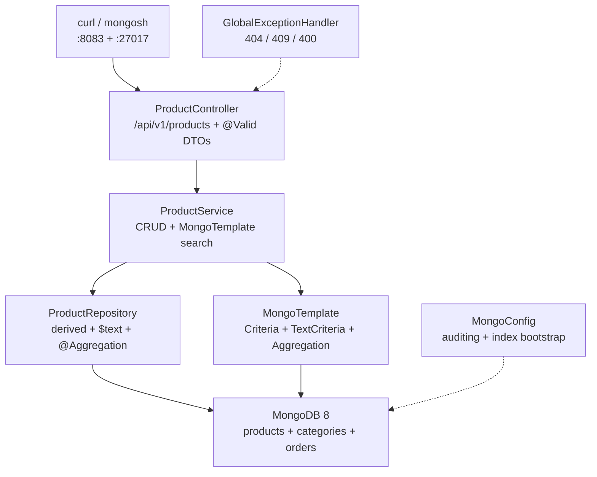
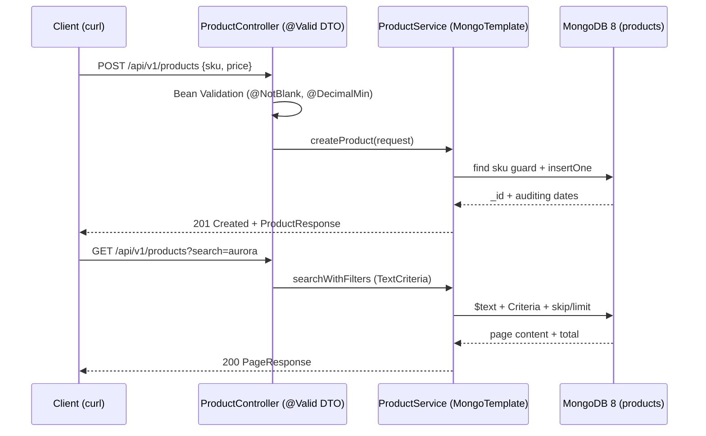

# 013 — Product Catalog Example (Boot 4.1.0 + Java 25, MongoDB 8)

> End-to-end product/order domain: documents, repository, service, controller, auditing + indexes, one aggregation, `@Version`, **one** multi-doc TX, Testcontainers IT, `curl` + `mongosh` trace.
>
> **Stack:** Spring Boot **4.1.0** · Java **25** · Spring Data MongoDB 5.x · MongoDB **8.x** · `mongo:8` + mongo-express.
>
> **Mirror note (read, not compiled):** shapes mirror `projects-v2/commerce-mesh/backend/product-catalog-service` (`document/Product.java`, `document/Category.java`, `repository/ProductRepository.java`, `service/ProductService.java`, `controller/ProductController.java`, `exception/GlobalExceptionHandler.java`, `config/MongoConfig.java`, `application.yml`) and `search-service` (`repository/ProductSearchRepository.java`, `service/SearchService.java`, `document/ProductDocument.java`, `config/MongoConfig.java`, `application.yml`) plus `commerce-mesh/docker-compose.yaml` (`mongodb` + `mongo-express`). Verified by **reading, not compiling**. Extensions (`AuditorAware`, `DuplicateKeyException→409`, `@Version`, single TX) marked `EXTENSION`.
>
> **Docs-embedded ONLY:** all Java / YAML / Compose lives in fenced blocks below. No `.java` / `application.yml` / Compose files were created.
>
> Companion guides: [001](./001-spring-boot-mongodb-setup.md) · [002](./002-document-mapping.md) · [003](./003-repository-query-methods.md) · [004](./004-mongotemplate-crud.md) · [005](./005-mongodb-query-language.md) · [006](./006-data-modeling-schema-design.md) · [007](./007-aggregation-framework.md) · [008](./008-indexing-query-performance.md) · [009](./009-transactions-concurrency.md) · [010](./010-replication-sharding-advanced.md) · [011](./011-reactive-testing-debugging.md) · [012](./012-production-readiness.md).

## Table of Contents
- [1. Domain](#1-domain-overview) · [2. Layers](#2-layer-map-flowchart) · [3. Documents](#3-documents-product--category) · [4. Repository](#4-productrepository) · [5. Service](#5-productservice-crud--search) · [6. Controller](#6-productcontroller--dtos) · [7. Errors](#7-globalexceptionhandler) · [8. Config](#8-mongoconfig) · [9. YAML](#9-applicationyml) · [10. Compose](#10-compose-block-mongo8--express) · [11. Aggregation](#11-aggregation-top-categories) · [12. @Version](#12-concurrency-with-version) · [13. TX](#13-the-one-multi-doc-tx-placeorder) · [14. IT](#14-testcontainers-it) · [15. Lifecycle](#15-request-lifecycle-sequence-diagram) · [16. Trace](#16-verification-trace-curl--mongosh) · [17. Pitfalls](#17-pitfalls-gold) · [18. Q&A](#18-interview-qa) · [19. Resources](#19-resources)

---

## 1. Domain Overview
Slice: `categories` → `products` → `orders` (+ `payments` intent in §13 only).
| Collection | Key fields | Index story |
|---|---|---|
| `products` | `sku` unique, `name`/`description` text, `categoryId`, `price`, `tags`, `isActive`/`isFeatured` | unique `sku`; compound text `name+description`; `categoryId` filter index |
| `categories` | `slug` unique, `name` text, `parentId`, `sortOrder` | unique `slug`; text on `name` |
| `orders` | `customerId`, `productId`, `qty`, `total`, `status` | TX-only (§13) |
| `idempotency_keys` | `key` unique + TTL | only if §13 grows retries ([009](./009-transactions-concurrency.md) §14) |
Rules ([006](./006-data-modeling-schema-design.md)): `BigDecimal` money (`Decimal128` on the wire),
UTC audit dates, soft-delete (`isActive=false`, mirrors real `deleteProduct`),
immutable order price snapshot at placement (live price stays in `products`,
orders never join for the price — see [006](./006-data-modeling-schema-design.md) §8).

The domain is coherent on purpose: categories own the taxonomy (`slug` unique,
`parentId` tree), products own the sellable snapshot (`sku` unique, `categoryId`
reference, `price` + `compareAtPrice` + `currency`), orders own the purchase
(`productId` + `qty` + `total` snapshot + `status`), and the `payments` intent
exists only inside the §13 TX. Reads fan out (catalog browse, keyword search,
top-category aggregation); writes stay single-document except `placeOrder`.

---

## 2. Layer Map (Flowchart)

Controllers validate, services orchestrate, repositories own fixed queries, `MongoTemplate` owns dynamic search + §11, config owns indexes.

---

## 3. Documents: Product + Category
Mirrors `catalog/document/Product.java` (209 lines) and `document/Category.java` (122 lines): `@MongoId`, `@TextIndexed`, `@Indexed(unique=true)`, `BigDecimal`, `@CreatedDate`/`@LastModifiedDate`. Getters/setters abbreviated.
```java
package com.commercemesh.catalog.document;
import java.math.BigDecimal;
import java.time.LocalDateTime;
import java.util.*;
import org.springframework.data.annotation.CreatedDate;
import org.springframework.data.annotation.LastModifiedDate;
import org.springframework.data.mongodb.core.index.Indexed;
import org.springframework.data.mongodb.core.index.TextIndexed;
import org.springframework.data.mongodb.core.mapping.Document;
import org.springframework.data.mongodb.core.mapping.MongoId;
@Document(collection = "products")
public class Product {
    @MongoId private String id;
    @TextIndexed private String name;
    @TextIndexed private String description;
    private String brand;
    @Indexed(unique = true) private String sku;
    private BigDecimal price, compareAtPrice;
    private String currency = "USD";
    private String categoryId;
    private List<String> images = new ArrayList<>(), tags = new ArrayList<>();
    private Map<String, String> attributes = new HashMap<>();
    private double averageRating = 0.0;
    private int reviewCount = 0;
    private boolean isActive = true, isFeatured = false;
    @CreatedDate private LocalDateTime createdAt;
    @LastModifiedDate private LocalDateTime updatedAt;
    public Product() {}
    // getters/setters mirror the real file one-for-one (omitted)
}
```
```java
package com.commercemesh.catalog.document;
import java.time.LocalDateTime;
import org.springframework.data.annotation.CreatedDate;
import org.springframework.data.annotation.LastModifiedDate;
import org.springframework.data.mongodb.core.index.Indexed;
import org.springframework.data.mongodb.core.index.TextIndexed;
import org.springframework.data.mongodb.core.mapping.Document;
import org.springframework.data.mongodb.core.mapping.MongoId;
@Document(collection = "categories")
public class Category {
    @MongoId private String id;
    @TextIndexed private String name;
    @Indexed(unique = true) private String slug;
    private String description, image, parentId;
    private boolean isActive = true;
    private int sortOrder = 0;
    @CreatedDate private LocalDateTime createdAt;
    @LastModifiedDate private LocalDateTime updatedAt;
    public Category() {}
    // getters/setters mirror the real file (omitted)
}
```
Search contrast: `search/document/ProductDocument.java` uses `@Id` + `@Field` + weighted `@TextIndexed(weight=10/5/3/2)` on `name/description/brand/tags` plus `@TextScore Float textScore` — scoring path behind §5 `sortByScore()`.

Import map (why each import exists — mirrors the real files, see [002](./002-document-mapping.md)):
`org.springframework.data.mongodb.core.mapping.Document` names the collection;
`MongoId` (catalog) vs `@Id` (search) both bind `String id` to `_id`;
`org.springframework.data.mongodb.core.index.Indexed` builds the unique `sku`/`slug` B-tree;
`TextIndexed` contributes the single compound text index per collection;
`CreatedDate`/`LastModifiedDate` are populated only because §8 enables auditing;
`BigDecimal` serializes as `Decimal128` so `199.99` survives without double drift;
collections stay plural (`products`, `categories`) matching `mongoTemplate.getCollection(...)` in §8.

---

## 4. ProductRepository
Union of catalog derived + `$text @Query` and search-service `@Aggregation` facets. Keep two interfaces in real code; merged here.
```java
package com.commercemesh.catalog.repository;
import com.commercemesh.catalog.document.Product;
import java.util.List;
import org.springframework.data.domain.Page;
import org.springframework.data.domain.Pageable;
import org.springframework.data.mongodb.repository.Aggregation;
import org.springframework.data.mongodb.repository.MongoRepository;
import org.springframework.data.mongodb.repository.Query;
import org.springframework.stereotype.Repository;
@Repository
public interface ProductRepository extends MongoRepository<Product, String> {
    Page<Product> findByCategoryId(String categoryId, Pageable pageable);
    Page<Product> findByIsActiveTrue(Pageable pageable);
    Page<Product> findByNameContainingIgnoreCaseOrDescriptionContainingIgnoreCase(String name, String description, Pageable pageable);
    Page<Product> findByTagsIn(List<String> tags, Pageable pageable);
    Page<Product> findByIsFeaturedTrueAndIsActiveTrue(Pageable pageable);
    List<Product> findByCategoryIdAndIsActiveTrue(String categoryId);
    @Query("{ $text: { $search: ?0 } }") Page<Product> searchByText(String searchText, Pageable pageable);
    @Query("{ '$text': { '$search': ?0 }, 'isActive': true }") Page<Product> searchActiveByKeyword(String keyword, Pageable pageable);
    @Aggregation(pipeline = {"{ '$match': { '_id': { '$in': ?0 } } }", "{ '$group': { '_id': '$categoryId', 'count': { '$sum': 1 } } }"})
    List<CategoryCount> countByCategory(List<String> productIds);
    record CategoryCount(String id, long count) {}
}
```
Derived for fixed filters ([003](./003-repository-query-methods.md)), `$text` for scored search ([005](./005-mongodb-query-language.md) + [008](./008-indexing-query-performance.md)), `@Aggregation` for facets ([007](./007-aggregation-framework.md)).

Method-by-method rationale: `findByCategoryId` powers category browse with pagination;
`findByIsActiveTrue` is the storefront default (never leak soft-deleted rows);
`findByNameContainingIgnoreCaseOrDescriptionContainingIgnoreCase` is the no-index fallback
when no text index exists yet — replace with `$text` once §8 runs; `findByTagsIn`
powers tag chips (`tags` `$in` list); `findByIsFeaturedTrueAndIsActiveTrue` backs the
`/featured` rail; `findByCategoryIdAndIsActiveTrue` is the unpaged internal helper used
by category services. `searchByText` is the catalog keyword entry; `searchActiveByKeyword`
adds the search-service `isActive:true` guard so drafts never rank; `countByCategory`
ports the search-service `$match $in` → `$group` facet pipeline (category counts for a
result id set), with `record CategoryCount` as the projection target.

---

## 5. ProductService (CRUD + Search)
CRUD mirrors `catalog/service/ProductService.java` (SKU guard, filter chain, soft delete); `searchWithFilters` ports `search/service/SearchService.java` (`TextCriteria` + `TextQuery.sortByScore()` + `Criteria` + count/find `PageImpl`).
```java
package com.commercemesh.catalog.service;
import com.commercemesh.catalog.document.Product;
import com.commercemesh.catalog.dto.PageResponse;
import com.commercemesh.catalog.dto.ProductRequest;
import com.commercemesh.catalog.dto.ProductResponse;
import com.commercemesh.catalog.exception.ResourceNotFoundException;
import com.commercemesh.catalog.repository.ProductRepository;
import org.springframework.data.domain.*;
import org.springframework.data.mongodb.core.MongoTemplate;
import org.springframework.data.mongodb.core.query.Criteria;
import org.springframework.data.mongodb.core.query.Query;
import org.springframework.data.mongodb.core.query.TextCriteria;
import org.springframework.data.mongodb.core.query.TextQuery;
import org.springframework.stereotype.Service;
import java.util.List;
@Service
public class ProductService {
    private final ProductRepository products;
    private final MongoTemplate mongoTemplate;
    public ProductService(ProductRepository products, MongoTemplate mongoTemplate) { this.products = products; this.mongoTemplate = mongoTemplate; }
    public ProductResponse createProduct(ProductRequest req) {
        if (products.findAll().stream().anyMatch(p -> p.getSku().equals(req.sku()))) throw new IllegalArgumentException("Product with SKU '" + req.sku() + "' already exists");
        Product p = new Product(); copy(req, p); return ProductResponse.from(products.save(p));
    }
    public ProductResponse updateProduct(String id, ProductRequest req) {
        Product p = products.findById(id).orElseThrow(() -> new ResourceNotFoundException("Product", "id", id));
        copy(req, p); return ProductResponse.from(products.save(p));
    }
    public ProductResponse getProductById(String id) {
        return ProductResponse.from(products.findById(id).orElseThrow(() -> new ResourceNotFoundException("Product", "id", id)));
    }
    public PageResponse<ProductResponse> getAllProducts(String categoryId, String search, List<String> tags, Boolean isActive, int page, int size, String sortBy) {
        Pageable pageable = PageRequest.of(page, size, Sort.by(sortBy != null ? sortBy : "createdAt").descending());
        Page<Product> result;
        if (search != null && !search.isBlank()) result = products.searchByText(search, pageable);
        else if (categoryId != null && !categoryId.isBlank()) result = products.findByCategoryId(categoryId, pageable);
        else if (tags != null && !tags.isEmpty()) result = products.findByTagsIn(tags, pageable);
        else if (Boolean.TRUE.equals(isActive)) result = products.findByIsActiveTrue(pageable);
        else result = products.findAll(pageable);
        List<ProductResponse> content = result.getContent().stream().filter(p -> isActive == null || p.isActive() == isActive).map(ProductResponse::from).toList();
        return new PageResponse<>(content, result.getNumber(), result.getSize(), result.getTotalElements(), result.getTotalPages());
    }
    public Page<Product> searchWithFilters(String keyword, String categoryId, Double minPrice, Double maxPrice, Double minRating, Pageable pageable) {
        Query query = (keyword != null && !keyword.isBlank())
                ? TextQuery.queryText(TextCriteria.forDefaultLanguage().matching(keyword)).sortByScore().with(pageable)
                : new Query().with(pageable);
        query.addCriteria(Criteria.where("isActive").is(true));
        if (categoryId != null && !categoryId.isBlank()) query.addCriteria(Criteria.where("categoryId").is(categoryId));
        if (minPrice != null) query.addCriteria(Criteria.where("price").gte(minPrice));
        if (maxPrice != null) query.addCriteria(Criteria.where("price").lte(maxPrice));
        if (minRating != null) query.addCriteria(Criteria.where("averageRating").gte(minRating));
        long total = mongoTemplate.count(Query.of(query).limit(0).skip(0), Product.class);
        return new PageImpl<>(mongoTemplate.find(query, Product.class), pageable, total);
    }
    public void deleteProduct(String id) {
        Product p = products.findById(id).orElseThrow(() -> new ResourceNotFoundException("Product", "id", id));
        p.setActive(false); products.save(p); // soft delete mirrors real service
    }
    private void copy(ProductRequest req, Product p) {
        p.setName(req.name()); p.setDescription(req.description()); p.setBrand(req.brand()); p.setSku(req.sku());
        p.setPrice(req.price()); p.setCompareAtPrice(req.compareAtPrice()); p.setCurrency(req.currency() != null ? req.currency() : "USD");
        p.setCategoryId(req.categoryId()); p.setImages(req.images() != null ? req.images() : List.of());
        p.setTags(req.tags() != null ? req.tags() : List.of()); p.setAttributes(req.attributes() != null ? req.attributes() : java.util.Map.of());
        p.setActive(req.isActive()); p.setFeatured(req.isFeatured());
    }
}
```
Pagination note ([004](./004-mongotemplate-crud.md)): repository methods return `Page`
directly; the `MongoTemplate` path must count then find and wrap in `PageImpl`
— exactly the search-service `textSearch`/`filterSearch` pattern with
`Query.of(query).limit(0).skip(0)` for the count so `skip/limit` never skews the total.
`TextQuery.queryText(tc).sortByScore()` orders by `$meta: textScore`; the filter-only
branch falls back to `Sort` on `price`/`averageRating`/`createdAt`. The `copy()` helper
keeps create/update symmetric (mirrors the real service field-for-field) and defaults
`currency` to `USD`, empty lists, and empty attribute maps so no null arrays persist.

---

## 6. ProductController + DTOs
Mirrors `catalog/controller/ProductController.java` (`/api/v1/products`, `201`/`204`, `/featured`, `@Valid` records) and `dto/ProductRequest.java`. Security trimmed.
```java
package com.commercemesh.catalog.controller;
import com.commercemesh.catalog.dto.PageResponse;
import com.commercemesh.catalog.dto.ProductRequest;
import com.commercemesh.catalog.dto.ProductResponse;
import com.commercemesh.catalog.service.ProductService;
import jakarta.validation.Valid;
import java.util.List;
import org.springframework.http.HttpStatus;
import org.springframework.http.ResponseEntity;
import org.springframework.web.bind.annotation.*;
@RestController @RequestMapping("/api/v1/products")
public class ProductController {
    private final ProductService productService;
    public ProductController(ProductService productService) { this.productService = productService; }
    @GetMapping
    public ResponseEntity<PageResponse<ProductResponse>> getAllProducts(@RequestParam(required = false) String categoryId, @RequestParam(required = false) String search, @RequestParam(required = false) List<String> tags, @RequestParam(required = false) Boolean isActive, @RequestParam(defaultValue = "0") int page, @RequestParam(defaultValue = "20") int size, @RequestParam(required = false) String sortBy) {
        return ResponseEntity.ok(productService.getAllProducts(categoryId, search, tags, isActive, page, size, sortBy));
    }
    @GetMapping("/{id}") public ResponseEntity<ProductResponse> getProductById(@PathVariable String id) { return ResponseEntity.ok(productService.getProductById(id)); }
    @PostMapping public ResponseEntity<ProductResponse> createProduct(@Valid @RequestBody ProductRequest req) { return ResponseEntity.status(HttpStatus.CREATED).body(productService.createProduct(req)); }
    @PutMapping("/{id}") public ResponseEntity<ProductResponse> updateProduct(@PathVariable String id, @Valid @RequestBody ProductRequest req) { return ResponseEntity.ok(productService.updateProduct(id, req)); }
    @DeleteMapping("/{id}") public ResponseEntity<Void> deleteProduct(@PathVariable String id) { productService.deleteProduct(id); return ResponseEntity.noContent().build(); }
    @GetMapping("/featured")
    public ResponseEntity<PageResponse<ProductResponse>> getFeatured(@RequestParam(defaultValue = "0") int page, @RequestParam(defaultValue = "20") int size) {
        return ResponseEntity.ok(productService.getAllProducts(null, null, null, true, page, size, "createdAt"));
    }
}
```
```java
package com.commercemesh.catalog.dto;
import jakarta.validation.constraints.*;
import java.math.BigDecimal;
import java.util.List;
import java.util.Map;
public record ProductRequest(@NotBlank(message = "Product name is required") String name, @NotBlank(message = "Product description is required") String description, String brand, @NotBlank(message = "SKU is required") String sku, @NotNull(message = "Price is required") @DecimalMin(value = "0.0", inclusive = false, message = "Price must be greater than 0") BigDecimal price, BigDecimal compareAtPrice, String currency, @NotBlank(message = "Category ID is required") String categoryId, List<String> images, List<String> tags, Map<String, String> attributes, boolean isActive, boolean isFeatured) {}
```
`ProductResponse.from(product)` and `PageResponse`/`ApiError.of(...)` mirror the real DTOs.

Controller contract notes: `GET /api/v1/products` keeps every filter optional with
`page=0&size=20` defaults so the storefront works with zero params; `GET /{id}` throws
`ResourceNotFoundException` → `404` (§7); `POST` returns `201` with the created body;
`PUT` is a full replace via the same `ProductRequest` validation (no PATCH drift);
`DELETE` soft-deletes and returns `204` with no body; `/featured` reuses the service
filter chain with `isActive=true` so the rail never shows drafts. Validation (`@NotBlank`
name/description/sku/categoryId, `@DecimalMin` price) is enforced before any DB touch,
so `400` field maps come from `MethodArgumentNotValidException` (§7), not Mongo errors.

---

## 7. GlobalExceptionHandler
Real handler: `ResourceNotFound→404`, `IllegalArgument/IllegalState→400`, `MethodArgumentNotValid→400`, `AccessDenied→403`, `BadCredentials→401`, fallback `→500`. Adds `DuplicateKeyException→409` (unique `sku`/`slug` else `500`) + mapping guard.
| Exception | HTTP | Why here |
|---|---|---|
| `ResourceNotFoundException` | `404` | mirrors real `orElseThrow` on every `findById` |
| `DuplicateKeyException` | `409` | `EXTENSION`: unique `sku`/`slug` race backstop |
| `MethodArgumentNotValidException` | `400` | `@Valid` record field map |
| `MappingException` | `400` | `EXTENSION`: bad BSON/`Decimal128` shapes |
| `IllegalArgumentException` | `400` | SKU pre-check message passthrough |
| `Exception` | `500` | catch-all, no stack leak |
```java
package com.commercemesh.catalog.exception;
import com.commercemesh.catalog.dto.ApiError;
import java.util.HashMap;
import java.util.Map;
import org.springframework.dao.DuplicateKeyException;
import org.springframework.data.mapping.MappingException;
import org.springframework.http.HttpStatus;
import org.springframework.http.ResponseEntity;
import org.springframework.web.bind.MethodArgumentNotValidException;
import org.springframework.web.bind.annotation.ExceptionHandler;
import org.springframework.web.bind.annotation.RestControllerAdvice;
@RestControllerAdvice
public class GlobalExceptionHandler {
    @ExceptionHandler(ResourceNotFoundException.class) public ResponseEntity<ApiError> handleNotFound(ResourceNotFoundException ex) { return ResponseEntity.status(HttpStatus.NOT_FOUND).body(ApiError.of(404, ex.getMessage())); }
    @ExceptionHandler(DuplicateKeyException.class) public ResponseEntity<ApiError> handleDuplicate(DuplicateKeyException ex) { return ResponseEntity.status(HttpStatus.CONFLICT).body(ApiError.of(409, "Duplicate key: SKU or slug already exists")); } // EXTENSION
    @ExceptionHandler(MethodArgumentNotValidException.class) public ResponseEntity<ApiError> handleValidation(MethodArgumentNotValidException ex) { Map<String, String> errors = new HashMap<>(); ex.getBindingResult().getFieldErrors().forEach(e -> errors.put(e.getField(), e.getDefaultMessage())); return ResponseEntity.badRequest().body(ApiError.of(400, "Validation failed", errors)); }
    @ExceptionHandler(MappingException.class) public ResponseEntity<ApiError> handleMapping(MappingException ex) { return ResponseEntity.badRequest().body(ApiError.of(400, "Document mapping failed")); } // EXTENSION
    @ExceptionHandler(IllegalArgumentException.class) public ResponseEntity<ApiError> handleIllegalArgument(IllegalArgumentException ex) { return ResponseEntity.badRequest().body(ApiError.of(400, ex.getMessage())); }
    @ExceptionHandler(Exception.class) public ResponseEntity<ApiError> handleGeneral(Exception ex) { return ResponseEntity.status(HttpStatus.INTERNAL_SERVER_ERROR).body(ApiError.of(500, "An unexpected error occurred")); }
}
```

---

## 8. MongoConfig
Mirrors `catalog/config/MongoConfig.java`: `@EnableMongoAuditing` + resolver-driven annotated indexes + raw compound text indexes. `AuditorAware` is the one addition (real file has no auditor, so `@CreatedBy` stays empty).
```java
package com.commercemesh.catalog.config;
import com.commercemesh.catalog.document.Category;
import com.commercemesh.catalog.document.Product;
import com.mongodb.client.model.IndexOptions;
import jakarta.annotation.PostConstruct;
import java.util.Optional;
import org.bson.Document;
import org.springframework.context.annotation.Bean;
import org.springframework.context.annotation.Configuration;
import org.springframework.data.domain.AuditorAware;
import org.springframework.data.mongodb.MongoTransactionManager;
import org.springframework.data.mongodb.config.EnableMongoAuditing;
import org.springframework.data.mongodb.core.MongoTemplate;
import org.springframework.data.mongodb.core.index.*;
@Configuration @EnableMongoAuditing
public class MongoConfig {
    private final MongoTemplate mongoTemplate;
    public MongoConfig(MongoTemplate mongoTemplate) { this.mongoTemplate = mongoTemplate; }
    @Bean AuditorAware<String> auditorAware() { return () -> Optional.of("catalog-service"); } // EXTENSION
    @Bean MongoTransactionManager transactionManager(org.springframework.data.mongodb.MongoDatabaseFactory f) { return new MongoTransactionManager(f); } // §13 only; needs replica set
    @PostConstruct public void initIndexes() {
        IndexResolver r = new MongoPersistentEntityIndexResolver(mongoTemplate.getConverter().getMappingContext());
        IndexOperations pOps = mongoTemplate.indexOps(Product.class); r.resolveIndexFor(Product.class).forEach(pOps::ensureIndex);
        IndexOperations cOps = mongoTemplate.indexOps(Category.class); r.resolveIndexFor(Category.class).forEach(cOps::ensureIndex);
        mongoTemplate.getCollection("products").createIndex(new Document("name", "text").append("description", "text"), new IndexOptions().name("product_text_search").background(true));
        mongoTemplate.getCollection("categories").createIndex(new Document("name", "text"), new IndexOptions().name("category_text_search").background(true));
    }
}
```
Search variant: `getIndexInfo()` guard + weighted `name(10)/description(5)/brand(3)/tags(2)` index in try/catch — prefer on shared clusters.

Auditing wiring: `@EnableMongoAuditing` activates `@CreatedDate`/`@LastModifiedDate`
(and `@CreatedBy` once the `AuditorAware` bean exists) without any repository change —
see [002](./002-document-mapping.md). Index bootstrap is idempotent: annotated indexes
resolve via `MongoPersistentEntityIndexResolver` on every start, raw `createIndex` calls
are no-ops when the named index already exists, so restarts are safe. Keep the manager
bean even when most paths are non-transactional — it is inert until `@Transactional` runs.

---

## 9. application.yml
MongoDB block byte-equivalent to catalog `application.yml` lines 14–22.
```yaml
server: {port: ${CATALOG_SERVICE_PORT:8083}}
spring:
  threads: {virtual: {enabled: true}}
  application: {name: product-catalog-service}
  data:
    mongodb:
      host: ${MONGO_HOST:localhost}
      port: 27017
      authentication-database: admin
      username: ${MONGO_ROOT_USER:root}
      password: ${MONGO_ROOT_PASSWORD:rootroot}
      database: ${MONGO_DATABASE:commercemesh}
management: {endpoints: {web: {exposure: {include: health,info,metrics,prometheus}}}}
```
`uri` overrides these keys — never set both ([001](./001-spring-boot-mongodb-setup.md) §10). Compose: `MONGO_HOST=mongodb`; host: `localhost`.

Port `8083` mirrors `CATALOG_SERVICE_PORT` in the real file; `search-service` uses
`8089` with the identical MongoDB block (only `spring.application.name` differs).
`authentication-database: admin` matches the Compose root user; scoped app users
authenticate against their owning DB instead ([001](./001-spring-boot-mongodb-setup.md) §9).
`commercemesh` is created lazily and seeded by `init-mongo.js` on first volume creation.

---

## 10. Compose Block (mongo:8 + express)
Mirrors `commerce-mesh/docker-compose.yaml` lines 40–73.
```yaml
services:
  mongodb:
    image: mongo:8
    container_name: cm-mongodb
    environment: {MONGO_INITDB_ROOT_USERNAME: ${MONGO_ROOT_USER:-root}, MONGO_INITDB_ROOT_PASSWORD: ${MONGO_ROOT_PASSWORD:-rootroot}, MONGO_INITDB_DATABASE: ${MONGO_DATABASE:-commercemesh}}
    ports: ["27017:27017"]
    volumes: [mongo_data:/data/db, ./scripts/init-mongo.js:/docker-entrypoint-initdb.d/init.js]
    healthcheck: {test: echo 'db.runCommand("ping").ok' | mongosh localhost:27017/test --quiet, interval: 5s, timeout: 3s, retries: 5}
    networks: [cm-network]
  mongo-express:
    image: mongo-express:latest
    container_name: cm-mongo-express
    environment: {ME_CONFIG_MONGODB_ADMINUSERNAME: ${MONGO_ROOT_USER:-root}, ME_CONFIG_MONGODB_ADMINPASSWORD: ${MONGO_ROOT_PASSWORD:-rootroot}, ME_CONFIG_MONGODB_URL: mongodb://${MONGO_ROOT_USER:-root}:${MONGO_ROOT_PASSWORD:-rootroot}@mongodb:27017/}
    ports: ["8081:8081"]
    depends_on: {mongodb: {condition: service_healthy}}
    networks: [cm-network]
networks: {cm-network: {driver: bridge}}
volumes: {mongo_data:}
```
> TX note: above is standalone (no TX). For §13 add `command: ["--replSet", "rs0", "--bind_ip_all"]` + `rs-init` sidecar running `rs.initiate()` ([009](./009-transactions-concurrency.md) §4).

Compose wiring mirror: `product-catalog-service` and `search-service` both set
`MONGO_HOST: mongodb` with `depends_on: mongodb: {condition: service_healthy}`, so the
app never races the `mongosh` ping healthcheck. `mongo_data:/data/db` survives `down`
(only `down -v` wipes it); `init-mongo.js` seeds collections + indexes on first volume
creation only. mongo-express on `:8081` is an inspector — never a dependency. Full
topology walkthrough in [001](./001-spring-boot-mongodb-setup.md) §7.

---

## 11. Aggregation: Top Categories
One Spring Aggregation API pipeline; shell twin in §16.
```java
package com.commercemesh.catalog.service;
import java.util.List;
import org.springframework.data.domain.Sort;
import org.springframework.data.mongodb.core.MongoTemplate;
import org.springframework.data.mongodb.core.aggregation.Aggregation;
import org.springframework.data.mongodb.core.query.Criteria;
import org.springframework.stereotype.Service;
import static org.springframework.data.mongodb.core.aggregation.Aggregation.*;
@Service
public class CategoryStatsService {
    private final MongoTemplate mongoTemplate;
    public CategoryStatsService(MongoTemplate mongoTemplate) { this.mongoTemplate = mongoTemplate; }
    public List<TopCategory> topCategories(int limit) {
        Aggregation agg = newAggregation(match(Criteria.where("isActive").is(true)), group("categoryId").count().as("productCount"), sort(Sort.by(Sort.Direction.DESC, "productCount")), limit(limit), project("productCount").and("_id").as("categoryId"));
        return mongoTemplate.aggregate(agg, "products", TopCategory.class).getMappedResults();
    }
    public record TopCategory(String categoryId, long productCount) {}
}
```
Pair with `{ isActive: 1, categoryId: 1 }` ([007](./007-aggregation-framework.md) + [008](./008-indexing-query-performance.md)); verify via `explain()` in §16.

Stage walk: `$match` prunes inactive rows using the filter index; `$group` buckets by
`categoryId` with `$sum:1` counts; `$sort` orders busiest first; `$limit` caps the rail;
`$project` renames `_id` → `categoryId` for the `TopCategory` record. The raw shell twin
in §16 runs the identical five stages, so `mongoTemplate.aggregate(...)` and `mongosh`
stay byte-parity — any divergence means the Java pipeline drifted.

---

## 12. Concurrency with @Version
Real documents carry no `@Version` — concurrent price/stock edits lost-update. Extension: guard field; loser gets `OptimisticLockingFailureException` + retries.
```java
import org.springframework.data.annotation.Version;
@Document(collection = "products") public class Product {
    @MongoId private String id; private String sku; private java.math.BigDecimal price;
    @Version private Long version; // EXTENSION
}
public ProductResponse updatePriceWithRetry(String id, java.math.BigDecimal delta, int max) {
    for (int a = 1; a <= max; a++) {
        try { Product p = products.findById(id).orElseThrow(() -> new ResourceNotFoundException("Product", "id", id)); p.setPrice(p.getPrice().add(delta)); return ProductResponse.from(products.save(p)); }
        catch (org.springframework.dao.OptimisticLockingFailureException e) { if (a == max) throw e; }
    } throw new IllegalStateException("unreachable");
}
```
Counters → guarded `findAndModify`; multi-field edits → `@Version`; cross-doc → §13.

---

## 13. The ONE Multi-Doc TX: placeOrder
**Justification:** only all-or-nothing span — `products.stock` + `orders` + `payments` across three documents. Crash between writes oversells with no order ([009](./009-transactions-concurrency.md) §3). Everything else stays single-doc atomic.
```java
package com.commercemesh.catalog.service;
import java.math.BigDecimal;
import java.time.Instant;
import org.springframework.data.mongodb.core.MongoTemplate;
import org.springframework.data.mongodb.core.query.*;
import org.springframework.stereotype.Service;
import org.springframework.transaction.annotation.Transactional;
@Service
public class OrderService {
    private final MongoTemplate mongoTemplate;
    public OrderService(MongoTemplate mongoTemplate) { this.mongoTemplate = mongoTemplate; }
    @Transactional(rollbackFor = InsufficientStockException.class)
    public String placeOrder(String customerId, String productId, int qty, BigDecimal unitPrice, String idempotencyKey) {
        var updated = mongoTemplate.updateFirst(Query.query(Criteria.where("_id").is(productId).and("stock").gte(qty)), new Update().inc("stock", -qty).set("updatedAt", Instant.now()), "products");
        if (updated.getModifiedCount() == 0) throw new InsufficientStockException(productId, qty);
        String orderId = "ord_" + java.util.UUID.randomUUID();
        var order = new org.bson.Document("_id", orderId).append("customerId", customerId).append("productId", productId).append("qty", qty).append("total", unitPrice.multiply(BigDecimal.valueOf(qty))).append("status", "CONFIRMED").append("createdAt", Instant.now());
        mongoTemplate.insert(order, "orders");
        mongoTemplate.insert(new org.bson.Document("_id", "pay_" + orderId).append("orderId", orderId).append("amount", order.get("total")).append("status", "AUTHORIZED").append("createdAt", Instant.now()), "payments");
        return orderId;
    }
    public static class InsufficientStockException extends RuntimeException {
        public InsufficientStockException(String productId, int qty) { super("Insufficient stock for " + productId + ", qty=" + qty); }
    }
}
```
> **Replica-set REQUIRED:** standalone rejects commits (`Transaction numbers are only allowed on a replica set member or mongos`). Use `--replSet rs0` + `rs.initiate()` + `?replicaSet=rs0`; 2–10 docs <100 ms, no I/O inside.

---

## 14. Testcontainers IT
`MongoDBContainer("mongo:8")` + `@ServiceConnection`, CRUD + TX rollback. Replica-set command required — without it the TX test fails fast by design.
```java
package com.commercemesh.catalog;
import com.commercemesh.catalog.dto.ProductRequest;
import com.commercemesh.catalog.service.OrderService;
import com.commercemesh.catalog.service.ProductService;
import java.math.BigDecimal;
import java.util.List;
import java.util.Map;
import org.junit.jupiter.api.Assertions;
import org.junit.jupiter.api.Test;
import org.springframework.beans.factory.annotation.Autowired;
import org.springframework.boot.test.context.SpringBootTest;
import org.springframework.boot.testcontainers.service.connection.ServiceConnection;
import org.springframework.data.mongodb.core.MongoTemplate;
import org.springframework.data.mongodb.core.query.Query;
import org.testcontainers.containers.MongoDBContainer;
import org.testcontainers.junit.jupiter.Container;
import org.testcontainers.junit.jupiter.Testcontainers;
@Testcontainers @SpringBootTest
class ProductCatalogIT {
    @Container @ServiceConnection static MongoDBContainer mongo = new MongoDBContainer("mongo:8").withCommand("--replSet", "rs0");
    @Autowired ProductService products; @Autowired OrderService orders; @Autowired MongoTemplate mongoTemplate;
    @Test void crudRoundTrip() {
        var req = new ProductRequest("Aurora Headphones", "ANC over-ear", "Aurora", "AUR-HP-001", new BigDecimal("199.99"), null, "USD", "cat_audio", List.of(), List.of("audio"), Map.of(), true, false);
        var created = products.createProduct(req);
        Assertions.assertNotNull(created.id()); Assertions.assertEquals("AUR-HP-001", products.getProductById(created.id()).sku());
        products.deleteProduct(created.id());
    }
    @Test void insufficientStockRollsBackOrderAndPayment() {
        long before = mongoTemplate.count(new Query(), "orders");
        Assertions.assertThrows(OrderService.InsufficientStockException.class, () -> orders.placeOrder("cust_9f21", "prod_aurora_hp", 999_999, new BigDecimal("199.99"), "idem-it-" + System.nanoTime()));
        Assertions.assertEquals(before, mongoTemplate.count(new Query(), "orders"));
    }
}
```

---

## 15. Request Lifecycle (Sequence Diagram)


---

## 16. Verification Trace (curl + mongosh)
IDs illustrative. Order: insert → find → update → aggregate → explain.
```bash
curl -s -X POST http://localhost:8083/api/v1/products -H 'Content-Type: application/json' -d '{"name":"Aurora Headphones","description":"ANC over-ear","brand":"Aurora","sku":"AUR-HP-001","price":199.99,"categoryId":"cat_audio","tags":["audio"],"isActive":true}' | python3 -m json.tool # 201; dup SKU -> 409 (§7)
curl -s 'http://localhost:8083/api/v1/products?search=aurora&page=0&size=20' | python3 -m json.tool
curl -s http://localhost:8083/api/v1/products/PRODUCT_ID | python3 -m json.tool
curl -s -X PUT http://localhost:8083/api/v1/products/PRODUCT_ID -H 'Content-Type: application/json' -d '{"name":"Aurora Headphones","description":"ANC over-ear v2","brand":"Aurora","sku":"AUR-HP-001","price":189.99,"categoryId":"cat_audio","tags":["audio"],"isActive":true}' | python3 -m json.tool # 200
curl -s -o /dev/null -w '%{http_code}\n' -X DELETE http://localhost:8083/api/v1/products/PRODUCT_ID # 204
curl -s -X POST http://localhost:8083/api/v1/products -H 'Content-Type: application/json' -d '{"name":"","price":-1}' | python3 -m json.tool # 400 + field map
```
```javascript
use commercemesh;
db.products.insertOne({ sku: "AUR-HP-001", name: "Aurora Headphones", description: "ANC over-ear", brand: "Aurora", price: NumberDecimal("199.99"), categoryId: "cat_audio", tags: ["audio"], isActive: true, isFeatured: false });
db.products.findOne({ sku: "AUR-HP-001" });
db.products.find({ $text: { $search: "aurora" } }, { score: { $meta: "textScore" } }).sort({ score: { $meta: "textScore" } }).limit(5);
db.products.updateOne({ sku: "AUR-HP-001" }, { $set: { price: NumberDecimal("189.99") }, $addToSet: { tags: "anc" } });
db.products.aggregate([{ $match: { isActive: true } }, { $group: { _id: "$categoryId", productCount: { $sum: 1 } } }, { $sort: { productCount: -1 } }, { $limit: 5 }]);
db.products.find({ $text: { $search: "aurora" }, isActive: true }).explain("executionStats");
```
Expect `acknowledged:true`, `modifiedCount:1`, `[{_id:"cat_audio",productCount:N}]`, `$text` on `product_text_search` (`TEXT`, not `COLLSCAN`).

---

## 17. Pitfalls (GOLD)
1. **Two text indexes per collection** — only one allowed; annotation + raw `createIndex` collide. One compound/weighted def, guarded.
2. **Duplicate SKU → 500** — real handler lacks the arm. Fix §7 `→409` + pre-check.
3. **`uri` + discrete keys** — `uri` wins silently. One style per env ([001](./001-spring-boot-mongodb-setup.md) §10).
4. **`localhost` in Compose** — container loopback. `MONGO_HOST=mongodb` (§9–§10).
5. **TX on standalone** — every commit throws. `--replSet rs0` + `rs.initiate()` (§13–§14).
6. **Bare read-modify-write** — lost update. `@Version` + retry (§12) or guarded `findAndModify`.
7. **`BigDecimal`/`Decimal128` drift** — `MappingException` arm (§7) + codecs ([002](./002-document-mapping.md)).
8. **Unpaged queries** — full scans. `Pageable` everywhere, `limit()`, `explain()` (§16).
9. **Missing `isActive` filter** — inactive rows leak. `...AndIsActiveTrue` (§4–§5).
10. **TX creep** — fan-out into `placeOrder` exceeds 60 s. Keep ONE short TX; async rollups ([009](./009-transactions-concurrency.md) §15–§16).

---

## 18. Interview Q&A
**Q1. Derived vs `@Query $text` vs `MongoTemplate` search — when is each?**
A: Derived (`findByCategoryId`, `findByTagsIn`) for fixed filters; `@Query $text` for scored entry points; `MongoTemplate` + `TextCriteria`/`sortByScore()` + `Criteria` when filters are dynamic, with count-then-find `PageImpl` — the search-service split (§4–§5).
**Q2. Why does `MongoConfig` create a raw text index when `@TextIndexed` exists?**
A: Annotations declare intent but miss pre-existing collections. `@PostConstruct` resolves annotated indexes via `MongoPersistentEntityIndexResolver` then enforces `product_text_search` by name; search-service adds a weighted guard via `getIndexInfo()` (§8).
**Q3. What does duplicate SKU return, and why extend the real handler?**
A: `DuplicateKeyException` on unique `sku`/`slug`. Real handler falls to `500`; §7 maps to `409`, keeping the `createProduct` pre-check as fast path and the index as backstop.
**Q4. Two admins edit one price — what breaks, and what does `@Version` add?**
A: Last-writer-wins (§12). `@Version` makes save compare-and-swap; loser gets `OptimisticLockingFailureException`, reloads and retries bounded. Counters prefer guarded `findAndModify`; cross-doc needs §13.
**Q5. Why is `placeOrder` the only TX, and what does it need topologically?**
A: Only all-or-nothing span: stock + order + payment — mid-crash oversells (§13). Needs a replica set (standalone has no oplog), 2–10 docs <100 ms, no I/O inside, whole-body retry; everything else stays single-doc/async ([009](./009-transactions-concurrency.md) §4/§12/§15).

---

## 19. Resources
**Track hub (001–012 + basics):** [Basics](./mongodb.md) · [001 — Setup](./001-spring-boot-mongodb-setup.md) · [002 — Document Mapping](./002-document-mapping.md) · [003 — Repository Query Methods](./003-repository-query-methods.md) · [004 — MongoTemplate CRUD](./004-mongotemplate-crud.md) · [005 — Query Language](./005-mongodb-query-language.md) · [006 — Schema Design](./006-data-modeling-schema-design.md) · [007 — Aggregation](./007-aggregation-framework.md) · [008 — Indexing & Performance](./008-indexing-query-performance.md) · [009 — Transactions & Concurrency](./009-transactions-concurrency.md) · [010 — Replication, Sharding & Advanced Ops](./010-replication-sharding-advanced.md) · [011 — Reactive, Validation & Testing](./011-reactive-testing-debugging.md) · [012 — Production Readiness](./012-production-readiness.md)
**Official docs:** [Spring Data MongoDB](https://docs.spring.io/spring-data-mongodb/reference/) · [MongoDB 8.0](https://www.mongodb.com/docs/manual/release-notes/8.0/) · [$text](https://www.mongodb.com/docs/manual/reference/operator/query/text/) · [Aggregation](https://www.mongodb.com/docs/manual/aggregation/) · [Transactions](https://www.mongodb.com/docs/manual/core/transactions/) · [Testcontainers MongoDB](https://java.testcontainers.org/modules/databases/mongodb/) · [`@ServiceConnection`](https://docs.spring.io/spring-boot/reference/testing/testcontainers.html#testing.testcontainers.service-connections)
**Repo mirrors (read, not compiled):** `product-catalog-service/document/Product.java` · `document/Category.java` · `repository/ProductRepository.java` · `service/ProductService.java` · `controller/ProductController.java` · `dto/ProductRequest.java` · `exception/GlobalExceptionHandler.java` · `config/MongoConfig.java` · `application.yml` · `search-service/repository/ProductSearchRepository.java` · `service/SearchService.java` · `document/ProductDocument.java` · `commerce-mesh/docker-compose.yaml` (lines 40–73)

---
*Capstone: [001](./001-spring-boot-mongodb-setup.md) connects, [002–008](./002-document-mapping.md) map/query/index, [009](./009-transactions-concurrency.md) guards writes — this guide assembles them.*
