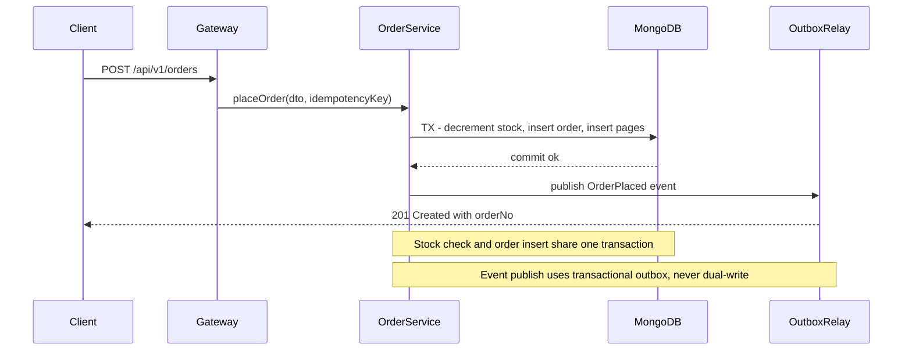
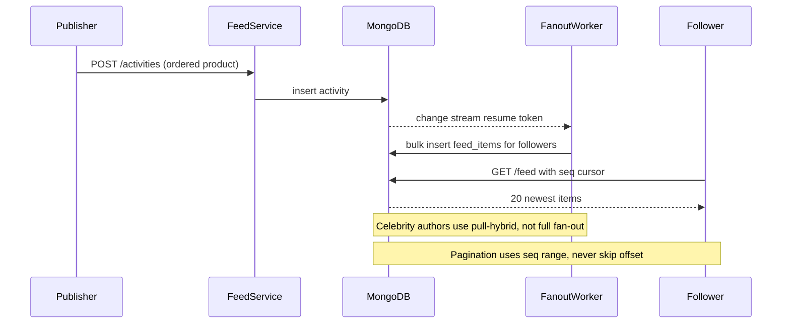
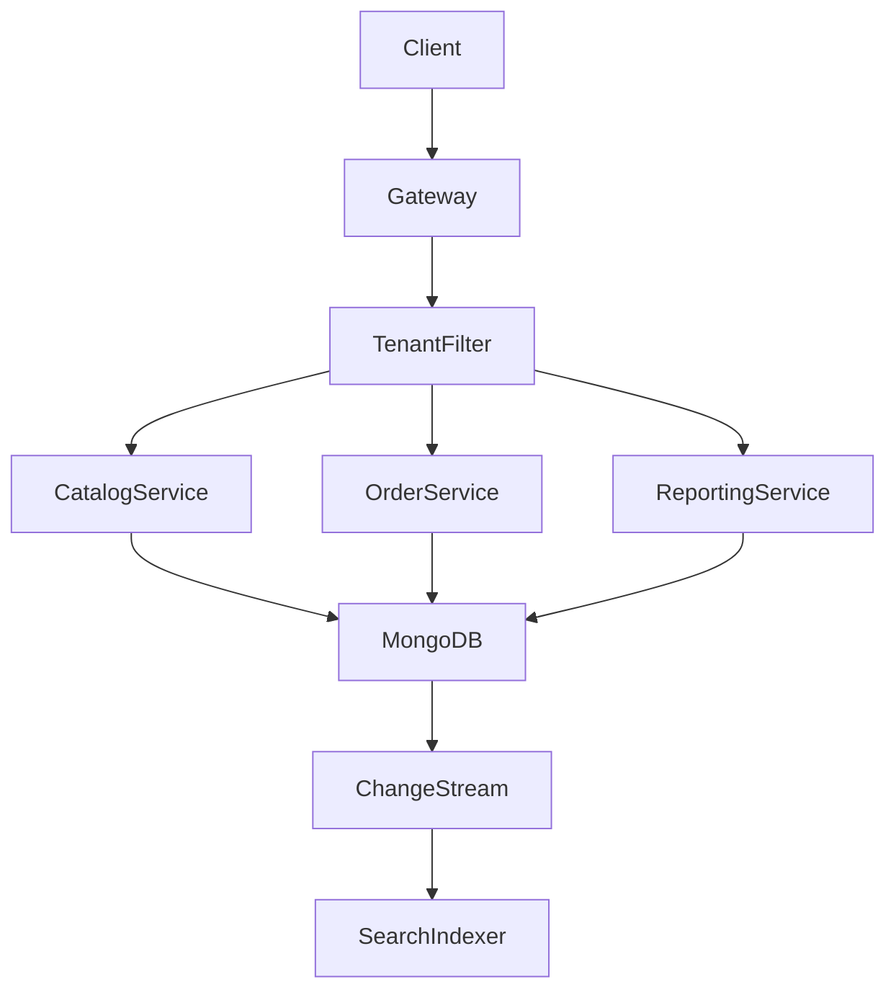

# 015 — System Design Scenarios (Boot 4.1.0 + Java 25, MongoDB 8)

> 11 end-to-end MongoDB system designs on one stack: requirements, data model + sample docs, API contract, queries, indexes, architecture, consistency, scaling, failure handling, monitoring, trade-offs.
>
> **Stack:** Spring Boot **4.1.0** · Java **25** · Spring Data MongoDB 5.x · MongoDB **8.x** · `mongo:8` replica set (transactions + change streams need `rs0`, even locally).
>
> **Conventions:** `com.commercemesh.*.document`, `Instant` UTC, `BigDecimal` money (`Decimal128` on the wire), `schemaVersion int` on every aggregate root. Snippets mirror repo style, **not compiled**.
>
> Companion guides: [006 — Data Modeling](./006-data-modeling-schema-design.md) · [008 — Indexing](./008-indexing-query-performance.md) · [010 — Replication/Sharding](./010-replication-sharding-advanced.md) · [013 — Product Catalog Example](./013-product-catalog-example.md) · [MongoDB Introduction](./mongodb.md).

## Table of Contents

- [1. How to Use These Scenarios](#1-how-to-use-these-scenarios-queries-first)
- [2. Product Catalog](#2-product-catalog-read-heavy-searchable)
- [3. Order Management](#3-order-management-1000s-of-items-pattern)
- [4. User Profiles + Preferences](#4-user-profiles--preferences)
- [5. Audit Logs](#5-audit-logs-append-only)
- [6. Event / Activity Feeds](#6-event--activity-feeds)
- [7. Multi-Tenant SaaS](#7-multi-tenant-saas-shared-collection-tenantid-design)
- [8. High-Volume Read API](#8-high-volume-read-api)
- [9. Analytics / Reporting](#9-analytics--reporting-pre-aggregated--merge)
- [10. Inventory Updates](#10-inventory-updates-atomic-decrement)
- [11. Large-Scale Document Storage](#11-large-scale-document-storage-gridfs-boundary)
- [12. Time-Series](#12-time-series-bucket--metafield)
- [13. Cross-Scenario Cheat Sheet](#13-cross-scenario-cheat-sheet)
- [14. Pitfalls (GOLD)](#14-pitfalls-gold)
- [15. Interview Q&A](#15-interview-qa)
- [16. Resources](#16-resources)

---

## 1. How to Use These Scenarios (Queries First)

Every scenario follows the same 11-point contract so you can compare them: requirements + assumptions, data model + sample docs, API contract, query patterns, index design, architecture, consistency/TX, scaling, failure handling, monitoring, trade-offs.
Design rule from [006](./006-data-modeling-schema-design.md): list queries first, group by access-together, size the working set, draw the aggregate boundary, then pick embed / reference / duplicate. Prove hot queries with `explain("executionStats")` ([008](./008-indexing-query-performance.md)) and place each workload on the right topology ([010](./010-replication-sharding-advanced.md)).

```java
// Header template (copy per aggregate):
// Q1 getById (QPS, p95, projection) | Q2 list/filter (sort, page size)
// W1 write (frequency, atomicity) | Size: avg KB, growth/week, TTL?
// Verdict: embed | reference | bucket | duplicate + staleness bound.
```

---

## 2. Product Catalog (Read-Heavy, Searchable)

**Requirements + assumptions:** 2M SKUs, 5k QPS reads / 20 QPS writes (250:1), p95 < 60 ms PDP, keyword + faceted browse, ≤ 60 s rating staleness OK. Replica set; working set fits RAM; search stays in MongoDB until relevance demands Atlas Search/ES.
**Data model + sample docs:** `products` (sellable snapshot) + `categories` (materialized-path tree). Never embed reviews/orders; keep rollups only ([006](./006-data-modeling-schema-design.md) §4, [013](./013-product-catalog-example.md) §3).

```json
{
  "_id": "prod_aur_hp_001", "sku": "AUR-HP-001", "name": "Aurora Wireless Headphones",
  "description": "Over-ear ANC headphones, 40h battery", "brand": "Aurora",
  "price": { "$numberDecimal": "199.00" }, "currency": "USD",
  "categoryId": "cat_audio_hp", "categoryPath": "/electronics/audio/headphones",
  "tags": ["wireless", "anc", "over-ear"], "attributes": { "color": "black", "batteryHrs": "40" },
  "averageRating": 4.6, "reviewCount": 1284, "topReviews": [{ "userId": "u_91", "rating": 5, "title": "Great ANC" }],
  "stock": 412, "isActive": true, "isFeatured": false, "schemaVersion": 2,
  "createdAt": { "$date": "2026-03-01T10:00:00Z" }, "updatedAt": { "$date": "2026-10-01T12:00:00Z" }
}
```
```json
{ "_id": "cat_audio_hp", "slug": "headphones", "name": "Headphones", "parentId": "cat_audio", "path": "/electronics/audio/headphones", "depth": 3, "sortOrder": 4, "isActive": true }
```

**API contract:**
| Method | Path | Result |
|---|---|---|
| `GET` | `/api/v1/products/{id}` | 200 PDP projection, 404 unknown |
| `GET` | `/api/v1/products?category={id}&sort=price&pageToken=` | 200 cursor page, 400 bad sort |
| `GET` | `/api/v1/products/search?q=anc&brand=` | 200 scored, 400 empty query |
| `POST` | `/api/v1/products` | 201, 409 on `sku` conflict |
**Query patterns:**
```java
Optional<Product> findBySku(String sku);
Page<Product> findByCategoryIdAndIsActiveTrue(String categoryId, Pageable p);
// MongoTemplate: Criteria categoryId + price range + sort + _id tiebreaker; TextCriteria for search.
```
**Index design:**
```javascript
db.products.createIndex({ sku: 1 }, { unique: true });
db.products.createIndex({ categoryId: 1, price: 1, _id: 1 });
db.products.createIndex({ name: "text", description: "text", brand: "text", tags: "text" });
db.products.createIndex({ isFeatured: 1, averageRating: -1 }, { partialFilterExpression: { isActive: true } });
db.categories.createIndex({ slug: 1 }, { unique: true });
db.categories.createIndex({ path: 1 });
```
**Architecture:** `Controller (validation) → ProductService → Repository / MongoTemplate → MongoDB 8 (primary, nearest for geo)` + async rating rollup via change stream ([013](./013-product-catalog-example.md) §2).
**Consistency / TX:** Single-doc atomicity only. Orders store an immutable price snapshot; rating rollup eventual (≤ 60 s). No multi-doc TX on reads.
**Scaling:** Vertical + secondary reads to ~5k QPS. Shard past ~500 GB / ~10k ops/s ([010](./010-replication-sharding-advanced.md) §8) on hashed `categoryId` or ranged `sku`.
**Failure handling:** `DuplicateKeyException → 409`; nightly rollup reconcile; prefix-regex fallback while text index rebuilds.
**Monitoring:** IXSCAN rate via `explain()`, text-index size, rollup lag, cache hit ratio, slow-log > 100 ms.
**Trade-offs:** Denormalized path + rollups = fast PDP but writers + staleness. Text index = zero-ops search, weaker relevance, one per collection.

---

## 3. Order Management (1000s-of-Items Pattern)

**Requirements + assumptions:** B2B orders with 500–2,400 lines, 200 QPS `getById`, 80 QPS `listByCustomer`, 20 QPS placements. 16 MiB hard limit; page 1 in 1 fetch; lines immutable after confirm. Canonical 1-squillions case ([006](./006-data-modeling-schema-design.md) §5).
**Data model + sample docs:** Summary-embed + pages-reference. `orders` holds header + totals + first lines; `order_item_pages` holds 100-line buckets keyed `(orderId, page)`.

```json
{
  "_id": "ord_2026_88121", "orderNo": "ORD-2026-88121", "customerId": "cust_acme_07",
  "status": "CONFIRMED", "currency": "USD", "subtotal": { "$numberDecimal": "48210.00" },
  "tax": { "$numberDecimal": "3856.80" }, "total": { "$numberDecimal": "52066.80" },
  "lineCount": 1240, "pageCount": 13,
  "firstLines": [
    { "sku": "AUR-HP-001", "name": "Aurora Headphones", "qty": 40, "unitPrice": { "$numberDecimal": "199.00" } },
    { "sku": "USB-C-65W", "name": "65W GaN Charger", "qty": 200, "unitPrice": { "$numberDecimal": "29.00" } }],
  "shipping": { "name": "Acme HQ", "city": "Austin", "zip": "78701" },
  "schemaVersion": 2, "createdAt": { "$date": "2026-10-10T14:00:00Z" }
}
```
```json
{ "_id": "ordpage_88121_01", "orderId": "ord_2026_88121", "page": 1, "lines": [{ "sku": "HDMI-2M", "qty": 500, "unitPrice": { "$numberDecimal": "9.50" } }], "schemaVersion": 2 }
```

**API contract:**
| Method | Path | Result |
|---|---|---|
| `POST` | `/api/v1/orders` | 201 (TX), 409 replay, 422 no stock |
| `GET` | `/api/v1/orders/{id}?page=0` | 200 header + page |
| `GET` | `/api/v1/orders?customerId=&pageToken=` | 200 cursor page |
| `POST` | `/api/v1/orders/{id}/cancel` | 200 / 409 already shipped |
**Query patterns:**
```java
Optional<Order> findById(String id);
List<Order> findByCustomerIdOrderByCreatedAtDesc(String customerId, Pageable p);
List<OrderItemPage> findByOrderIdOrderByPageAsc(String orderId);
// @Transactional placeOrder(): stock + order + pages + idempotency key atomically.
```
**Index design:**
```javascript
db.orders.createIndex({ customerId: 1, createdAt: -1, _id: 1 });
db.orders.createIndex({ orderNo: 1 }, { unique: true });
db.orders.createIndex({ status: 1, createdAt: -1 });
db.order_item_pages.createIndex({ orderId: 1, page: 1 }, { unique: true });
```
**Architecture (order flow):**

**Consistency / TX:** One multi-doc TX at placement (`majority`). After confirm lines immutable; status via `@Version` optimistic locking ([013](./013-product-catalog-example.md) §12–§13).
**Scaling:** Headers < 32 KB keep working set small. Pages shard on hashed `orderId`; deep pages range-paginated, never `skip()`.
**Failure handling:** Idempotency key (unique + TTL) makes retries safe; conditional `$gte` stock guard → 422; outbox retries with backoff, DLQ after N attempts.
**Monitoring:** TX abort rate, placement p95, page fan-out count, oversell 422s, outbox lag, `lineCount` p99 (resize pages if > 2k).
**Trade-offs:** 1-fetch page 1 + bounded docs vs two-collection deep reads + TX cost. Single-giant-doc is simpler until 16 MiB kills the biggest customer.

---

## 4. User Profiles + Preferences

**Requirements + assumptions:** 10M users, 1k QPS reads, 100 QPS pref writes, p95 < 30 ms. Identity + address + prefs read-together; secrets/history read-alone. GDPR erasure required.
**Data model + sample docs:** Embed small/lifecycle-bound (address, prefs); reference unbounded (sessions, consent history) ([006](./006-data-modeling-schema-design.md) §3).

```json
{
  "_id": "u_91", "email": "sam@example.com", "displayName": "Sam",
  "defaultAddress": { "line1": "1 Main St", "city": "Austin", "zip": "78701", "country": "US" },
  "prefs": { "locale": "en-US", "theme": "dark", "marketingOptIn": false },
  "roleIds": ["buyer"], "isActive": true, "schemaVersion": 2,
  "createdAt": { "$date": "2025-06-01T09:00:00Z" }, "updatedAt": { "$date": "2026-10-12T08:00:00Z" }
}
```
```json
{ "_id": "sess_abc", "userId": "u_91", "refreshHash": "argon2$...", "expiresAt": { "$date": "2026-10-20T00:00:00Z" }, "revoked": false }
```

**API contract:**
| Method | Path | Result |
|---|---|---|
| `GET` | `/api/v1/users/{id}` | 200 projection, 404 unknown |
| `PATCH` | `/api/v1/users/{id}/prefs` | 200 merged prefs |
| `DELETE` | `/api/v1/users/{id}` | 202 erasure scheduled |
**Query patterns:**
```java
Optional<User> findByEmail(String email);
Optional<User> findByIdAndIsActiveTrue(String id);
// Partial: updateFirst(set("prefs.theme", "light")) — never rewrite whole doc.
```
**Index design:**
```javascript
db.users.createIndex({ email: 1 }, { unique: true, partialFilterExpression: { isActive: true } });
db.users.createIndex({ updatedAt: -1 });
db.user_sessions.createIndex({ userId: 1, expiresAt: 1 });
db.user_sessions.createIndex({ expiresAt: 1 }, { expireAfterSeconds: 0 });
```
**Architecture:** `UserService → users` (primary) + `user_sessions` (TTL) + erasure worker. Argon2 hashes isolated in `user_credentials`, never in profile projection.
**Consistency / TX:** Single-doc `$set` patches; no TX. Erasure is a saga: anonymize → revoke sessions → downstream tombstones via outbox.
**Scaling:** Secondaries + Redis (`user:{id}`, 5-min TTL, evict on PATCH). Shard hashed `email` only past ~500 GB.
**Failure handling:** Unique-email race → 409; idempotent patch retries; resumable erasure cursor over `erasure_jobs`.
**Monitoring:** PATCH p95, cache hit ratio, TTL lag, erasure SLA, 409 rate.
**Trade-offs:** Embedded prefs = 1-fetch profile, tiny rewrites. Separate credentials = extra login lookup but least-privilege + clean TTL.

---

## 5. Audit Logs (Append-Only)

**Requirements + assumptions:** 50k appends/day, rare reads (investigations/exports), 7-year retention, tamper-evidence, never update/delete in place. Secondary reads OK.
**Data model + sample docs:** One immutable event per doc; `$jsonSchema` blocks updates at the DB layer.

```json
{
  "_id": "aud_9f31", "tenantId": "t_acme", "actorId": "u_91", "action": "ORDER_REFUND",
  "entityType": "order", "entityId": "ord_2026_88121",
  "before": { "status": "CONFIRMED" }, "after": { "status": "REFUNDED" },
  "ip": "203.0.113.7", "hashChain": "sha256:prev+body", "immutable": true,
  "createdAt": { "$date": "2026-10-12T10:01:00Z" }
}
```

**API contract:**
| Method | Path | Result |
|---|---|---|
| `POST` | `/api/v1/audit/events` (internal) | 202 buffered |
| `GET` | `/api/v1/audit?entityId=&from=&to=` | 200 range page (compliance role) |
**Query patterns:**
```java
// Writes: insertOne only — no save(), no @Modifying update.
// Reads: findByEntityIdAndCreatedAtBetween(entityId, from, to, pageable)
```
**Index design:**
```javascript
db.audit_events.createIndex({ entityId: 1, createdAt: -1 });
db.audit_events.createIndex({ tenantId: 1, createdAt: -1 });
db.audit_events.createIndex({ action: 1, createdAt: -1 });
db.audit_events.createIndex({ createdAt: -1 }); // exports; cold-archive after 1y
```
**Architecture:** `Service → bounded queue → bulk inserter (ordered:false, 500/batch) → audit_events (moderate→strict)` → yearly cold export. App role has `insert + find` only.
**Consistency / TX:** No TX. At-least-once retryable inserts; hash-chain `H_n = sha256(H_{n-1} + body)` detects gaps on export.
**Scaling:** Time-partitioned collections (`audit_2026_q4`) or shard `{tenantId: 1, createdAt: 1}` past ~1 TB. Bulk keeps ingest p95 < 5 ms.
**Failure handling:** Queue absorbs downtime; dedupe via unique `eventId`; validation errors → DLQ, never dropped.
**Monitoring:** Insert lag, batch error rate, nightly chain-verify, GB/week, unauthorized-update attempts (= 0).
**Trade-offs:** One-doc-per-event = trivial appends, strong audit, high count. Capped rejected: silent drops + unshardable.

---

## 6. Event / Activity Feeds

**Requirements + assumptions:** 500 QPS fan-out writes, 2k QPS reads, p95 < 50 ms, 30-day hot window, per-user `seq` ordering. Push + pull fallback. Replica set + change streams.
**Data model + sample docs:** `activities` (immutable truth) + `feed_items` (per-user fan-out, 30-d TTL). Never `$push` into a user doc ([006](./006-data-modeling-schema-design.md) §9).

```json
{ "_id": "act_551", "actorId": "u_91", "verb": "ordered", "objectType": "product", "objectId": "prod_aur_hp_001", "createdAt": { "$date": "2026-10-12T11:00:00Z" } }
```
```json
{ "_id": "feed_u77_act551", "userId": "u_77", "activityId": "act_551", "seq": 10421, "seen": false, "createdAt": { "$date": "2026-10-12T11:00:01Z" } }
```

**API contract:**
| Method | Path | Result |
|---|---|---|
| `GET` | `/api/v1/feed?cursor=&limit=20` | 200 newest-first, cursor = `seq` |
| `POST` | `/api/v1/feed/{id}/seen` | 200 idempotent |
**Query patterns:**
```java
List<FeedItem> findByUserIdAndSeqLessThanOrderBySeqDesc(String userId, long cursor, Pageable p);
// Bulk fan-out inserts (ordered:false); reads range on (userId, seq), never skip().
```
**Index design:**
```javascript
db.feed_items.createIndex({ userId: 1, seq: -1 });
db.feed_items.createIndex({ userId: 1, seen: 1, seq: -1 });
db.feed_items.createIndex({ createdAt: 1 }, { expireAfterSeconds: 2592000 });
db.activities.createIndex({ actorId: 1, createdAt: -1 });
```
**Architecture (fan-out):**

**Consistency / TX:** Eventual (≤ 2 s). No TX; resume token persisted per batch so crashes resume gap-free.
**Scaling:** Normal authors push; celebrities (> 10k followers) pull-hybrid (read-time merge). Shard `feed_items` on hashed `userId` when hot.
**Failure handling:** Crash → replay from token; `_id = userId+activityId` absorbs dupes; spikes shed to pull mode + rate-limit.
**Monitoring:** Fan-out lag p95, items/activity histogram, TTL delete rate, resume age, feed-empty rate.
**Trade-offs:** Push = fast reads + write amplification; pull = cheap writes + slow reads. Hybrid by follower count; pure either fails at extremes.

---

## 7. Multi-Tenant SaaS (Shared-Collection `tenantId` Design)

**Requirements + assumptions:** 5k tenants (95% small / 5% large), isolation is a security invariant, 100× QPS spread, SOC2 logical separation suffices. Shared collection, `tenantId` first in every key.
**Data model + sample docs:** Every doc carries `tenantId`; uniques always compound with tenant.

```json
{ "_id": "inv_t_acme_1001", "tenantId": "t_acme", "sku": "AUR-HP-001", "qty": 412, "price": { "$numberDecimal": "199.00" }, "schemaVersion": 2, "updatedAt": { "$date": "2026-10-12T09:00:00Z" } }
```

**API contract:** Tenant from JWT/path, never body. `GET /api/v1/{tenant}/inventory/{sku}` → 200 / 404 (404 masks cross-tenant existence, never 403 on IDs).
**Query patterns:**
```java
// Base repo enforces tenant on EVERY query:
Optional<Doc> findByTenantIdAndSku(String tenantId, String sku);
// Template: where("tenantId").is(t).and("sku").is(sku) — no untenantized find().
```
**Index design:**
```javascript
db.inventory.createIndex({ tenantId: 1, sku: 1 }, { unique: true });
db.inventory.createIndex({ tenantId: 1, updatedAt: -1 });
db.inventory.createIndex({ tenantId: 1, categoryId: 1, price: 1 });
```
**Architecture:**

**Consistency / TX:** Per-tenant TX scope only; never cross-tenant. Large backfills batched with `tenantId` filter so small tenants keep p95.
**Scaling:** Shared cluster until noisy-neighbor pain; then zones/shard `{tenantId: 1, _id: 1}` + dedicated cluster for whales. Per-tenant gateway rate-limit.
**Failure handling:** Missing `tenantId` fails closed (400, never default tenant); CI isolation tests (B docs invisible to A); offboard = range delete + archive export.
**Monitoring:** Per-tenant QPS/latency/errors, missing-filter CI grep, largest-tenant GB share, slow queries by tenant.
**Trade-offs:** Shared = cheap ops + easy analytics but one bug can leak; DB-per-tenant = isolation but migration sprawl. Shared + enforced filter is the default ([006](./006-data-modeling-schema-design.md) §17).

---

## 8. High-Volume Read API

**Requirements + assumptions:** 20k QPS price reads, p95 < 25 ms, 99.9%, ≤ 10 s staleness OK. Java 25 virtual threads; MongoDB truth, Redis look-aside.
**Data model + sample docs:** §2 `products` shape served via projection (`sku, price, stock, v`) + `product_summaries` for hottest 1% SKUs.

```json
{ "_id": "prod_aur_hp_001", "sku": "AUR-HP-001", "price": { "$numberDecimal": "199.00" }, "stock": 412, "v": 18, "updatedAt": { "$date": "2026-10-12T12:00:00Z" } }
```

**API contract:** `GET /api/v1/prices/{sku}` → 200 (`ETag: W/"v18"`, `Cache-Control: max-age=10`) / 304 on `If-None-Match`.
**Query patterns:**
```java
// Covered projection — no full-doc fetch:
Query q = Query.query(Criteria.where("sku").is(sku));
q.fields().include("sku", "price", "stock", "v");
// @Cacheable(value = "price", key = "#sku", sync = true) + @CacheEvict on change.
```
**Index design:**
```javascript
db.products.createIndex({ sku: 1 });
db.products.createIndex({ sku: 1, price: 1, stock: 1 }); // covered read
```
**Architecture:** `CDN/edge (10 s) → API (virtual threads) → Redis (jittered TTL) → MongoDB primary/nearest` + change-stream invalidator. Sticky `sku → mongos` when sharded.
**Consistency / TX:** Eventual (≤ 10 s); `v` backs `ETag` so clients never regress. No TX on reads.
**Scaling:** Stateless API × N (`maxPoolSize` 50–100/node, [010](./010-replication-sharding-advanced.md) §17), Redis Cluster past ~50k QPS, secondaries/`nearest` for geo. Shard past sustained 10k ops/s or 500 GB.
**Failure handling:** `sync=true` single-flight + hedged read vs miss storms; stale-while-revalidate on failover; per-SKU rate-limit vs herds.
**Monitoring:** p50/p95/p99 by SKU decile, hit ratio (alert < 90%), single-flight wait, pool checkout latency, replication lag, non-IXSCAN count.
**Trade-offs:** Cache = p95 win + invalidation cost; covered projection = tiny IO + index RAM. Always-primary full docs is correct and slow.

---

## 9. Analytics / Reporting (Pre-Aggregated + `$merge`)

**Requirements + assumptions:** 100M order lines, dashboard p95 < 400 ms, freshness ≤ 15 min, slices by day × category × tenant. Per-request raw aggregation banned.
**Data model + sample docs:** `sales_daily` maintained incrementally via `$merge`; dashboards read only it.

```json
{ "_id": "t_acme_2026-10-12_audio", "tenantId": "t_acme", "day": { "$date": "2026-10-12T00:00:00Z" }, "categoryId": "cat_audio", "orders": 312, "units": 1840, "revenue": { "$numberDecimal": "214500.00" }, "updatedAt": { "$date": "2026-10-12T12:15:00Z" } }
```

**API contract:** `GET /api/v1/reports/sales?from=&to=&category=` → 200 from `sales_daily` (never `orders`); 422 if range > 90 d without export job.
**Query patterns:**
```java
List<SalesDaily> findByTenantIdAndDayBetween(String tenantId, Instant from, Instant to);
// Scheduled: $match new orders → $group by day+category → $merge into sales_daily.
```
```javascript
db.orders.aggregate([
  { $match: { createdAt: { $gte: ISODate("2026-10-12T12:00:00Z") } } },
  { $group: { _id: { day: { $dateTrunc: { date: "$createdAt", unit: "day" } }, categoryId: "$categoryId", tenantId: "$tenantId" }, orders: { $sum: 1 }, revenue: { $sum: "$total" } } },
  { $merge: { into: "sales_daily", on: "_id", whenMatched: "merge", whenNotMatched: "insert" } }
]);
```
**Index design:**
```javascript
db.sales_daily.createIndex({ tenantId: 1, day: -1 });
db.sales_daily.createIndex({ tenantId: 1, categoryId: 1, day: -1 });
db.orders.createIndex({ createdAt: 1, tenantId: 1 }); // incremental $match leg
```
**Architecture:** `orders (OLTP) → 15-min agg job (idempotent window) → $merge → sales_daily (serving)` → dashboard. Job reads secondary, writes `majority`.
**Consistency / TX:** Eventual (15-min). `$merge` atomic per doc; reruns idempotent (same `_id`); late events via previous-window reprocess.
**Scaling:** Add `sales_hourly` intraday, `sales_monthly` for year views. Shard serving coll `{tenantId: 1, day: 1}` past ~1 TB.
**Failure handling:** Checkpoint per window; merge-on-`_id` prevents dupes; `$jsonSchema` guards serving-coll drift.
**Monitoring:** Freshness lag (`now - max(day)`), `$merge` insert/modify counts, pipeline duration, stale-banner metric.
**Trade-offs:** Pre-agg = fast dashboards + staleness + pipeline to own. Live `$group` is fresh and too slow past ~1M docs.

---

## 10. Inventory Updates (Atomic Decrement)

**Requirements + assumptions:** 3k decrement QPS flash-sale peak, zero oversell, p95 < 40 ms. Single-doc atomicity suffices; TX would add latency.
**Data model + sample docs:** One doc per SKU×warehouse; conditional `$inc`; `@Version` for admin edits.

```json
{ "_id": "inv_aur_hp_001_dfw", "sku": "AUR-HP-001", "warehouse": "DFW", "qty": 412, "reserved": 18, "version": 44, "updatedAt": { "$date": "2026-10-12T12:00:00Z" } }
```

**API contract:** `POST /api/v1/inventory/{sku}/reserve {qty}` → 200 / 422 insufficient / 409 version conflict (admin set).
**Query patterns:**
```java
// Conditional decrement — the whole pattern:
UpdateResult r = mongoTemplate.updateFirst(
  Query.query(Criteria.where("sku").is(sku).and("qty").gte(qty)),
  new Update().inc("qty", -qty).inc("reserved", qty), Inventory.class);
if (r.getModifiedCount() == 0) throw new InsufficientStockException(sku);
```
**Index design:**
```javascript
db.inventory.createIndex({ sku: 1, warehouse: 1 }, { unique: true });
db.inventory.createIndex({ qty: 1 }); // low-stock scan
db.inventory.createIndex({ updatedAt: -1 }); // reconcile cursor
```
**Architecture:** `OrderService → inventory (updateFirst with qty guard)`; guard + update are one atomic op, so oversell is impossible. Compensating release on cancel.
**Consistency / TX:** Strong single-doc (`majority`); no multi-doc TX on hot path. Expiry worker returns stale `reserved → qty`.
**Scaling:** Contention is per-SKU: split hot SKU across warehouses (`DFW/AUS/LAX`). Shard hashed `sku` only at single-shard saturation.
**Failure handling:** `modifiedCount == 0` → 422 (never negative); retries deduped by idempotency key; crashed holder → TTL sweep.
**Monitoring:** 422 rate, CAS retries, sub-safety-stock alerts, expiry lag, per-SKU heatmap.
**Trade-offs:** Conditional `$inc` = correct + fast, no over-reserve. Warehouse-split = throughput + allocation logic. `stock_movements` log adds audit off-path.

---

## 11. Large-Scale Document Storage (GridFS Boundary)

**Requirements + assumptions:** Manuals/images/invoices 100 KB–2 GB, 500 QPS downloads / 50 QPS uploads, range resumes, virus-scan before publish. Rule: > 16 MiB never in a normal doc; binaries > ~5 MiB go to GridFS/object storage, never Base64.
**Data model + sample docs:** Metadata in `assets` + bytes in `fs.chunks` (or S3 key); MongoDB stores pointers, not bytes.

```json
{
  "_id": "asset_manual_aur_hp", "tenantId": "t_acme", "productId": "prod_aur_hp_001",
  "kind": "manual", "contentType": "application/pdf", "sizeBytes": 18432000, "storage": "gridfs",
  "filesId": "68f0a1b2c3d4e5f6a7b8c9d0", "sha256": "9f31…", "scanStatus": "CLEAN",
  "schemaVersion": 1, "createdAt": { "$date": "2026-10-01T09:00:00Z" }
}
```

**API contract:**
| Method | Path | Result |
|---|---|---|
| `POST` | `/api/v1/assets (multipart)` | 202 scanning, 413 over limit |
| `GET` | `/api/v1/assets/{id}/download (Range)` | 200/206 stream, 404 unscanned |
**Query patterns:**
```java
Optional<Asset> findByProductIdAndKind(String productId, String kind);
// GridFsTemplate.store(stream, name, meta) / getResource(fileId).
```
**Index design:**
```javascript
db.assets.createIndex({ productId: 1, kind: 1 });
db.assets.createIndex({ tenantId: 1, createdAt: -1 });
db.assets.createIndex({ sha256: 1 }); // dedupe
// fs.chunks / fs.files indexes are driver-managed — do not drop.
```
**Architecture:** `Client → AssetService → quarantine → scanner → GridFS/S3 → assets → CDN signed URL`. Bytes stream from storage, never via 16 MiB docs.
**Consistency / TX:** Eventual publish (`UPLOADING → CLEAN → LIVE`); no TX across storage + DB; nightly orphan sweep on unreferenced `filesId`.
**Scaling:** GridFS shards on `files_id`; past ~500 GB binaries prefer S3/GCS + CDN with MongoDB as metadata index. Default 255 KB chunks; raise for sequential media.
**Failure handling:** Chunked resume; scan-fail → `QUARANTINED` (never served); checksum mismatch → 422 + re-upload.
**Monitoring:** Upload/download p95, scan lag, orphan ratio, GB/week, CDN hit ratio, checksum failures.
**Trade-offs:** GridFS = single stack + backup weight; S3+pointer = infinite scale + two systems. Both beat Base64 (+33%, guarantees 16 MiB outage).

---

## 12. Time-Series (Bucket + `metaField`)

**Requirements + assumptions:** 100k points/min, 90-day hot + 2-year cold, p95 < 200 ms rollups, late points ≤ 1 h. Native time-series (MongoDB 8), not hand buckets unless custom granularity needed.
**Data model + sample docs:** One measurement per insert; engine buckets by `metaField` ([010](./010-replication-sharding-advanced.md) §13).

```javascript
db.createCollection("iot_readings", {
  timeseries: { timeField: "ts", metaField: "device", granularity: "seconds" },
  expireAfterSeconds: 7776000 // 90 d hot; cold-export older
});
```
```json
{ "ts": { "$date": "2026-10-12T12:00:05Z" }, "device": { "deviceId": "wh_dfw_03", "sku": "AUR-HP-001" }, "tempC": 21.4, "humidity": 44.1, "qtyOnHand": 412 }
```

**API contract:** `GET /api/v1/metrics?device=&from=&to=&rollup=5m` → 200 downsampled; 422 if raw range > 24 h (force rollup).
**Query patterns:**
```java
// Range + downsample ($dateTrunc + $avg/$max), never find-all:
Aggregation.newAggregation(match(where("device.deviceId").is(id).and("ts").gte(from).lt(to)), group(dateTrunc("ts", "5m")).avg("tempC"));
```
**Index design:**
```javascript
// Auto-index on (timeField, metaField); add secondary:
db.iot_readings.createIndex({ device: 1, ts: -1 });
```
**Architecture:** `Devices → ingest (batches 500–1k, ordered:false) → iot_readings (90-d TTL)` → `$merge` to `iot_hourly` (2-yr) → Grafana.
**Consistency / TX:** Eventual; late ≤ 1 h accepted, older to cold correction. No TX.
**Scaling:** ~10× compression vs flat docs. Shard hashed `device.deviceId` at ingest saturation; split hot (90 d) vs cold (warehouse).
**Failure handling:** Buffer absorbs downtime; reject `ts > now+5 min`; gap detector + device-spool backfill.
**Monitoring:** Ingest lag, bucket density, TTL/export gap, late-point rate, downsample p95, `metaField` cardinality.
**Trade-offs:** Native = compression + fast ranges but no in-place rewrite of old buckets + one `metaField` shape. Hand buckets = control + reimplemented engine.

---

## 13. Cross-Scenario Cheat Sheet

| Scenario | Hot Pattern | Index First Key | TX? | Shard Trigger |
|---|---|---|---|---|
| Catalog | `categoryId + price` + text | `sku!` | No | 500 GB / 10k ops |
| Orders 1-squillions | `(customerId, createdAt)` + `(orderId, page!)` | `orderNo!` | Placement only | Pages on `orderId` |
| Profiles | `email!` partial-active | `email!` | No | Rare |
| Audit | `(entityId, createdAt)` | range | No | Time-partition |
| Feeds | `(userId, seq desc)` range | `_id=user+act` | No | `userId` hashed |
| Multi-tenant | `(tenantId, …)` everywhere | `(tenantId, sku)!` | Per-tenant | `(tenantId, _id)` |
| Read API | covered `sku` | `sku` | No | Secondaries first |
| Analytics | `(tenantId, day)` serving | serving `_id` | No (`$merge`) | Serving coll |
| Inventory | conditional `$inc` | `(sku, wh)!` | No | Warehouses first |
| GridFS | metadata `(productId, kind)` | `sha256` dedupe | No | `files_id` / S3 |
| Time-series | `(device, ts)` + TTL | auto bucket | No | `deviceId` hashed |

`!` = unique. Every row assumes replica set + `majority` for money, secondaries/`nearest` for reads ([010](./010-replication-sharding-advanced.md) §5–§7).

### 13.1 Read/Write + Consistency Map

| Scenario | Read : Write | Freshness Bound | Consistency Model | Hot Collection |
|---|---|---|---|---|
| Catalog | 250 : 1 | 60 s (rollups) | Single-doc + eventual rollup | `products` |
| Orders | 14 : 1 | Strong at placement | Multi-doc TX, then immutable | `orders` + pages |
| Profiles | 10 : 1 | Immediate (own write) | Single-doc atomic patch | `users` |
| Audit | 1 : 50 | Seconds (buffered) | At-least-once + hash-chain | `audit_events` |
| Feeds | 4 : 1 | 2 s fan-out | Eventual, token-resumed | `feed_items` |
| Multi-tenant | Varies 100x | Immediate (own tenant) | Per-tenant TX scope | tenant collections |
| Read API | 1000 : 1 | 10 s (cached) | Eventual + `ETag` version | `products` projection |
| Analytics | 20 : 1 | 15 min window | Eventual, idempotent `$merge` | `sales_daily` |
| Inventory | 1 : 3 (peak writes) | Immediate | Single-doc linearizable | `inventory` |
| GridFS | 10 : 1 | Minutes (scan gate) | Eventual publish, sweep orphans | `assets` + `fs.chunks` |
| Time-series | 1 : 20 | Seconds–minutes | Eventual, late-window repair | `iot_readings` |

### 13.2 How Scenarios Combine in One System

A real commerce stack uses most of these at once — the patterns compose:

- **Catalog (§2) + Read API (§8):** same `products` shape; §2 is the model, §8 is the serving layer (projection + Redis + `ETag`) in front of it.
- **Orders (§3) + Inventory (§10):** placement TX decrements `inventory` with the conditional `$inc` from §10, then inserts header + pages from §3 plus an outbox row.
- **Profiles (§4) + Multi-tenant (§7):** add `tenantId` first to every `users` index (`(tenantId, email)` unique) when SaaS-ifying profiles; erasure saga stays per-tenant.
- **Audit (§5) + Orders/Inventory:** every placement, cancel, refund, and stock adjustment emits an audit event; hash-chain verification covers money movement end to end.
- **Feeds (§6) + Orders:** `OrderPlaced` / `OrderShipped` activities fan out to buyer + seller feeds via the §6 worker; celebrity-seller fallback applies to flash-sale merchants.
- **Analytics (§9) + Time-series (§12):** `sales_daily` serves business dashboards while `iot_hourly` serves ops dashboards; both use the same `$merge` incremental-window technique.
- **GridFS (§11) + Catalog (§2):** manuals/images attach to `productId` via `assets`; PDP returns metadata only, bytes stream from GridFS/S3/CDN.
- **Failure-mode reuse:** idempotency keys (§3, §10), outbox relay (§3), TTL sweeps (§4, §6, §12), and `explain()` gates ([008](./008-indexing-query-performance.md)) appear in nearly every row — learn them once.

### 13.3 Sharding Readiness Checklist

1. Secondaries + covered projections + Redis exhausted first ([010](./010-replication-sharding-advanced.md) §5, §8).
2. Shard key is tenant/device/order-local and present in every hot query (`tenantId`, `deviceId`, `orderId`, `userId`).
3. Unique constraints re-expressible with the shard key as prefix (or relaxed by design).
4. Chunks pre-split for the whale tenant/device; balancer window set off-peak.
5. Change-stream consumers and `$merge` jobs tested against `mongos` routing, not just replica set.

---

## 14. Pitfalls (GOLD)

1. **One giant order/product doc** → `BSONObjectTooLarge` on the biggest customer. Fix: summary-embed + pages/buckets from day one (§3, [006](./006-data-modeling-schema-design.md) §9).
2. **Deep `skip()` on feeds/history** → scans everything skipped. Fix: `(userId, seq)` / `(customerId, createdAt)` range cursors ([008](./008-indexing-query-performance.md)).
3. **Missing `tenantId` in one filter/index** → leak or COLLSCAN. Fix: tenant-first indexes + base-repo enforcement + isolation tests (§7).
4. **Multi-doc TX on hot counters/feeds** → latency + aborts. Fix: single-doc `$inc`/insert; TX only for placement/money (§10, [013](./013-product-catalog-example.md) §13).
5. **Live `$group` over 100M docs per dashboard hit** → p95 blowout. Fix: pre-aggregate + `$merge`, serving coll only (§9).
6. **Base64 blobs / > 16 MiB in JSON docs** → OOM + hard failures. Fix: GridFS/S3 + pointer, stream bytes (§11).
7. **Hand-rolled buckets before native time-series** → 10× storage + slow ranges. Fix: `timeField + metaField + granularity` first (§12, [010](./010-replication-sharding-advanced.md) §13).
8. **Sharding on day one** → jumbo chunks + scatter-gather. Fix: secondaries + covered queries first; shard past ~500 GB / ~10k ops/s ([010](./010-replication-sharding-advanced.md) §8–§10).
9. **No idempotency on orders/reserves** → double-charge on retry. Fix: `idempotency_keys` unique + TTL, `_id=user+activity` dedupe (§3, §10).
10. **TTL as precise expiry (OTP/sessions/holds)** → ~60 s sweeper holes. Fix: re-check on read + one lifetime per collection ([006](./006-data-modeling-schema-design.md) §19).

---

## 15. Interview Q&A

**Q1. Order with 2,400 lines — how do you avoid the 16 MiB limit without killing PDP latency?**
A: Summary-embed + pages-reference: `orders` keeps header, totals, shipping snapshot, and first lines for 1-fetch detail; `order_item_pages(orderId, page)` buckets hold 100 lines each with unique `(orderId, page)`. Placement is one TX (stock + header + pages); deep pages range-paginate. Header stays < 32 KB while 2,400 lines stay addressable — §3, [006](./006-data-modeling-schema-design.md) §5.

**Q2. Flash-sale inventory — TX or single-doc atomicity, and how do you prove no oversell?**
A: Single-doc conditional `$inc` (`qty >= requested` guard + update in one op); `modifiedCount == 0` → 422. TX would serialize hot-SKU throughput for no benefit. Split heat across warehouse docs, dedupe retries with idempotency keys, sweep expired reservations — §10.

**Q3. Shared-collection multi-tenancy — what enforces isolation, and when would you leave it?**
A: `tenantId` first in every filter and index (`(tenantId, sku)` unique), base-repository enforcement that fails closed, 404-masking on IDs, CI isolation tests. Leave it (DB-per-tenant / dedicated cluster) only for whale-tenant noise or compliance-mandated separation — §7, [006](./006-data-modeling-schema-design.md) §17.

**Q4. Dashboard over 100M order lines with p95 < 400 ms — live aggregation or pre-aggregation?**
A: Pre-aggregation: scheduled `$match` new window → `$group` by day × category × tenant → `$merge` into `sales_daily` on stable `_id` (idempotent reruns); dashboards query only the serving collection on `(tenantId, day)`. Live `$group` is fresh and too slow at scale; 15-min freshness + `$merge` counts + lag alerts make the trade explicit — §9.

---

## 16. Resources

**This track (read in order):**

- [006 — Data Modeling & Schema Design](./006-data-modeling-schema-design.md) — embed vs reference, 1-squillions, buckets, tenancy, TTL; modelling theory behind every scenario.
- [008 — Indexing & Query Performance](./008-indexing-query-performance.md) — ESR, multikey/text/partial/TTL, `explain()`, pagination cursors used in §2–§9.
- [010 — Replication, Sharding & Advanced Operations](./010-replication-sharding-advanced.md) — replica sets, shard keys, change streams, TTL/time-series/GridFS behind §6 and §11–§12.
- [013 — Product Catalog Example](./013-product-catalog-example.md) — runnable Boot 4.1.0 + Java 25 product/order code (documents, TX, `@Version`, Testcontainers) behind §2–§3.
- [MongoDB Introduction](./mongodb.md) — BSON, 16 MiB limit, replica sets, sharding, transactions primer.

**Official docs:**

- MongoDB 8.0 docs — Data modeling, time-series collections, GridFS, `$merge`, change streams, sharding.
- Spring Data MongoDB 5.x reference — `MongoTemplate`, repositories, transactions, auditing, converters.
- Spring Boot 4.1.0 reference — virtual threads, observability (Micrometer), Testcontainers support.
