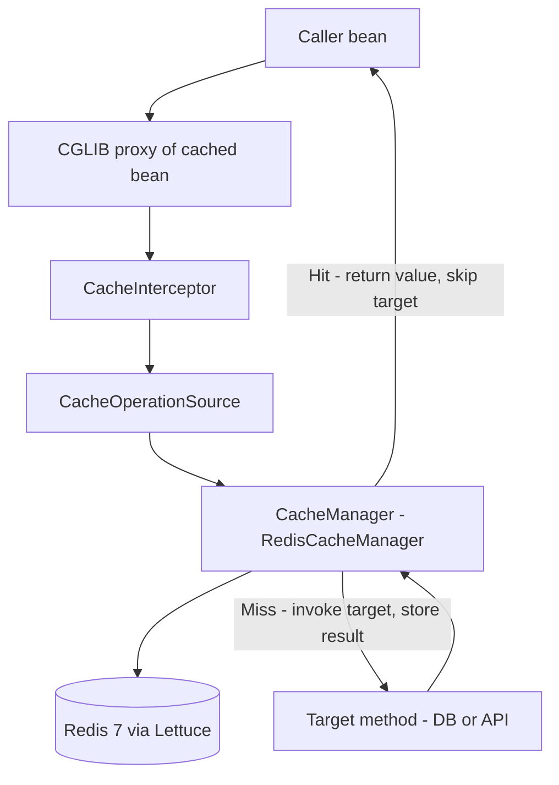
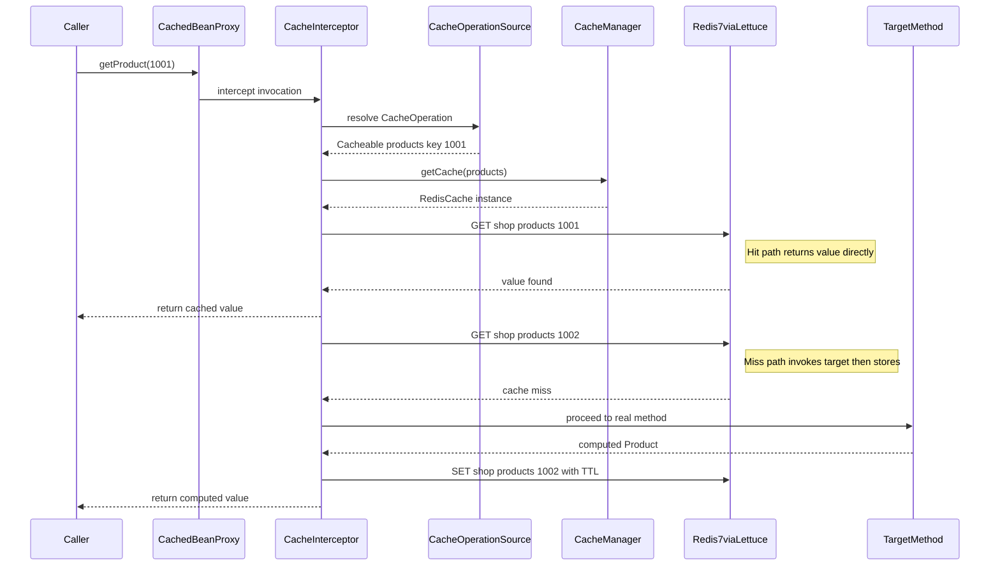

# 001 — Spring Cache Fundamentals

> **Baseline:** Spring Boot **4.1** + Java **25** + Spring Framework **7.x** + Redis **7.x**.
> Client: **Lettuce** (default in `spring-boot-starter-data-redis`, Netty-based, multiplexed async I/O).
> Scope: **Section A only** — fundamentals, abstraction vs provider, internals, flow, providers,
> `RedisTemplate`, local vs distributed, cache-aside, and AOP proxies. Setup lives in `./002-spring-boot-redis-setup.md`.

---

### What Is Spring Cache?

**WHAT:** Spring Cache is a **declarative caching abstraction** in Spring Framework
(`org.springframework.cache`, since 3.1). You annotate methods with `@Cacheable`, `@CachePut`,
`@CacheEvict`, `@Caching`, or `@CacheConfig`, enable it once with `@EnableCaching`, and Spring
adds caching without Redis or Caffeine APIs in your business code.

**WHY:** Without it every method repeats the same boilerplate: build a key, look it up, branch on
hit/miss, call the database, serialize, store with a TTL, handle eviction. That leaks infrastructure
into business logic and drifts between methods (key collisions, missing TTLs, stale reads). The
abstraction centralizes policy in annotations plus one `CacheManager` configuration.

```java
package com.example.shop.service;

import org.springframework.cache.annotation.Cacheable;
import org.springframework.stereotype.Service;

@Service
public class ProductService {

    // Intent only: "cache this by productId in 'products'". No Redis API here.
    @Cacheable(value = "products", key = "#productId")
    public Product getProduct(String productId) {
        return productRepository.findById(productId)
                .orElseThrow(() -> new ProductNotFoundException(productId));
    }
}
```

```java
package com.example.shop.config;

import org.springframework.cache.annotation.EnableCaching;
import org.springframework.context.annotation.Configuration;

@Configuration
@EnableCaching // Registers CacheInterceptor infrastructure (see AOP section)
public class CacheInfraConfig {
}
```

**Key idea:** Spring Cache answers *when and what* to cache. A **provider** answers *where and how*
bytes are stored (map, Caffeine, Redis, Hazelcast).

---

### Abstraction vs Redis vs Provider

**WHAT:** Three distinct layers. Confusing them is the most common beginner mistake.

**WHY:** "`@Cacheable` means Redis" is wrong. The annotation never touches the network. Redis never sees
your Java method. The provider bridges the two, and each layer can be swapped or tested independently.

| Layer | Role | Examples | Sees what? |
|---|---|---|---|
| **Abstraction** | Stable SPI + annotations: `Cache`, `CacheManager`, `CacheResolver`, `KeyGenerator`, `@Cacheable` / `@CacheEvict` / `@CachePut` | `CacheInterceptor`, `AnnotationCacheOperationSource` | Java methods, keys, cache names |
| **Provider** | Implements the SPI, stores bytes | `ConcurrentMapCacheManager`, `CaffeineCacheManager`, `RedisCacheManager`, `EhCacheCacheManager`, `HazelcastCacheManager` | Serialized keys/values, TTLs, eviction |
| **Redis** | Distributed infrastructure holding the bytes | Redis 7 standalone, primary-replica + Sentinel, Cluster | RESP commands (`GET`, `SET EX`, `DEL`) |

```java
package com.example.shop.config;

import java.time.Duration;
import org.springframework.context.annotation.Bean;
import org.springframework.context.annotation.Configuration;
import org.springframework.data.redis.cache.RedisCacheConfiguration;
import org.springframework.data.redis.cache.RedisCacheManager;
import org.springframework.data.redis.connection.RedisConnectionFactory;
import org.springframework.data.redis.serializer.GenericJackson2JsonRedisSerializer;
import org.springframework.data.redis.serializer.RedisSerializationContext;
import org.springframework.data.redis.serializer.StringRedisSerializer;

// Annotations stay untouched; swapping THIS bean swaps the provider.
@Configuration
public class RedisProviderConfig {

    @Bean
    public RedisCacheManager cacheManager(RedisConnectionFactory connectionFactory) {
        RedisCacheConfiguration defaults = RedisCacheConfiguration.defaultCacheConfig()
                .entryTtl(Duration.ofMinutes(10))
                .serializeKeysWith(RedisSerializationContext.SerializationPair
                        .fromSerializer(new StringRedisSerializer()))
                .serializeValuesWith(RedisSerializationContext.SerializationPair
                        .fromSerializer(new GenericJackson2JsonRedisSerializer()))
                .prefixCacheNameWith("shop::");
        return RedisCacheManager.builder(connectionFactory).cacheDefaults(defaults).build();
    }
}
```

**Mental model:** annotations declare *policy*; `CacheManager` resolves *which cache*; `Cache` does storage; Lettuce translates to RESP; Redis executes.

---

### Provider vs Abstraction — Who Owns What?

**WHAT:** The abstraction defines contracts; the provider fulfills them. Code depends only on the
contracts, so changing providers is a configuration change, not a rewrite.

**WHY:** This lets you start on `ConcurrentMapCache` in tests, use Caffeine on a single instance, and
switch to Redis when scaling horizontally — without touching `@Cacheable` methods.

| Concern | Abstraction owns? | Provider owns? |
|---|---|---|
| Cache name, key SpEL, `condition` / `unless` | Yes (`@Cacheable` attributes) | No |
| When to intercept (AOP pointcut) | Yes (`CacheInterceptor`) | No |
| Annotation parsing | Yes (`CacheOperationSource`) | No |
| Key/value serialization format | No | Yes (JDK, JSON, String) |
| TTL, null handling, key prefix | No (declared centrally) | Yes (`RedisCacheConfiguration`) |
| Eviction algorithm | No | Yes (Caffeine W-TinyLFU, Redis `maxmemory-policy`) |
| Replication, clustering, persistence | No | Yes (Sentinel / Cluster) |
| Threading, connection pooling | No | Yes (Lettuce multiplexing) |

> Swap rule: editing a `@Cacheable` method means an abstraction concern; editing only a
> `CacheManager` bean or `application.yml` means a provider concern.

---

### How Spring Cache Works Internally

**WHAT:** A call on a cached bean goes through a Spring AOP proxy to `CacheInterceptor`
(a `MethodInterceptor`). It asks `CacheOperationSource` what operation applies, resolves the `Cache`
via `CacheResolver` / `CacheManager`, builds the key via `KeyGenerator`, and invokes the target only
on a miss (for `@Cacheable`).

**WHY:** This chain explains every classic symptom: "never hits" (key mismatch), "annotation ignored"
(self-invocation bypasses the proxy), "stale data" (missing eviction), "slow first call then fast"
(cold miss, then warm hits).



1. Caller invokes `getProduct("1001")` on the **proxy**, not the raw bean.
2. Proxy delegates to `CacheInterceptor.invoke()`.
3. Interceptor fetches the `CacheOperation` from `AnnotationCacheOperationSource` (parsed once, cached).
4. `CacheResolver` turns `value = "products"` into `Cache` instances; SpEL or `KeyGenerator` builds the key.
5. **Hit:** `cache.get(key)` returns a value; interceptor returns it; target never runs.
6. **Miss:** interceptor calls `proceed()`, then `cache.put(key, result)` honoring `condition` / `unless`.
7. `@CachePut` always proceeds then updates; `@CacheEvict` removes before or after (`beforeInvocation`).

```java
package com.example.shop.service;

import org.springframework.cache.annotation.CacheEvict;
import org.springframework.cache.annotation.CachePut;
import org.springframework.cache.annotation.Cacheable;
import org.springframework.stereotype.Service;

@Service
public class PricingService {

    @Cacheable(value = "prices", key = "#sku", unless = "#result == null")
    public String priceOf(String sku) {
        return pricingClient.fetch(sku); // runs ONLY on miss
    }

    @CachePut(value = "prices", key = "#sku")
    public String refreshPrice(String sku) {
        return pricingClient.fetch(sku); // always runs, then overwrites entry
    }

    @CacheEvict(value = "prices", key = "#sku")
    public void dropPrice(String sku) {
    }
}
```

---

### Architecture and Request Flow — Hit vs Miss

**WHAT:** One `@Cacheable` call traced end to end: proxy to interceptor to manager to Lettuce to
Redis 7, with the hit path (fast, no target call) and the miss path (target runs, result stored).

**WHY:** Latency and correctness both live here. Hits must never touch the database. Misses must
populate exactly once per key. Evictions must remove the right entry. Seeing both paths makes timeouts,
serialization errors, and thundering-herd retries diagnosable.



| Path | Redis calls | Target runs? | Latency |
|---|---|---|---|
| Hit | One `GET` | No | Sub-ms to low ms |
| Miss | `GET` + work + `SET` with TTL | Yes | Full backend cost + two round trips |
| Null guarded (`unless`) | `GET` misses every time | Yes, every time | Avoids cache pollution |
| `@CacheEvict` | `DEL` before/after method | Depends on `beforeInvocation` | Invalidation only |

---

### Supported Cache Providers

**WHAT:** One `CacheManager` per storage technology. You pick the provider by declaring its bean or
starter; annotations stay identical.

**WHY:** Each trades simplicity, speed, capacity, and sharing differently. A local map suits tests but
is invisible to other instances. Redis is required once replicas must agree on cached state.

| Provider | `CacheManager` | Storage | When to choose | Watch out |
|---|---|---|---|---|
| `ConcurrentMap` | `ConcurrentMapCacheManager` | JVM heap, per instance | Tests, local dev, tiny apps | No TTL natively, unbounded, not shared |
| **Caffeine** | `CaffeineCacheManager` | JVM heap, per instance | Single instance, bounded fast cache | Per-instance; stale across replicas |
| **EhCache 3 / JCache** | `JCacheCacheManager` | Heap + off-heap + disk | Existing EhCache setups, tiered storage | Heavier config; clustering needs Terracotta |
| **Redis** | `RedisCacheManager` | Distributed Redis 7 via Lettuce | Shared cache, larger-than-heap, TTL + persistence | Network hop, serialization, cold misses |
| **Hazelcast** | `HazelcastCacheManager` | Distributed grid | Peer-to-peer grid, compute-near-data | Cluster ops complexity |

```java
package com.example.shop.config;

import com.github.benmanes.caffeine.cache.Caffeine;
import java.time.Duration;
import org.springframework.cache.CacheManager;
import org.springframework.cache.caffeine.CaffeineCacheManager;
import org.springframework.context.annotation.Bean;
import org.springframework.context.annotation.Configuration;
import org.springframework.context.annotation.Profile;

// Same @Cacheable methods under every profile — only the manager changes.
@Configuration
public class ProviderSelectionConfig {

    @Bean
    @Profile("single")
    public CacheManager caffeineManager() {
        CaffeineCacheManager manager = new CaffeineCacheManager("products", "prices");
        manager.setCaffeine(Caffeine.newBuilder()
                .maximumSize(10_000)
                .expireAfterWrite(Duration.ofMinutes(5)));
        return manager;
    }
}
```

---

### Spring Cache vs RedisTemplate

**WHAT:** Both ship with Spring Data Redis at different levels. Spring Cache is **declarative**
(annotate intent); `RedisTemplate` is **programmatic** (issue commands yourself).

**WHY:** Use the abstraction for uniform method-result caching. Drop to `RedisTemplate` for data
structures, atomic counters, locks, streams, or Lua scripts the annotations cannot express.

| Dimension | Spring Cache (`@Cacheable` + `RedisCacheManager`) | `RedisTemplate` / `StringRedisTemplate` |
|---|---|---|
| Style | Declarative annotation | Manual GET / SET logic |
| Hit/miss branching | Automatic in `CacheInterceptor` | Manual null checks |
| Key/TTL policy | Centralized in `RedisCacheConfiguration` | Per call site (flexible, drifts) |
| Structures | Opaque values only | Hashes, lists, sets, zsets, streams, bitmaps |
| Atomics / Lua / locks | Not available | `increment`, `SessionCallback`, `SET NX PX` |
| Best for | "Cache this result for 10 minutes" | Counters, queues, leaderboards, rate limiters |

```java
package com.example.shop.service;

import java.time.Duration;
import org.springframework.data.redis.core.StringRedisTemplate;
import org.springframework.stereotype.Service;

// Lower level: explicit commands, explicit TTL, explicit miss handling.
@Service
public class ViewCounterService {

    private final StringRedisTemplate redis;

    public ViewCounterService(StringRedisTemplate redis) {
        this.redis = redis;
    }

    public long recordView(String productId) {
        Long views = redis.opsForValue().increment("views:product:" + productId);
        redis.expire("views:product:" + productId, Duration.ofDays(30));
        return views == null ? 0L : views;
    }
}
```

> Rule of thumb: `@Cacheable` for read-through method caching; `RedisTemplate` when you need Redis as
> a data-structure server, not just a result store.

---

### Spring Cache (Redis) vs Caffeine and Local Caches

**WHAT:** Caffeine caches inside one JVM heap. Redis-backed Spring Cache stores outside the JVM,
reachable from every replica via Lettuce.

**WHY:** Local hits are faster (no network) but diverge: instance A holds a stale price while B
already refreshed. Redis trades one network hop for one shared truth, which horizontal scaling needs.

| Dimension | Caffeine / local | Spring Cache + Redis 7 |
|---|---|---|
| Hit latency | Nanos to micros (in-process) | Sub-ms to low ms (network + serialization) |
| Shared across replicas | No, per-instance copy | Yes, same keyspace |
| Capacity | Bounded by heap (GC pressure) | Bounded by Redis memory + `maxmemory-policy` |
| Eviction | Size + expire-after-write/access (W-TinyLFU) | TTL + `allkeys-lru` / `volatile-lfu` |
| Restart | Cold every deploy | Warm if Redis persists (RDB/AOF) |
| Invalidation | Broadcast or accept drift | Single `DEL` visible to all readers |

Many teams combine both: Caffeine as L1 (seconds TTL) in front of Redis as L2 (minutes TTL) via a
`CompositeCacheManager` or two-level `Cache` — at the cost of two TTLs and two invalidation paths.

---

### Local vs Distributed Cache

**WHAT:** Local state lives in the application process; distributed state lives in Redis, shared by
every process.

**WHY:** The choice sets the consistency story. Local forces per-instance staleness or an invalidation
bus. Distributed centralizes invalidation (`DEL` once, visible everywhere) but adds network,
serialization, and availability dependencies.

| Question | Prefer local (Caffeine) | Prefer distributed (Redis 7) |
|---|---|---|
| Replicas? | One | Two or more |
| Staleness tolerance? | Brief staleness OK (short TTL) | Must invalidate now (prices, inventory) |
| Dataset size? | Fits in heap | Larger than heap or must survive restarts |
| Failure blast radius? | One instance goes cold | Redis outage affects all (fallback to origin) |

```yaml
# application.yml — Boot 4.1 Lettuce client (Redis provider only; local needs no client)
spring:
  data:
    redis:
      host: localhost
      port: 6379
      timeout: 2000ms
```

---

### Cache-Aside Pattern and Its Relationship to Spring Cache

**WHAT:** Cache-aside (lazy loading) means the application owns population: read the cache first; on
miss read the source of truth, write the result into the cache with a TTL, and return it. Writes go to
the database plus explicit cache invalidation or update.

**WHY:** It caches only what is requested (no wasted warm-up), survives cache loss (misses repopulate),
and keeps the database as the system of record. The price is first-request miss latency plus TTL and
invalidation discipline against stale reads.

Read path: application to cache lookup to hit (return value) or miss (load DB to populate with TTL to return fresh). Write path: write DB first, then evict or update the entry.

**Relationship:** `@Cacheable` *is* cache-aside automated by AOP. `@CachePut` is the populate step.
`@CacheEvict` is the invalidation step. Spring Cache does **not** do read-through / write-through or
write-behind — the database call is always your method body.

| Cache-aside step | Spring Cache equivalent | Notes |
|---|---|---|
| Lookup first | `CacheInterceptor` to `cache.get(key)` | Skips target on hit |
| Load on miss | `proceed()` to your repository | Your DB / API call |
| Populate with TTL | `cache.put` via `entryTtl` | Honors `unless` (skip nulls) |
| Invalidate on write | `@CacheEvict` / `@CachePut` | Pick `beforeInvocation` deliberately |
| Stale-read bound | `entryTtl` + explicit eviction | Short TTL or event-driven evict |

```java
package com.example.shop.service;

import org.springframework.cache.annotation.CacheEvict;
import org.springframework.cache.annotation.Cacheable;
import org.springframework.stereotype.Service;

// Declarative cache-aside: reads populate lazily, writes invalidate explicitly.
@Service
public class CatalogService {

    @Cacheable(value = "catalog", key = "#id")
    public CatalogEntry get(String id) {
        return catalogRepository.load(id); // runs ONLY on miss
    }

    @CacheEvict(value = "catalog", key = "#entry.id")
    public void update(CatalogEntry entry) {
        catalogRepository.save(entry); // DB first, then evict (default after invocation)
    }
}
```

---

### AOP Proxy Processing — CacheInterceptor, CacheOperationSource, proxyTargetClass, Limits

**WHAT:** Caching is Spring AOP around advice. A proxy wraps each bean with cache operations; the
proxy's `CacheInterceptor` runs instead of or around the target method.

**WHY:** Every "annotation silently ignored" incident is a proxy incident. If the call never passes
through the proxy, the interceptor never runs — with zero errors logged.

- `CacheInterceptor` (`org.springframework.cache.interceptor.CacheInterceptor`): hit/miss/put/evict
  logic, registered by `ProxyCachingConfiguration` once `@EnableCaching` is present.
- `CacheOperationSource` (default `AnnotationCacheOperationSource`): parses `@Cacheable` / `@CachePut` /
  `@CacheEvict` plus `@CacheConfig` defaults into `CacheOperation` metadata, cached per method.
- `proxyTargetClass` (default **`true`** since Boot 2.0, incl. 4.1): `true` forces CGLIB subclass
  proxies (no interface needed); `false` allows JDK dynamic proxies for interface methods only. Set via
  `@EnableCaching(proxyTargetClass = ...)` or `spring.aop.proxy-target-class`.

```java
package com.example.shop.service;

import org.springframework.cache.annotation.Cacheable;
import org.springframework.context.annotation.Lazy;
import org.springframework.stereotype.Service;

@Service
public class OrderService {

    @Cacheable(value = "products", key = "#id")
    public String getProduct(String id) {
        return "product-" + id; // expensive lookup stands in here
    }

    // BROKEN: self-invocation bypasses the proxy — cache never consulted.
    public String brokenBatch(String id) {
        return this.getProduct(id);
    }
}

// FIX: call through the injected proxy so the interceptor runs.
@Service
class FixedOrderService {

    private final FixedOrderService self;

    FixedOrderService(@Lazy FixedOrderService self) {
        this.self = self;
    }

    @Cacheable(value = "products", key = "#id")
    public String getProduct(String id) {
        return "product-" + id;
    }

    public String fixedBatch(String id) {
        return self.getProduct(id); // through CGLIB proxy -> CacheInterceptor runs
    }
}
```

**Limit 1 — self-invocation bypasses the proxy.** `this.cachedMethod()` never leaves the target, so no
lookup happens. Fix with self-injection (`@Lazy`), or moving the method to another bean.

**Limit 2 — `private` methods are never intercepted.** Spring AOP proxies only visible method
executions. Annotating `private` silently does nothing.

**Limit 3 — `final` classes / methods cannot be advised with CGLIB.** A `final` class cannot be
subclassed; a `final` method cannot be overridden, so the proxy has nowhere to install the
interceptor. Keep cached methods non-final, or extract an interface.

> Proxy creation, advisor matching, and JDK-vs-CGLIB internals are traced in `../spring-aop/015-how-aop-works-internally.md`. Caching reuses that machinery with `CacheInterceptor` as the advice.

---

> **Pitfalls — read before shipping to production**
>
> - **Self-invocation:** `this.cachedMethod()` skips the proxy; call through the injected proxy.
> - **`private` / `final`:** never cached under Spring AOP; keep cached methods visible and non-final.
> - **No TTL:** entries can live forever; always set `entryTtl` plus per-cache overrides.
> - **Null pollution:** use `unless = "#result == null"` or `disableCachingNullValues()`.
> - **Key collisions:** methods sharing one cache name need explicit `key` SpEL plus a name prefix.
> - **Serialization drift:** prefer JSON over JDK serialization for version tolerance.
> - **Stale reads:** every write path needs `@CacheEvict` / `@CachePut`; the cache never watches the DB.
> - **Redis down:** size Lettuce timeouts/pools; decide fallback (fail open to DB vs fail fast).

---

## Interview Q&A

**Q1:** What is Spring Cache, and how does it differ from Redis itself?
**A:** Spring Cache is a declarative method-level abstraction (annotations plus `Cache` / `CacheManager`
SPI) deciding when and what to cache, while Redis is a distributed in-memory server holding bytes. The
bridge is a provider such as `RedisCacheManager` on Lettuce and Redis 7.

**Q2:** How does a `@Cacheable` call flow on hit vs miss?
**A:** The caller hits the CGLIB proxy, which delegates to `CacheInterceptor`. It resolves the operation
from `CacheOperationSource`, gets the `RedisCache`, and issues a `GET`. On hit it returns without running
the target; on miss it proceeds to the target, stores via `SET` with TTL, and returns.

**Q3:** Why is `@Cacheable` sometimes silently ignored?
**A:** Proxy bypass: self-invocation (`this.method()`), a `private` method, or a `final` class/method
CGLIB cannot override. The call never reaches `CacheInterceptor`. Fix with self-injection, visible
non-final methods, or moving the method to another bean.

**Q4:** When would you choose Redis over Caffeine, and what do you give up?
**A:** Choose Redis when replicas must share state, data exceeds heap, or entries must survive restarts;
one `DEL` invalidates all readers. You pay a network hop plus serialization per hit and own Redis
availability, Lettuce tuning, and key/TTL design.

**Q5:** How does Spring Cache relate to cache-aside, and what do you still own?
**A:** `@Cacheable` automates cache-aside: lookup, load on miss, populate with TTL. You still own keys,
TTLs, null guards (`unless`), invalidation on every write (`@CacheEvict` / `@CachePut`), and staleness
bounds — the cache never observes the database by itself.

---

## Resources

- Next step — Boot 4.1 + Lettuce + Redis 7 setup: `./002-spring-boot-redis-setup.md`
- AOP proxy internals behind `CacheInterceptor`: `../spring-aop/015-how-aop-works-internally.md`
- Redis concepts, data types, operations: `./redis.md`
- Official docs:
  - [Spring Framework — Cache Abstraction](https://docs.spring.io/spring-framework/reference/integration/cache.html)
  - [Spring Data Redis](https://docs.spring.io/spring-data/redis/reference/)
  - [Redis 7 Documentation](https://redis.io/docs/latest/)
  - [Lettuce Reference](https://lettuce.io/core/release/reference/)
