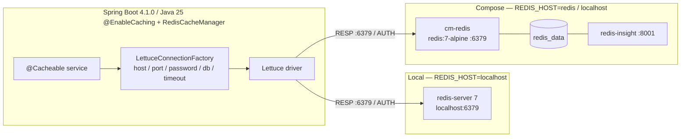

# 002 — Spring Boot Redis Setup (Boot 4.1.0 + Java 25, Redis 7, Lettuce)

> Section B of the Spring Redis track: connect a Boot 4.1.0 app to Redis 7 over Lettuce,
> enable Redis-backed caching, externalize config via env vars, and verify end to end
> across local, `docker run`, and Compose topologies.
>
> Companion guides: [001 — Spring Cache Fundamentals](./001-spring-cache-fundamentals.md) ·
> [004 — Redis Cache Configuration](./004-redis-cache-configuration.md) ·
> [013 — Spring Boot Actuator](../spring-introduction/013-spring-actuator.md).

## Table of Contents

- [1. Prerequisites](#1-prerequisites)
- [2. Dependencies — Maven and Gradle](#2-dependencies--maven-and-gradle)
- [3. Auto-Configuration](#3-auto-configuration)
- [4. Enabling Caching with `@EnableCaching`](#4-enabling-caching-with-enablecaching)
- [5. Full `application.yml`](#5-full-applicationyml)
- [6. Every Property Explained](#6-every-property-explained)
- [7. Run Redis Locally](#7-run-redis-locally)
- [8. `docker run` — One-Off Redis](#8-docker-run--one-off-redis)
- [9. Full `docker-compose` — Redis + RedisInsight](#9-full-docker-compose--redis--redisinsight)
- [10. Topology — Local vs Compose](#10-topology--local-vs-compose)
- [11. Externalized Config per Environment](#11-externalized-config-per-environment)
- [12. TLS and Auth Notes](#12-tls-and-auth-notes)
- [13. Verify Redis Is the Cache Provider](#13-verify-redis-is-the-cache-provider)
- [14. Troubleshooting](#14-troubleshooting)
- [15. Pitfalls (GOLD)](#15-pitfalls-gold)
- [16. Interview Q&A](#16-interview-qa)
- [17. Resources](#17-resources)

> Serialization tuning, per-cache TTL, and key prefixes belong to
> [004](./004-redis-cache-configuration.md). Annotation semantics (`@Cacheable`, `@CacheEvict`)
> belong to [001](./001-spring-cache-fundamentals.md).

---

## 1. Prerequisites

| Requirement | Version | Check | Notes |
|---|---|---|---|
| Java | **25** | `java -version` | Matches `java.version=25` in `cart-service/pom.xml`. |
| Spring Boot | **4.1.0** | parent POM below | Via `spring-boot-starter-parent:4.1.0`. |
| Redis server | **7.x** | `redis-server --version` → `v=7.*` | Compose pins `redis:7-alpine`; keep local on 7.x too. |
| Build tool | Maven 3.9+ or Gradle 8.10+ | `mvn -version` / `gradle --version` | Both dependency blocks given in §2. |
| Docker + Compose v2 | 24+ | `docker compose version` | Needed for §8–§9. |
| Redis client | **Lettuce (default)** | none — transitive | Do NOT add Jedis unless switching drivers (§14). |

Also: `spring-boot-starter-actuator` on the classpath (recommended; `cart-service` has it),
ports **6379** (Redis) and **8001** (RedisInsight) free.

---

## 2. Dependencies — Maven and Gradle

Two starters, matching `projects-v2/commerce-mesh/backend/cart-service/pom.xml` exactly:

- `spring-boot-starter-data-redis` — `LettuceConnectionFactory`, `RedisTemplate`,
  `StringRedisTemplate`, repositories. Pulls `lettuce-core` transitively.
- `spring-boot-starter-cache` — cache abstraction (`CacheManager`, `@Cacheable` support).
  Without it, `spring.cache.*` keys are inert and no `CacheManager` is created.

### Maven (`pom.xml`)

```xml
<parent>
    <groupId>org.springframework.boot</groupId>
    <artifactId>spring-boot-starter-parent</artifactId>
    <version>4.1.0</version>
    <relativePath/>
</parent>

<properties>
    <java.version>25</java.version>
</properties>

<dependencies>
    <dependency>
        <groupId>org.springframework.boot</groupId>
        <artifactId>spring-boot-starter-data-redis</artifactId>
    </dependency>
    <dependency>
        <groupId>org.springframework.boot</groupId>
        <artifactId>spring-boot-starter-cache</artifactId>
    </dependency>
    <dependency>
        <groupId>org.springframework.boot</groupId>
        <artifactId>spring-boot-starter-actuator</artifactId>
    </dependency>
</dependencies>
```

No `<version>` on starters — the 4.1.0 parent BOM manages them, exactly as `cart-service` does.

### Gradle (`build.gradle` / `build.gradle.kts`)

```groovy
// Groovy DSL — Boot 4.1.0, Java 25
plugins {
    id 'java'
    id 'org.springframework.boot' version '4.1.0'
    id 'io.spring.dependency-management' version '1.1.7'
}
java { toolchain { languageVersion = JavaLanguageVersion.of(25) } }
dependencies {
    implementation 'org.springframework.boot:spring-boot-starter-data-redis'
    implementation 'org.springframework.boot:spring-boot-starter-cache'
    implementation 'org.springframework.boot:spring-boot-starter-actuator'
}
```

```kotlin
// Kotlin DSL — equivalent
plugins {
    java()
    id("org.springframework.boot") version "4.1.0"
    id("io.spring.dependency-management") version "1.1.7"
}
java { toolchain { languageVersion.set(JavaLanguageVersion.of(25)) } }
dependencies {
    implementation("org.springframework.boot:spring-boot-starter-data-redis")
    implementation("org.springframework.boot:spring-boot-starter-cache")
    implementation("org.springframework.boot:spring-boot-starter-actuator")
}
```

Confirm exactly one driver (Lettuce present, Jedis absent unless intended):

```bash
./mvnw dependency:tree | grep -i -E "lettuce|jedis|data-redis|cache"
./gradlew dependencies --configuration runtimeClasspath | grep -i -E "lettuce|jedis|data-redis|cache"
```

> If both drivers land on the classpath, Boot prefers Lettuce — but pin
> `spring.data.redis.client-type: lettuce` to remove all doubt (§14).

---

## 3. Auto-Configuration

With both starters present, Boot wires Redis with zero `@Bean` methods:

1. **`LettuceConnectionConfiguration`** — fires because `lettuce-core` is present and no custom
   `RedisConnectionFactory` bean exists. Reads `spring.data.redis.*` and builds the single
   `LettuceConnectionFactory` for all Redis traffic.
2. **`RedisAutoConfiguration`** — creates `RedisTemplate` and `StringRedisTemplate` from it.
3. **`CacheAutoConfiguration` + `RedisCacheManager`** — because `spring-boot-starter-cache` is
   present and `spring.cache.type=redis`, the `CacheManager` is Redis-backed instead of the
   in-memory `ConcurrentMapCacheManager` fallback. `spring.cache.redis.time-to-live` tunes it.
4. **Actuator health contributor** — exposes the `redis` indicator at `/actuator/health`.

Rules of thumb:

- Defining your own `RedisConnectionFactory`/`CacheManager` bean **disables** that slice of
  auto-config — only do it for custom serializers or per-cache TTL (see [004](./004-redis-cache-configuration.md)).
- Missing `spring-boot-starter-cache` → in-memory fallback (or none) and dead
  `spring.cache.redis.*` keys. This is the #1 "works but Redis is empty" cause.
- `spring.cache.type` unset + multiple providers on classpath → Boot may pick non-Redis.
  Pin `redis` explicitly, as `cart-service` does.

---

## 4. Enabling Caching with `@EnableCaching`

Auto-config creates the beans; `@EnableCaching` activates the annotation proxy:

```java
@SpringBootApplication
@EnableCaching   // activates @Cacheable / @CacheEvict / @CachePut proxies
public class CartServiceApplication {
    public static void main(String[] args) {
        SpringApplication.run(CartServiceApplication.class, args);
    }
}
```

Checklist: `@EnableCaching` present once · at least one `@Cacheable` method exists (else the
keyspace stays empty) · cached methods are `public` and called **through the Spring proxy**
(self-invocation bypasses caching — see [001](./001-spring-cache-fundamentals.md)).

Smoke-test bean:

```java
@Service
public class PingService {
    @Cacheable(cacheNames = "ping")
    public String ping(String key) {
        return "pong-" + System.currentTimeMillis(); // cached after first call
    }
}
```

Call `ping("a")` twice — the second call returns the identical string. Then
`redis-cli KEYS 'ping*'` must show the entry (§13).

---

## 5. Full `application.yml`

Mirrors `cart-service/src/main/resources/application.yml` for the Redis/cache sections,
adds the required `database` + `timeout`, keeps the `REDIS_HOST`/`REDIS_PASSWORD` env style:

```yaml
server:
  port: ${CART_SERVICE_PORT:8084}

spring:
  application:
    name: cart-service
  data:
    redis:
      host: ${REDIS_HOST:localhost}
      port: 6379
      password: ${REDIS_PASSWORD:rootroot}
      database: 0
      timeout: 2000ms
      # client-type: lettuce
      # ssl:
      #   enabled: false
  cache:
    type: redis
    redis:
      time-to-live: 3600000   # 3_600_000 ms = 1 hour

management:
  endpoints:
    web:
      exposure:
        include: health,info,caches,metrics,prometheus
  endpoint:
    health:
      probes:
        enabled: true
      show-details: always
```

Parity with `cart-service`: `host`/`port`/`password` and both `cache` keys are byte-identical;
`database: 0` and `timeout: 2000ms` make implicit defaults explicit; `caches` is added to
Actuator exposure for §13 verification.

---

## 6. Every Property Explained

| Property | Value | Meaning |
|---|---|---|
| `spring.data.redis.host` | `${REDIS_HOST:localhost}` | Redis hostname; env override, `localhost` local default. Compose services set `REDIS_HOST: redis` (service name on `cm-network`). Wrong value → `Connection refused`. |
| `spring.data.redis.port` | `6379` | Redis default TCP port. Kept literal (all local topologies publish it); externalize to `${REDIS_PORT:6379}` only for non-standard managed ports. |
| `spring.data.redis.password` | `${REDIS_PASSWORD:rootroot}` | `AUTH` secret; must match server `--requirepass`. `rootroot` is **dev-only** — never ship it past localhost (§11–§12). Missing/wrong → `NOAUTH` / `WRONGPASS`. |
| `spring.data.redis.database` | `0` | Logical DB index (`0`–`15`). `cart-service` omits it (also resolves to `0`). Cheap keyspace separation, not ACLs. Inspect with `redis-cli -n N` or you will "see nothing" (§14). |
| `spring.data.redis.timeout` | `2000ms` | Lettuce connect + read timeout. `2000ms`/`2s`/`PT2S` all parse; bare `2000` = ms. Raise to `5s`+ for managed/cross-AZ Redis. |
| `spring.cache.type` | `redis` | Forces `RedisCacheManager`; without it Boot may silently pick the in-memory provider. Always set explicitly. |
| `spring.cache.redis.time-to-live` | `3600000` | Default TTL for all `RedisCacheManager` entries. Bare number = **ms** → 1 hour. `0`/absent = no expiry (stale-data risk). `3600s`/`1h`/`PT1H` are equivalent, clearer forms. |
| `client-type` / `ssl.*` / `key-prefix` *(commented)* | — | `client-type: lettuce` pins the driver; `ssl.enabled: true` for TLS endpoints (§12); prefix knobs are detailed in [004](./004-redis-cache-configuration.md). |

---

## 7. Run Redis Locally

```bash
# macOS
brew install redis@7
redis-server --port 6379 --requirepass rootroot --save '' --appendonly no

# Ubuntu / Debian (confirm `redis-server --version` prints v=7.x)
sudo apt-get install -y redis-server
sudo sed -i 's/^requirepass .*/requirepass rootroot/' /etc/redis/redis.conf
sudo systemctl restart redis-server

# sanity check
redis-cli -a rootroot PING   # PONG
```

Match the app defaults (port `6379`, password `rootroot`, DB `0`). If local Redis has no
password, `CONFIG SET requirepass rootroot` — or clear the app password for that profile.
Stop the bare server (`redis-cli -a rootroot SHUTDOWN NOSAVE`) before starting a container
on the same port, and vice versa.

---

## 8. `docker run` — One-Off Redis

```bash
docker run -d --name cm-redis-standalone -p 6379:6379 \
  redis:7-alpine redis-server --requirepass rootroot

docker exec cm-redis-standalone redis-cli -a rootroot PING   # PONG

REDIS_HOST=localhost REDIS_PASSWORD=rootroot ./mvnw spring-boot:run

docker stop cm-redis-standalone && docker rm cm-redis-standalone
```

Storage is ephemeral (container filesystem); add `-v redis_data:/data` or use §9 for persistence.

---

## 9. Full `docker-compose` — Redis + RedisInsight

Mirrors the `redis` + `redis-insight` services from
`projects-v2/commerce-mesh/docker-compose.yaml` (image, command, ports, volume, healthcheck,
network, Insight wiring). Save as `docker-compose.redis.yml`:

```yaml
services:
  redis:
    image: redis:7-alpine
    container_name: cm-redis
    command: redis-server --requirepass ${REDIS_PASSWORD:-rootroot}
    ports:
      - "6379:6379"
    volumes:
      - redis_data:/data
    healthcheck:
      test: ["CMD", "redis-cli", "--raw", "incr", "ping"]
      interval: 5s
      timeout: 3s
      retries: 5
    networks:
      - cm-network

  redis-insight:
    image: redis/redisinsight:latest
    container_name: cm-redis-insight
    ports:
      - "8001:5540"
    depends_on:
      redis:
        condition: service_healthy
    networks:
      - cm-network

networks:
  cm-network:
    driver: bridge

volumes:
  redis_data:
```

```bash
REDIS_PASSWORD=rootroot docker compose -f docker-compose.redis.yml up -d
docker compose -f docker-compose.redis.yml ps   # redis (healthy), redis-insight running
REDIS_HOST=localhost REDIS_PASSWORD=rootroot ./mvnw spring-boot:run
# from INSIDE another compose service: REDIS_HOST=redis (as cart-service does)
```

Notes: the upstream healthcheck exercises a server round-trip (the canonical
`["CMD", "redis-cli", "ping"]` → `PONG` form is equivalent for readiness gating);
`depends_on: service_healthy` stops dependents racing a cold Redis; `redis_data:/data`
survives `down` (only `down -v` wipes it); RedisInsight at `http://localhost:8001` is an
inspector, never in the request path.

---

## 10. Topology — Local vs Compose

Same app and YAML shape; only `REDIS_HOST` and secret injection change.



Local: app → Lettuce → `localhost:6379`. Compose: app → Lettuce → `cm-redis:6379`
(`depends_on: service_healthy` orders startup); Insight attaches sideways. The `AUTH`
secret always comes from `REDIS_PASSWORD`, never hardcoded Java.

---

## 11. Externalized Config per Environment

Same artifact everywhere; only env vars change — the `cart-service` pattern
(`REDIS_HOST: redis` in Compose + `${REDIS_PASSWORD:-rootroot}` default).

| Env | `REDIS_HOST` | `REDIS_PASSWORD` | DB / TTL | TLS | Notes |
|---|---|---|---|---|---|
| **dev** | `localhost` (default) | `rootroot` (default) | DB `0`, TTL `3600000` | off | Zero-config `bootRun`; bare server or §8 container. |
| **test** | ephemeral (`localhost`, dynamic port) | test-only secret | DB `0`, short TTL (`60s`) | off | Prefer Testcontainers `redis:7-alpine`; flush between suites; keep `cache.type=redis` so tests hit the real provider. |
| **staging** | `redis` / `staging-redis.internal` | vault value | DB per service, TTL mirrors prod | on if managed | Rehearse prod wiring; assert `redis: UP` in pipeline. |
| **prod** | managed endpoint (ElastiCache / Memorystore) | secret manager only, rotated | DB `0` (often the only allowed index), TTL per 004 policy | **on** | No defaults relied upon; timeout `5s`+; private network only (drop published `6379`). |

```bash
export REDIS_HOST=staging-redis.internal REDIS_PASSWORD='s3cr3t-from-vault'
export SPRING_DATA_REDIS_TIMEOUT=5s SPRING_CACHE_REDIS_TIME_TO_LIVE=3600000
```

Non-secret shape differences go in profile files (`application-prod.yml`), secrets stay in
env/vault — prod uses bare `${REDIS_HOST}`/`${REDIS_PASSWORD}` (no default) to fail fast.

---

## 12. TLS and Auth Notes

- **Auth.** Compose enables `--requirepass`; a fresh local install has none. Mismatch either
  way → `NOAUTH`/`WRONGPASS` (§14). Rotate server secret + injected `REDIS_PASSWORD`
  together (standalone Redis has no dual-password window).
- **Redis 7 ACLs.** For least privilege, replace the shared password with an ACL user
  (`ACL SETUSER appuser on >secret ~cart:* +@all -@dangerous`) and set Boot's
  `spring.data.redis.username` + `password` (Lettuce sends `AUTH user pass`).
- **TLS.** Managed endpoints (often port `6380`) need `spring.data.redis.ssl.enabled: true`;
  Lettuce negotiates TLS but still validates certs — `PKIX path building failed` means the
  provider CA is missing from the JVM truststore, not that the flag is wrong.
- **Posture.** `redis_data` is unencrypted files (rely on host disk encryption); keep Redis
  off the public edge beyond dev. Never commit real passwords; never reuse `rootroot`
  outside localhost; never disable TLS to "fix" a handshake without reading the CA error.

---

## 13. Verify Redis Is the Cache Provider

Run all four — any single check can mislead; together they are conclusive.

**Check 1 — `CacheManager` bean type (fastest).** Temporary probe, read startup log:

```java
@Component
public class CacheManagerProbe implements CommandLineRunner {
    private final CacheManager cacheManager;
    public CacheManagerProbe(CacheManager cacheManager) { this.cacheManager = cacheManager; }
    @Override
    public void run(String... args) {
        System.out.println("CACHE_MANAGER_TYPE=" + cacheManager.getClass().getName());
    }
}
```

✅ `org.springframework.data.redis.cache.RedisCacheManager` → Redis is provider.
❌ `ConcurrentMap`/`Simple`/`NoOpCacheManager` → revisit §2–§4.

**Check 2 — Actuator health + caches.**

```bash
curl -s http://localhost:8084/actuator/health | python3 -m json.tool
# { "status": "UP", "components": { "redis": { "status": "UP", ... } } }
curl -s http://localhost:8084/actuator/caches | python3 -m json.tool
```

`redis: UP` proves the Lettuce connection; `/actuator/caches` lists live caches
(404 → add `caches` to exposure, already in §5). Deep-dive:
[013 — Spring Boot Actuator](../spring-introduction/013-spring-actuator.md).

**Check 3 — `redis-cli` keyspace proof.** Call `ping("a")` twice (§4), then:

```bash
redis-cli -a rootroot -n 0 KEYS 'ping*'
# 1) "ping::a"        (<cacheName>::<key>)
redis-cli -a rootroot -n 0 TTL 'ping::a'
# (integer) 3599      # counts down from ~3600s: the 3600000 ms TTL applied
redis-cli -a rootroot MONITOR | head -20   # live GET/SETEX traffic
```

No keys → wrong DB (`-n`), wrong host, or provider is not Redis.

**Check 4 — RedisInsight.** Open `http://localhost:8001`, add DB (host
`host.docker.internal`, port `6379`, password `rootroot`, DB `0`); `ping::a` with ≈1 h TTL
must be browsable. Checks 1+2+3 (or 4) green = Section B done.

---

## 14. Troubleshooting

| Symptom | Signal | Cause | Fix |
|---|---|---|---|
| **Connection refused** | `Unable to connect`, `redis: DOWN` | No server; wrong host/port; containerized app using `localhost` | Start Redis (§7–§9); `redis-cli -h $REDIS_HOST PING`; Compose → `REDIS_HOST=redis`, host → `localhost`. |
| **Auth failed** | `NOAUTH`, `WRONGPASS` | Password mismatch vs `--requirepass` | `redis-cli -a $REDIS_PASSWORD PING` must print `PONG`; align env; restart app. |
| **Timeout** | `RedisCommandTimeoutException`, connect timed out | Firewall/SG, TLS-vs-plaintext mismatch, aggressive timeout | Raise `timeout` (`5s`+ managed); match `ssl.enabled` + port (`6379` vs TLS `6380`). |
| **Wrong DB index** | Health `UP`, `KEYS *` empty | App writes DB N, you inspect DB 0 | Query per index (`-n $DB`); `INFO keyspace` shows counts; standardize per-service DBs. |
| **Lettuce vs Jedis on classpath** | Pool keys ignored, odd CI behavior | Both drivers present; `jedis.pool.*` keys dead under Lettuce | Keep one driver (Lettuce); remove `redis.clients:jedis` or pin `client-type: lettuce`; re-run §2 grep. |
| **Writes never reach Redis** | Health `UP`, keyspace empty | Starter/`@EnableCaching` missing; self-invocation; wrong `cache.type` | §2–§4 checklist; Check 1 bean type; call through proxy ([001](./001-spring-cache-fundamentals.md)). |
| **TTL looks wrong** | `TTL` = `-1` or odd seconds | `0`/absent = persist; bare `3600` read as ms | Keep `3600000` (=1 h); `TTL` reports **seconds**; per-cache precedence in [004](./004-redis-cache-configuration.md). |

Drill order: `PING` → health → bean type → `KEYS`/`TTL`. First failure names the layer.

---

## 15. Pitfalls (GOLD)

1. **Two starters, not one** — `data-redis` without `cache` (or vice versa) silently degrades.
2. **Unpinned `cache.type`** — Boot may pick in-memory; explicit `redis` is one-line insurance.
3. **`localhost` inside containers** — copy the `REDIS_HOST=redis` *pattern* from `cart-service`, not the literal.
4. **Dev password leaks to prod** — prod uses bare `${REDIS_PASSWORD}` (no default) so a missing secret fails loudly.
5. **Bare-number durations** — `3600000` is ms; `3600` expecting seconds yields a 3.6 s TTL. Prefer `1h`/`2s` except the mirrored line.
6. **Wrong DB inspection** — always `SELECT`/`-n` explicitly; standardize indexes per service.
7. **Dual drivers** — one driver per service; two pool namespaces, only one honored.
8. **Auth-less healthcheck vs `--requirepass`** — holds every `depends_on` service in `starting` forever.
9. **Publishing 6379 beyond dev** — staging/prod use the private network only.
10. **Tuning serialization too early** — JDK defaults suffice for setup; JSON/per-cache TTL is [004](./004-redis-cache-configuration.md), after this is green.

---

## 16. Interview Q&A

**Q1. Why is Lettuce Boot's default Redis client, and when would you use Jedis?**
A: Lettuce is Netty-based, non-blocking, thread-safe over a shared connection, with
pipelining and reactive support — ideal for auto-configuration. Jedis is blocking with a
pooled per-operation model. Choose Jedis only for legacy compatibility; otherwise stay on
Lettuce and avoid dual-driver ambiguity (§14).

**Q2. `data-redis` is added but Redis stays empty. Top three causes, in order?**
A: (1) `spring-boot-starter-cache`/`@EnableCaching` missing — no proxy at all. (2)
`spring.cache.type` not `redis` — in-memory manager absorbs calls. (3) Self-invoked or
non-public cached method bypasses the proxy. The Check-1 bean type
(`RedisCacheManager` vs `ConcurrentMapCacheManager`) discriminates instantly.

**Q3. What does `time-to-live=3600000` do, and what does `0` mean?**
A: Default TTL for every `RedisCacheManager` entry — bare `3600000` = ms = 1 hour, after
which reads recompute. `0`/absent = no expiry (stale-data + growth risk). Per-cache
overrides (004) beat this default.

**Q4. Same YAML connects locally but gets `Connection refused` containerized. Why?**
A: `${REDIS_HOST:localhost}` resolves to the container's own loopback. Inside Compose/K8s it
must be the service name (`REDIS_HOST=redis`) or managed endpoint — same artifact,
different injected env (§11).

**Q5. How do you prove production traffic is served by Redis, not a fallback?**
A: Four-way evidence: (a) bean type is `RedisCacheManager`; (b) `/actuator/health` shows
`redis: UP`; (c) `redis-cli`/`MONITOR` shows `GET`/`SETEX` with `TTL` counting down on real
keys; (d) RedisInsight agrees. Health alone can lie (proxy bypass keeps health `UP`), so
require the keyspace proof.

---

## 17. Resources

**This track (in order):**

- [001 — Spring Cache Fundamentals](./001-spring-cache-fundamentals.md) — annotations, proxy semantics (prerequisite).
- [004 — Redis Cache Configuration](./004-redis-cache-configuration.md) — serializers, per-cache TTL, prefixes (follow-up).
- [013 — Spring Boot Actuator](../spring-introduction/013-spring-actuator.md) — health, `caches` endpoint, Prometheus.

**Official docs:** [Boot Reference — Redis](https://docs.spring.io/spring-boot/reference/data/nosql.html#data.nosql.redis) · [Caching](https://docs.spring.io/spring-boot/reference/io/caching.html) · [Spring Data Redis](https://docs.spring.io/spring-data-redis/reference/) · [Lettuce](https://lettuce.io/core/release/reference/) · [Redis 7](https://redis.io/docs/latest/)

**Repo mirrors:** `projects-v2/commerce-mesh/backend/cart-service/pom.xml` (Boot 4.1.0, Java 25, starter coords) · `.../cart-service/src/main/resources/application.yml` (`REDIS_HOST`/`REDIS_PASSWORD`, `cache.type=redis`, `time-to-live: 3600000`) · `projects-v2/commerce-mesh/docker-compose.yaml` (`redis:7-alpine --requirepass`, healthcheck, `redis_data`, Insight).

---

*Next: [004 — Redis Cache Configuration](./004-redis-cache-configuration.md).*
