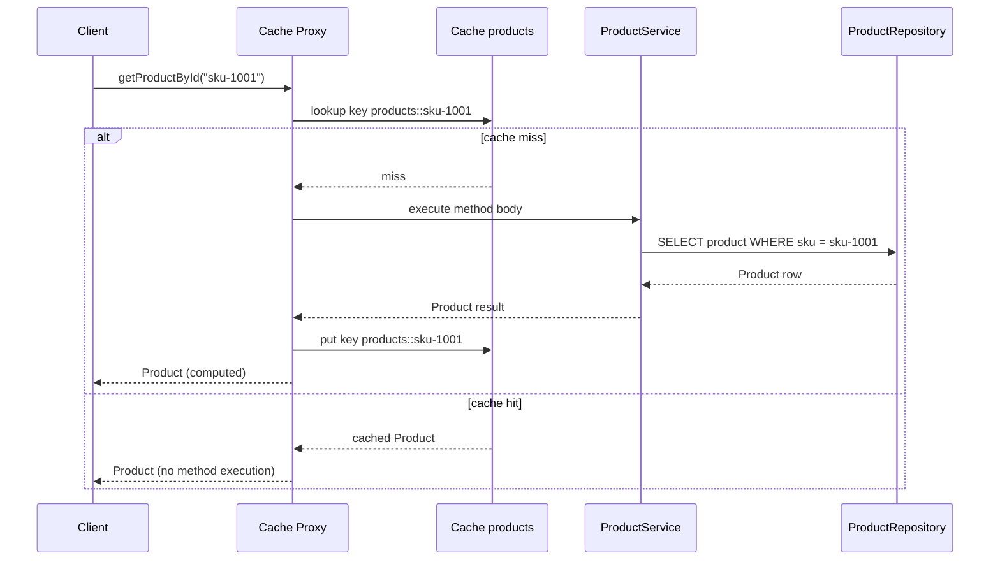
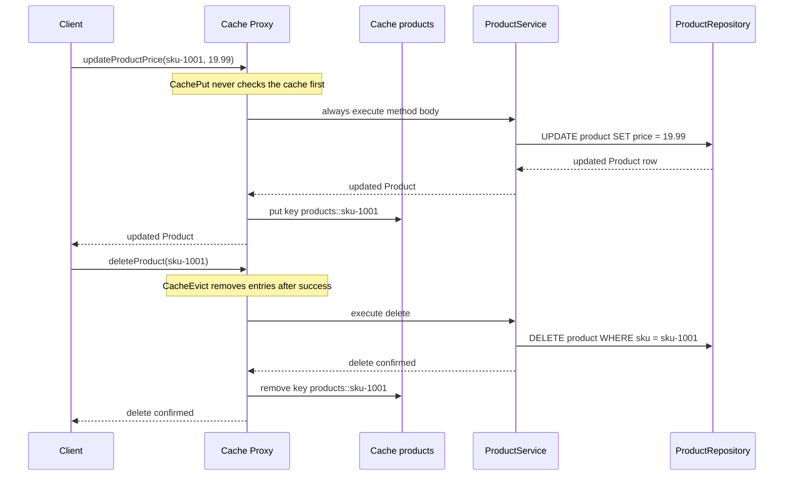

# 003 — Spring Cache Annotations Deep Dive (Boot 4.1 + Java 25)

> Section C of the Spring + Redis caching track. All 6 cache annotations —
> `@EnableCaching`, `@Cacheable`, `@CachePut`, `@CacheEvict`, `@Caching`, `@CacheConfig` —
> with every important attribute, product-catalog examples, and real code-review failures.

**Stack:** Spring Boot 4.1, Java 25, `spring-boot-starter-cache` +
`spring-boot-starter-data-redis` (Lettuce, Redis 7+/8). Every example uses the
**product-catalog domain** (`Product`, `ProductRepository`, `ProductService`) so keys,
evictions, and conditions stay comparable across annotations.

**Attribute map — which annotation supports what:**

| Attribute | `@Cacheable` | `@CachePut` | `@CacheEvict` | `@CacheConfig` | Evaluated |
|---|---|---|---|---|---|
| `value` / `cacheNames` (aliases) | ✅ | ✅ | ✅ | ✅ (default) | Startup |
| `key` (SpEL) | ✅ | ✅ | ✅ | ❌ | Per call |
| `keyGenerator` (bean name) | ✅ | ✅ | ✅ | ✅ (default) | Per call |
| `cacheManager` (bean name) | ✅ | ✅ | ✅ | ✅ (default) | Per call |
| `cacheResolver` (bean name) | ✅ | ✅ | ✅ | ✅ (default) | Per call |
| `condition` (SpEL) | ✅ | ✅ | ✅ | ❌ | **Before** method |
| `unless` (SpEL) | ✅ | ✅ | ❌ | ❌ | **After** method |
| `sync` | ✅ | ❌ | ❌ | ❌ | Per call |
| `allEntries` | ❌ | ❌ | ✅ | ❌ | Per call |
| `beforeInvocation` | ❌ | ❌ | ✅ | ❌ | Per call |

> `cacheManager` and `cacheResolver` are mutually exclusive — set one, never both.
> `key` and `keyGenerator` are likewise mutually exclusive.

**Prerequisites:** [Spring Cache Fundamentals](./001-spring-cache-fundamentals.md),
[Cache Key Design](./005-cache-key-design.md),
[Invalidation and Consistency](./006-invalidation-and-consistency.md).

---

## 1. `@EnableCaching` — switching the machinery on

**Purpose.** Turns on annotation-driven cache management. Without it, `@Cacheable` /
`@CachePut` / `@CacheEvict` / `@Caching` are silently ignored — methods run normally and
nothing is cached. It imports `CachingConfigurationSelector`, registering the
`CacheInterceptor`, the `CacheOperationSource` that parses annotations, and the proxies.

**Use cases:** exactly one — the config class of any app using declarative caching, once per
application (next to `@SpringBootApplication` or on a dedicated config class).

| Attribute | Default | Behavior |
|---|---|---|
| `mode` | `AdviceMode.PROXY` | `PROXY` = Spring AOP (only external proxy calls intercepted). `ASPECTJ` = bytecode weaving, intercepts self-invocation and private methods, needs weaving setup. |
| `proxyTargetClass` | `false` | `false` = JDK proxies for interfaced beans (only interface methods cached); `true` = force CGLIB. Interfaceless beans use CGLIB either way. |
| `order` | `LOWEST_PRECEDENCE` | Cache advisor order vs others (e.g. `@Transactional`). Keep the default unless cache/TX nesting is deliberate. |

**Hit vs miss relevance:** installs the interceptor that makes hits possible. No proxy →
every call is effectively a miss; the cache is never consulted.

```java
package com.shop.catalog.config;

import java.time.Duration;
import org.springframework.cache.CacheManager;
import org.springframework.cache.annotation.EnableCaching;
import org.springframework.context.annotation.Bean;
import org.springframework.context.annotation.Configuration;
import org.springframework.data.redis.cache.RedisCacheConfiguration;
import org.springframework.data.redis.cache.RedisCacheManager;
import org.springframework.data.redis.connection.RedisConnectionFactory;
import org.springframework.data.redis.serializer.GenericJackson2JsonRedisSerializer;
import org.springframework.data.redis.serializer.RedisSerializationContext;

@Configuration
@EnableCaching // without this, every caching annotation below is a no-op
public class CacheSetup {
    @Bean
    CacheManager cacheManager(RedisConnectionFactory cf) {
        var ser = new GenericJackson2JsonRedisSerializer();
        var defaults = RedisCacheConfiguration.defaultCacheConfig()
                .entryTtl(Duration.ofMinutes(5))
                .serializeValuesWith(RedisSerializationContext.SerializationPair.fromSerializer(ser));
        return RedisCacheManager.builder(cf).cacheDefaults(defaults)
                .withCacheConfiguration("products", defaults.entryTtl(Duration.ofMinutes(10)))
                .withCacheConfiguration("priceLists", defaults.entryTtl(Duration.ofSeconds(60)))
                .transactionAware().build();
    }
}
```

Caches in this guide (`products`, `priceLists`, `catalog`, `recommendations`) are
pre-declared above to pin TTL/serialization. Undeclared names still work with Redis
(created with defaults) — declare them to control TTL.

**Common mistakes + debugging:** missing `@EnableCaching` (nothing cached, no error — run
the §8 checklist); duplicate `@EnableCaching` with different `mode` (only one wins);
`proxyTargetClass=false` + method absent from the interface (proxy never sees it).

---

## 2. `@Cacheable` — read-through caching (the workhorse)

**Purpose.** Read-through: Spring computes a key and looks it up first. On a **hit** the
cached value returns and the body **never runs**. On a **miss** the body runs (repo call,
computation, HTTP call) and the return value is stored before being returned.

**Use cases:** `getProductById` (repository call), `computeRecommendations` (expensive
computation), `fetchVendorPriceList` (remote API response) — anything referentially
transparent for its arguments and safe to reuse for the TTL window.

**Hit vs miss:** miss = absent/expired → execute → if no exception and `unless` does not
veto → `put(key, result)` → return. Hit = present → return immediately, body skipped (no
query in logs). Exception = nothing stored, `unless` skipped, exception propagates.
Exceptions are never cached.



| Attribute | Default | Behavior |
|---|---|---|
| `value` / `cacheNames` | required | Aliases. Hit in **any** short-circuits; on miss the result is written to **all**. |
| `key` | `""` | SpEL over args (`#sku`, `#product.sku`, `#category + ':' + #page`). See §7. |
| `keyGenerator` | `"simpleKeyGenerator"` | Bean when `key` empty: no args → `SimpleKey.EMPTY`; one arg → the arg; several → `SimpleKey(a,b,c)`. |
| `cacheManager` | `"cacheManager"` | Bean name with several managers (Redis vs Caffeine). Exclusive with `cacheResolver`. |
| `cacheResolver` | — | Bean for dynamic per-call resolution. Exclusive with `cacheManager`. |
| `condition` | `""` | SpEL **before** execution. `false` → method runs, cache never consulted, nothing stored. No `#result`. |
| `unless` | `""` | SpEL **after** return. `true` → veto the put. Sees `#result`. Never runs on exception. Rejected with `sync=true`. |
| `sync` | `false` | Stampede protection: concurrent misses on one key block, single thread executes. Needs one cache, no `unless`. |

```java
package com.shop.catalog.service;

import java.util.List;
import org.springframework.cache.annotation.Cacheable;
import org.springframework.stereotype.Service;
import com.shop.catalog.engine.RecommendationEngine;
import com.shop.catalog.model.PriceList;
import com.shop.catalog.model.Product;
import com.shop.catalog.model.Recommendation;
import com.shop.catalog.repo.ProductRepository;
import com.shop.catalog.vendor.VendorPricingClient;

@Service
public class ProductService {
    private final ProductRepository products;
    private final VendorPricingClient vendorClient;
    public ProductService(ProductRepository products, VendorPricingClient vendorClient) {
        this.products = products;
        this.vendorClient = vendorClient;
    }
    @Cacheable(value = "products", key = "#sku",
            condition = "!#sku.startsWith('test-')", unless = "#result == null")
    public Product getProductById(String sku) {
        return products.findBySku(sku).orElse(null); // miss: SELECT ... WHERE sku = ?
    }
    @Cacheable(value = "recommendations", sync = true) // key: SimpleKey(category, limit)
    public List<Recommendation> computeRecommendations(String category, int limit) {
        return RecommendationEngine.topN(category, limit); // miss only: seconds of compute
    }
    @Cacheable(value = "priceLists", key = "#vendorId + ':' + #region",
            cacheManager = "shortTtlCacheManager",
            unless = "#result == null || #result.entries().isEmpty()")
    public PriceList fetchVendorPriceList(String vendorId, String region) {
        return vendorClient.downloadPriceList(vendorId, region); // miss: HTTP call
    }
}
```

Keys: `getProductById("sku-1001")` → `products::sku-1001`;
`computeRecommendations("audio", 10)` → `SimpleKey("audio", 10)`;
`fetchVendorPriceList("acme","eu")` → `priceLists::acme:eu`. `condition` gates before
execution (test SKUs never consult); `unless` vetoes after (nulls discarded, DB retried).

**Common mistakes + debugging:** `void` return (nothing to store — use `@CacheEvict`);
`sync=true` with two caches or `unless` (startup failure); expecting `unless` on
exceptions (never runs); caching a mutable entity and mutating the reference (corrupts the
entry — return DTOs/copies).

---

## 3. `@CachePut` — always execute, then refresh the entry

**Purpose.** Forces execution **every time**, then writes the return value under the key. A
write-through refresh, not a read — the cache is never consulted first. Keeps the cache
coherent right after a state change without a second round trip.

**Use cases:** `updateProductPrice` / `saveProduct` — persist the row, then overwrite the
key the `@Cacheable` read path uses, so the next read hits.

**`@CachePut` vs `@Cacheable` semantic difference (memorize this):**

| | `@Cacheable` | `@CachePut` |
|---|---|---|
| Method executed? | Only on **miss** | **Always** |
| Cache consulted first? | Yes | No |
| Result stored? | On miss (unless vetoed) | Always (unless vetoed / `condition` false / exception) |
| Placed on | Reads: `getProductById` | Writes: `updateProductPrice` |
| `sync` support? | Yes | No |



| Attribute | Default | Behavior |
|---|---|---|
| `value` / `cacheNames` | required | Cache(s) to write into. Same alias semantics as `@Cacheable`. |
| `key` | `""` | **Must match the `@Cacheable` key** or the refresh lands on a sibling entry. `#result` available (`#result.sku`). |
| `keyGenerator` | `"simpleKeyGenerator"` | Fallback when `key` empty. Exclusive with `key`. |
| `cacheManager` / `cacheResolver` | defaults | Same routing as `@Cacheable`; mutually exclusive. |
| `condition` | `""` | SpEL **before**: `false` → method runs, put skipped. No `#result`. |
| `unless` | `""` | SpEL **after**: `true` → discard. Sees `#result`; skipped on exception. |

```java
package com.shop.catalog.service;

import org.springframework.cache.annotation.CachePut;
import org.springframework.stereotype.Service;
import org.springframework.transaction.annotation.Transactional;
import com.shop.catalog.model.Product;
import com.shop.catalog.repo.ProductRepository;

@Service
public class CatalogAdminService {
    private final ProductRepository products;
    public CatalogAdminService(ProductRepository products) {
        this.products = products;
    }
    @Transactional
    @CachePut(value = "products", key = "#sku", unless = "#result == null")
    public Product updateProductPrice(String sku, double newPrice) {
        Product p = products.findBySku(sku).orElseThrow(() -> new ProductNotFoundException(sku));
        p.setPrice(newPrice);
        return products.save(p); // put after successful return
    }
    @CachePut(value = "products", key = "#result.sku") // result-derived key
    public Product createProduct(Product draft) {
        draft.setVersion(1);
        return products.save(draft);
    }
}
```

**Common mistakes + debugging:** `@CachePut` on a read (never hits — hit rate zero) or
`@Cacheable` on a write (hits skip the update); read/write **key mismatch** (second entry
— audit with `redis-cli --scan --pattern 'products*'`); expecting the put on exception
(throwing stores nothing, `unless` skipped).

---

## 4. `@CacheEvict` — removing stale entries, on purpose

**Purpose.** Removes entries — one key or whole caches. Keeps the catalog consistent after
deletes, bulk imports, or changes whose blast radius exceeds a single key.

**Use cases:** `deleteProduct` (single key), `replaceEntireCatalog` (whole cache),
`repriceCategory` (item + dependent list caches), nightly feed imports.

| Attribute | Default | Behavior |
|---|---|---|
| `value` / `cacheNames` | required | Cache(s) to evict from. |
| `key` | `""` | SpEL entry key. Empty + `allEntries=false` → generator from args, so `deleteProduct("sku-1001")` matches `@Cacheable(key = "#sku")`. |
| `keyGenerator` | `"simpleKeyGenerator"` | Fallback when `key` empty. |
| `cacheManager` / `cacheResolver` | defaults | Same routing; mutually exclusive. |
| `condition` | `""` | SpEL **before**: `false` → no eviction. |
| `allEntries` | `false` | `true` → ignore `key`, clear **every entry** in the named cache(s). |
| `beforeInvocation` | `false` | `false` = evict **after** success (exception → stale entry survives). `true` = evict **before** running (survives exceptions). |

**Eviction timing — the table that decides correctness:**

| `beforeInvocation` | Method succeeds | Method throws |
|---|---|---|
| `false` (default) | Evict after return | **No eviction** — stale entry remains |
| `true` | Evict before + method runs | Evicted anyway (next read repopulates) |

Default `false` for DB-tied deletes (failed delete must not drop the good copy). `true`
for best-effort invalidation regardless of outcome. The §3 diagram shows the flow.

```java
package com.shop.catalog.service;

import org.springframework.cache.annotation.CacheEvict;
import org.springframework.stereotype.Service;
import org.springframework.transaction.annotation.Transactional;
import com.shop.catalog.repo.ProductRepository;

@Service
public class CatalogEvictionService {
    private final ProductRepository products;
    public CatalogEvictionService(ProductRepository products) {
        this.products = products;
    }
    @Transactional
    @CacheEvict(value = "products", key = "#sku") // after success; failure keeps the copy
    public void deleteProduct(String sku) {
        products.deleteBySku(sku);
    }
    @CacheEvict(value = { "products", "priceLists", "recommendations" }, allEntries = true)
    public void replaceEntireCatalog() {
        products.reloadFromNightlyFeed();
    }
    @CacheEvict(value = "priceLists", key = "#vendorId + ':' + #region", beforeInvocation = true)
    public void forcePriceListRefresh(String vendorId, String region) {
        products.markPriceListDirty(vendorId, region);
    }
}
```

**Common mistakes + debugging:** no `key` + no `allEntries` on a no-arg method →
`SimpleKey.EMPTY` matches nothing readers wrote; `allEntries=true` at peak → full-miss
stampede (reserve for off-peak bulk ops); forgetting dependent caches (reprice updates
`products` but `priceLists` still shows the old price — evict both or use `@Caching`).

---

## 5. `@Caching` — combining several operations on one method

**Purpose.** Java forbids repeating the same annotation, so `@Caching` groups multiple
`@Cacheable` / `@CachePut` / `@CacheEvict` operations that must fire together. One catalog
write refreshes the item entry while dropping list and recommendation caches.

**Use cases:** `updateProduct` (put item + evict lists), `deleteProduct` (evict item + evict
lists), promotions invalidating product and recommendation caches.

| Attribute | Contains | Behavior |
|---|---|---|
| `cacheable` | `@Cacheable[]` | Grouped read-throughs. Rare — most methods need at most one. |
| `put` | `@CachePut[]` | Grouped refreshes, each with its own key/condition. |
| `evict` | `@CacheEvict[]` | Grouped evictions with independent `key` / `allEntries` / `beforeInvocation`. |

Nested operations keep their own `condition`; evaluation follows declaration order.

```java
package com.shop.catalog.service;

import org.springframework.cache.annotation.CacheEvict;
import org.springframework.cache.annotation.CachePut;
import org.springframework.cache.annotation.Caching;
import org.springframework.stereotype.Service;
import org.springframework.transaction.annotation.Transactional;
import com.shop.catalog.model.Product;
import com.shop.catalog.repo.ProductRepository;

@Service
public class CatalogWriteService {
    private final ProductRepository products;
    public CatalogWriteService(ProductRepository products) {
        this.products = products;
    }
    @Transactional
    @Caching(
        put = @CachePut(value = "products", key = "#product.sku", unless = "#result == null"),
        evict = {
            @CacheEvict(value = "priceLists", allEntries = true),
            @CacheEvict(value = "recommendations", allEntries = true)
        }
    )
    public Product updateProduct(Product product) {
        return products.save(product);
    }
}
```

**Common mistakes + debugging:** stacking two `@CacheEvict` directly → "duplicate
annotation" compile error is the signal to wrap in `@Caching`; overlapping put + evict on
the same key (later-declared wins — keep minimal and ordered); hiding a three-cache blast
radius without a comment (name the reason, as above).

---

## 6. `@CacheConfig` — class-level defaults, DRY cache names

**Purpose.** Defaults for the whole class: cache name(s), `KeyGenerator`,
`CacheManager`/`CacheResolver`. Methods inherit and override only what they specify. Caches
nothing by itself.

**Use cases:** a service sharing one cache (`ProductCatalogService` → `products`), or a
team-standard generator/manager applied to every method in a class.

| Attribute | Default | Behavior |
|---|---|---|
| `cacheNames` (`value` alias) | `{}` | Defaults for methods omitting `value`. Method-level `value` **replaces**, never merges. |
| `keyGenerator` | `""` | Default bean for methods without explicit `key`/`keyGenerator`. |
| `cacheManager` | `""` | Default manager bean. Exclusive with `cacheResolver`. |
| `cacheResolver` | `""` | Default resolver bean. Exclusive with `cacheManager`. |

No `key`, `condition`, `unless`, `sync`, `allEntries`, or `beforeInvocation` here — those
are per-invocation and belong on the method.

```java
package com.shop.catalog.service;

import java.util.List;
import org.springframework.cache.annotation.CacheConfig;
import org.springframework.cache.annotation.CacheEvict;
import org.springframework.cache.annotation.Cacheable;
import org.springframework.stereotype.Service;
import com.shop.catalog.model.Product;
import com.shop.catalog.repo.ProductRepository;

@Service
@CacheConfig(cacheNames = "products", cacheManager = "cacheManager",
        keyGenerator = "catalogKeyGenerator")
public class ProductCatalogService {
    private final ProductRepository products;
    public ProductCatalogService(ProductRepository products) {
        this.products = products;
    }
    @Cacheable(key = "#sku") // inherits cache, generator, manager
    public Product getBySku(String sku) {
        return products.findBySku(sku).orElse(null);
    }
    @Cacheable(cacheNames = "recommendations", key = "#category + ':' + #limit")
    public List<Product> topSellers(String category, int limit) {
        return products.findTopSellers(category, limit);
    }
    @CacheEvict(key = "#sku", cacheManager = "caffeineCacheManager")
    public void evictLocalCopy(String sku) {
        // removes from the in-process "products" cache, not Redis
    }
}
```

```java
package com.shop.catalog.config;

import java.util.Arrays;
import org.springframework.cache.interceptor.KeyGenerator;
import org.springframework.context.annotation.Bean;
import org.springframework.context.annotation.Configuration;

@Configuration
public class CatalogKeyConfig {
    @Bean("catalogKeyGenerator")
    KeyGenerator catalogKeyGenerator() {
        return (target, method, params) -> "catalog:" + method.getName() + ":"
                + String.join(".", Arrays.stream(params)
                        .map(p -> p == null ? "null" : p.toString()).toList());
    }
}
```

**Common mistakes + debugging:** expecting method `value` to *add* to the class default
(it replaces — list every cache); `@CacheConfig` on the interface with `@Cacheable` on
the impl under JDK proxies (defaults invisible — keep both on the same level); assuming
`@CacheConfig` alone caches anything (each method still needs its own annotation).

---

## 7. Keys, SpEL custom keys, cache names, and `condition` vs `unless`

### 7.1 Default key generation (no `key` given)

| Call shape | Generated key |
|---|---|
| `getCatalog()` (no args) | `SimpleKey.EMPTY` — **one shared entry** for all callers |
| `getProductById("sku-1001")` | The argument itself (`"sku-1001"`) |
| `search("audio", 2, true)` | `new SimpleKey("audio", 2, true)` (deep-equals) |

A no-arg `@Cacheable` unintentionally shares one entry; overloaded methods with coincident
args collide. Prefer explicit `key` for anything non-trivial (see
[Cache Key Design](./005-cache-key-design.md)).

### 7.2 SpEL custom keys — the expressions you will actually use

Names: `#a0`/`#p0` (positional), `#root.args[0]`, named params (only with `-parameters`,
on by default in Boot 4.1 builds), `#root.methodName`, `#root.target`, `#result`
(post-execution only: `key` on `@CachePut`, plus `unless`).

| Goal | Expression |
|---|---|
| Single id | `key = "#sku"` |
| Composite | `key = "#category + ':' + #page"` |
| Nested property | `key = "#product.sku"` |
| Null-safe nested | `key = "#product?.sku ?: 'unknown'"` |
| Method-qualified | `key = "#root.methodName + ':' + #sku"` |
| Result-derived (put) | `key = "#result.sku"` |
| Static utility | `key = "T(com.shop.catalog.Keys).product(#sku)"` |

### 7.3 Cache names — conventions that survive production

One cache per **invalidation unit**: `products` (per-item), `priceLists` (aggregates),
`recommendations` (computed). Renaming `products` → `productsV2` orphans every entry and
cold-starts at deploy — version the *key format* instead. Redis stores entries as
`<cacheName>::<key>`, so keep names short, lowercase, colon-free.

### 7.4 `condition` vs `unless` — the truth table

`condition` runs **before** (gate: consult / execute-and-store, params only); `unless`
runs **after** (veto: store or discard, sees `#result`). On exception nothing is stored
and `unless` never runs.

| `condition` | Outcome | `unless` | Consulted? | Stored? |
|---|---|---|---|---|
| `true` (or empty) | returns | `false` (or empty) | ✅ yes | ✅ yes |
| `true` | returns | `true` | ✅ yes | ❌ vetoed |
| `false` | returns | (skipped) | ❌ no | ❌ no |
| `true` | **throws** | (skipped) | ✅ yes | ❌ never |
| `false` | **throws** | (skipped) | ❌ no | ❌ never |

```java
package com.shop.catalog.service;

import java.util.List;
import org.springframework.cache.annotation.Cacheable;
import org.springframework.stereotype.Service;
import com.shop.catalog.model.Product;
import com.shop.catalog.repo.ProductRepository;

@Service
public class CatalogSearchService {
    private final ProductRepository products;
    public CatalogSearchService(ProductRepository products) {
        this.products = products;
    }
    @Cacheable(value = "catalog", key = "#category + ':' + #page",
            condition = "#page < 5", // deep pages: never consult or fill
            unless = "#result == null || #result.isEmpty()") // empty pages: discard
    public List<Product> searchCategory(String category, int page) {
        return products.findByCategory(category, page);
    }
}
```

Page 1 with results → consulted + stored. Page 1 empty → consulted (miss), executed,
discarded. Page 9 → never consulted, never stored. Exception → nothing stored.

---

## 8. Common mistakes + debugging playbook

**1. Self-invocation — the #1 "caching silently does nothing" cause.** Advice lives in a
proxy *around* the bean. `this.getProductById(sku)` from the same class never passes
through it — no lookup, no put, no eviction, zero errors logged.

```java
package com.shop.catalog.service;

import org.springframework.cache.annotation.Cacheable;
import org.springframework.stereotype.Service;
import com.shop.catalog.model.Product;
import com.shop.catalog.repo.ProductRepository;

@Service
public class BrokenCatalogService {
    private final ProductRepository products;
    public BrokenCatalogService(ProductRepository products) {
        this.products = products;
    }
    public Product getWithFallback(String sku) {
        return getProductById(sku); // skips the proxy — always a miss
    }
    @Cacheable("products")
    public Product getProductById(String sku) {
        return products.findBySku(sku).orElse(null);
    }
}
```

Fixes: inject the proxied self (`@Lazy ProductService self`), move the cached method to a
separate bean, or use `AdviceMode.ASPECTJ` with weaving. Verify with
`logging.level.org.springframework.cache=TRACE` and `redis-cli MONITOR`.

**2. Private / final methods.** JDK proxies see only interface methods; CGLIB cannot
override `private`/`final`. It compiles, starts, and never caches. Keep cached methods
`public`, non-`final` (or use ASPECTJ mode).

**3. `void @Cacheable`.** No return value to store — Spring warns and caches nothing. Use
`@CacheEvict` for write-only side effects.

**4. `@CachePut` vs `@Cacheable` mix-up.** `@CachePut` on a read hits the DB every call
(always executes); `@Cacheable` on a write returns the stale row and skips the update on
a hit. Reads `@Cacheable`, writes `@CachePut` (+ evictions).

**5. `unless` on exceptions.** Throwing stores nothing and `unless` is skipped — errors are
never cached, with or without `unless`. To record failures, catch inside and return a
sentinel value that `unless` can inspect.

**6. Key mismatch between read and write paths.** `@Cacheable(key = "#sku")` on reads but
default generation on `@CachePut update(Product p)` writes under `SimpleKey(product)` —
two entries, reads stay stale. `redis-cli --scan --pattern 'products*' | sort` should show
one entry per SKU; make both sides spell the identical expression.

---

## Pitfalls

!!! warning "GOLD — cache-annotation pitfalls (read before shipping)"
    - **Missing `@EnableCaching`** — every annotation silently ignored; methods run, nothing cached.
    - **Self-invocation** (`this.cachedMethod()`) bypasses the proxy — the #1 "caching does nothing" cause.
    - **`private`/`final` cached methods** — invisible to proxies; keep them `public`, non-`final`.
    - **`void @Cacheable`** — nothing to store; use `@CacheEvict` for write-only operations.
    - **`@CachePut` on reads** — always executes, hit rate zero; **`@Cacheable` on writes** — hits skip the write.
    - **Read/write key mismatch** — refresh lands on a sibling entry, reads stay stale; scan the keyspace.
    - **`unless` never runs on exception** — exceptions are never cached, with or without `unless`.
    - **`sync=true` + `unless` or multiple caches** — startup failure; one cache, drop `unless`.
    - **`condition=false` skips the lookup too** — not just the store; design guards accordingly.
    - **Caching mutable entities** — callers mutating the reference corrupt the entry; return copies/DTOs.
    - **`allEntries` clears at peak** — instant stampede; prefer targeted keys off-peak.
    - **Method `value` replaces `@CacheConfig` names** — it does not merge; list every cache explicitly.

---

## Interview Q&A

**Q1. Why is my `@Cacheable` still executing every time — nothing is ever served from cache?**
Checklist: (1) `@EnableCaching` present? Without it every annotation is a no-op.
(2) Through the proxy? Self-invocation and `private`/`final` methods bypass Spring AOP.
(3) `condition` accidentally `false`, or a distinct key per call? Confirm with
`logging.level.org.springframework.cache=TRACE` and `redis-cli MONITOR`.

**Q2. `@CachePut` vs `@Cacheable` — what is the semantic difference, and when is each used?**
`@Cacheable` is read-through: consult first, execute only on miss, then store.
`@CachePut` is write-through refresh: always execute, never consult, then overwrite.
Reads (`getProductById`, computations, API responses) get `@Cacheable`; writes
(`updateProductPrice`) get `@CachePut` with a key identical to the reader's. Swapped:
`@CachePut` on a read destroys the hit rate; `@Cacheable` on a write lets hits skip the
update.

**Q3. When does `condition` run versus `unless`, and what can each expression see?**
`condition` runs *before*: `false` skips lookup and store (method still runs), params only
— never `#result`. `unless` runs *after* success: `true` vetoes the store and sees
`#result` (`unless = "#result == null"`). On exception nothing is stored and `unless` never
runs. `condition=false` also skips the lookup — a frequent surprise.

**Q4. How do `allEntries` and `beforeInvocation` change `@CacheEvict` behavior?**
`allEntries=true` ignores any key and clears the named caches — for bulk ops like
`replaceEntireCatalog`, but a stampede risk at peak. `beforeInvocation=false` (default)
evicts only after success (failed delete keeps the good copy); `true` evicts before
execution, surviving even a throwing method — best-effort invalidation that may drop a copy
the method then fails to replace.

**Q5. What does `@Caching` solve, and what does `@CacheConfig` solve?**
Java forbids duplicate annotations, so `@Caching` groups several operations on one method —
`@CachePut` the item plus `@CacheEvict(allEntries=true)` on dependent list caches, each
with independent keys/conditions. `@CacheConfig` is class-level DRY: default `cacheNames`,
`keyGenerator`, `cacheManager`/`cacheResolver` inherited by every method (method-level
`value` *replaces* the default, never merges). Neither caches anything alone.

**Q6. How is the default cache key built, and when do you switch to SpEL or a custom `KeyGenerator`?**
No `key` → `SimpleKeyGenerator` from args: none → shared `SimpleKey.EMPTY`; one → the arg;
several → `SimpleKey(a, b, c)`. Use SpEL (`"#category + ':' + #page"`, `"#product.sku"`,
`"#result.sku"` on `@CachePut`) for composite/nested/result-derived keys, and a shared
`KeyGenerator` bean (via `keyGenerator` or `@CacheConfig`) for service-wide namespacing
(e.g. a `catalog:` prefix). Read and write paths must spell byte-identical keys.

---

## Resources

- Spring Framework reference — Cache Abstraction (attribute contracts, SpEL context):
  [docs.spring.io/spring-framework/reference/integration/cache.html](https://docs.spring.io/spring-framework/reference/integration/cache.html)
- Spring Boot reference — caching auto-configuration and `spring.cache.*` properties:
  [docs.spring.io/spring-boot/reference/io/caching.html](https://docs.spring.io/spring-boot/reference/io/caching.html)
- Next in this track: [Spring Cache Fundamentals](./001-spring-cache-fundamentals.md) ·
  [Cache Key Design](./005-cache-key-design.md) ·
  [Invalidation and Consistency](./006-invalidation-and-consistency.md)
