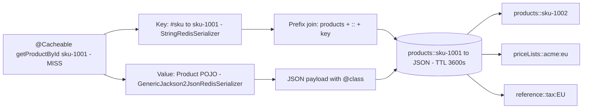

# 004 — Redis Cache Configuration (Boot 4.1.0 + Java 25, Lettuce, Redis 7)

> Section D of the Spring Redis track: how `RedisCacheManager` and
> `RedisCacheConfiguration` turn `@Cacheable` intent into Redis bytes — TTLs,
> serializers, prefixes, null handling, observability, and multi-manager setups.
>
> Companion guides: [002 — Spring Boot Redis Setup](./002-spring-boot-redis-setup.md) ·
> [003 — Cache Annotations](./003-cache-annotations.md) ·
> [005 — Cache Key Design](./005-cache-key-design.md) ·
> [Redis Introduction](./redis.md).
>
> **Stack:** Spring Boot **4.1.0** · Java **25** · Lettuce (default) · Redis **7.x**.
> Base example mirrors `projects-v2/commerce-mesh/backend/cart-service/src/main/java/com/commercemesh/cart/config/RedisConfig.java` **exactly**.

## Table of Contents

- [1. Base Example — `cart-service` `RedisConfig` (Exact Mirror)](#1-base-example--cart-service-redisconfig-exact-mirror)
- [2. Auto-Config vs Explicit Bean](#2-auto-config-vs-explicit-bean)
- [3. `RedisCacheManager` Deep Dive](#3-rediscachemanager-deep-dive)
- [4. `RedisCacheConfiguration` Deep Dive](#4-rediscacheconfiguration-deep-dive)
- [5. Cache Names / Regions](#5-cache-names--regions)
- [6. Default + Per-Cache TTL](#6-default--per-cache-ttl)
- [7. Serialization — Key vs Value](#7-serialization--key-vs-value)
- [8. JSON vs JDK Trade-Off Table](#8-json-vs-jdk-trade-off-table)
- [9. `GenericJackson2JsonRedisSerializer` in Boot 4.1](#9-genericjackson2jsonredisserializer-in-boot-41)
- [10. `ObjectMapper` Config](#10-objectmapper-config)
- [11. Null-Value Caching](#11-null-value-caching)
- [12. Key Prefixes](#12-key-prefixes)
- [13. Write Path — From Method to Keyspace](#13-write-path--from-method-to-keyspace)
- [14. Statistics and Observability](#14-statistics-and-observability)
- [15. Custom Multi-Manager — Redis + Caffeine](#15-custom-multi-manager--redis--caffeine)
- [16. Database Selection Caveat](#16-database-selection-caveat)
- [17. Verify End to End](#17-verify-end-to-end)
- [18. Pitfalls (GOLD)](#18-pitfalls-gold)
- [19. Interview Q&A](#19-interview-qa)
- [20. Resources](#20-resources)

---

## 1. Base Example — `cart-service` `RedisConfig` (Exact Mirror)

Canonical starting point. Everything below explains *why each line exists*.

Byte-for-byte mirror of `RedisConfig.java`, imports included:

```java
package com.commercemesh.cart.config;

import java.time.Duration;

import org.springframework.cache.annotation.EnableCaching;
import org.springframework.context.annotation.Bean;
import org.springframework.context.annotation.Configuration;
import org.springframework.data.redis.cache.RedisCacheConfiguration;
import org.springframework.data.redis.connection.RedisConnectionFactory;
import org.springframework.data.redis.core.RedisTemplate;
import org.springframework.data.redis.serializer.GenericJackson2JsonRedisSerializer;
import org.springframework.data.redis.serializer.RedisSerializationContext;
import org.springframework.data.redis.serializer.StringRedisSerializer;

@Configuration
@EnableCaching
public class RedisConfig {

    /**
     * Default cache configuration — 1-hour TTL with JSON serialization of values.
     * Applied globally to all caches; custom per-cache TTL can be set via
     * {@code spring.cache.redis.time-to-live} in application properties.
     */
    @Bean
    public RedisCacheConfiguration redisCacheConfiguration() {
        return RedisCacheConfiguration.defaultCacheConfig()
                .entryTtl(Duration.ofHours(1))
                .serializeKeysWith(
                        RedisSerializationContext.SerializationPair.fromSerializer(new StringRedisSerializer()))
                .serializeValuesWith(
                        RedisSerializationContext.SerializationPair.fromSerializer(new GenericJackson2JsonRedisSerializer()))
                .disableCachingNullValues();
    }

    /**
     * RedisTemplate with JSON serialization — useful for manual Redis operations.
     */
    @Bean
    public RedisTemplate<String, Object> redisTemplate(RedisConnectionFactory connectionFactory) {
        RedisTemplate<String, Object> template = new RedisTemplate<>();
        template.setConnectionFactory(connectionFactory);
        template.setKeySerializer(new StringRedisSerializer());
        template.setHashKeySerializer(new StringRedisSerializer());
        template.setValueSerializer(new GenericJackson2JsonRedisSerializer());
        template.setHashValueSerializer(new GenericJackson2JsonRedisSerializer());
        template.afterPropertiesSet();
        return template;
    }
}
```

| Line(s) | What it does | Deep-dive |
|---|---|---|
| `@Configuration @EnableCaching` | Registers config; activates the cache-annotation proxy | [002 §4](./002-spring-boot-redis-setup.md), [003 §1](./003-cache-annotations.md) |
| `RedisCacheConfiguration` bean | Global defaults (TTL, serializers, null policy) for `RedisCacheManager` | §4 |
| `entryTtl(ofHours(1))` | Every entry expires 1 h after write unless overridden per cache | §6 |
| `serializeKeysWith(StringRedisSerializer)` | Readable keys (`products::sku-1001`), not JDK blobs | §7 |
| `serializeValuesWith(GenericJackson2JsonRedisSerializer)` | Values as JSON with type info | §7–§10 |
| `disableCachingNullValues()` | `null` results never stored | §11 |
| `RedisTemplate<String, Object>` bean | Manual access (`opsForValue/Hash`) with the *same* serializer pair | §7 |
| `afterPropertiesSet()` | Freezes template init; omitting it leaves serializers unapplied | §7 |

Two beans, two jobs: the configuration bean shapes **declarative** caching
(`@Cacheable`); the template shapes **imperative** access. Keep their serializer
choices identical or the same value looks different per write path.

---

## 2. Auto-Config vs Explicit Bean

With `spring-boot-starter-data-redis` + `spring-boot-starter-cache` and
`spring.cache.type=redis`, Boot builds a `RedisCacheManager` already (see
[002 §3](./002-spring-boot-redis-setup.md#3-auto-configuration)). The question is
which inputs it uses.

| Declaration | Effect on auto-config | Use when |
|---|---|---|
| None (properties only) | Boot builds manager from `spring.cache.redis.*` | Zero-code setup; single TTL is enough |
| `RedisCacheConfiguration` bean (§1) | Does **NOT** disable auto-config; becomes the default for every cache | One global TTL + serializer pair suffices (`cart-service` case) |
| `RedisCacheManager` / `CacheManager` bean (§6, §15) | **Replaces** Boot's manager | Per-cache TTL map, multi-manager, `transactionAware()`, custom `cacheWriter` |
| `RedisConnectionFactory` bean | **Replaces** Lettuce auto-config | Custom client config (timeout, SSL, cluster) — rarely needed for caching |

Precedence for TTL: explicit `entryTtl` bean > `spring.cache.redis.time-to-live` >
no expiry. Keep one source of truth — a bean saying 1 h next to a property saying
30 m will confuse the next reader.

---

## 3. `RedisCacheManager` Deep Dive

`org.springframework.data.redis.cache.RedisCacheManager` maps
`getCache(name)` / `put` / `evict` to Redis `GET` / `SETEX` / `DEL`:

- **One manager, many caches.** Names (`products`, `priceLists`) are *regions* in one
  manager sharing the connection factory, with per-region TTL/serializer overrides.
- **Lazy by default.** A name first seen on a `@Cacheable` call is created from the
  *default* config. Pre-declare via `withInitialCacheConfigurations` to pin TTLs.
- **Builder:** `RedisCacheManager.builder(cf).cacheDefaults(defaults)
  .withInitialCacheConfigurations(map).transactionAware().build()`.
  Underneath, a `RedisCacheWriter` (default `NonLockingRedisCacheWriter`) issues the
  commands; the config's key prefix + serializer pairs shape every byte (§7, §12).
- **What it is NOT:** not a pool (Lettuce), not a template (`RedisTemplate`), not the
  proxy (`@EnableCaching`). `redis: UP` + empty keyspace = proxy bypassed
  (self-invocation), not a manager fault — see
  [003 §8](./003-cache-annotations.md#8-common-mistakes--debugging-playbook).

```java
@Bean
CacheManager cacheManager(RedisConnectionFactory cf, RedisCacheConfiguration defaults) {
    return RedisCacheManager.builder(cf).cacheDefaults(defaults).transactionAware().build();
}
```

Injecting the §1 bean as `defaults` keeps a single TTL/serializer definition.

---

## 4. `RedisCacheConfiguration` Deep Dive

Immutable value object — every modifier returns a **new** instance. The §1 chain:

| Builder call | Default without it | §1 choice | Effect |
|---|---|---|---|
| `entryTtl(Duration)` | `ZERO` = persist (no expiry) | `ofHours(1)` | `SETEX` 3600 s; `TTL` counts down from ~3600 |
| `serializeKeysWith(...)` | JDK serialization | `StringRedisSerializer` | Readable keys in `redis-cli` / Insight |
| `serializeValuesWith(...)` | JDK serialization | `GenericJackson2JsonRedisSerializer` | JSON values with type info |
| `disableCachingNullValues()` | Nulls cached via `NullValue` sentinel | Disabled | `null` never stored (§11) |

Notes: `defaultCacheConfig()` starts with no TTL, JDK serializers, `cacheName::`
prefix on, nulls cached — §1 overrides all four. `serializeKeysWith` /
`serializeValuesWith` take a `SerializationPair` (`fromSerializer(...)`), never a raw
serializer. Reuse is safe: `defaults.entryTtl(ofMinutes(10))` derives a per-cache
variant without mutating `defaults` (§6). A `private` bean method or wrong return type
silently leaves defaults in place — verify with `TTL` / `GET` (§17).

---

## 5. Cache Names / Regions

A cache name is an **invalidation unit** — a namespace segment sharing the manager but
independently expirable/evictable. One per unit (`products` per-item,
`priceLists` aggregates, `reference` near-static):

```java
@Cacheable(value = "products", key = "#sku")
public Product getProductById(String sku) { ... }

@Cacheable(value = "priceLists", key = "#vendorId + ':' + #region")
public PriceList fetchVendorPriceList(String vendorId, String region) { ... }
```

Keep names short, lowercase, colon-free (Redis renders `<cacheName>::<key>`, §12).
Undeclared names work (created with defaults) — declare them in §6 to pin TTLs.
Renaming `products` → `productsV2` orphans every entry and cold-starts the deploy;
version the *key format* instead. Full discipline in
[005](./005-cache-key-design.md).

---

## 6. Default + Per-Cache TTL

TTL = *"how long may a copy lie?"*. Code `entryTtl` wins over
`spring.cache.redis.time-to-live`; bare `3600000` = **ms** (prefer `1h`/`PT1H`).
When regions need different freshness, build an explicit manager with
**initialDefaults + `withInitialCacheConfigurations` map**:

```java
@Bean
CacheManager cacheManager(RedisConnectionFactory cf) {
    var keys = RedisSerializationContext.SerializationPair
            .fromSerializer(new StringRedisSerializer());
    var values = RedisSerializationContext.SerializationPair
            .fromSerializer(new GenericJackson2JsonRedisSerializer());

    // Initial defaults: fallback for every cache without an explicit entry.
    RedisCacheConfiguration initialDefaults = RedisCacheConfiguration.defaultCacheConfig()
            .entryTtl(Duration.ofHours(1))
            .serializeKeysWith(keys)
            .serializeValuesWith(values)
            .disableCachingNullValues();

    // Per-cache overrides: same serializers, different TTLs.
    Map<String, RedisCacheConfiguration> perCache = Map.of(
            "products", initialDefaults.entryTtl(Duration.ofMinutes(10)),
            "priceLists", initialDefaults.entryTtl(Duration.ofMinutes(1)),
            "reference", initialDefaults.entryTtl(Duration.ofHours(24)));

    return RedisCacheManager.builder(cf)
            .cacheDefaults(initialDefaults)
            .withInitialCacheConfigurations(perCache)
            .transactionAware()
            .build();
}
```

| Cache | TTL | Rationale |
|---|---|---|
| fallback | 1 h | Matches §1 / `cart-service` generic default |
| `products` | 10 m | Repricing bounds staleness without hammering the DB |
| `priceLists` | 1 m | Volatile vendor aggregates stay near-fresh |
| `reference` | 24 h | Countries/tax codes are near-static |

Precedence: per-cache map → `cacheDefaults`/config bean → property → persist.
Verify: `TTL products::sku-1001` ≈ 600, `TTL reference::tax:EU` ≈ 86400 (§17).

---

## 7. Serialization — Key vs Value

Keys must be **scannable**, values **portable**:

| Side | §1 serializer | Why |
|---|---|---|
| Key / hash key | `StringRedisSerializer` (UTF-8) | `SCAN --pattern`, `KEYS`, Insight, `MONITOR` all assume readable keys |
| Value / hash value | `GenericJackson2JsonRedisSerializer` (JSON + `@class`) | Survives redeploys, debuggable via `GET`, no `serialVersionUID` coupling |

Set **all four** template serializers (key + hash key, value + hash value) — a missing
hash serializer leaves hash fields as JDK blobs while string keys look fine.
`redis-cli` contrast: `GET 'products::sku-1001'` →
`{"@class":"...Product","sku":"sku-1001","price":19.99}` with §1, vs
`\xAC\xED\x00\x05...` binary garbage with JDK keys (patterns fail, `MONITOR`
unreadable). Rule: never ship JDK keys; prefer JSON values unless §8 says otherwise.

---

## 8. JSON vs JDK Trade-Off Table

| Dimension | JSON (`GenericJackson2JsonRedisSerializer`, §1) | JDK (`JdkSerializationRedisSerializer`, default) |
|---|---|---|
| Readability | ✅ Human-readable, `GET`-debuggable | ❌ Opaque binary |
| Portability | ✅ Any JSON reader; tolerant to added fields | ❌ Java-only; `serialVersionUID` breaks reads after refactors |
| Size / speed | Larger (`@class` + field names); fast enough for cache paths | Smaller dense graphs; faster for huge graphs, slower to evolve |
| Type fidelity | Needs `@class`; polymorphic/generic collections need care (§10) | Exact: cycles, private state, full generics |
| Security / ops | Rare parser issues, patched via Jackson | Gadget risk on untrusted data; binary keys break `SCAN` patterns |

Verdict: JSON values + String keys for every cache whose readers may outlive the
writer's deploy (nearly all catalog/cart caches). JDK only for transient
Java-internal blobs — isolated under their own cache names/TTLs.

---

## 9. `GenericJackson2JsonRedisSerializer` in Boot 4.1

**Confirmed still present in Boot 4.1.0.** The §1 mirror compiles against
`spring-boot-starter-parent:4.1.0` — the class ships with the managed Spring Data
Redis; no migration is forced. It serializes any `Object` to JSON with an embedded
`@class` property (default typing) so `RedisCacheManager`, which stores `Object`
values, can reconstruct `Product` vs `PriceList` without a compile-time target.

Alternative for single-type caches: `JacksonJsonRedisSerializer<T>`, bound to one
target type (no `@class` noise, stricter reads):

```java
var productJson = new JacksonJsonRedisSerializer<>(objectMapper, Product.class);
```

Adopting it means one `RedisCacheConfiguration` per value type in the §6 map
(`products` → `Product.class`, `priceLists` → `PriceList.class`) — a `PriceList`
read through a `Product`-typed serializer fails.

---

## 10. `ObjectMapper` Config

The no-arg serializer builds its own mapper (fine for POJOs). Catalog payloads need
four behaviors — supply a configured mapper:

```java
public static GenericJackson2JsonRedisSerializer jsonValues() {
    ObjectMapper mapper = JsonMapper.builder()
            .addModule(new JavaTimeModule())                            // Instant/LocalDateTime
            .disable(SerializationFeature.WRITE_DATES_AS_TIMESTAMPS)    // ISO-8601, not epoch
            .build();
    return new GenericJackson2JsonRedisSerializer(mapper);
}
```

1. **`JavaTimeModule`.** Without it `Instant`/`LocalDateTime` fail or degrade to
   numbers. Disable timestamps so values read `"2026-10-12T09:30:00Z"`.
2. **Records (Java 25).** No extra module — Jackson 2.12+ detects canonical
   constructors (`record Product(String sku, BigDecimal price)` round-trips as-is).
3. **Nested objects.** Recurse by default (`Product` → `Money` → `Currency`). Risk is
   *size*: a 500-item embedded list bloats every read — split hot collections into
   their own caches.
4. **Generic collections + type-info caveat.** A *top-level* `List<Product>` cached as
   `Object` may come back as `List<LinkedHashMap>` if element `@class` info is lost —
   symptom: miss works, hit throws `ClassCastException: LinkedHashMap → Product`.
   Fixes: concrete DTO element types, keep default typing enabled, or a typed
   `JacksonJsonRedisSerializer` for that cache. Round-trip-test (`put`→`get`→cast)
   every generic cached method.

Replace both `serializeValuesWith(...)` calls (§1, §6) and both template
value-serializer calls with `jsonValues()`.

---

## 11. Null-Value Caching

- **Nulls cached (framework default):** `null` is stored as a `NullValue` sentinel
  placeholder. Next lookup **hits** and returns `null` without executing — *negative
  caching*, protecting against missing-SKU penetration loops.
- **`disableCachingNullValues()` (§1):** `null` never stored; every missing-key lookup
  re-executes. Simpler (cache holds only real data), no penetration protection.

`cart-service` disables it: a cached `null` for "cart not yet created" would mask the
later `addItem` write unless eviction is perfect. For hostile read-heavy keyspaces,
enable null caching with a **short TTL** instead (omit `disableCachingNullValues`,
`entryTtl(ofMinutes(10))`), or scope it per method with
`unless = "#result == null"` ([003 §2](./003-cache-annotations.md)). Document the
choice — on-call must know whether "DB hammered by missing keys" or "stale null
after create" is the expected failure.

---

## 12. Key Prefixes

Every entry is `<prefix><key>`; the default prefix is the cache name plus the
**two-colon** separator:

```bash
redis-cli -a rootroot KEYS 'products*'
# 1) "products::sku-1001"   # <cacheName>::<method key>
```

`prefixCacheNameWith("cart-service:")` scopes a service
(`cart-service:products:sku-1001`) — prefer over DB indexes for sharing (§16).
`computePrefixWith(name -> "cm:" + name + ":")` embeds tenant/region segments; keep
the function **stable across deploys** (changing it orphans the keyspace like a
rename). Never disable the prefix: without the cache segment, regions collide and
`allEntries` eviction becomes unimplementable. Key-format discipline in
[005](./005-cache-key-design.md).

---

## 13. Write Path — From Method to Keyspace

One `@Cacheable` miss through both serializers into the Redis 7 keyspace (§1 config):



Miss runs the method; key bytes (UTF-8) + value bytes (JSON) join via `::` into a
region-grouped keyspace (`SCAN products::*`). Changing either serializer mid-deploy
produces mixed-format bytes — tolerate old reads or flush the region first.

---

## 14. Statistics and Observability

Three layers, cheapest first:

```bash
# Actuator: live caches + Redis health (caches in exposure list per 002 §5)
curl -s http://localhost:8084/actuator/caches | python3 -m json.tool
curl -s http://localhost:8084/actuator/health   # redis: UP
```

Empty `caches` + `redis: UP` = no annotated method has run yet. `404` = `caches`
missing from `management.endpoints.web.exposure.include`.

Micrometer `CacheMetrics` — hit/miss/put/evict per cache (bind once for all managers):

```java
@Bean
CacheMetricsRegistrar cacheMetricsRegistrar(
        List<CacheManager> cacheManagers, MeterRegistry registry) {
    return new CacheMetricsRegistrar(cacheManagers, registry);
}
```

Watch `cache_gets_total{cache="products",result="hit|miss"}` (hit-ratio cliffs mean
accidental eviction, TTL collapse, or key-format orphaning) plus Redis-side
`INFO stats | grep evicted_keys`, `MEMORY USAGE <key>` / `--bigkeys`, slow-log.
Rising `evicted_keys` + falling hit ratio = `maxmemory` too small or TTLs too long.

---

## 15. Custom Multi-Manager — Redis + Caffeine

Hot per-instance data (flags) → **Caffeine** (in-process, no network); shared
authoritative data → **Redis** (coherence). Declare both, `@Primary` the default:

```java
@Configuration
@EnableCaching
public class MultiCacheConfig {

    @Bean("redisManager")
    @Primary // default for @Cacheable without an explicit cacheManager
    CacheManager redisManager(RedisConnectionFactory cf) {
        var defaults = RedisCacheConfiguration.defaultCacheConfig()
                .entryTtl(Duration.ofHours(1))
                .serializeKeysWith(RedisSerializationContext.SerializationPair
                        .fromSerializer(new StringRedisSerializer()))
                .serializeValuesWith(RedisSerializationContext.SerializationPair
                        .fromSerializer(new GenericJackson2JsonRedisSerializer()))
                .disableCachingNullValues();
        return RedisCacheManager.builder(cf).cacheDefaults(defaults).build();
    }

    @Bean("caffeineManager")
    CacheManager caffeineManager() {
        var mgr = new CaffeineCacheManager("localFlags", "localReference");
        mgr.setCaffeine(Caffeine.newBuilder()
                .maximumSize(10_000).expireAfterWrite(Duration.ofMinutes(5)));
        return mgr;
    }
}
```

```java
@Cacheable(value = "products", cacheManager = "redisManager", key = "#sku")
public Product getProductById(String sku) { ... }      // shared, coherent

@Cacheable(value = "localFlags", cacheManager = "caffeineManager", key = "#flag")
public boolean isFlagEnabled(String flag) { ... }      // per-instance hot path
```

`cacheManager` and `cacheResolver` are mutually exclusive. Eviction must target the
manager that wrote the entry (cross-manager eviction is a silent no-op). Bind the
`List<CacheManager>` registrar (§14) so Caffeine caches get meters too.

---

## 16. Database Selection Caveat

`spring.data.redis.database: 0` selects a **logical index** (`SELECT 0`–`15`) in one
process — not a namespace, quota, ACL, or failure domain:

- **Shared everything.** One `maxmemory`, one eviction policy, one persistence, one
  event loop. `allkeys-lru` pressure from DB 5 evicts *your* DB 0 keys.
- **Cluster forbids `SELECT`.** Only DB 0 exists — `database: 3` code fails with
  `ERR SELECT is not allowed in cluster mode` at migration.
- **No security boundary.** Any authed client can `SELECT` any index; ACLs scope by
  key pattern, not index. Plus the classic outage: service writes DB 2, on-call
  inspects DB 0, declares caching broken ([002 §14](./002-spring-boot-redis-setup.md)).

Use **key prefixes instead** (§12): `cart-service:products::...` survives Cluster,
composes with `SCAN '<service>:*'` and ACL patterns (`~cart-service:*`). Keep
`database: 0` everywhere; use separate instances when noisy-neighbor eviction is
unacceptable.

---

## 17. Verify End to End

With §1 applied and a `@Cacheable("products")` method called twice (second call
identical = hit):

```bash
redis-cli -a rootroot -n 0 KEYS 'products*'          # 1) "products::sku-1001"
redis-cli -a rootroot -n 0 TTL 'products::sku-1001'  # (integer) ~3597 (1 h default)
redis-cli -a rootroot -n 0 GET 'products::sku-1001'  # {"@class":"...Product",...} JSON
redis-cli -a rootroot -n 0 TTL 'priceLists::acme:eu'  # ~60 (§6 per-cache map)
redis-cli -a rootroot -n 0 TTL 'reference::tax:EU'    # ~86400
redis-cli -a rootroot MONITOR | head -20              # GET / SETEX products::... (debug only)
```

`TTL -1` = persisting (no TTL configured — check §6 precedence); `-2` = absent
(nulls per §11, wrong DB per §16, proxy bypass per [003 §8](./003-cache-annotations.md)).
Full provider proof in [002 §13](./002-spring-boot-redis-setup.md).

---

## 18. Pitfalls (GOLD)

!!! warning "GOLD — cache-configuration pitfalls (read before shipping)"
    - **JDK-serialized keys** — binary keys break `SCAN`/Insight; always `StringRedisSerializer` for keys (§7).
    - **No TTL anywhere** — `defaultCacheConfig()` persists; set `entryTtl` or `time-to-live` ([002](./002-spring-boot-redis-setup.md)).
    - **Bean vs property TTL disagreement** — bean wins; keep one source of truth (§6).
    - **Half-migrated serializers** — template JSON vs manager JDK (or missing hash serializers / `afterPropertiesSet`); align §1 pairs, verify with `GET`.
    - **Untested generic payloads** — top-level `List<Product>` returns `List<LinkedHashMap>` on hit (§10); round-trip-test every generic method.
    - **Wrong null policy** — disabled + penetration traffic hammers the DB; enabled + write-heavy carts serves stale nulls (§11).
    - **Mid-deploy format change** — new prefix/serializers orphan old bytes; tolerate mixed reads or flush.
    - **Rename instead of key versioning** — cache/prefix renames cold-start deploys (§5, §12).
    - **DB index as isolation** — shared eviction/config, Cluster rejects `SELECT`; use prefixes (§16).
    - **Cross-manager eviction** — evicting through a non-writing manager is a silent no-op (§15).
    - **No metrics** — bind `CacheMetricsRegistrar` + watch `evicted_keys` from day one (§14).

---

## 19. Interview Q&A

**Q1. `RedisCacheConfiguration` vs `RedisCacheManager` — when do you declare each?**
A: Configuration is immutable *policy* (TTL, serializer pairs, prefix, null handling)
— declaring it customizes Boot's manager without replacing auto-config (§1). The
manager is the live `CacheManager` (`GET`/`SETEX`/`DEL`) — declare it only for
per-cache TTL maps, multi-manager, or `transactionAware()` (§6, §15), which replaces
Boot's manager.

**Q2. How do default and per-cache TTLs interact?**
A: Per-cache map → `cacheDefaults`/config bean → `time-to-live` property → persist.
§6 gives `products` 10 m, `priceLists` 1 m, `reference` 24 h over a 1 h default.
`TTL -1` = no expiry; `-2` = absent. Bare property numbers are ms — prefer `1h`.

**Q3. Why String keys but JSON values?**
A: Keys must be scannable — JDK keys are binary garbage breaking `SCAN`/`MONITOR`
(§7). Values prefer JSON for cross-deploy portability and `GET`-debuggability; JDK
couples readers to `serialVersionUID` with gadget risk (§8). Cost: `@class` payload
overhead + the generics round-trip caveat (§10).

**Q4. What does `disableCachingNullValues` change, and when is each choice right?**
A: Default stores `null` as a `NullValue` sentinel (negative caching vs
penetration); disabled (§1) re-executes every missing-key lookup. `cart-service`
disables it so "cart not yet created" nulls don't mask later writes; hostile
missing-SKU catalogs may want enabled-with-short-TTL plus `unless = "#result == null"`.

**Q5. Why is DB index not isolation, and what replaces it?**
A: Indexes share memory/eviction/persistence/event loop; Cluster rejects `SELECT`;
any authed client reaches any index (§16). Replace with stable key prefixes
(`cart-service:products::...`) + ACL patterns — or separate instances for
noisy-neighbor eviction. Keep `database: 0`.

---

## 20. Resources

**This track (in order):**

- [002 — Spring Boot Redis Setup](./002-spring-boot-redis-setup.md) — starters, Lettuce auto-config, `application.yml`, provider verification (prerequisite).
- [003 — Cache Annotations](./003-cache-annotations.md) — `@EnableCaching`, `@Cacheable`/`@CachePut`/`@CacheEvict`, `cacheManager` routing (sibling).
- [005 — Cache Key Design](./005-cache-key-design.md) — naming, composite keys, versioning (follow-up).
- [Redis Introduction](./redis.md) — RESP, types, persistence, eviction, `SCAN` vs `KEYS` (substrate).

**Official docs:** [Spring Data Redis — Cache Support](https://docs.spring.io/spring-data-redis/reference/redis-and-spring/cache.html) · [Boot — Caching](https://docs.spring.io/spring-boot/reference/io/caching.html) · [Boot — Redis](https://docs.spring.io/spring-boot/reference/data/nosql.html#data.nosql.redis) · [Framework — Cache Abstraction](https://docs.spring.io/spring-framework/reference/integration/cache.html) · [Redis 7](https://redis.io/docs/latest/)

**Repo mirrors:** `projects-v2/commerce-mesh/backend/cart-service/.../config/RedisConfig.java` (exact §1 base) · `.../cart-service/src/main/resources/application.yml` (`cache.type=redis`, `time-to-live: 3600000`) · `projects-v2/commerce-mesh/docker-compose.yaml` (`redis:7-alpine --requirepass`, Insight).

---

*Next: [005 — Cache Key Design](./005-cache-key-design.md).*
