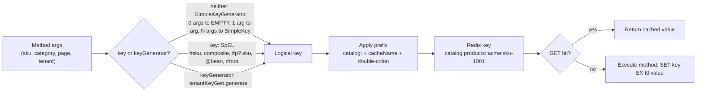

# 005 — Cache Key Design (Boot 4.1 + Java 25)

> Section E of the Spring + Redis caching track. How cache keys are built, spelled, namespaced, versioned, and debugged — all examples in the **product-catalog domain** (`Product`, `ProductService`, `ProductRepository`).

**Stack:** Spring Boot 4.1, Java 25, `spring-boot-starter-cache` +
`spring-boot-starter-data-redis` (Lettuce, Redis 7+/8). Keys below are logical
`Cache` keys; the Redis wire form adds prefix + serialization per
[Redis Cache Configuration](./004-redis-cache-configuration.md).

**Prerequisites:** [Spring Cache Fundamentals](./001-spring-cache-fundamentals.md),
[Cache Annotations](./003-cache-annotations.md),
[Redis Cache Configuration](./004-redis-cache-configuration.md).
**Next:** [Invalidation and Consistency](./006-invalidation-and-consistency.md) ·
[Testing and Debugging](./010-testing-debugging.md).

---

## Table of Contents

- [1. Default Key Generation](#1-default-key-generation)
- [2. Simple vs Compound Keys](#2-simple-vs-compound-keys)
- [3. SpEL Keys](#3-spel-keys)
- [4. Custom `KeyGenerator` Bean](#4-custom-keygenerator-bean)
- [5. User, Tenant, Request, and Business-ID Keys](#5-user-tenant-request-and-business-id-keys)
- [6. Collisions](#6-collisions)
- [7. Prefixes and Naming Convention](#7-prefixes-and-naming-convention)
- [8. Null and `Optional` Parameters](#8-null-and-optional-parameters)
- [9. Versioning Keys](#9-versioning-keys)
- [10. Multi-Tenant Keys](#10-multi-tenant-keys)
- [11. No Secrets in Keys](#11-no-secrets-in-keys)
- [12. Miss Debugging Playbook](#12-miss-debugging-playbook)
- [13. `redis-cli` Inspection Session](#13-redis-cli-inspection-session)
- [14. Key Assembly Flow](#14-key-assembly-flow)
- [Pitfalls](#pitfalls)
- [Interview Q&A](#interview-qa)
- [Resources](#resources)

---

## 1. Default Key Generation

No `key` and no `keyGenerator` → `SimpleKeyGenerator`. Purely positional: it sees
the argument list, never parameter names or types.

| Args | Rule | Stored key |
|---|---|---|
| 0 args | `SimpleKey.EMPTY` | One shared singleton entry per cache name |
| 1 arg | arg itself | `sku-1001`, `42`, the `Product` instance |
| N args | `SimpleKey(arg1, …, argN)` | Deep-equals composite over all arguments |

```java
@Cacheable("catalogStats") // 0 args -> SimpleKey.EMPTY: exactly ONE entry
public long countAllProducts() { return products.count(); }

@Cacheable("catalog") // N args, no key -> SimpleKey("electronics", 2)
public List<Product> search(String category, int page) {
    return products.findByCategory(category, page);
}
```

Defaults suit single-argument lookups in a dedicated cache. Two single-arg methods
sharing one cache collide on equal values (`getBySku("x")` vs `getById("x")`,
see §6). Anything shared or composite deserves explicit SpEL.

> `key` and `keyGenerator` are mutually exclusive — setting both fails at startup.
> Class-level default: `@CacheConfig(keyGenerator = "…")`.

---

## 2. Simple vs Compound Keys

**Simple key:** one atomic identifier — SKU, category slug, tenant id. Readable in
the CLI, cheap to evict precisely. **Compound key:** two or more facts fused —
`category + page`, `tenant + sku`, `sku + currency`. Required whenever the result
depends on more than one input.

```java
@Cacheable(value = "products", key = "#sku") // simple: one SKU, one truth
public Product getBySku(String sku) { return products.findBySku(sku).orElse(null); }

@Cacheable(value = "catalog", key = "#category + ':' + #page") // compound
public List<Product> search(String category, int page) { return products.findByCategory(category, page); }
```

**Rule:** every parameter (plus ambient input — tenant, locale, currency) that
changes the result must appear in the key or the cache name. Drop `page` from the
key and page 1 is served forever.

---

## 3. SpEL Keys

Evaluated per call. Named params need `-parameters` (Boot 4.1 plugins enable it by
default); `#p0` / `#a0` always work as fallback.

| SpEL | Example | Notes |
|---|---|---|
| `#id` | `key = "#sku"` | Named parameter; preferred form |
| Composite | `key = "'cat:' + #category + ':' + #page"` | Literal prefix + concatenation |
| Nested | `key = "#p.sku"` | Property navigation (`#product.sku`) |
| Null-safe | `key = "#p?.sku"` | `null` instead of NPE when arg is `null` |
| `#root.methodName` | `key = "#root.methodName + ':' + #sku"` | Namespaces sibling methods in one cache |
| `#root.caches` | `key = "#root.caches[0].name + ':' + #sku"` | Rarely needed; cache name already namespaces |
| `T()` static | `T(java.util.UUID).randomUUID().toString()` | **Anti-pattern** — fresh key per call, 0% hits |
| Bean | `key = "@skuHelper.normalize(#sku)"` | Delegates formatting to a Spring bean |

```java
// Composite: literal prefix + two parameters.
@Cacheable(value = "catalog", key = "'cat:' + #category + ':' + #page")
public List<Product> search(String category, int page) { return products.findByCategory(category, page); }

// Null-safe navigation + method-name namespacing + bean helper.
@Cacheable(value = "products", key = "#product?.sku")
public Product byProduct(Product product) { return products.findBySku(product.getSku()).orElse(null); }

@Cacheable(value = "products", key = "#root.methodName + ':' + #sku")
public Product getBySku(String sku) { return products.findBySku(sku).orElse(null); }

@Cacheable(value = "products", key = "@skuHelper.normalize(#sku)")
public Product getNormalized(String sku) { return products.findBySku(sku.trim().toLowerCase()).orElse(null); }
```

```java
@Component("skuHelper")
public class SkuKeyHelper {
    public String normalize(String raw) {
        return raw == null ? "null-sku" : raw.trim().toLowerCase();
    }
}
```

`#result` never exists in a `@Cacheable` key (nothing computed yet at lookup) —
only in `unless` and `@CachePut` keys. Keep expressions side-effect free: no
randoms, clocks, or repository calls.

---

## 4. Custom `KeyGenerator` Bean

Centralizes a scheme repeated across methods: tenant prefixing, normalization,
version tags. Reach for it when 3+ methods share one convention or the rule needs
Java (hashing, locale handling) that SpEL expresses poorly.

```java
package com.shop.catalog.keys;

import java.lang.reflect.Method;
import org.springframework.cache.interceptor.KeyGenerator;
import org.springframework.stereotype.Component;

@Component("tenantKeyGen")
public class TenantKeyGenerator implements KeyGenerator {

    private final TenantContext tenants;

    public TenantKeyGenerator(TenantContext tenants) {
        this.tenants = tenants;
    }

    @Override
    public Object generate(Object target, Method method, Object... params) {
        StringBuilder sb = new StringBuilder(tenants.currentTenant());
        for (Object p : params) sb.append(':').append(p == null ? "null" : p.toString().trim().toLowerCase());
        return sb.toString(); // e.g. "acme:sku-1001"
    }
}
```

```java
package com.shop.catalog.config;

import org.springframework.cache.annotation.CacheConfig;
import org.springframework.cache.annotation.EnableCaching;
import org.springframework.cache.interceptor.KeyGenerator;
import org.springframework.context.annotation.Bean;
import org.springframework.context.annotation.Configuration;
import com.shop.catalog.keys.TenantContext;
import com.shop.catalog.keys.TenantKeyGenerator;

@Configuration
@EnableCaching
@CacheConfig(keyGenerator = "tenantKeyGen") // default for every method in scope
public class CatalogCacheKeys {

    @Bean("tenantKeyGen")
    KeyGenerator tenantKeyGen(TenantContext tenants) {
        return new TenantKeyGenerator(tenants);
    }
}
```

```java
@Cacheable(value = "products", keyGenerator = "tenantKeyGen")
public Product getBySku(String sku) {
    return products.findBySku(sku).orElse(null);
}
```

Keep `generate()` pure and fast — it runs on every call, hit or miss. No clocks,
randoms, or unbounded `toString()` dumps.

---

## 5. User, Tenant, Request, and Business-ID Keys

```java
// User-scoped (high cardinality — short TTL) / tenant-scoped / request idempotency (minutes only) / business id (ideal).
@Cacheable(value = "recommendations", key = "#userId + ':' + #category")
public List<Product> recommend(String userId, String category) { return products.recommendFor(userId, category); }

@Cacheable(value = "products", key = "#tenantId + ':' + #sku")
public Product getForTenant(String tenantId, String sku) { return products.findByTenantAndSku(tenantId, sku).orElse(null); }

@Cacheable(value = "checkoutAttempts", key = "#requestId")
public Receipt checkout(String requestId, Cart cart) { return checkoutService.charge(requestId, cart); }

@Cacheable(value = "products", key = "#sku")
public Product getBySku(String sku) { return products.findBySku(sku).orElse(null); }
```

Prefer business ids wherever possible: stable, unique, shared between read and eviction paths.

---

## 6. Collisions

Same cache name + same key shape across methods → the second `put` silently
overwrites the first, and readers get each other's rows.

```java
// COLLISION: both land on "sku-1001" inside "products".
@Cacheable(value = "products", key = "#sku")
public Product getBySku(String sku) { return products.findBySku(sku).orElse(null); }

@Cacheable(value = "products", key = "#id")
public Product getById(String id) { return products.findById(id).orElse(null); }
```

Fix by namespacing — pick one convention and apply it everywhere:

```java
// Option A: separate cache names (own TTL policy each).
@Cacheable(value = "products-by-sku", key = "#sku")
public Product getBySku(String sku) { return products.findBySku(sku).orElse(null); }

// Option B: method namespace inside a shared cache.
@Cacheable(value = "products", key = "'sku:' + #sku")
public Product getBySku2(String sku) { return products.findBySku(sku).orElse(null); }

@Cacheable(value = "products", key = "'id:' + #id")
public Product getById(String id) { return products.findById(id).orElse(null); }
```

Audit: `redis-cli --scan --pattern '<prefix>*' | sort` must show one entry per
logical row. Duplicates or cross-served rows mean read and write paths spell
different keys — align them before blaming "stale cache".

---

## 7. Prefixes and Naming Convention

Spring Cache on Redis writes `prefix + cacheName + "::" + key`. Convention:

```text
service:cache:version:entity:id
catalog:products:v2:sku-1001
catalog:catalog:v1:electronics:2
```

i.e. `catalog:products::acme:sku-1001` on the wire when the logical key already
carries the tenant. Keep segments lowercase, colon-separated, no spaces — colons
are the convention RedisInsight splits on.

```java
@Bean
RedisCacheManager cacheManager(RedisConnectionFactory cf) {
    var keys = new StringRedisSerializer();
    var values = new GenericJackson2JsonRedisSerializer();
    var defaults = RedisCacheConfiguration.defaultCacheConfig()
            .entryTtl(Duration.ofMinutes(10))
            .serializeKeysWith(SerializationPair.fromSerializer(keys))
            .serializeValuesWith(SerializationPair.fromSerializer(values))
            .prefixCacheNameWith("catalog:"); // "catalog:" + "products" + "::" + key
    return RedisCacheManager.builder(cf).cacheDefaults(defaults).build();
}
```

`prefixCacheNameWith` is global and static — it cannot vary per request. Put `v1` /
`v2` and tenant segments in the cache name (`products-v2`) or the key
(`tenant:sku`), never by rebuilding the prefix dynamically.

---

## 8. Null and `Optional` Parameters

A `null` key argument does not skip caching — it funnels every null-arg call onto
one shared entry (`"null"` via SpEL concatenation, `SimpleKey(null)` by default).

| Call | Key produced | Effect |
|---|---|---|
| `getBySku(null)`, `key = "#sku"` | `null` key — lookup fails / skipped | Guard with `condition` |
| `search(null, 2)`, composite SpEL | `"null:2"` | All null-category calls share one entry |
| `getOpt(Optional.empty())`, default gen | `SimpleKey(Optional.empty)` | Keyed on the wrapper, not the content |
| `#product?.sku`, product `null` | `null` | Same funnel — add `condition` |

```java
// Skip caching when the key input is absent — don't park nulls in Redis.
@Cacheable(value = "products", key = "#sku", condition = "#sku != null")
public Product getBySku(String sku) { return products.findBySku(sku).orElse(null); }

// Unwrap Optional BEFORE it reaches the generator — key on content, never the wrapper.
@Cacheable(value = "products", key = "#sku")
public Product getOpt(String sku) { return products.findBySku(sku).orElse(null); }
// Caller: service.getOpt(opt.orElse(null)) — never pass the Optional itself.
```

Pair with `unless = "#result == null"` (see
[Cache Annotations](./003-cache-annotations.md)) so a miss that finds nothing does
not also store a placeholder under the null-derived key.

---

## 9. Versioning Keys

Schemas change: `Product` gains a field, price math changes, value serialization
moves. A version segment (`v1` → `v2`) gives new code a clean keyspace while old
entries age out — no downtime, no `FLUSHDB`.

```java
// v1 reader (old): @Cacheable(value = "products-v1", key = "#sku")
// v2 reader (new): version lives in the cache name.
@Cacheable(value = "products-v2", key = "#sku")
public Product getBySkuV2(String sku) {
    return products.findBySku(sku).orElse(null);
}
```

```java
@Component
public class CatalogVersionRollover {
    private final CacheManager caches;
    public CatalogVersionRollover(CacheManager caches) { this.caches = caches; }

    // After deploy: drain the previous version so memory returns promptly.
    public void evictOldVersion() {
        var v1 = caches.getCache("products-v1");
        if (v1 != null) v1.clear();
    }
}
```

Rollover: (1) deploy reading `products-v2` (miss → DB fallback); (2) let `v2` fill
naturally; (3) `clear()` `products-v1` off-peak and drop its config. Versions only
move forward — never redefine `v1` for a new schema.

---

## 10. Multi-Tenant Keys

| Strategy | Key shape | Pros | Cons |
|---|---|---|---|
| Tenant in key | `acme:sku-1001` in `products` | One cache, simple ops | One forgotten segment cross-contaminates |
| Separate cache | `products-acme :: sku-1001` | Hard isolation, per-tenant TTL | Name explosion; needs a `CacheResolver` |
| Cluster hash tag | `{acme}:sku-1001` | One slot per tenant — efficient multi-key ops | Matters only on Cluster |

```java
// Tenant in key — cheapest; centralize via tenantKeyGen (§4) so no method forgets it.
@Cacheable(value = "products", key = "#tenantId + ':' + #sku")
public Product byTenantInKey(String tenantId, String sku) {
    return products.findByTenantAndSku(tenantId, sku).orElse(null);
}

// Hash tag — same, but braces pin the Cluster slot for Lua / multi-key pipelines.
@Cacheable(value = "products", key = "'{' + #tenantId + '}:' + #sku")
public Product byTenantHashTag(String tenantId, String sku) {
    return products.findByTenantAndSku(tenantId, sku).orElse(null);
}
```

Default to **tenant-in-key**. Separate caches only for per-tenant TTL or hard size
isolation (resolver side in
[Redis Cache Configuration](./004-redis-cache-configuration.md)). `{tenant}` tags
only on Cluster *and* only when multi-key commands must share a slot — plain
`GET`/`SET` workloads gain nothing from tags.

---

## 11. No Secrets in Keys

Keys are operational data: `MONITOR` output, `SLOWLOG` entries, `--scan` dumps,
metrics labels, logs, crash reports. Anything in the key is plaintext on the wire
and at rest.

```java
// NEVER: token or PII in the key — leaks into MONITOR / slowlog.
@Cacheable(value = "sessions", key = "#authToken")
public Session session(String authToken) { return sessions.lookup(authToken); }

// INSTEAD: hash the secret, cache by the digest.
@Cacheable(value = "sessions", key = "@shaHelper.hex(#authToken)")
public Session sessionByHash(String authToken) { return sessions.lookup(authToken); }
```

Hash with SHA-256 (keyed HMAC when the digest must resist rainbow tables) and keep
the raw secret out of SpEL. Same for emails/phones: normalize → hash, or key by
the surrogate user id.

---

## 12. Miss Debugging Playbook

A miss = lookup key differed from stored key, entry expired, or lookup never
reached Redis. Work in order:

1. **`TRACE` the `CacheInterceptor`.** `logging.level.org.springframework.cache=TRACE`
   logs computed key, cache name, hit/miss. No lines → proxy never intercepted
   (self-invocation, `private`/`final`, missing `@EnableCaching`).
2. **Scan the keyspace.** `redis-cli --scan --pattern 'catalog:*'` shows what is
   really stored. Duplicates/missing entries → read/write key mismatch.
3. **`MONITOR` one call.** `redis-cli MONITOR`, invoke once, compare the `GET` key
   with the earlier `SET` key byte for byte.
4. **Check TTL.** `TTL <key>`: `-2` = absent (never stored/evicted), `-1` = no
   expiry (TTL misconfigured), countdown = alive.
5. **Suspect the key serializer.** Keys must use `StringRedisSerializer`. A cache
   switched to JSON/JDK key serialization writes binary keys the CLI `GET` never
   matches (`catalog:products::\x00…`). Standardize per
   [Redis Cache Configuration](./004-redis-cache-configuration.md).

```properties
logging.level.org.springframework.cache=TRACE
logging.level.org.springframework.data.redis.cache=DEBUG
```

---

## 13. `redis-cli` Inspection Session

One session proving the scheme end to end — scan, read, TTL, `MONITOR`, evict:

```bash
# 1. What did the app actually write?
redis-cli --scan --pattern 'catalog:*' | sort
# catalog:products::acme:sku-1001
# catalog:products::acme:sku-1002
# catalog:catalog::cat:electronics:2

# 2. Read one entry + check its TTL (-2 missing, -1 no expiry).
redis-cli GET 'catalog:products::acme:sku-1001'
redis-cli TTL 'catalog:products::acme:sku-1001'
# (integer) 512

# 3. Watch a single call (second terminal): GET key must equal the SET key above.
redis-cli MONITOR | grep -i 'sku-1001'

# 4. Evict one SKU precisely, then confirm the miss path refills it.
redis-cli DEL 'catalog:products::acme:sku-1001'
redis-cli --scan --pattern 'catalog:products*' | wc -l
```

---

## 14. Key Assembly Flow



Debug left to right: wrong input at A (null arg), wrong branch at B, mismatched
expression at C, or prefix/serializer drift at D each leaves a distinct `MONITOR`
signature.

---

## Pitfalls

!!! warning "GOLD — cache-key pitfalls (read before shipping)"
    - **Shared cache + default keys** — `getBySku`/`getById` on `"sku-1001"` overwrite each other; namespace by cache name or key prefix.
    - **Under-specified compound keys** — `search(category)` without `page` serves page 1 forever; every result-varying input belongs in the key.
    - **`T(UUID.randomUUID())` / clocks in SpEL** — fresh key per call guarantees 0% hits.
    - **`#result` in a `@Cacheable` key** — no result exists at lookup time; `@CachePut`/`unless`-only.
    - **Null-arg funnel** — `null` becomes `"null"`/`SimpleKey(null)`; guard with `condition = "#arg != null"`.
    - **Caching the `Optional` wrapper** — unwrap first; key on content, never `Optional.empty`.
    - **Read/write key mismatch** — `@CachePut` spelling differs from the reader; diff with `--scan`.
    - **Secrets/PII in keys** — keys land in `MONITOR`/`SLOWLOG`/dumps; hash credentials, key by digest.
    - **Missing tenant segment** — one method without it leaks rows across tenants; centralize in a `KeyGenerator`.
    - **Binary key serializer** — JSON/JDK keys are unreadable and CLI-unmatchable; keep `StringRedisSerializer` for keys.
    - **Version reuse** — never redefine `v1`; roll forward and `clear()` the old cache off-peak.

---

## Interview Q&A

**Q1. No `key` declared — what key does Spring use for zero, one, and many args?**
`SimpleKeyGenerator`: 0 → shared `SimpleKey.EMPTY` (one entry per cache); 1 → the
arg itself; N → `SimpleKey(a, b, …)` with deep equality. Hence two single-arg
methods in one cache collide on equal values, and multi-arg methods are safe only
while every input is an argument.

**Q2. SpEL or custom `KeyGenerator` — which, when?**
SpEL (`#sku`, `'cat:' + #category + ':' + #page`, `#p?.sku`,
`@skuHelper.normalize(#sku)`, `#root.methodName`) for per-method composite,
nested, null-safe, or namespaced keys. `KeyGenerator` bean (`tenantKeyGen` via
`keyGenerator` / `@CacheConfig`) for service-wide rules — tenant prefix,
normalization, version tags — or Java logic SpEL handles poorly. Mutually
exclusive; read and write paths must spell byte-identical keys.

**Q3. Two methods share a cache and key shape — how do you fix it?**
Namespace: split cache names (`products-by-sku` vs `products-by-id`, own TTLs each)
or prefix inside the key (`'sku:' + #sku` vs `'id:' + #id`, or `#root.methodName`).
Verify with `redis-cli --scan --pattern '<prefix>*' | sort` — one entry per row.

**Q4. How do you version keys and isolate tenants?**
Version in cache name/key (`products-v2`): deploy the new reader, let `v2` fill on
misses, `clear()` `products-v1` off-peak — never redefine old versions. Tenants:
default tenant-in-key (`acme:sku-1001` via `KeyGenerator`); separate caches for
per-tenant TTL/isolation; `{tenant}` hash tags only on Cluster when multi-key ops
must share a slot.

**Q5. Hits are zero though Redis holds data — debug sequence?**
(1) `TRACE` `org.springframework.cache` — computed key + did the proxy intercept?
(2) `--scan --pattern` — read/write key mismatch? (3) `MONITOR` one call — diff
`GET` vs stored `SET` byte for byte. (4) `TTL` — `-2` absent, `-1` no expiry.
(5) Key serializer — non-`String` serialization writes binary keys the CLI never
matches. Null funnels and missing tenant segments are the usual shape culprits.

---

## Resources

- Spring Framework reference — Cache Abstraction (key generation, SpEL context):
  [docs.spring.io/spring-framework/reference/integration/cache.html](https://docs.spring.io/spring-framework/reference/integration/cache.html)
- Spring Data Redis reference — `RedisCacheConfiguration`, serialization, prefixes:
  [docs.spring.io/spring-data-redis/reference/redis/redis-cache.html](https://docs.spring.io/spring-data-redis/reference/redis/redis-cache.html)
- Redis docs — keyspace, `SCAN`, `MONITOR`, `TTL`, Cluster hash tags:
  [redis.io/docs/latest/develop/using-commands/keyspace/](https://redis.io/docs/latest/develop/using-commands/keyspace/)
- Track companions: [Cache Annotations](./003-cache-annotations.md) ·
  [Redis Cache Configuration](./004-redis-cache-configuration.md) ·
  [Invalidation and Consistency](./006-invalidation-and-consistency.md) ·
  [Testing and Debugging](./010-testing-debugging.md)
