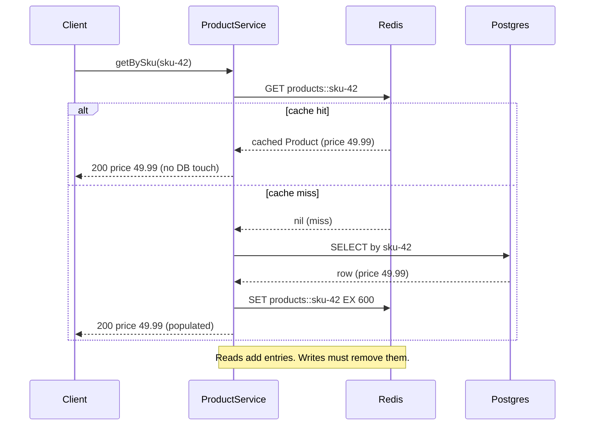
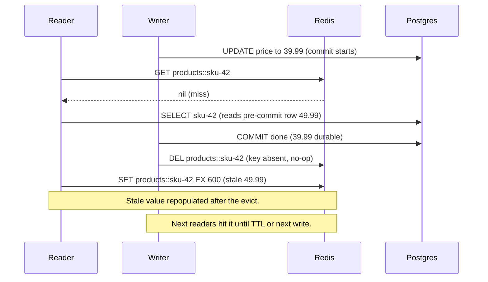
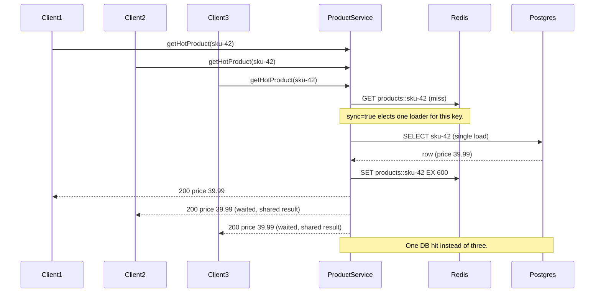

# 006 — Invalidation and Consistency (Boot 4.1 + Java 25)

> Section F of the Spring + Redis caching track. How cached product data stops being true — TTL expiry, explicit eviction, refresh-vs-evict, write-through invalidation, stale windows, multi-instance visibility, races, stampede / penetration / avalanche, warming, negative caching, transaction boundaries, failure handling, and event-driven invalidation.

**Stack:** Spring Boot **4.1**, Java **25**, Spring Framework **7.x**, `spring-boot-starter-cache` + `spring-boot-starter-data-redis` (Lettuce, Redis 7+/8). Domain throughout is **product-catalog** (`Product`, `ProductRepository`, `ProductService`, caches `products`, `products:search`, `priceLists`).

**Prerequisites:** [Spring Cache Fundamentals](./001-spring-cache-fundamentals.md) · [Cache Annotations](./003-cache-annotations.md) · [Redis Cache Configuration](./004-redis-cache-configuration.md) · [Redis Introduction](./redis.md).

**Next:** [Product Catalog Example](./007-product-catalog-example.md) · [Advanced Production](./009-advanced-production.md).

---

## Table of Contents

- [1. The core problem](#1-the-core-problem)
- [2. TTL expiration](#2-ttl-expiration)
- [3. Explicit invalidation with `@CacheEvict`](#3-explicit-invalidation-with-cacheevict)
- [4. Refresh with `@CachePut` and the refresh-vs-evict decision](#4-refresh-with-cacheput-and-the-refresh-vs-evict-decision)
- [5. Invalidation after DB writes (write-through-app)](#5-invalidation-after-db-writes-write-through-app)
- [6. Read-after-write consistency and the stale window](#6-read-after-write-consistency-and-the-stale-window)
- [7. Staleness causes](#7-staleness-causes)
- [8. Multi-instance consistency](#8-multi-instance-consistency)
- [9. Races: lost updates and check-and-set](#9-races-lost-updates-and-check-and-set)
- [10. Stampede, penetration, avalanche](#10-stampede-penetration-avalanche)
- [11. Warming and preloading](#11-warming-and-preloading)
- [12. Negative caching](#12-negative-caching)
- [13. Transaction boundaries](#13-transaction-boundaries)
- [14. DB transactions are not Redis atomicity](#14-db-transactions-are-not-redis-atomicity)
- [15. Failed-update strategies](#15-failed-update-strategies)
- [16. Outbox pattern and event-driven invalidation](#16-outbox-pattern-and-event-driven-invalidation)
- [Pitfalls](#pitfalls)
- [Interview Q&A](#interview-qa)
- [Resources](#resources)

---

## 1. The core problem

**WHAT:** Caching copies a row under a key with a lifetime; from that instant the copy ages. Invalidation decides **when that copy stops being served** — by time (TTL), explicit signal (evict), overwrite (refresh), or external event (message).

**WHY:** Every production cache incident is an invalidation incident. `GET /products/sku-42` caches price `49.99` for 10 minutes, an admin sets `39.99` in Postgres, and shoppers see `49.99` until the entry expires or is evicted. Designs: **short TTL + bounded staleness**, or **evict/refresh on every mutation + ordering complexity**. Most catalogs need both, per cache.

```java
package com.shop.catalog.model;

import java.math.BigDecimal;
import java.time.Instant;

public record Product(String sku, String name, BigDecimal price, int stock, Instant updatedAt) {}
```

```java
package com.shop.catalog.repo;

import com.shop.catalog.model.Product;
import java.util.List;
import java.util.Optional;

public interface ProductRepository {
    Optional<Product> findBySku(String sku);
    List<Product> findByCategory(String category);
    Product save(Product product);
    void deleteBySku(String sku);
}
```

> Reads add entries, writes remove or replace them, and time removes whatever writes miss.

---

## 2. TTL expiration

**WHAT:** Every Redis entry carries a TTL. On lapse Redis drops the key (lazy on access + active sampling) and the next read repopulates from the DB.

**WHY:** TTL is the only invalidation that works when the writer **bypasses the app** — manual SQL fix, bulk import, another service on the same table. Explicit eviction cannot fire if your code never runs; expiry still converges.

```java
package com.shop.catalog.config;

import java.time.Duration;
import org.springframework.cache.CacheManager;
import org.springframework.context.annotation.Bean;
import org.springframework.context.annotation.Configuration;
import org.springframework.data.redis.cache.RedisCacheConfiguration;
import org.springframework.data.redis.cache.RedisCacheManager;
import org.springframework.data.redis.connection.RedisConnectionFactory;
import org.springframework.data.redis.serializer.GenericJackson2JsonRedisSerializer;
import org.springframework.data.redis.serializer.RedisSerializationContext;

@Configuration
public class CatalogCacheConfig {
    @Bean
    CacheManager cacheManager(RedisConnectionFactory cf) {
        var ser = new GenericJackson2JsonRedisSerializer();
        var defaults = RedisCacheConfiguration.defaultCacheConfig()
                .entryTtl(Duration.ofMinutes(5)).disableCachingNullValues()
                .serializeValuesWith(RedisSerializationContext.SerializationPair.fromSerializer(ser));
        return RedisCacheManager.builder(cf).cacheDefaults(defaults)
                .withCacheConfiguration("products", defaults.entryTtl(Duration.ofMinutes(10)))
                .withCacheConfiguration("products:search", defaults.entryTtl(Duration.ofMinutes(2)))
                .withCacheConfiguration("priceLists", defaults.entryTtl(Duration.ofSeconds(60)))
                .build();
    }
}
```

| Cache | TTL | Reasoning |
|---|---|---|
| `products` | 5–10 min | Hot keys; explicit evict backs it up, TTL is the safety net |
| `products:search` | 1–2 min | Key space explodes (`shoes:0`, `shoes:1`…); expiry does the cleanup |
| `priceLists` | 30–60 s | Bounds overcharge/undercharge windows |
| Negative entries | 30–60 s | A restock must become visible fast (§12) |

Two facts: TTL is **set at write time, not sliding** (`SET … EX ttl` per put; hits do not extend life), and **`@Cacheable` has no TTL attribute** — policy lives on the `CacheManager` (see [004](./004-redis-cache-configuration.md)). Verify with `redis-cli TTL "products::sku-42"`.

---

## 3. Explicit invalidation with `@CacheEvict`

**WHAT:** `@CacheEvict` deletes entries on a write method using the reader's key (`DEL`; `CLEAR` for `allEntries=true`). Full attribute semantics in [003](./003-cache-annotations.md).

**WHY:** TTL alone leaves a stale window up to the full TTL. Explicit eviction closes it to milliseconds on paths your code controls.

```java
package com.shop.catalog.service;

import com.shop.catalog.model.Product;
import com.shop.catalog.repo.ProductRepository;
import org.springframework.cache.annotation.CacheEvict;
import org.springframework.cache.annotation.Cacheable;
import org.springframework.cache.annotation.Caching;
import org.springframework.stereotype.Service;

@Service
public class ProductService {
    private final ProductRepository products;
    public ProductService(ProductRepository products) { this.products = products; }

    @Cacheable(value = "products", key = "#sku")
    public Product getBySku(String sku) {
        return products.findBySku(sku).orElseThrow(() -> new ProductNotFoundException(sku));
    }

    @CacheEvict(value = "products", key = "#product.sku")
    public Product updatePrice(Product product) { return products.save(product); }

    @Caching(evict = {
            @CacheEvict(value = "products", key = "#sku"),
            @CacheEvict(value = "products:search", allEntries = true)
    })
    public void deleteBySku(String sku) { products.deleteBySku(sku); }
}
```

Rules: reader and writer must spell **byte-identical keys** (SpEL both sides; check `redis-cli --scan --pattern 'products*' | sort`). Default is **evict-after-success** (`beforeInvocation=false`): a throwing write keeps the good copy. `beforeInvocation=true` evicts even on failure — best-effort (§15) but can drop a copy the method never replaces. `allEntries=true` ignores the key: right for unbounded search/list key spaces, but a peak-time stampede trigger (§10). `DEL` on an absent key is a safe no-op.

---

## 4. Refresh with `@CachePut` and the refresh-vs-evict decision

**WHAT:** `@CachePut` always executes and **overwrites** with the return value; `@CacheEvict` always executes and **deletes**. Refresh leaves a warm entry; eviction leaves a cold miss.

```java
package com.shop.catalog.service;

import com.shop.catalog.model.Product;
import com.shop.catalog.repo.ProductRepository;
import org.springframework.cache.annotation.CachePut;
import org.springframework.stereotype.Service;

@Service
public class ProductRefreshService {
    private final ProductRepository products;
    public ProductRefreshService(ProductRepository products) { this.products = products; }

    @CachePut(value = "products", key = "#product.sku")
    public Product updateAndRefresh(Product product) { return products.save(product); }
}
```

| Factor | Prefer `@CachePut` (refresh) | Prefer `@CacheEvict` (evict) |
|---|---|---|
| Rebuild cost | Expensive (join, aggregation) — keep warm | Cheap row lookup — miss is affordable |
| Fresh value | Method returns full fresh `Product` | Returns `void`/ID/partial DTO |
| Write frequency | Low (price edits) | High (per-order stock tick) |
| Truth risk | Return value **is** the truth | Triggers/generated columns change row after return |
| Failure | Failed write stores nothing; partial return poisons cache | Failed write keeps old good copy |
| Herd | None — stays warm | One cold miss per key |

Catalog defaults: `@CachePut` for price/detail edits returning the saved entity; `@CacheEvict` for `decrementStock` and deletes; one off-peak `allEntries=true` clear for bulk imports. Never `@CachePut` a stale request DTO — it cements old data as fresh.

---

## 5. Invalidation after DB writes (write-through-app)

**WHAT:** The app owns the ordering: **DB first, then evict/refresh**, on every mutation, with the reader's key.

**WHY:** Spring caching is **cache-aside**: reads populate on miss, but no `save()` propagates automatically. A write path that forgets the cache op stays stale until TTL. The app is the write-through channel.

```java
package com.shop.catalog.service;

import com.shop.catalog.model.Product;
import com.shop.catalog.repo.ProductRepository;
import org.springframework.cache.annotation.CacheEvict;
import org.springframework.cache.annotation.CachePut;
import org.springframework.cache.annotation.Caching;
import org.springframework.stereotype.Service;

@Service
public class CatalogWriteService {
    private final ProductRepository products;
    public CatalogWriteService(ProductRepository products) { this.products = products; }

    @Caching(put = @CachePut(value = "products", key = "#product.sku"),
             evict = @CacheEvict(value = "products:search", allEntries = true))
    public Product renameProduct(Product product) { return products.save(product); }

    @Caching(evict = {
            @CacheEvict(value = "products", key = "#sku"),
            @CacheEvict(value = "products:search", allEntries = true),
            @CacheEvict(value = "priceLists", allEntries = true)
    })
    public void removeProduct(String sku) { products.deleteBySku(sku); }
}
```

Audit every bypass: admin console, REST `PUT/PATCH`, CSV import, sync jobs, direct SQL migrations (only TTL saves you), a second service on the same table (§16), and `delete` paths (teams remember update, forget delete).

---

## 6. Read-after-write consistency and the stale window

**WHAT:** Read-after-write means a writer's next `GET` sees its own write. Holds only if the write invalidated the exact key **and** the read lands after the `DEL`/`SET` completes. The `COMMIT`→`DEL-ACK` gap is the **stale window** (sub-ms locally, tens of ms cross-AZ under load).

**WHY:** Users notice their own writes most. Shrink the window with synchronous eviction on the request thread (default `@CacheEvict`, so the writer's response waits for coherence) and bound it with short TTL. Name the bound ("items: ms on write path, 10 min worst case; search: 2 min") — unnamed staleness becomes a Sev-2.



---

## 7. Staleness causes

| # | Cause | Example | Fix |
|---|---|---|---|
| 1 | Write path forgets eviction | `bulkImport()` with no cache op | Audit mutations; `MONITOR` during writes |
| 2 | Read/write key mismatch | `key="#sku"` vs default key | Identical SpEL; scan keyspace |
| 3 | Write bypasses app | DBA `UPDATE` directly | Short TTL; document lag |
| 4 | Second writer service | Pricing service, same table | Event fan-out (§16) |
| 5 | Eviction lost | `DEL` fails in failover | Retry + reconciler (§15) |
| 6 | TX rollback confusion | Refresh before commit, then rollback | `afterCommit` (§13) |
| 7 | Long TTL, no fan-out | Search 30 min, evict items only | `@Caching` fan-out or 1–2 min TTL |
| 8 | Local copy | Caffeine holds old price | Pub/sub or drop L1 (§8) |
| 9 | Negative outlives fix | Absent-marker 10 min | 30–60 s negatives (§12) |
| 10 | Replica lag | Async replica read pre-`DEL` | Read-after-write from primary |

---

## 8. Multi-instance consistency

**WHAT:** Visibility depends on where bytes live. **Shared Redis: invalidation is free.** All instances share one keyspace — A's `DEL` is instantly visible to B's next `GET`. No coordination code.

**Local Caffeine: invalidation is per-JVM.** A evicts its map; B serves stale until local TTL. Fix: **pub/sub broadcast** — each instance subscribes to an invalidation topic and evicts locally. That is the bridge to **two-level caching** (L1 Caffeine + L2 Redis; full design in [009](./009-advanced-production.md)): read L1 → L2 → DB (fill both); write updates DB, `DEL`s Redis, publishes `invalidate:products:{sku}`. Redis pub/sub suffices for cache-control; Kafka (§16) is for cross-service domain events.

| Topology | Cost | Visibility | Use |
|---|---|---|---|
| Shared Redis | One `DEL` | Instant all instances | Default |
| Caffeine only | Local | Stale on siblings | Single instance / stale-tolerant |
| Two-level + pub/sub | `DEL` + broadcast | ms, more moving parts | P99 on ultra-hot keys |

> Do not add L1 for unmeasured latency. Check `redis-cli --latency-history` and P99 first.

---

## 9. Races: lost updates and check-and-set

Caching adds a shared mutable copy, so races span two systems. **Race A — read-modify-write lost update (oversell).** Two orders read `stock=5` from the same entry, subtract 2, write `3`; answer should be `1`. The non-atomic sequence is the cause; the cache widens it with a shared stale start. Prefer: (1) atomic DB update (`UPDATE … SET stock = stock - ? WHERE sku = ? AND stock >= ?`, then evict); (2) atomic `DECRBY` with async reconciliation (see 009); (3) locking (`FOR UPDATE` / `@Version`).

```java
// BROKEN: both threads read 5, both write 3. One decrement lost.
public void decrementBroken(String sku, int qty) {
    Product cached = productService.getBySku(sku);
    productRepository.save(new Product(cached.sku(), cached.name(),
            cached.price(), cached.stock() - qty, cached.updatedAt()));
}
```

**Race B — stale repopulate between `COMMIT` and `DEL`.** A reader missing in that gap loads the pre-commit row and `SET`s it *after* the writer's `DEL` (which hit an absent key) — stale entry with a full TTL. Mitigate with short TTL (bounds to one TTL), `@CachePut` refresh post-commit (writer's `SET` corrects; narrows to `SET`-vs-`SET`), **check-and-set** (`SET … NX EX`, `WATCH/MULTI`, Lua compare-and-refresh, version-stamped keys — plain `GET`-then-`SET` is not atomic), and only where proven, **delete-twice** (`DEL`, wait ~100–500 ms past read latency, `DEL` again).



---

## 10. Stampede, penetration, avalanche

| Mode | Cause | Symptom | Fix |
|---|---|---|---|
| **Stampede** (herd) | Hot key expires; hundreds miss at once | DB spike, latency cliff at expiry/deploy | `sync=true` single-flight; jittered TTL; off-peak clears; warming |
| **Penetration** | Keys that **never exist** (bad SKUs, scrapers) always miss | DB CPU up, hit rate flat | Negative caching (§12); validation; Bloom filter |
| **Avalanche** | One generation shares TTL + start (10k keys, TTL 600, all die together) | Periodic synchronized storms; sawtooth latency | Jittered TTL; staggered warming; TTL bands |

`@Cacheable(sync=true)`: one thread loads the key, same-key waiters block on the loader. Limits (fail fast): **exactly one cache, no `unless`**; **same-key only** (10 cold SKUs = 10 loads, correctly); **blocking** (size pools for loader latency); **no help for penetration** (exceptions never cache) or cross-key avalanche (pair with jitter).

```java
package com.shop.catalog.service;

import com.shop.catalog.model.Product;
import com.shop.catalog.repo.ProductRepository;
import org.springframework.cache.annotation.Cacheable;
import org.springframework.stereotype.Service;

@Service
public class HotProductService {
    private final ProductRepository products;
    public HotProductService(ProductRepository products) { this.products = products; }

    @Cacheable(value = "products", key = "#sku", sync = true)
    public Product getHotProduct(String sku) {
        return products.findBySku(sku).orElseThrow(() -> new ProductNotFoundException(sku));
    }
}
```

Jittered TTL: band per cache first (`products` 10 min, `products:search` 2 min, `priceLists` 60 s de-syncs generations); for per-key spread wrap the `CacheManager` or `expire` programmatically after write. Bloom (`BF.EXISTS` via Redis Stack, or in-app Bloom from the SKU dictionary) rejects garbage pre-DB; negatives absorb the remainder.



---

## 11. Warming and preloading

**WHAT:** Populate hot entries **before** traffic — at startup, post-deploy, post-clear — so the first shopper hits. Cold deploys are self-inflicted stampedes.

**WHY + which runner:** `ApplicationRunner` (parsed `ApplicationArguments`, `--flags`) vs `CommandLineRunner` (raw `String...`) — identical timing (post-context, pre-traffic). Use `ApplicationRunner` when flags like `--no-cache-warm` matter.

```java
package com.shop.catalog.warmup;

import com.shop.catalog.service.ProductService;
import java.util.List;
import org.slf4j.Logger;
import org.slf4j.LoggerFactory;
import org.springframework.boot.ApplicationArguments;
import org.springframework.boot.ApplicationRunner;
import org.springframework.stereotype.Component;

@Component
public class CatalogCacheWarmer implements ApplicationRunner {
    private static final Logger log = LoggerFactory.getLogger(CatalogCacheWarmer.class);
    private final ProductService products;
    private static final List<String> HOT_SKUS = List.of("sku-42", "sku-77", "sku-101");
    public CatalogCacheWarmer(ProductService products) { this.products = products; }

    @Override
    public void run(ApplicationArguments args) {
        if (args.containsOption("no-cache-warm")) { log.info("Warming skipped"); return; }
        int warmed = 0;
        for (String sku : HOT_SKUS) {
            try { products.getBySku(sku); warmed++; }
            catch (Exception ex) { log.warn("Warmup miss sku={}: {}", sku, ex.toString()); }
        }
        log.info("Warming done: {} entries", warmed);
    }
}
```

(`CommandLineRunner` variant is identical with `run(String... args)` — use when no flag parsing is needed.) Discipline: **best-effort per key** (catch-and-log; slow Redis must not crash the deploy), **top-N only** (trailing-7-day sales, not full catalog), **stagger replicas** (random 0–5 s sleep), **re-warm after bulk clears**.

---

## 12. Negative caching

**WHAT:** Cache the *absence* — `null` or `"ABSENT"` marker with **short TTL** — so missing-SKU traffic (typos, scrapers, bugs, thousands/min) does not each hit the DB.

```java
package com.shop.catalog.config;

import java.time.Duration;
import org.springframework.cache.CacheManager;
import org.springframework.context.annotation.Bean;
import org.springframework.context.annotation.Configuration;
import org.springframework.data.redis.cache.RedisCacheConfiguration;
import org.springframework.data.redis.cache.RedisCacheManager;
import org.springframework.data.redis.connection.RedisConnectionFactory;

@Configuration
public class NegativeCacheConfig {
    @Bean
    CacheManager negativeAwareCacheManager(RedisConnectionFactory cf) {
        var products = RedisCacheConfiguration.defaultCacheConfig()
                .entryTtl(Duration.ofMinutes(10)).disableCachingNullValues();
        var missing = RedisCacheConfiguration.defaultCacheConfig()
                .entryTtl(Duration.ofSeconds(45)); // nulls allowed: no disable call
        return RedisCacheManager.builder(cf).cacheDefaults(products)
                .withCacheConfiguration("products:missing", missing).build();
    }
}
```

```java
package com.shop.catalog.service;

import com.shop.catalog.model.Product;
import com.shop.catalog.repo.ProductRepository;
import org.springframework.cache.annotation.Cacheable;
import org.springframework.stereotype.Service;

@Service
public class ProductLookupService {
    private final ProductRepository products;
    public ProductLookupService(ProductRepository products) { this.products = products; }

    @Cacheable(value = "products", key = "#sku", unless = "#result == null")
    public Product getBySkuOrNull(String sku) { return products.findBySku(sku).orElse(null); }

    @Cacheable(value = "products:missing", key = "#sku", unless = "#result != null")
    public String missingMarker(String sku) {
        return products.findBySku(sku).isPresent() ? null : "ABSENT";
    }
}
```

Rules: **30–60 s TTL max** (a product created right after a marker must appear); **evict the negative on create** (both `products` and `products:missing`); **separate cache name** for independent TTL/metrics. Prefer an explicit sentinel via `RedisTemplate` when serializers drop nulls or metrics must split miss-vs-absent.

---

## 13. Transaction boundaries

**WHAT:** `@Transactional` + cache ops span **two uncoordinated systems**: JDBC commit/rollback and immediate Redis `DEL`/`SET`. Spring orders interceptors; it does not fuse them.

| Ordering | Failure | Verdict |
|---|---|---|
| **Evict-then-commit** (`@CacheEvict` in TX, `DEL` now, commit after) | `DEL` runs, `COMMIT` fails → good copy lost; §9 refill can cache the old row | Avoid |
| **Commit-then-evict** (`afterCommit`) | Rollback → cache untouched; commit → evict in ms | **Default** |

```java
package com.shop.catalog.service;

import com.shop.catalog.model.Product;
import com.shop.catalog.repo.ProductRepository;
import java.util.Objects;
import org.springframework.cache.CacheManager;
import org.springframework.stereotype.Service;
import org.springframework.transaction.annotation.Transactional;
import org.springframework.transaction.support.TransactionSynchronization;
import org.springframework.transaction.support.TransactionSynchronizationManager;

@Service
public class TransactionalCatalogService {
    private final ProductRepository products;
    private final CacheManager caches;
    public TransactionalCatalogService(ProductRepository products, CacheManager caches) {
        this.products = products; this.caches = caches;
    }

    @Transactional
    public Product updatePriceTx(Product product) {
        Product saved = products.save(product);
        String sku = saved.sku();
        TransactionSynchronizationManager.registerSynchronization(new TransactionSynchronization() {
            @Override
            public void afterCommit() {
                Objects.requireNonNull(caches.getCache("products")).evict(sku);
                Objects.requireNonNull(caches.getCache("products:search")).clear();
            }
        });
        return saved;
    }
}
```

No active TX → `registerSynchronization` throws; guard with `isActive()` and fall back to immediate evict. `afterCommit` runs on the request thread, so the response still waits for the `DEL` (writer's follow-up read is coherent). Declarative equivalent: `@TransactionalEventListener(phase = AFTER_COMMIT)` on `PriceChanged(sku)` — same ordering, pairs with §16.

---

## 14. DB transactions are not Redis atomicity

Postgres and Redis are **two systems, no shared manager, no XA/2PC** spanning "row commit + `DEL` ack". Every cache-aside write is **two commits with a crash window**: crash after commit, before `DEL` → new row, old cache (fix: reconciler §15 + short TTL); crash after `DEL`, before commit (evict-then-commit) → cold cache, old row repopulated as if fresh (worse; fix structurally with §13); `SET` ok + DB rollback (`@CachePut` in TX) → cache holds a never-existent row (fix: refresh only in `afterCommit`). Redis gives single-command atomicity (`SET`/`DEL`/`DECRBY`/Lua) and same-shard `MULTI/EXEC` — atomic vs other Redis clients, saying nothing about Postgres; Spring's `RedisTransactionManager` binds Redis-only `MULTI/EXEC`, never enlists JDBC. **The DB is the record; the cache is a best-effort self-healing copy.**

---

## 15. Failed-update strategies

DB ok + `DEL`/`SET` failed (timeout, failover, blip) needs a built retry. Layer 1 — **evict-on-failure in-request:** catch, log, async retry; never roll back committed truth for a best-effort copy.

```java
package com.shop.catalog.service;

import com.shop.catalog.model.Product;
import com.shop.catalog.repo.ProductRepository;
import org.slf4j.Logger;
import org.slf4j.LoggerFactory;
import org.springframework.cache.CacheManager;
import org.springframework.scheduling.annotation.Async;
import org.springframework.stereotype.Service;
import org.springframework.transaction.annotation.Transactional;

@Service
public class ResilientCatalogService {
    private static final Logger log = LoggerFactory.getLogger(ResilientCatalogService.class);
    private final ProductRepository products;
    private final CacheManager caches;
    public ResilientCatalogService(ProductRepository products, CacheManager caches) {
        this.products = products; this.caches = caches;
    }

    @Transactional
    public Product updateWithEvictRetry(Product product) {
        Product saved = products.save(product);
        try { caches.getCache("products").evict(saved.sku()); }
        catch (Exception ex) {
            log.warn("Evict failed sku={}, retrying: {}", saved.sku(), ex.toString());
            retryEvictAsync(saved.sku());
        }
        return saved;
    }

    @Async
    public void retryEvictAsync(String sku) {
        try { Thread.sleep(500); caches.getCache("products").evict(sku); }
        catch (Exception ex) { log.error("Evict retry failed sku={}", sku, ex); }
    }
}
```

Layer 2 — **reconcile job:** `@Scheduled(fixedDelay = 5m)` evicts SKUs from indexed `findSkusUpdatedSince(now - 10m, 500)` (overlapping window survives one missed run; cap/page; skip when Redis unhealthy), clearing `products:search` if anything moved. Layer 3 — **durable outbox** (§16) when "stale 5 min" is unacceptable: eviction intent commits in the same DB TX so crashes lose nothing.

---

## 16. Outbox pattern and event-driven invalidation

**WHAT:** Writer commits a domain event into an **outbox table in the same DB TX** as the row; a relay publishes to Kafka (durable, cross-service) or Redis pub/sub (ephemeral, cache-control); each service evicts its own caches. Solves crash-between-commit-and-`DEL` (outbox row survived atomically) and cross-service fan-out (search, pricing, BFF). Flow: `TX(UPDATE + INSERT outbox)` → `COMMIT` → relay polls unpublished → publishes → each consumer evicts idempotently.

```sql
CREATE TABLE product_outbox (
    id BIGSERIAL PRIMARY KEY, aggregate TEXT NOT NULL DEFAULT 'product',
    sku TEXT NOT NULL, event_type TEXT NOT NULL, payload JSONB NOT NULL,
    created_at TIMESTAMPTZ NOT NULL DEFAULT now(), published BOOLEAN NOT NULL DEFAULT FALSE
);
CREATE INDEX ix_product_outbox_unpublished ON product_outbox (id) WHERE NOT published;
```

```java
package com.shop.catalog.service;

import com.fasterxml.jackson.databind.ObjectMapper;
import com.shop.catalog.model.Product;
import com.shop.catalog.outbox.ProductOutboxEvent;
import com.shop.catalog.outbox.ProductOutboxRepository;
import com.shop.catalog.repo.ProductRepository;
import java.util.Map;
import org.springframework.stereotype.Service;
import org.springframework.transaction.annotation.Transactional;

@Service
public class OutboxCatalogService {
    private final ProductRepository products;
    private final ProductOutboxRepository outbox;
    private final ObjectMapper mapper;
    public OutboxCatalogService(ProductRepository products, ProductOutboxRepository outbox, ObjectMapper mapper) {
        this.products = products; this.outbox = outbox; this.mapper = mapper;
    }

    @Transactional // row + event commit together, or neither does
    public Product updatePriceWithEvent(Product product) {
        Product saved = products.save(product);
        var payload = mapper.valueToTree(Map.of("sku", saved.sku(), "price", saved.price().toString()));
        outbox.save(new ProductOutboxEvent(saved.sku(), "PRICE_CHANGED", payload));
        return saved;
    }
}
```

Idempotent Kafka consumer (redelivery-safe: absent-key evict is a no-op; key Kafka partitioning by SKU for per-product order; throw on poison for retry/DLT since the row already committed):

```java
package com.shop.catalog.events;

import com.fasterxml.jackson.databind.JsonNode;
import com.fasterxml.jackson.databind.ObjectMapper;
import org.slf4j.Logger;
import org.slf4j.LoggerFactory;
import org.springframework.cache.CacheManager;
import org.springframework.kafka.annotation.KafkaListener;
import org.springframework.stereotype.Component;

@Component
public class ProductInvalidationListener {
    private static final Logger log = LoggerFactory.getLogger(ProductInvalidationListener.class);
    private final CacheManager caches;
    private final ObjectMapper mapper;
    public ProductInvalidationListener(CacheManager caches, ObjectMapper mapper) {
        this.caches = caches; this.mapper = mapper;
    }

    @KafkaListener(topics = "catalog.product-events", groupId = "catalog-cache-invalidation")
    public void onProductEvent(String raw) {
        try {
            JsonNode event = mapper.readTree(raw);
            String sku = event.path("sku").asText();
            caches.getCache("products").evict(sku);
            if (!event.path("event_type").asText().equals("STOCK_CHANGED")) {
                caches.getCache("products:search").clear();
            }
            log.debug("Invalidated sku={}", sku);
        } catch (Exception ex) {
            log.error("Invalidation failed event={}", raw, ex);
            throw new IllegalStateException("Cache invalidation failed", ex);
        }
    }
}
```

Same-service alternative without Kafka: `StringRedisTemplate.convertAndSend("catalog:invalidate", sku)` after commit + `RedisMessageListenerContainer`/`MessageListenerAdapter` handler evicting the local Caffeine entry. **Kafka** (durable, replayable) for cross-service domain events; **Redis pub/sub** (fire-and-forget) for ephemeral L1 broadcast.

---

## Pitfalls

!!! warning "GOLD — invalidation and consistency pitfalls (read before shipping)"
    - **Missing invalidation on a write path** — new import/admin op saves rows, touches no cache; audit every mutation.
    - **Read/write key mismatch** — refresh lands on a sibling key; scan must show one entry per SKU both ways.
    - **Refreshing from a stale DTO** — `@CachePut` the saved entity, never the request object.
    - **`@CachePut` inside `@Transactional`** — rollback cannot un-`SET`; refresh in `afterCommit`.
    - **Assuming DB TX covers Redis** — two systems, no XA; commit-then-evict + reconciler.
    - **`allEntries=true` at peak** — instant cold keyspace and stampede; targeted keys, off-peak clears, warm after.
    - **`sync=true` with `unless`/multiple caches** — fails fast; one cache, no `unless`, same-key only.
    - **One TTL for a generation** — synchronized mass expiry; jitter + per-cache bands.
    - **No negative cache** — garbage SKUs all hit Postgres; 30–60 s markers + validate/Bloom.
    - **Long-lived negatives** — 10-min marker hides a 1-min-old product; short TTL, evict on create.
    - **Caffeine with no broadcast** — siblings go stale; pub/sub or drop L1.
    - **Failing DB writes over cache failures** — never roll back truth for a copy; retry async, reconcile.
    - **Non-idempotent consumers** — redelivery must be safe; evict-by-key is, read-modify-write is not.
    - **Warming that fails boot** — best-effort per key, catch-and-log.

---

## Interview Q&A

**Q1. Price updated but refresh shows the old price — stale-after-update diagnosis?**
Order: (1) write path missed eviction; (2) read/write key mismatch (`--scan` check); (3) `@CachePut` from DTO not saved entity; (4) evict-before-commit + stale repopulate (§9); (5) Caffeine without broadcast (§8); (6) rollback after cache op (§13). Check `TTL` (old entry vs fresh repopulate), `MONITOR` for the `DEL`, and second writers (§16).

**Q2. Redis goes down — does the catalog fall over, and what happens on recovery?**
Reads degrade not die: `@Cacheable` loaders serve from DB — slowly — if timeouts/pools survive the stampede. Writes commit while `DEL`/`SET` fail, so recovery is a stale-or-cold mix: cold keys repopulate right, lost-eviction keys hold pre-outage values until TTL. Hence async retry (§15 L1) + reconciler (L2): convergence bounded by TTL, not instant.

**Q3. Flash sale on one hot SKU in 60 s — stop the stampede-at-spike?**
Pre-warm the SKU (§11, no cold key); `sync=true` single-flight (one DB load per key); jitter TTLs so siblings do not co-expire; no `allEntries` near the spike; size pools for one miss-generation. `sync=true` is same-key only — add negatives/validation for distinct-key and penetration traffic.

**Q4. `@CachePut` vs `@CacheEvict` — how to choose?**
Refresh when the method returns full fresh truth, rebuild is costly, writes rare (warm hit next). Evict when return is partial/`void`, writes hot, or DB enrichment changes the row post-return. Default: `@CachePut` price/detail edits, `@CacheEvict` stock ticks/deletes, bulk clears off-peak (§4).

**Q5. Why can't `@Transactional` make DB + evict atomic — what ordering instead?**
No shared manager, no XA/2PC across Postgres and Redis: two commits, one crash window. Use commit-then-evict (`afterCommit` / `AFTER_COMMIT` events), never refresh in-TX, never fail writes on cache errors, plus reconciler + short TTL. Cache is self-healing copy; DB is record.

**Q6. Two services share the product table with separate caches — coherent without 2PC?**
Outbox + fan-out (§16): row + event commit in one DB TX; relay publishes to Kafka; each service evicts idempotently. At-least-once, SKU-keyed partitioning, duplication-tolerant. Redis pub/sub for same-service L1 broadcast; Kafka for durable cross-service events with replay/DLT.

---

## Resources

- Spring Framework — Cache Abstraction (`@CachePut`/evict/`sync` contracts): [docs.spring.io/spring-framework/reference/integration/cache.html](https://docs.spring.io/spring-framework/reference/integration/cache.html)
- Spring Boot — caching auto-configuration, `spring.cache.*`: [docs.spring.io/spring-boot/reference/io/caching.html](https://docs.spring.io/spring-boot/reference/io/caching.html)
- Spring Data Redis — `RedisCacheManager`, pub/sub containers: [docs.spring.io/spring-data/redis/reference](https://docs.spring.io/spring-data/redis/reference/)
- Redis — expiration and `SET` (`NX`/`EX`): [redis.io/docs/latest/commands/expire](https://redis.io/docs/latest/commands/expire/) · [redis.io/docs/latest/commands/set](https://redis.io/docs/latest/commands/set/)
- Transaction-bound events: [docs.spring.io/spring-framework/reference/data-access/transaction/event.html](https://docs.spring.io/spring-framework/reference/data-access/transaction/event.html)
- This track: [Cache Annotations](./003-cache-annotations.md) · [Redis Cache Configuration](./004-redis-cache-configuration.md) · [Product Catalog Example](./007-product-catalog-example.md) · [Advanced Production](./009-advanced-production.md) · [Redis Introduction](./redis.md)
