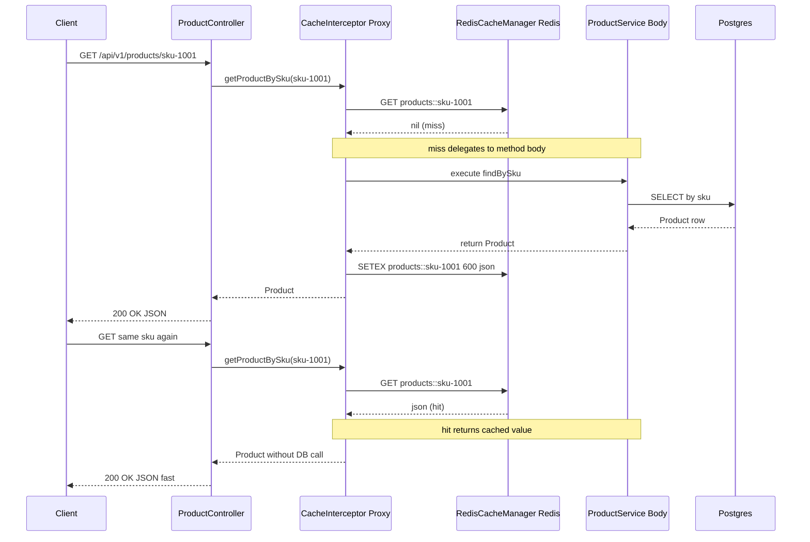
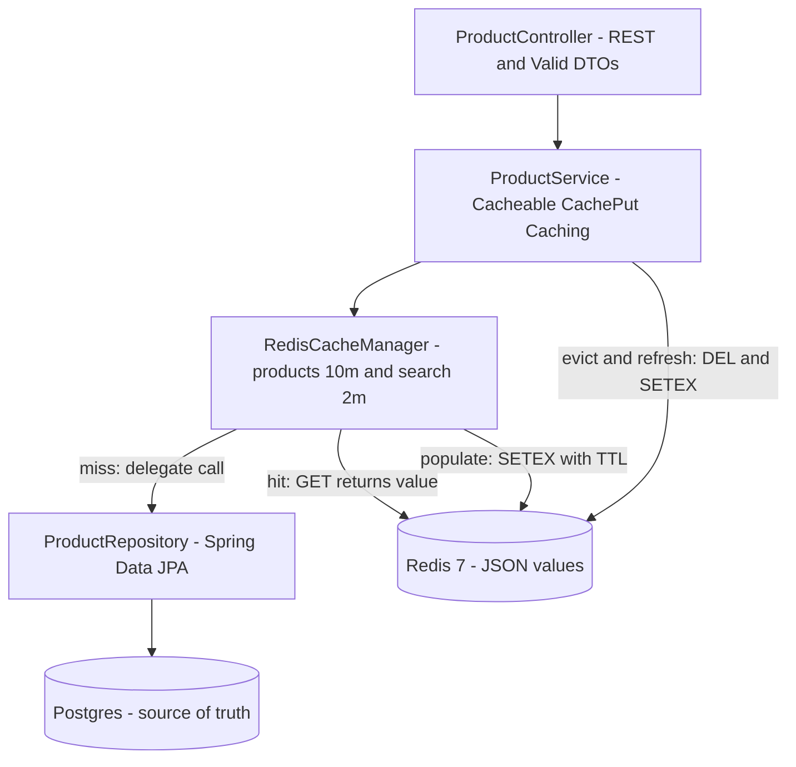

# 007 — Product Catalog Example (Boot 4.1.0 + Java 25, Lettuce, Redis 7)

> Section G of the Spring Redis track: a complete docs-embedded runnable
> product-catalog service — entity, repository, cached service, controller,
> cache config, YAML, Compose, curl-verified trace, Testcontainers IT.
>
> **Stack:** Spring Boot **4.1.0** · Java **25** · Lettuce · Redis **7.x** ·
> Spring Data JPA (Postgres) + `spring-boot-starter-data-redis` + `spring-boot-starter-cache`.
>
> **Convention mirror — verified by reading, not compiling.** Every snippet mirrors
> `projects-v2/commerce-mesh/backend/cart-service` conventions, verified by reading
> `config/RedisConfig.java`, `service/CartService.java`, `controller/CartController.java`,
> `exception/GlobalExceptionHandler.java`, `application.yml`, the service `pom.xml`, and
> root `projects-v2/commerce-mesh/docker-compose.yaml`. Snippets were **not compiled** —
> copy into a fresh Boot 4.1.0 module and run `./mvnw test` to compile-verify.
>
> Companion guides: [002](./002-spring-boot-redis-setup.md) · [003](./003-cache-annotations.md) ·
> [004](./004-redis-cache-configuration.md) · [006](./006-invalidation-and-consistency.md) ·
> [010](./010-testing-debugging.md).

## Table of Contents

- [1. What you build](#1-what-you-build) · [2. Dependencies](#2-dependencies) · [3. Entity](#3-product-entity)
- [4. Repository](#4-productrepository) · [5. Service](#5-productservice) · [6. Controller](#6-productcontroller)
- [7. Error handler](#7-error-handler) · [8. CacheConfig](#8-cacheconfig) · [9. YAML](#9-applicationyml)
- [10. Compose](#10-docker-composeyml) · [11. Trace](#11-request-flow-trace) · [12. Logging](#12-error-handling-and-logging)
- [13. IT](#13-testcontainers-it) · [14. Diagrams](#14-diagrams)
- [15. Pitfalls (GOLD)](#15-pitfalls-gold) · [16. Interview Q&A](#16-interview-qa) · [17. Resources](#17-resources)

---

## 1. What you build

CRUD + search over `Product` (`com.shop.catalog`), Redis as cache provider.

| Endpoint | Cache behavior |
|---|---|
| `GET /api/v1/products/{sku}` | `@Cacheable("products")` key `#sku`, TTL 10 m |
| `GET /api/v1/products/search?category=&page=&size=` | `@Cacheable("product-search")` compound key, TTL 2 m |
| `PUT /api/v1/products/{sku}/price` | `@CachePut("products")` key `#sku`, refresh in place |
| `DELETE /api/v1/products/{sku}` | `@Caching` fan-out: evict item + clear `product-search` |
| `POST /api/v1/products` | Write-through, evict `product-search` (new row matches any query) |

Keys render `products::sku-1001`, `product-search::footwear:0:20` (`<cacheName>::<key>`, [004](./004-redis-cache-configuration.md)). Naming per [005](./005-cache-key-design.md); semantics per [003](./003-cache-annotations.md) and [006](./006-invalidation-and-consistency.md).

---

## 2. Dependencies

Mirror `cart-service/pom.xml` parent + `java.version`, Mongo swapped for JPA/Postgres:

```xml
<parent>
    <groupId>org.springframework.boot</groupId>
    <artifactId>spring-boot-starter-parent</artifactId>
    <version>4.1.0</version>
    <relativePath/>
</parent>
<properties>
    <java.version>25</java.version>
    <testcontainers.version>1.20.6</testcontainers.version>
</properties>
<dependencies>
    <dependency><groupId>org.springframework.boot</groupId><artifactId>spring-boot-starter-web</artifactId></dependency>
    <dependency><groupId>org.springframework.boot</groupId><artifactId>spring-boot-starter-validation</artifactId></dependency>
    <dependency><groupId>org.springframework.boot</groupId><artifactId>spring-boot-starter-data-jpa</artifactId></dependency>
    <dependency><groupId>org.springframework.boot</groupId><artifactId>spring-boot-starter-data-redis</artifactId></dependency>
    <dependency><groupId>org.springframework.boot</groupId><artifactId>spring-boot-starter-cache</artifactId></dependency>
    <dependency><groupId>org.springframework.boot</groupId><artifactId>spring-boot-starter-actuator</artifactId></dependency>
    <dependency><groupId>org.postgresql</groupId><artifactId>postgresql</artifactId><scope>runtime</scope></dependency>
    <dependency><groupId>org.springframework.boot</groupId><artifactId>spring-boot-starter-test</artifactId><scope>test</scope></dependency>
    <dependency><groupId>org.testcontainers</groupId><artifactId>postgresql</artifactId><version>${testcontainers.version}</version><scope>test</scope></dependency>
    <dependency><groupId>org.testcontainers</groupId><artifactId>junit-jupiter</artifactId><version>${testcontainers.version}</version><scope>test</scope></dependency>
</dependencies>
```

`data-redis` pulls `lettuce-core` transitively — same driver as `cart-service`, no Jedis. Two-starter rule: [002](./002-spring-boot-redis-setup.md#2-dependencies--maven-and-gradle).

---

## 3. Product entity

Natural key `sku` is `@Id`, so cache key (`#sku`) equals row identity. Entity is a class (records cannot carry `@Entity` lifecycle); request DTOs (§6) are records in `cart-service` style:

```java
package com.shop.catalog.model;

import jakarta.persistence.Column;
import jakarta.persistence.Entity;
import jakarta.persistence.Id;
import jakarta.persistence.Table;
import jakarta.validation.constraints.DecimalMin;
import jakarta.validation.constraints.Min;
import jakarta.validation.constraints.NotBlank;
import java.math.BigDecimal;
import java.time.Instant;

@Entity
@Table(name = "products")
public class Product {
    @Id @Column(nullable = false, updatable = false) private String sku;
    @NotBlank @Column(nullable = false) private String name;
    @NotBlank @Column(nullable = false) private String category;
    @DecimalMin(value = "0.0", inclusive = true)
    @Column(nullable = false, precision = 12, scale = 2) private BigDecimal price = BigDecimal.ZERO;
    @Min(0) @Column(nullable = false) private int stock;
    @Column(nullable = false) private Instant updatedAt = Instant.now();
    protected Product() {}
    public Product(String sku, String name, String category, BigDecimal price, int stock) {
        this.sku = sku; this.name = name; this.category = category; this.price = price; this.stock = stock;
    }
    public String getSku() { return sku; }
    public String getName() { return name; }
    public void setName(String n) { this.name = n; }
    public String getCategory() { return category; }
    public BigDecimal getPrice() { return price; }
    public void setPrice(BigDecimal p) { this.price = p; }
    public int getStock() { return stock; }
    public void setStock(int s) { this.stock = s; }
    public Instant getUpdatedAt() { return updatedAt; }
    public void setUpdatedAt(Instant t) { this.updatedAt = t; }
}
```

---

## 4. ProductRepository

Spring Data JPA, derived queries only:

```java
package com.shop.catalog.repository;

import com.shop.catalog.model.Product;
import java.util.Optional;
import org.springframework.data.domain.Page;
import org.springframework.data.domain.Pageable;
import org.springframework.data.jpa.repository.JpaRepository;
import org.springframework.stereotype.Repository;

@Repository
public interface ProductRepository extends JpaRepository<Product, String> {
    Optional<Product> findBySku(String sku);
    Page<Product> findByCategory(String category, Pageable pageable);
    void deleteBySku(String sku);
}
```

---

## 5. ProductService

All four annotations in one class (semantics: [003](./003-cache-annotations.md)). Same shape as `cart-service`'s `@Cacheable(value = "carts", key = "#userId")`:

```java
package com.shop.catalog.service;

import com.shop.catalog.exception.ProductNotFoundException;
import com.shop.catalog.model.Product;
import com.shop.catalog.repository.ProductRepository;
import java.math.BigDecimal;
import java.time.Instant;
import java.util.List;
import org.slf4j.Logger;
import org.slf4j.LoggerFactory;
import org.springframework.cache.annotation.CacheEvict;
import org.springframework.cache.annotation.CachePut;
import org.springframework.cache.annotation.Cacheable;
import org.springframework.cache.annotation.Caching;
import org.springframework.data.domain.PageRequest;
import org.springframework.stereotype.Service;
import org.springframework.transaction.annotation.Transactional;

@Service
public class ProductService {
    private static final Logger log = LoggerFactory.getLogger(ProductService.class);
    private final ProductRepository products;
    public ProductService(ProductRepository products) { this.products = products; }

    @Cacheable(value = "products", key = "#sku")
    public Product getProductBySku(String sku) {
        log.debug("cache miss: loading product {} from DB", sku);
        return products.findBySku(sku).orElseThrow(() -> new ProductNotFoundException(sku));
    }

    @Cacheable(value = "product-search", key = "#category + ':' + #page + ':' + #size")
    public List<Product> search(String category, int page, int size) {
        log.debug("cache miss: searching {} {} {}", category, page, size);
        return products.findByCategory(category, PageRequest.of(page, size)).getContent();
    }

    @Transactional
    @CachePut(value = "products", key = "#sku")
    @CacheEvict(value = "product-search", allEntries = true)
    public Product updatePrice(String sku, BigDecimal price) {
        Product p = products.findBySku(sku).orElseThrow(() -> new ProductNotFoundException(sku));
        p.setPrice(price); p.setUpdatedAt(Instant.now());
        Product saved = products.save(p);
        log.debug("price updated: {} -> {}", sku, price);
        return saved;
    }

    @Transactional
    @Caching(evict = {
            @CacheEvict(value = "products", key = "#sku"),
            @CacheEvict(value = "product-search", allEntries = true)
    })
    public void deleteProduct(String sku) {
        if (!products.existsById(sku)) throw new ProductNotFoundException(sku);
        products.deleteBySku(sku);
        log.debug("product deleted and evicted: {}", sku);
    }

    @Transactional
    @CacheEvict(value = "product-search", allEntries = true)
    public Product createProduct(Product product) {
        product.setUpdatedAt(Instant.now());
        return products.save(product);
    }
}
```

Exceptions are never cached — only returned values are stored. `updatePrice` always executes then overwrites `products::sku` (refresh fits read-heavy prices, [006](./006-invalidation-and-consistency.md)); deletes have nothing to write so evict-only. Page/size stay in the search key so pages never collide. Never call `this.search(...)` — self-invocation bypasses the proxy.

---

## 6. ProductController

Mirrors `CartController`: constructor injection, `@Valid @RequestBody` records, `ResponseEntity`, `201 + Location` on POST:

```java
package com.shop.catalog.controller;

import com.shop.catalog.model.Product;
import com.shop.catalog.service.ProductService;
import jakarta.validation.Valid;
import jakarta.validation.constraints.DecimalMin;
import jakarta.validation.constraints.Min;
import jakarta.validation.constraints.NotBlank;
import java.math.BigDecimal;
import java.net.URI;
import java.util.List;
import org.springframework.http.ResponseEntity;
import org.springframework.web.bind.annotation.*;

@RestController
@RequestMapping("/api/v1/products")
public class ProductController {
    private final ProductService service;
    public ProductController(ProductService service) { this.service = service; }

    @GetMapping("/{sku}")
    public ResponseEntity<Product> getBySku(@PathVariable String sku) {
        return ResponseEntity.ok(service.getProductBySku(sku));
    }

    @GetMapping("/search")
    public ResponseEntity<List<Product>> search(@RequestParam String category,
            @RequestParam(defaultValue = "0") @Min(0) int page,
            @RequestParam(defaultValue = "20") @Min(1) int size) {
        return ResponseEntity.ok(service.search(category, page, size));
    }

    @PostMapping
    public ResponseEntity<Product> create(@Valid @RequestBody CreateProductRequest r) {
        Product saved = service.createProduct(new Product(r.sku(), r.name(), r.category(), r.price(), r.stock()));
        return ResponseEntity.created(URI.create("/api/v1/products/" + saved.getSku())).body(saved);
    }

    @PutMapping("/{sku}/price")
    public ResponseEntity<Product> updatePrice(@PathVariable String sku,
            @Valid @RequestBody UpdatePriceRequest r) {
        return ResponseEntity.ok(service.updatePrice(sku, r.price()));
    }

    @DeleteMapping("/{sku}")
    public ResponseEntity<Void> delete(@PathVariable String sku) {
        service.deleteProduct(sku);
        return ResponseEntity.noContent().build();
    }

    public record CreateProductRequest(@NotBlank String sku, @NotBlank String name,
            @NotBlank String category,
            @DecimalMin(value = "0.0", inclusive = true) BigDecimal price, @Min(0) int stock) {}
    public record UpdatePriceRequest(@DecimalMin(value = "0.0", inclusive = true) BigDecimal price) {}
}
```

---

## 7. Error handler

Mirrors `cart-service GlobalExceptionHandler` (`@RestControllerAdvice`, per-exception methods) but returns an RFC 7807-style ProblemDetail-ish map instead of `ApiError`:

```java
package com.shop.catalog.exception;

import jakarta.servlet.http.HttpServletRequest;
import java.net.URI;
import java.util.Map;
import java.util.stream.Collectors;
import org.slf4j.Logger;
import org.slf4j.LoggerFactory;
import org.springframework.http.HttpStatus;
import org.springframework.http.ResponseEntity;
import org.springframework.web.bind.MethodArgumentNotValidException;
import org.springframework.web.bind.annotation.ExceptionHandler;
import org.springframework.web.bind.annotation.RestControllerAdvice;

@RestControllerAdvice
public class GlobalExceptionHandler {
    private static final Logger log = LoggerFactory.getLogger(GlobalExceptionHandler.class);

    @ExceptionHandler(ProductNotFoundException.class)
    public ResponseEntity<Map<String, Object>> handleNotFound(ProductNotFoundException ex, HttpServletRequest req) {
        return problem(HttpStatus.NOT_FOUND, "Product not found", ex.getMessage(), req);
    }

    @ExceptionHandler(MethodArgumentNotValidException.class)
    public ResponseEntity<Map<String, Object>> handleValidation(MethodArgumentNotValidException ex, HttpServletRequest req) {
        String detail = ex.getBindingResult().getFieldErrors().stream()
                .map(fe -> fe.getField() + ": " + fe.getDefaultMessage())
                .collect(Collectors.joining("; "));
        return problem(HttpStatus.BAD_REQUEST, "Validation failed", detail, req);
    }

    @ExceptionHandler(IllegalArgumentException.class)
    public ResponseEntity<Map<String, Object>> handleBadRequest(IllegalArgumentException ex, HttpServletRequest req) {
        return problem(HttpStatus.BAD_REQUEST, "Bad request", ex.getMessage(), req);
    }

    @ExceptionHandler(Exception.class)
    public ResponseEntity<Map<String, Object>> handleGeneric(Exception ex, HttpServletRequest req) {
        log.error("Unhandled exception", ex);
        return problem(HttpStatus.INTERNAL_SERVER_ERROR, "Internal server error", "An unexpected error occurred", req);
    }

    private ResponseEntity<Map<String, Object>> problem(HttpStatus status, String title, String detail, HttpServletRequest req) {
        return ResponseEntity.status(status).body(Map.of(
                "type", URI.create("https://shop.example/problems/" + status.value()).toString(),
                "title", title, "status", status.value(), "detail", detail, "instance", req.getRequestURI()));
    }
}
```

```java
package com.shop.catalog.exception;

public class ProductNotFoundException extends RuntimeException {
    public ProductNotFoundException(String sku) { super("Product not found: " + sku); }
}
```

Throwing (not returning `null`) plus `disableCachingNullValues` means a 404 never poisons the cache — the next request retries the DB (§12).

---

## 8. CacheConfig

`RedisCacheConfiguration` (1 h, String keys, JSON values, no nulls) and `RedisTemplate` mirror `cart-service RedisConfig` byte-for-byte; the `CacheManager` bean adds the per-cache map from [004](./004-redis-cache-configuration.md#6-default--per-cache-ttl) (`products` 10 m, `product-search` 2 m):

```java
package com.shop.catalog.config;

import java.time.Duration;
import java.util.Map;
import org.springframework.cache.CacheManager;
import org.springframework.cache.annotation.EnableCaching;
import org.springframework.context.annotation.Bean;
import org.springframework.context.annotation.Configuration;
import org.springframework.data.redis.cache.RedisCacheConfiguration;
import org.springframework.data.redis.cache.RedisCacheManager;
import org.springframework.data.redis.connection.RedisConnectionFactory;
import org.springframework.data.redis.core.RedisTemplate;
import org.springframework.data.redis.serializer.GenericJackson2JsonRedisSerializer;
import org.springframework.data.redis.serializer.RedisSerializationContext;
import org.springframework.data.redis.serializer.StringRedisSerializer;

@Configuration
@EnableCaching
public class CacheConfig {
    @Bean
    public RedisCacheConfiguration redisCacheConfiguration() {
        return RedisCacheConfiguration.defaultCacheConfig()
                .entryTtl(Duration.ofHours(1))
                .serializeKeysWith(RedisSerializationContext.SerializationPair.fromSerializer(new StringRedisSerializer()))
                .serializeValuesWith(RedisSerializationContext.SerializationPair.fromSerializer(new GenericJackson2JsonRedisSerializer()))
                .disableCachingNullValues();
    }

    @Bean
    public CacheManager cacheManager(RedisConnectionFactory cf, RedisCacheConfiguration redisCacheConfiguration) {
        Map<String, RedisCacheConfiguration> perCache = Map.of(
                "products", redisCacheConfiguration.entryTtl(Duration.ofMinutes(10)),
                "product-search", redisCacheConfiguration.entryTtl(Duration.ofMinutes(2)));
        return RedisCacheManager.builder(cf).cacheDefaults(redisCacheConfiguration)
                .withInitialCacheConfigurations(perCache).transactionAware().build();
    }

    @Bean
    public RedisTemplate<String, Object> redisTemplate(RedisConnectionFactory cf) {
        RedisTemplate<String, Object> t = new RedisTemplate<>();
        t.setConnectionFactory(cf);
        t.setKeySerializer(new StringRedisSerializer());
        t.setHashKeySerializer(new StringRedisSerializer());
        t.setValueSerializer(new GenericJackson2JsonRedisSerializer());
        t.setHashValueSerializer(new GenericJackson2JsonRedisSerializer());
        t.afterPropertiesSet();
        return t;
    }
}
```

Precedence: per-cache map → `cacheDefaults` bean → `spring.cache.redis.time-to-live` → persist ([004](./004-redis-cache-configuration.md)).

---

## 9. application.yml

Redis/cache slice mirrors `cart-service application.yml`; `database`/`timeout` explicit per [002](./002-spring-boot-redis-setup.md#5-full-applicationyml):

```yaml
server:
  port: ${CATALOG_SERVICE_PORT:8085}
spring:
  application:
    name: product-catalog
  datasource:
    url: ${POSTGRES_URL:jdbc:postgresql://localhost:5432/catalog}
    username: ${POSTGRES_USER:catalog}
    password: ${POSTGRES_PASSWORD:catalogpw}
  jpa:
    hibernate:
      ddl-auto: validate
  data:
    redis:
      host: ${REDIS_HOST:localhost}
      port: 6379
      password: ${REDIS_PASSWORD:rootroot}
      database: 0
      timeout: 2000ms
  cache:
    type: redis
    redis:
      time-to-live: 3600000   # 1 h fallback; per-cache beans in §8 win
management:
  endpoints:
    web:
      exposure:
        include: health,info,caches,metrics,prometheus
```

Local: defaults. Compose: `REDIS_HOST=redis`. Prod: bare `${REDIS_HOST}`/`${REDIS_PASSWORD}` (fail fast).

---

## 10. docker-compose.yml

`redis` + `redis-insight` mirror `projects-v2/commerce-mesh/docker-compose.yaml` (image, `--requirepass`, ports, volume, healthcheck, network); app uses `REDIS_HOST: redis`:

```yaml
services:
  postgres:
    image: postgres:16-alpine
    container_name: catalog-postgres
    environment:
      POSTGRES_USER: ${POSTGRES_USER:-catalog}
      POSTGRES_PASSWORD: ${POSTGRES_PASSWORD:-catalogpw}
      POSTGRES_DB: catalog
    ports: ["5432:5432"]
    volumes: [pg_data:/var/lib/postgresql/data]
    networks: [cm-network]
  redis:
    image: redis:7-alpine
    container_name: cm-redis
    command: redis-server --requirepass ${REDIS_PASSWORD:-rootroot}
    ports: ["6379:6379"]
    volumes: [redis_data:/data]
    healthcheck:
      test: ["CMD", "redis-cli", "--raw", "incr", "ping"]
      interval: 5s
      timeout: 3s
      retries: 5
    networks: [cm-network]
  redis-insight:
    image: redis/redisinsight:latest
    container_name: cm-redis-insight
    ports: ["8001:5540"]
    depends_on: {redis: {condition: service_healthy}}
    networks: [cm-network]
  product-catalog:
    build: .
    container_name: cm-product-catalog
    ports: ["8085:8085"]
    environment:
      REDIS_HOST: redis
      REDIS_PASSWORD: ${REDIS_PASSWORD:-rootroot}
      POSTGRES_URL: jdbc:postgresql://postgres:5432/catalog
    depends_on: {redis: {condition: service_healthy}}
    networks: [cm-network]
networks: {cm-network: {driver: bridge}}
volumes: {pg_data:, redis_data:}
```

```bash
REDIS_PASSWORD=rootroot docker compose up -d
```

---

## 11. Request-flow trace

Seed once:

```bash
curl -s -X POST http://localhost:8085/api/v1/products -H 'Content-Type: application/json' \
  -d '{"sku":"sku-1001","name":"Trail Sneakers","category":"footwear","price":79.99,"stock":50}'
```

### Request 1 — miss → DB → populate

```bash
curl -s http://localhost:8085/api/v1/products/sku-1001 | python3 -m json.tool
```

Expected `200 OK` from Postgres:

```json
{"sku": "sku-1001", "name": "Trail Sneakers", "category": "footwear", "price": 79.99, "stock": 50}
```

Path: `GET products::sku-1001` → nil → `SELECT` → `SETEX ... 600 <json>`. Verify:

```bash
redis-cli -a rootroot -n 0 GET 'products::sku-1001'   # {"@class":"com.shop.catalog.model.Product",...}
redis-cli -a rootroot -n 0 TTL 'products::sku-1001'   # (integer) 600
redis-cli -a rootroot -n 0 KEYS 'products*'           # 1) "products::sku-1001"
```

`TTL -2` = put never happened (exception, wrong DB, proxy bypass — [002](./002-spring-boot-redis-setup.md#14-troubleshooting)).

### Request 2 — hit, no DB

```bash
curl -s http://localhost:8085/api/v1/products/sku-1001 | python3 -m json.tool
# identical JSON in single-digit ms; no "cache miss" DEBUG line — body never ran
```

```bash
redis-cli -a rootroot -n 0 TTL 'products::sku-1001'  # 59x — counting down, NOT reset
redis-cli -a rootroot -n 0 KEYS 'products*'          # 1) "products::sku-1001"
```

Reads never extend TTL. Expire (or `DEL`) and the next read misses again — the TTL backstop ([006](./006-invalidation-and-consistency.md)).

### Request 3 — PUT price → `@CachePut` refresh

```bash
curl -s -X PUT http://localhost:8085/api/v1/products/sku-1001/price \
  -H 'Content-Type: application/json' -d '{"price":69.99}' | python3 -m json.tool
# {"sku":"sku-1001", ... "price": 69.99} — 200 OK, DB write committed, entry overwritten
```

```bash
redis-cli -a rootroot -n 0 GET 'products::sku-1001'  # ... "price":69.99 ... (no extra GET needed)
redis-cli -a rootroot -n 0 TTL 'products::sku-1001'  # (integer) 600 (fresh TTL)
redis-cli -a rootroot -n 0 KEYS 'product-search*'    # (empty array) — aggregates evicted
```

Next `GET` returns `69.99` from cache — no stale window on the item key.

### Request 4 — DELETE → `@Caching` fan-out evict

```bash
curl -s -i -X DELETE http://localhost:8085/api/v1/products/sku-1001  # 204 No Content
curl -s http://localhost:8085/api/v1/products/sku-1001 | python3 -m json.tool
```

Expected `404` (nothing cached — throw path stores nothing):

```json
{"type": "https://shop.example/problems/404", "title": "Product not found", "status": 404, "detail": "Product not found: sku-1001", "instance": "/api/v1/products/sku-1001"}
```

```bash
redis-cli -a rootroot -n 0 DEL 'products::sku-1001'  # (integer) 0 — already gone via evict
redis-cli -a rootroot -n 0 KEYS 'products*'          # (empty array)
redis-cli -a rootroot -n 0 GET 'products::sku-1001'  # (nil)
```

Manual hatches: `DEL` one SKU; per-pattern `SCAN` loops per category (never `KEYS` in prod — [005](./005-cache-key-design.md)).

---

## 12. Error handling and logging

- **Hit/miss at DEBUG.** `log.debug("cache miss: ...")` runs only on a miss (hits skip the body). `INFO` on mutations only, as `cart-service` does.
- **Exception → no cache.** Throwing + `disableCachingNullValues` means 404s/`null`s are never stored; retries re-check the DB. Hostile missing-key floods need short-TTL negative caching instead ([006](./006-invalidation-and-consistency.md)).
- **400s never reach the cache.** Validation fails in §7 before any service call — no populate, no evict.
- **Every mutator owns its fan-out.** Create clears `product-search`; price refreshes item + clears search; delete clears both. A future `updateStock` without annotations ships stale reads until TTL.

---

## 13. Testcontainers IT

Full-context IT (`@DataJpaTest` would slice out `RedisCacheManager`): `@ServiceConnection` Redis 7 + Postgres, assertions through the proxied service:

```java
package com.shop.catalog;

import com.shop.catalog.model.Product;
import com.shop.catalog.repository.ProductRepository;
import com.shop.catalog.service.ProductService;
import java.math.BigDecimal;
import org.junit.jupiter.api.BeforeEach;
import org.junit.jupiter.api.Test;
import org.springframework.beans.factory.annotation.Autowired;
import org.springframework.boot.test.context.SpringBootTest;
import org.springframework.boot.testcontainers.service.connection.ServiceConnection;
import org.springframework.data.redis.core.RedisTemplate;
import org.testcontainers.containers.GenericContainer;
import org.testcontainers.containers.PostgreSQLContainer;
import org.testcontainers.junit.jupiter.Container;
import org.testcontainers.junit.jupiter.Testcontainers;
import org.testcontainers.utility.DockerImageName;
import static org.assertj.core.api.Assertions.assertThat;

@SpringBootTest
@Testcontainers
class ProductCacheIT {
    @Container @ServiceConnection(name = "redis")
    static GenericContainer<?> redis = new GenericContainer<>(DockerImageName.parse("redis:7-alpine"))
            .withExposedPorts(6379).withCommand("redis-server", "--requirepass", "testpw");
    @Container @ServiceConnection
    static PostgreSQLContainer<?> postgres = new PostgreSQLContainer<>("postgres:16-alpine");
    @Autowired ProductService service;
    @Autowired ProductRepository repository;
    @Autowired RedisTemplate<String, Object> redisTemplate;

    @BeforeEach
    void setUp() {
        repository.deleteAll();
        redisTemplate.getConnectionFactory().getConnection().serverCommands().flushDb();
        repository.save(new Product("sku-9001", "Cache Boots", "footwear", new BigDecimal("120.00"), 10));
    }

    @Test
    void missThenHit() {
        service.getProductBySku("sku-9001");   // miss: SETEX
        service.getProductBySku("sku-9001");   // hit: body skipped
        assertThat(redisTemplate.hasKey("products::sku-9001")).isTrue();
        assertThat(redisTemplate.getExpire("products::sku-9001")).isBetween(1L, 600L);
    }

    @Test
    void updatePriceRefreshesEntry() {
        service.getProductBySku("sku-9001");
        service.updatePrice("sku-9001", new BigDecimal("99.99"));
        assertThat(service.getProductBySku("sku-9001").getPrice()).isEqualByComparingTo("99.99");
        assertThat(redisTemplate.hasKey("products::sku-9001")).isTrue();
    }

    @Test
    void deleteEvictsItemAndSearch() {
        service.getProductBySku("sku-9001");
        service.search("footwear", 0, 20);
        assertThat(redisTemplate.hasKey("product-search::footwear:0:20")).isTrue();
        service.deleteProduct("sku-9001");
        assertThat(redisTemplate.hasKey("products::sku-9001")).isFalse();
        assertThat(redisTemplate.hasKey("product-search::footwear:0:20")).isFalse();
        assertThat(repository.findBySku("sku-9001")).isEmpty();
    }
}
```

Keep `spring.cache.type=redis` in tests (real provider, not `ConcurrentMap`) and set `SPRING_DATA_REDIS_PASSWORD=testpw` to match the container ([002](./002-spring-boot-redis-setup.md)).

---

## 14. Diagrams

Full lifecycle (participants declared; Notes carry plain text):



Layer view, controller down through cache to both stores:



---

## 15. Pitfalls (GOLD)

!!! warning "GOLD — catalog caching pitfalls (read before shipping)"
    - **Self-invocation bypass** — `this.getProductBySku(...)` skips the proxy; every call is a miss ([003](./003-cache-annotations.md)).
    - **Missing `@EnableCaching`** — annotations become silent no-ops; health `UP`, Redis empty ([002](./002-spring-boot-redis-setup.md)).
    - **Compound key missing a dimension** — search keyed by category only serves page 0 for page 1 ([005](./005-cache-key-design.md)).
    - **`@CachePut` without search eviction** — refreshed item plus stale aggregates ([006](./006-invalidation-and-consistency.md)).
    - **Caching the 404** — returning `null` with nulls enabled freezes "missing" into Redis; this guide throws instead.
    - **New mutator without fan-out** — a future `updateStock` lacking annotations ships stale reads until TTL.
    - **`KEYS` in prod** — trace uses `KEYS` for readability; prod uses `SCAN` ([005](./005-cache-key-design.md)).
    - **Bean vs property TTL split** — §8 map beats §9 `time-to-live`; know the precedence ([004](./004-redis-cache-configuration.md)).
    - **Testing the wrong provider** — IT without `cache.type=redis` passes on `ConcurrentMap`, proving nothing.
    - **`localhost` in Compose** — app needs `REDIS_HOST: redis`, not the default.

---

## 16. Interview Q&A

**Q1. Why `@Cacheable` for reads, `@CachePut` + `@CacheEvict` for price updates, eviction-only for deletes?**
A: Reads populate on miss and skip the body on hit. Price writes must run every time, then refresh the item while clearing aggregates holding the old price. Deletes have no value to write, so fan-out eviction via `@Caching` is the only option. Criteria: [006](./006-invalidation-and-consistency.md).

**Q2. What does the `product-search` compound key prevent, and what happens on create?**
A: `#category + ':' + #page + ':' + #size` isolates every query — without page/size segments, page 1 serves page 0 rows. A create may match any query, so `createProduct` clears the region (`allEntries = true`). Rules: [005](./005-cache-key-design.md).

**Q3. Request 1 vs request 2 at Redis-command level?**
A: Request 1: `GET products::sku-1001` → nil → `SELECT` → `SETEX ... 600 <json>`. Request 2: `GET` → hit, no `SELECT`, no `SETEX`, TTL untouched. Visible in `MONITOR`; diagram in §14.

**Q4. Is a 404 written to Redis? Why does it matter?**
A: No — the service throws before returning and `disableCachingNullValues` blocks null writes, so retries re-check the DB. Correct when SKUs are created later; hostile missing-key floods instead need short-TTL negative caching ([006](./006-invalidation-and-consistency.md)).

**Q5. How does `CacheConfig` relate to commerce-mesh `RedisConfig`? Where do 10 m / 2 m come from?**
A: The 1 h defaults bean and `RedisTemplate` mirror `cart-service RedisConfig` exactly. The 10 m / 2 m overlay is the [004 §6](./004-redis-cache-configuration.md#6-default--per-cache-ttl) extension: an explicit `CacheManager` with `withInitialCacheConfigurations`. Precedence: per-cache map → defaults bean → property → persist.

---

## 17. Resources

**This track:** [002](./002-spring-boot-redis-setup.md) (starters, Lettuce, YAML, verification) · [003](./003-cache-annotations.md) (annotation semantics in §5) · [004](./004-redis-cache-configuration.md) (serializers, per-cache TTL, prefixes in §8) · [006](./006-invalidation-and-consistency.md) (refresh-vs-evict, staleness in §11–§12) · [010](./010-testing-debugging.md) (integration tests for the flows above) · [005](./005-cache-key-design.md) (compound keys, `SCAN`).

**Official docs:** [Spring Data Redis — Cache](https://docs.spring.io/spring-data-redis/reference/redis-and-spring/cache.html) · [Boot — Caching](https://docs.spring.io/spring-boot/reference/io/caching.html) · [Framework — Cache Abstraction](https://docs.spring.io/spring-framework/reference/integration/cache.html) · [Testcontainers + `@ServiceConnection`](https://docs.spring.io/spring-boot/reference/testing/testcontainers.html) · [Redis 7](https://redis.io/docs/latest/)

**Repo mirrors (read, not compiled):** `projects-v2/commerce-mesh/backend/cart-service/.../config/RedisConfig.java` (§8 base) · `.../service/CartService.java` (`@Cacheable`/`@CacheEvict` shapes) · `.../controller/CartController.java` (`ResponseEntity` + `@Valid` records) · `.../exception/GlobalExceptionHandler.java` (handler shape) · `.../cart-service/src/main/resources/application.yml` (`REDIS_HOST`/`REDIS_PASSWORD`, `time-to-live: 3600000`) · `projects-v2/commerce-mesh/docker-compose.yaml` (`redis:7-alpine --requirepass`, healthcheck, Insight).

---

*Next: [010 — Testing and Debugging](./010-testing-debugging.md).*
