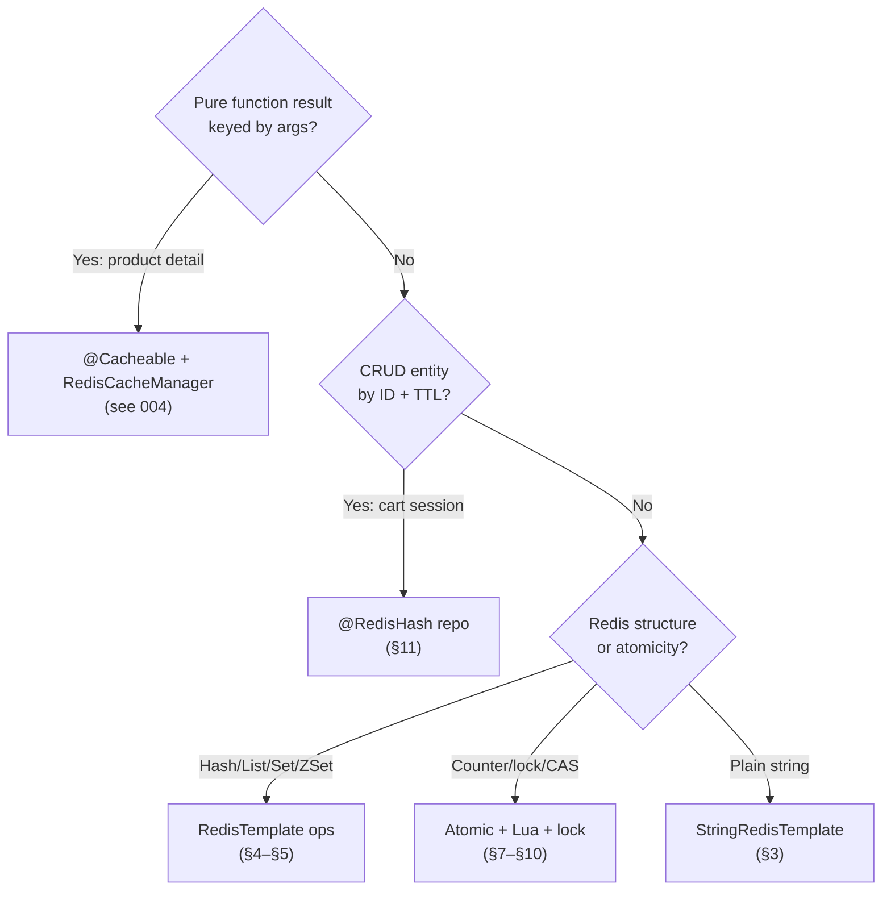

# 008 — RedisTemplate Direct Access (Boot 4.1 + Java 25, Product-Catalog / Cart)

> Section H of the Spring Redis track: bypassing the cache abstraction on purpose —
> `RedisTemplate` / `StringRedisTemplate` for carts, counters, leaderboards, locks,
> transactions, and Lua scripts that `@Cacheable` cannot express.
>
> Companion guides: [001 — Spring Cache Fundamentals](./001-spring-cache-fundamentals.md) ·
> [004 — Redis Cache Configuration](./004-redis-cache-configuration.md) ·
> [006 — Invalidation and Consistency](./006-invalidation-and-consistency.md) ·
> [Redis Introduction](./redis.md).
>
> **Stack:** Spring Boot **4.1.0** · Java **25** · Spring Framework **7.x** ·
> Lettuce (default) · Redis **7.x**. Domain: **product-catalog** (`Product`) + **cart**
> (`cart:{id}` hash, recently-viewed, wishlist, leaderboard).

## Table of Contents

- [1. When to Bypass the Abstraction](#1-when-to-bypass-the-abstraction)
- [2. `RedisTemplate` vs `StringRedisTemplate`](#2-redistemplate-vs-stringredistemplate)
- [3. `ValueOperations` — get/set/NX/counters](#3-valueoperations--getsetnxcounters)
- [4. Hash Ops — `cart:{id}` Pattern](#4-hash-ops--cartid-pattern)
- [5. List / Set / ZSet — Viewed, Wishlist, Leaderboard](#5-list--set--zset--viewed-wishlist-leaderboard)
- [6. TTL Management — expire/persist/getExpire](#6-ttl-management--expirepersistgetexpire)
- [7. Atomic Ops — INCR/DECR, SET NX, HINCRBY](#7-atomic-ops--incrdecr-set-nx-hincrby)
- [8. Transactions — `SessionCallback` MULTI/EXEC](#8-transactions--sessioncallback-multiexec)
- [9. Lua Scripting — Atomic Inventory Decrement](#9-lua-scripting--atomic-inventory-decrement)
- [10. Redis Locks + Redlock Limitations](#10-redis-locks--redlock-limitations)
- [11. Redis Repositories vs Abstraction](#11-redis-repositories-vs-abstraction)
- [12. When-NOT-to-Bypass + Maintenance Trade-Offs](#12-when-not-to-bypass--maintenance-trade-offs)
- [13. Verify End to End](#13-verify-end-to-end)
- [Pitfalls (GOLD)](#pitfalls-gold)
- [Interview Q&A](#interview-qa)
- [Resources](#resources)

---

## 1. When to Bypass the Abstraction

**WHAT:** The abstraction (`@Cacheable`, `CacheManager`) caches *method results under derived keys*. `RedisTemplate` runs *Redis commands on explicit keys* — carts, leaderboards, counters, locks.
**WHY:** A cart is a mutable hash with per-field increments and a sliding TTL; a leaderboard is a live `ZSET`. Forcing these through `@Cacheable` gives whole-blob rewrites, key collisions, and lost updates. Direct access is honest; the price is owning keys, serializers, and TTLs.



Rule: derived copies → annotation; live structures/atomicity → template; entity-by-ID → repo. Mixed flows are normal — see [006](./006-invalidation-and-consistency.md) for copy-vs-live consistency.

---

## 2. `RedisTemplate` vs `StringRedisTemplate`

**WHAT:** Two templates over the same Lettuce `RedisConnectionFactory`. `RedisTemplate<String, Object>` stores JSON values; `StringRedisTemplate` stores `String ↔ String`.
**WHY:** Pick by *value type*. Product/cart payloads need JSON; flags, tokens, idempotency keys, and counters are strings — JSON-wrapping them only adds quoting bugs.

| Template | Serializers | Use for |
|---|---|---|
| `RedisTemplate<String, Object>` | `StringRedisSerializer` keys + `GenericJackson2JsonRedisSerializer` values | Product JSON, cart hashes, POJOs |
| `StringRedisTemplate` | `StringRedisSerializer` both sides | Tokens, flags, counters, lock values, rate windows |

Mirror of the commerce-mesh bean ([004 §1](./004-redis-cache-configuration.md#1-base-example--cart-service-redisconfig-exact-mirror)):

```java
package com.commercemesh.cart.config;

import org.springframework.context.annotation.Bean;
import org.springframework.context.annotation.Configuration;
import org.springframework.data.redis.connection.RedisConnectionFactory;
import org.springframework.data.redis.core.RedisTemplate;
import org.springframework.data.redis.core.StringRedisTemplate;
import org.springframework.data.redis.serializer.GenericJackson2JsonRedisSerializer;
import org.springframework.data.redis.serializer.StringRedisSerializer;

@Configuration
public class RedisConfig {
    @Bean
    public RedisTemplate<String, Object> redisTemplate(RedisConnectionFactory cf) {
        RedisTemplate<String, Object> t = new RedisTemplate<>();
        t.setConnectionFactory(cf);
        t.setKeySerializer(new StringRedisSerializer());
        t.setHashKeySerializer(new StringRedisSerializer());
        t.setValueSerializer(new GenericJackson2JsonRedisSerializer());
        t.setHashValueSerializer(new GenericJackson2JsonRedisSerializer());
        t.afterPropertiesSet(); // mandatory — without it serializers fall back to JDK
        return t;
    }

    @Bean // Boot auto-configures this; declare only to customize
    public StringRedisTemplate stringRedisTemplate(RedisConnectionFactory cf) {
        return new StringRedisTemplate(cf);
    }
}
```

Keep this pair **identical** to the `RedisCacheConfiguration` pair in [004](./004-redis-cache-configuration.md), or one product looks different per write path.

---

## 3. `ValueOperations` — get/set/NX/counters

**WHAT:** `opsForValue()` = `GET`/`SET`/`SET NX`/`INCR` for string keys: product blobs, missing-markers, view counters.
**WHY:** Lowest-ceremony path — one key, one value, optional TTL. All later sections generalize these four verbs.

```java
package com.shop.catalog.service;

import java.time.Duration;
import org.springframework.data.redis.core.RedisTemplate;
import org.springframework.data.redis.core.StringRedisTemplate;
import org.springframework.stereotype.Service;

@Service
public class ProductValueStore {
    private final RedisTemplate<String, Object> template;
    private final StringRedisTemplate strings;
    public ProductValueStore(RedisTemplate<String, Object> template, StringRedisTemplate strings) {
        this.template = template; this.strings = strings;
    }
    public void cacheProduct(String sku, Object json) {
        template.opsForValue().set("catalog:product:" + sku, json, Duration.ofMinutes(10)); // SET EX
    }
    public Object readProduct(String sku) {
        return template.opsForValue().get("catalog:product:" + sku); // GET; null = absent/expired
    }
    public boolean markMissing(String sku) { // negative cache — see 006 §12
        return Boolean.TRUE.equals(strings.opsForValue()
                .setIfAbsent("catalog:missing:" + sku, "1", Duration.ofSeconds(45))); // SET NX EX
    }
    public long bumpViews(String sku) {
        Long n = strings.opsForValue().increment("catalog:views:" + sku); // INCR, atomic
        return n == null ? 0L : n;
    }
}
```

| Call | RESP | Notes |
|---|---|---|
| `set(k, v, ttl)` | `SET k v EX s` | Always prefer over `set` + `expire` pair |
| `get(k)` | `GET k` | `null` = absent or expired (`TTL -2`) |
| `setIfAbsent(k, v, ttl)` | `SET k v NX EX s` | Lease / dedupe / negative-cache guard |
| `increment(k[, d])` | `INCR [BY]` | Post-image; creates key at `0 + delta` |

---

## 4. Hash Ops — `cart:{id}` Pattern

**WHAT:** One cart = one hash: key `cart:{id}`, field per `sku`, value per quantity. Mirrors the commerce-sphere cart example.
**WHY:** Field-level writes (add one SKU, `HINCRBY` one qty, `HDEL` one line) avoid whole-blob deserialize-mutate-rewrite races. Datatype internals: [Redis Introduction](./redis.md#redis-data-types).

```java
package com.shop.cart.service;

import java.time.Duration;
import java.util.Map;
import org.springframework.data.redis.core.RedisTemplate;
import org.springframework.stereotype.Service;

@Service
public class CartHashStore {
    private static final Duration TTL = Duration.ofHours(6);
    private final RedisTemplate<String, Object> template;
    public CartHashStore(RedisTemplate<String, Object> template) { this.template = template; }
    private static String key(String cartId) { return "cart:{" + cartId + "}"; } // {} = Cluster hash tag (§8)
    public void addLine(String cartId, String sku, int qty) {
        template.opsForHash().put(key(cartId), sku, qty); // HSET
        template.expire(key(cartId), TTL); // sliding window
    }
    public void addLines(String cartId, Map<String, Integer> lines) {
        template.opsForHash().putAll(key(cartId), lines);
        template.expire(key(cartId), TTL);
    }
    public long bumpQty(String cartId, String sku, long delta) {
        long q = (Long) template.opsForHash().increment(key(cartId), sku, delta); // HINCRBY
        template.expire(key(cartId), TTL);
        return q;
    }
    public Map<Object, Object> snapshot(String cartId) {
        return template.opsForHash().entries(key(cartId)); // HGETALL
    }
    public void removeLine(String cartId, String sku) {
        template.opsForHash().delete(key(cartId), sku); // HDEL
    }
}
```

TTLs live on **keys, not fields**: `cart:{id}` carries the 6 h window; SKUs cannot expire individually. On checkout/abandon `delete(key)` — don't leave an empty hash. `HGETALL` is O(n): cap lines (~100) or `HSCAN` via `opsForHash().scan()`.

---

## 5. List / Set / ZSet — Viewed, Wishlist, Leaderboard

**WHAT:** One example per collection, matched to its query shape: List = ordered history, Set = deduped wishlist, ZSet = ranked best-sellers.
**WHY:** The structure *is* the query. Reimplementing push+trim, membership, or ranking on strings hashes poorly.

```java
package com.shop.catalog.service;

import java.time.Duration;
import java.util.Set;
import org.springframework.data.redis.core.RedisTemplate;
import org.springframework.data.redis.core.StringRedisTemplate;
import org.springframework.stereotype.Service;

@Service
public class DiscoveryStore {
    private final StringRedisTemplate strings;
    private final RedisTemplate<String, Object> template;
    public DiscoveryStore(StringRedisTemplate s, RedisTemplate<String, Object> t) {
        this.strings = s; this.template = t;
    }
    public void trackView(String userId, String sku) { // LIST — newest first, capped
        String k = "shop:user:" + userId + ":recent";
        strings.opsForList().leftPush(k, sku); // LPUSH
        strings.opsForList().trim(k, 0, 19); // LTRIM cap 20
        strings.expire(k, Duration.ofDays(30));
    }
    public boolean addWishlist(String userId, String sku) { // SET — dedupe + O(1) member check
        String k = "shop:user:" + userId + ":wishlist";
        Long added = strings.opsForSet().add(k, sku); // SADD → 1 if new
        strings.expire(k, Duration.ofDays(90));
        return added != null && added == 1L;
    }
    public boolean isWishlisted(String userId, String sku) {
        return Boolean.TRUE.equals(strings.opsForSet()
                .isMember("shop:user:" + userId + ":wishlist", sku)); // SISMEMBER
    }
    public void recordSale(String category, String sku, double units) { // ZSET — ranked
        template.opsForZSet().incrementScore("shop:leaderboard:" + category, sku, units); // ZINCRBY
        template.expire("shop:leaderboard:" + category, Duration.ofDays(7));
    }
    public Set<Object> topSellers(String category, int n) {
        return template.opsForZSet().reverseRange("shop:leaderboard:" + category, 0, n - 1); // ZREVRANGE
    }
}
```

| Structure | Key pattern | Discipline |
|---|---|---|
| List `LPUSH`+`LTRIM 0 19` | `shop:user:{id}:recent` | Cap length *and* TTL — unbounded lists OOM |
| Set `SADD`/`SISMEMBER`/`SREM` | `shop:user:{id}:wishlist` | `SREM` on unwish, `DEL` on account delete |
| ZSet `ZINCRBY`/`ZREVRANGE` | `shop:leaderboard:{cat}` | Weekly TTL; cold categories rebuild from orders DB |

For explicit-score writes use `opsForZSet().add(key, value, score)` or a `DefaultTypedTuple` (`org.springframework.data.redis.core.DefaultTypedTuple`).

---

## 6. TTL Management — expire/persist/getExpire

**WHAT:** Manual lifecycle — template writes carry **no default TTL** (unlike `RedisCacheManager.entryTtl` in [004](./004-redis-cache-configuration.md)). Every key needs a conscious lifetime.
**WHY:** A forgotten `expire` is a forever-key and an ops incident. These four verbs are the discipline.

```java
package com.shop.cart.service;

import java.time.Duration;
import java.util.concurrent.TimeUnit;
import org.springframework.data.redis.core.RedisTemplate;
import org.springframework.stereotype.Service;

@Service
public class CartTtlPolicy {
    private final RedisTemplate<String, Object> template;
    public CartTtlPolicy(RedisTemplate<String, Object> t) { this.template = t; }
    public boolean slide(String cartId) { // sliding window on each write
        return Boolean.TRUE.equals(template.expire("cart:{" + cartId + "}", Duration.ofHours(6)));
    }
    public long ttlSeconds(String cartId) { // -2 absent/expired, -1 persisting
        Long ttl = template.getExpire("cart:{" + cartId + "}");
        return ttl == null ? -2L : ttl;
    }
    public long ttlMillis(String cartId) {
        Long ms = template.getExpire("cart:{" + cartId + "}", TimeUnit.MILLISECONDS);
        return ms == null ? -2L : ms;
    }
    public boolean pin(String cartId) { // checkout hold — removes TTL deliberately
        return Boolean.TRUE.equals(template.persist("cart:{" + cartId + "}"));
    }
    public void abandon(String cartId) { template.delete("cart:{" + cartId + "}"); } // DEL
}
```

| Probe | Meaning | Action |
|---|---|---|
| `getExpire == -2` | Absent/expired | Recreate cart |
| `getExpire == -1` | Persisting, no TTL | Bug unless `pin()` was deliberate |
| `expire() == false` | Key missing | Don't assume the write landed |

Prefer `set(k, v, ttl)` over `set` + `expire`: the pair is two round trips, crashable between them.

---

## 7. Atomic Ops — INCR/DECR, SET NX, HINCRBY

**WHAT:** Single commands Redis executes atomically: counters, acquire-if-absent, per-field bumps. No lock needed — for *one* command.
**WHY:** Hottest catalog races are single-key (two checkouts on one stock, two clicks on one SKU). One atomic command closes them; `GET`-then-`SET` in Java reopens them. Model: [Redis Introduction](./redis.md#concurrency-and-atomicity).

```java
// Counter — atomic server-side, race-free.
Long views = strings.opsForValue().increment("catalog:views:sku-1001"); // INCR
Long left = strings.opsForValue().decrement("catalog:stock:sku-1001"); // DECR
// Idempotency marker — only first checkout attempt wins.
Boolean first = strings.opsForValue()
        .setIfAbsent("shop:idem:" + orderId, "locked", Duration.ofMinutes(10)); // SET NX EX
// Cart line — bump one field without touching siblings.
Long qty = (Long) template.opsForHash().increment("cart:{u-42}", "sku-1001", 1); // HINCRBY
```

Boundary: one command = atomic, **two commands ≠ atomic**. `INCR`+`EXPIRE` can strand a TTL-less key — use `set(k,v,ttl)`, a transaction (§8), or Lua (§9). Conditional logic ("decrement only if ≥ qty") is §9, not here.

---

## 8. Transactions — `SessionCallback` MULTI/EXEC

**WHAT:** `MULTI`/`EXEC` queues commands and runs them back-to-back — isolated, *not* rollback-able. `SessionCallback` pins one Lettuce connection for the block.
**WHY:** Checkout touches several keys with no interleaving (stock + cart line + idempotency flag). Queued *syntax* errors abort; *runtime* errors don't roll back — validate before `multi()`. Can't branch → use Lua (§9). Substrate: [Redis Introduction](./redis.md#transactions).

```java
package com.shop.cart.service;

import java.time.Duration;
import java.util.List;
import org.springframework.data.redis.core.RedisOperations;
import org.springframework.data.redis.core.StringRedisTemplate;
import org.springframework.stereotype.Service;

@Service
public class CheckoutTx {
    private final StringRedisTemplate strings;
    public CheckoutTx(StringRedisTemplate s) { this.strings = s; }
    @SuppressWarnings({"unchecked", "rawtypes"})
    public void reserve(String cartId, String sku, String orderId) {
        List<Object> r = strings.execute((RedisOperations ops) -> {
            ops.multi(); // MULTI — everything below queues
            ops.opsForValue().decrement("catalog:stock:" + sku);
            ops.opsForHash().delete("cart:{" + cartId + "}", sku);
            ops.opsForValue().setIfAbsent("shop:idem:" + orderId, "reserved", Duration.ofMinutes(10));
            return ops.exec(); // EXEC
        });
        if (r == null || r.isEmpty()) throw new IllegalStateException("TX aborted cart=" + cartId);
    }
}
```

| Fact | Implication |
|---|---|
| Sequential template calls use different connections | Only `SessionCallback` gives a real tx |
| No rollback on runtime error | Reconcile after, per [006](./006-invalidation-and-consistency.md) |
| Cluster: all keys one slot | Co-locate with `{tag}` or get `CROSSSLOT` ([Redis Introduction](./redis.md#redis-cluster)) |
| DB `@Transactional` ≠ Redis tx | No XA — commit-then-evict ordering ([006](./006-invalidation-and-consistency.md)) |

---

## 9. Lua Scripting — Atomic Inventory Decrement

**WHAT:** Server-side Lua runs atomically: read stock, decide, write — one round trip. Spring: `DefaultRedisScript<T>` + `template.execute(script, keys, args)`.
**WHY:** `MULTI` can't branch ("decrement *only if* enough"). Client check-then-decrement oversells: two checkouts read `1`, both decrement → `-1`. Substrate: [Redis Introduction](./redis.md#lua-scripting).

```java
package com.shop.catalog.service;

import java.util.List;
import org.springframework.context.annotation.Bean;
import org.springframework.context.annotation.Configuration;
import org.springframework.data.redis.core.RedisTemplate;
import org.springframework.data.redis.core.script.DefaultRedisScript;
import org.springframework.data.redis.core.script.RedisScript;
import org.springframework.stereotype.Service;

@Configuration
class InventoryScriptConfig {
    @Bean // KEYS[1]=stock key, ARGV[1]=qty → new stock, or -1 if short
    RedisScript<Long> decrementIfEnoughScript() {
        DefaultRedisScript<Long> s = new DefaultRedisScript<>();
        s.setScriptText("""
                local stock = tonumber(redis.call('GET', KEYS[1]) or '0')
                local qty = tonumber(ARGV[1])
                if stock >= qty then return redis.call('DECRBY', KEYS[1], qty)
                else return -1 end
                """);
        s.setResultType(Long.class);
        return s;
    }
}

@Service
public class InventoryService {
    private final RedisTemplate<String, Object> template;
    private final RedisScript<Long> script;
    public InventoryService(RedisTemplate<String, Object> t, RedisScript<Long> s) {
        this.template = t; this.script = s;
    }
    public boolean tryDecrement(String sku, int qty) { // EVALSHA + fallback
        Long left = template.execute(script, List.of("catalog:stock:" + sku), String.valueOf(qty));
        return left != null && left >= 0; // false → map to 409/out-of-stock
    }
}
```

Rules: keys in `KEYS` (never interpolate — Cluster + `EVALSHA` correctness), args in `ARGV`, keep scripts < ~5 ms (they block the loop), deterministic only, `setResultType` must match the Lua return.

---

## 10. Redis Locks + Redlock Limitations

**WHAT:** Single-instance lock = `SET key <uuid> NX PX <lease>` + Lua compare-and-delete unlock. Redlock = same idea on N masters with majority quorum — with known gaps.
**WHY:** Checkout/coupon/sale-start need cross-instance exclusion. UUID + Lua fixes the classic steal (A's lease lapses, B acquires, A `DEL`s B's lock). Remaining gaps (fencing, drift) decide if Redis is even the right lock. Concept: [Redis Introduction](./redis.md#distributed-locks-concept); Redlock: [Redis Introduction](./redis.md#redlock-overview).

```java
package com.shop.cart.lock;

import java.time.Duration;
import java.util.List;
import java.util.UUID;
import org.springframework.data.redis.core.StringRedisTemplate;
import org.springframework.data.redis.core.script.DefaultRedisScript;
import org.springframework.stereotype.Component;

@Component
public class RedisCheckoutLock {
    private final StringRedisTemplate strings;
    public RedisCheckoutLock(StringRedisTemplate s) { this.strings = s; }
    public String tryAcquire(String cartId, Duration lease) {
        String token = UUID.randomUUID().toString(); // unique per holder
        boolean ok = Boolean.TRUE.equals(
                strings.opsForValue().setIfAbsent("lock:checkout:" + cartId, token, lease)); // SET NX PX
        return ok ? token : null;
    }
    public boolean release(String cartId, String token) {
        DefaultRedisScript<Long> unlock = new DefaultRedisScript<>();
        unlock.setScriptText("""
                if redis.call('GET', KEYS[1]) == ARGV[1] then
                  return redis.call('DEL', KEYS[1]) else return 0 end
                """);
        unlock.setResultType(Long.class);
        Long out = strings.execute(unlock, List.of("lock:checkout:" + cartId), token);
        return out != null && out == 1L;
    }
}
```

| Lock rule | Violation symptom |
|---|---|
| Unique UUID per acquire | Static value → anyone unlocks anyone |
| `SET NX PX` in one call | `SET`+`PEXPIRE` strands a leaseless lock on crash |
| Lua compare-del release | Plain `DEL` deletes the *next* holder's lock |
| Short lease (5–30 s) + idempotent work | Long lease stalls on crash; renew only what you own |

**Redlock limitations:** no **fencing** — a GC-paused holder wakes after expiry while a second holder is inside; both believe they own it. Fencing tokens (monotonic epoch the resource checks) close this; Redlock alone doesn't. Majority-on-5 also assumes bounded **clock drift** and independent failures — NTP jumps and correlated partitions break both. **Recommendation:** money/inventory truth → Postgres advisory lock, `SELECT … FOR UPDATE`, or outbox-serialized worker. Redis lock only for *efficiency* exclusion (single warmer/report) with short lease + idempotency.

---

## 11. Redis Repositories vs Abstraction

**WHAT:** `@RedisHash` maps an entity to a hash + `CrudRepository`; `@TimeToLive` sets expiry. The cache abstraction maps *method results* to keys. Same server, opposite models.
**WHY:** Repos feel familiar but own their keyspace (`<name>:<id>` + index sets) and converters — clashes with hand-rolled `cart:{id}` keys in §4. One owner per prefix.

```java
package com.shop.cart.repo;

import java.time.Duration;
import org.springframework.data.annotation.Id;
import org.springframework.data.redis.core.RedisHash;
import org.springframework.data.redis.core.TimeToLive;
import org.springframework.data.repository.CrudRepository;

@RedisHash("cart-session") // hash "cart-session:<id>"
public class CartSession {
    @Id private String id;
    private String userId;
    private int lineCount;
    @TimeToLive private Long ttlSeconds = Duration.ofHours(6).toSeconds(); // seconds
}
interface CartSessionRepository extends CrudRepository<CartSession, String> {
}
```

| Dimension | `@Cacheable` | `RedisTemplate` (§2–§10) | `@RedisHash` repo |
|---|---|---|---|
| Models | Method result by args | Arbitrary structures | Entity by ID |
| Key control | `CacheManager` + prefix ([004](./004-redis-cache-configuration.md)) | You, fully | Framework-owned |
| TTL | `entryTtl` per cache | Per key, manual | `@TimeToLive` per entity |
| Atomicity | Single `SETEX` | Full (§7–§9) | Single-entity save |
| Best for | Product copies | Cart, leaderboard, locks | Session/cart CRUD |

Never mix repo and template on one prefix: give repos `cart-session:*`, manual hashes `cart:{*}`.

---

## 12. When-NOT-to-Bypass + Maintenance Trade-Offs

**WHAT:** Where direct access is wrong, and what manual keyspace ownership costs versus the abstraction.
**WHY:** Each template call is a key/TTL/serializer/observability contract you maintain across deploys and Boot upgrades. The abstraction centralizes them.

### When NOT to bypass

| Situation | Use instead | Reason |
|---|---|---|
| Plain method-result cache (product by SKU) | `@Cacheable` ([004](./004-redis-cache-configuration.md)) | Free TTL/prefix policy; composes with `@CacheEvict` |
| Invalidation must follow DB writes | Commit-then-evict ([006](./006-invalidation-and-consistency.md)) | Template writes bypass eviction wiring |
| Same key, two writers | One owner only | Format/TTL divergence |
| Multi-key across Cluster slots | Co-located `{tag}` keys or DB tx | `CROSSSLOT` at runtime; Lua/tx need one slot |
| Money-critical exclusion | DB advisory / `FOR UPDATE` | Redlock has no fencing (§10) |
| Prod key inspection | `SCAN` ([Redis Introduction](./redis.md#key-management)) | `KEYS *` blocks the loop |

### Maintenance / ops: abstraction vs manual

| Cost | Abstraction (`@Cacheable`) | Manual (`RedisTemplate`) |
|---|---|---|
| **Upgrade cost** | One config bean changes | Every call site + Lua re-tested; mixed formats mid-rollout |
| **Observability** | `CacheManager` metrics, uniform prefixes | Custom timers + `MONITOR`/`SLOWLOG` per key |
| **Key discipline** | Prefix + TTL enforced centrally | You enforce `shop:*`, `{tags}`, TTLs — review + `SCAN` in CI |
| **Test burden** | Swap provider (`ConcurrentMapCache`) | Testcontainers per structure; Lua needs real Redis, not mocks |
| **Failure mode** | Loader fallback on miss | You code fallback/retry/reconciler ([006](./006-invalidation-and-consistency.md)) |

---

## 13. Verify End to End

With §2 applied, `addLine("u-42","sku-1001",2)` + `recordSale("audio","sku-1001",1)`:

```bash
redis-cli -n 0 HGETALL 'cart:{u-42}'           # sku-1001 -> 2
redis-cli -n 0 TTL 'cart:{u-42}'              # ~21600 (6 h sliding)
redis-cli -n 0 ZRANGE 'shop:leaderboard:audio' 0 -1 WITHSCORES
redis-cli -n 0 GET 'catalog:stock:sku-1001'   # after §9 tryDecrement
redis-cli -n 0 TTL 'lock:checkout:u-42'       # -2 unlocked, >0 held
```

Empty `HGETALL` + `TTL -2` = expired cart (recreate); `TTL -1` = missing `expire` (§6); `CROSSSLOT` = add `{tag}` (§8); `NOSCRIPT` noise = cold script cache (re-`EVAL`).

---

## Pitfalls (GOLD)

!!! warning "GOLD — direct-access pitfalls (read before shipping)"
    - **JDK-serialized keys** — binary keys break `SCAN`/Insight; `StringRedisSerializer` always (§2).
    - **Missing `afterPropertiesSet()`** — silent JDK fallback; every read looks corrupt.
    - **Template/cache serializer split** — align with [004](./004-redis-cache-configuration.md); verify via `GET`/`HGETALL`.
    - **No TTL on manual keys** — template has no `entryTtl`; audit every write (§6).
    - **`set` + `expire` pairs** — crash strands immortal keys; single `set(k,v,ttl)` or Lua.
    - **TTL on hash fields** — impossible; expire key, `DEL` cart on checkout (§4).
    - **Whole-cart blob rewrites** — lost updates; hash + `HINCRBY` (§4, §7).
    - **Unbounded lists/zsets** — `LTRIM` caps + TTLs (§5).
    - **Branching inside MULTI** — unsupported; Lua branches (§8 → §9).
    - **Plain `GET`-then-`SET` CAS** — race; `SET NX` / `HINCRBY` / Lua (§7, §9).
    - **Plain `DEL` unlock** — steals next holder's lock; UUID + Lua compare-del (§10).
    - **Redlock for money** — no fencing, drift-sensitive; DB lock + idempotency (§10).
    - **Mixed repo/template prefixes** — one owner per prefix (§11).
    - **`KEYS *` in prod** — blocks loop; `SCAN` ([Redis Introduction](./redis.md#key-management)).

---

## Interview Q&A

**Q1. `RedisTemplate` vs `StringRedisTemplate` — when each?**
A: Value type (§2). POJOs/JSON → `RedisTemplate<String, Object>` with String keys + Jackson JSON values (commerce-mesh mirror). Pure strings (tokens, counters, lock values) → `StringRedisTemplate`; JSON-wrapping a counter adds quoting bugs.

**Q2. Template vs cache abstraction — why not `RedisTemplate` for everything?**
A: Abstraction centralizes TTL/prefix/serializer policy and composes with `@CacheEvict`/`@CachePut` ([001](./001-spring-cache-fundamentals.md), [004](./004-redis-cache-configuration.md), [006](./006-invalidation-and-consistency.md)). Template buys structure power (hash/zset/Lua/locks) at per-call-site ownership cost (§12). Copies → annotation; live structures/atomicity → template; entity CRUD → repo.

**Q3. Two checkouts, one unit left — how does Lua prevent oversell?**
A: Client `GET`-check-`DECRBY` races (§9). `decrementIfEnough` runs check-and-decrement atomically, returning `-1` when short — one winner. `MULTI` can't branch so it can't express this; bare `DECRBY` goes negative.

**Q4. Walk through the safe Redis lock and its limits.**
A: `SET lock:{id} <uuid> NX PX <lease>`, work, Lua `GET`-compare-`DEL` (§10). UUID stops cross-client deletes; single-command acquire stops leaseless locks; Lua stops steal-on-expiry. Limits: GC-pause fencing gap + drift-fragile quorum — short lease + idempotent work; DB locks for money.

**Q5. JSON-string cart loses concurrent updates — fix?**
A: Whole-blob read-modify-write races (§4, §7). Model `cart:{id}` as hash: `HSET` per line, `HINCRBY` per bump, `HDEL` per removal, sliding `expire` on the key. Field ops are atomic and sibling-independent; `DEL` the key on checkout; no per-field TTLs.

---

## Resources

**This track (in order):**

- [001 — Spring Cache Fundamentals](./001-spring-cache-fundamentals.md) — abstraction vs provider, when annotations suffice (prerequisite).
- [004 — Redis Cache Configuration](./004-redis-cache-configuration.md) — commerce-mesh `RedisConfig` mirror, TTL/serializer policy for §2 (prerequisite).
- [006 — Invalidation and Consistency](./006-invalidation-and-consistency.md) — commit-then-evict, stampede/penetration, outbox fan-out (sibling).
- [Redis Introduction](./redis.md) — datatypes ([Redis Data Types](./redis.md#redis-data-types)) · Lua ([Lua Scripting](./redis.md#lua-scripting)) · transactions ([Transactions](./redis.md#transactions)) · locks + Redlock ([Concurrency and Atomicity](./redis.md#concurrency-and-atomicity)) · keys/TTL ([Key Management](./redis.md#key-management)).

**Official docs:** [Spring Data Redis — RedisTemplate](https://docs.spring.io/spring-data-redis/reference/redis/template.html) · [Scripting](https://docs.spring.io/spring-data-redis/reference/redis/scripting.html) · [Repositories](https://docs.spring.io/spring-data-redis/reference/redis/repositories.html) · [Redis 7 — Transactions](https://redis.io/docs/latest/develop/interact/transactions/) · [Redis 7 — Lua](https://redis.io/docs/latest/develop/programmability/eval-intro/) · [Redis 7 — SET](https://redis.io/docs/latest/commands/set/)

**Repo mirrors:** `projects-v2/commerce-mesh/backend/cart-service/.../config/RedisConfig.java` (§2 base) · commerce-sphere cart-hash example (§4 shape).

---

*Next: [006 — Invalidation and Consistency](./006-invalidation-and-consistency.md) for eviction ordering around these direct writes.*
