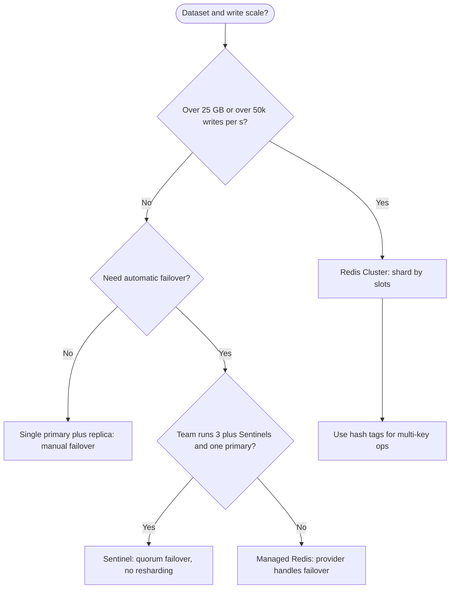
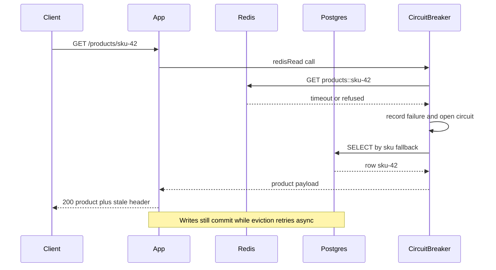

# 009 — Advanced Production: Resilience, HA, and Operations (Boot 4.1 + Java 25, Lettuce, Redis 7)

> Section I of the Spring Redis track: running Spring Cache + Redis 7 in production —
> stampede / penetration / avalanche defense, warming, single-flight, locking scope,
> pooling, Sentinel vs Cluster, failover, memory, observability, tracing, outage
> fallback, timeouts, hot keys, large objects, TLS, K8s, scaling, degradation matrix.
>
> Companion guides: [002 — Setup](./002-spring-boot-redis-setup.md) ·
> [004 — Cache Configuration](./004-redis-cache-configuration.md) ·
> [006 — Invalidation and Consistency](./006-invalidation-and-consistency.md) ·
> [010 — Testing and Debugging](./010-testing-debugging.md) ·
> [012 — Architecture and System Design](./012-architecture-system-design.md) ·
> [Redis Introduction](./redis.md) ([Sentinel](./redis.md#redis-sentinel) ·
> [Cluster](./redis.md#redis-cluster) · [TLS](./redis.md#tls-support) ·
> [Security](./redis.md#redis-security) · [Replication and HA](./redis.md#replication-and-high-availability)) ·
> [Actuator](../spring-introduction/013-spring-actuator.md).
>
> **Stack:** Spring Boot **4.1.0** · Java **25** · Lettuce (default) · Redis **7.x**.
> Domain: product-catalog (`products`, `products:search`).

## Table of Contents

- [0. Ownership tags](#0-ownership-tags)
- [1. Stampede prevention](#1-stampede-prevention)
- [2. Penetration defense](#2-penetration-defense)
- [3. Avalanche defense](#3-avalanche-defense)
- [4. Warming](#4-warming)
- [5. Single-flight](#5-single-flight)
- [6. Distributed locking](#6-distributed-locking)
- [7. Pooling (Lettuce)](#7-pooling-lettuce)
- [8. Sentinel vs Cluster](#8-sentinel-vs-cluster)
- [9. HA and failover](#9-ha-and-failover)
- [10. Memory and eviction](#10-memory-and-eviction)
- [11. Hit ratio](#11-hit-ratio)
- [12. Actuator and Micrometer](#12-actuator-and-micrometer)
- [13. Tracing](#13-tracing)
- [14. Outage fallback](#14-outage-fallback)
- [15. Timeouts](#15-timeouts)
- [16. Hot keys](#16-hot-keys)
- [17. Large objects](#17-large-objects)
- [18. TLS and security](#18-tls-and-security)
- [19. Kubernetes](#19-kubernetes)
- [20. Scaling](#20-scaling)
- [21. Degradation matrix](#21-degradation-matrix)
- [Pitfalls (GOLD)](#pitfalls-gold)
- [Interview Q&A](#interview-qa)
- [Resources](#resources)

---

## 0. Ownership tags

Every technique carries one tag — who provides it, who gets paged when it breaks:

| Tag | Meaning | Examples |
|---|---|---|
| `[Spring]` | Spring / Boot / Micrometer provides it; you configure | `sync=true`, `LettuceConnectionFactory`, `spring.data.redis.*`, Actuator, OTel spans |
| `[Redis]` | Redis server / topology provides it | `SET NX`, Sentinel quorum, Cluster slots, `maxmemory-policy`, replica reads, `rediss://` |
| `[App]` | You write and test the logic | Jitter, Bloom, negative cache, warmer, futures map, fencing, Caffeine shield, compression |
| `[Arch]` | Whole-system property | Stateless app + shared Redis, degradation behavior |

Rule: declarative in Spring → `[Spring]`; atomic in Redis → `[Redis]`; else explicit `[App]` code with tests.

---

## 1. Stampede prevention

One hot key expires; 500 threads miss at once; Postgres — not Redis — falls over. Three layers, use all:

**`sync=true` `[Spring]`** — one DB load per key; followers block on the key lock. Same-key only, single cache, no `unless` (Boot fails fast), followers hold servlet threads (pair with §15 timeouts).

```java
@Cacheable(cacheNames = "products", key = "#sku", sync = true) // [Spring]
public Product getBySku(String sku) {
    return products.findBySku(sku).orElseThrow(() -> new ProductNotFoundException(sku));
}
```

**Probabilistic early refresh `[App]`** — refresh before expiry, serve stale meanwhile:

```java
// [App] The closer to expiry, the likelier this reader triggers one background refresh.
static boolean refreshEarly(Instant expiresAt, Duration window) {
    var remaining = Duration.between(Instant.now(), expiresAt);
    if (remaining.isZero() || remaining.isNegative()) return true;
    if (remaining.compareTo(window) > 0) return false;
    double p = 1.0 - ((double) remaining.toMillis() / window.toMillis());
    return ThreadLocalRandom.current().nextDouble() < p;
}
```

**TTL jitter `[App]`** — Spring's `entryTtl` is one Duration, so randomize per region at config time:

```java
// [App] products: 30 min +/- 5 min; search: 5 min +/- 90 s; fragments: 60 s +/- 15 s.
RedisCacheConfiguration jittered(RedisCacheConfiguration base, Duration nominal, Duration spread) {
    long delta = ThreadLocalRandom.current().nextLong(-spread.toMillis(), spread.toMillis() + 1);
    return base.entryTtl(nominal.plusMillis(delta));
}
```

Checklist: `sync` `[Spring]` + early refresh `[App]` + jitter `[App]` + no `allEntries=true` near peaks. Theory in [006](./006-invalidation-and-consistency.md), TTL wiring in [004](./004-redis-cache-configuration.md).

---

## 2. Penetration defense

Random SKUs, bots, typos: distinct keys, every one misses to Postgres. `sync=true` cannot help (no shared key). Three layers:

**Bloom pre-check `[App]` (+ `[Redis]` option)** — "definitely absent" → fast 404, no I/O; "maybe present" → proceed. Local `BitSet` filter `[App]`, or `BF.EXISTS` via RedisBloom `[Redis]`. False positives cost a lookup; false negatives must be impossible — rebuild on catalog snapshot change.

**Negative cache `[App]`** — cache the absence 30–60 s (Spring defaults to `disableCachingNullValues()`, so this is explicit code). Evict the marker on create or a 10-min marker hides a 1-min-old product:

```java
// [App] Validate sku -> Bloom mightExist -> GET key -> NULL marker? -> single-flight DB load,
// then SETEX value or 45 s NULL marker.
static final String NULL = "NULL";
```

**Request validation `[App]`** — regex/allow-list, length cap, per-IP rate limit. A `400` never touches Redis or Postgres: cheapest defense per cycle.

Order: validate `[App]` → Bloom `[App]`/`[Redis]` → cache → negative marker `[App]` → single-flight load (§5).

---

## 3. Avalanche defense

Whole keyspace expires (or restarts/flushes) at once. Stampede is one key; avalanche is everything.

**Jittered TTL `[App]`** — §1 mechanism applied globally; audit with `--scan` + `TTL`, expect a spread not a spike. Bands in [004](./004-redis-cache-configuration.md).

**Staggered expiry and rebuild `[App]`** — bulk `clear()` off-peak then warm (§4); stagger prefix flushes by region/shard; give `products:search` shorter, wider-jittered TTLs than `products` so regions never co-expire; after cold restart warm top-N first and shed load (§14) until hit ratio recovers (§11).

---

## 4. Warming

Preload hot keys before traffic so first users never pay a cold miss. Spring has no warmer — an `ApplicationRunner` lists top SKUs and loads them `[App]`:

```java
@Component // [App] Best-effort: per-key try/catch, never fails boot.
public class CatalogCacheWarmer implements ApplicationRunner {
    @Override
    public void run(ApplicationArguments args) {
        List<String> skus;
        try { skus = topSkus.topN(500); }
        catch (Exception ex) { log.warn("Warming skipped: source unavailable", ex); return; }
        int ok = 0;
        for (String sku : skus) {
            try { catalog.loadIntoCache(sku); ok++; } // jittered TTL [App]
            catch (Exception ex) { log.warn("Warming failed sku={}", sku, ex); }
        }
        log.info("Warming done ok={}/{}", ok, skus.size());
    }
}
```

Source top-N from access logs/analytics/static top-100; re-warm after clears and cold restarts. Trade-offs in [006](./006-invalidation-and-consistency.md).

---

## 5. Single-flight

Collapse N concurrent loads for one missing key into 1 DB call.

**`sync=true` `[Spring]`** — framework single-flight, §1. Scope: same key, same JVM, one cache.

**`ConcurrentHashMap` of futures `[App]`** — for manual cache-aside paths (`RedisTemplate`, fan-out, search pages). Losers attach instead of loading. Intra-JVM only; across replicas rely on per-instance `sync` (usually enough) or a Redis lock (§6) when duplicate compute is unacceptable:

```java
// [App] Always remove in whenComplete — a crashed load must not poison the map.
public CompletableFuture<V> load(K key, Function<K, V> loader) {
    return inflight.computeIfAbsent(key, k -> CompletableFuture.supplyAsync(() -> loader.apply(k))
            .whenComplete((v, ex) -> inflight.remove(k)));
}
```

---

## 6. Distributed locking

`SET key value NX PX ttl` is atomic `[Redis]` — one winner. Lease, renewal, fencing are `[App]`. Always set `PX`, hold << TTL, release only your token via Lua compare-and-del (never blind `DEL`):

```java
// [Redis] acquire: setIfAbsent(key, token, lease). [App] release: Lua get-compare-del.
String lua = "if redis.call('get',KEYS[1])==ARGV[1] then return redis.call('del',KEYS[1]) else return 0 end";
```

Fencing `[App]`: ordering-sensitive sinks (inventory, ledger) take a monotonic token and reject stale holders — a zombie with an expired lease cannot reorder writes.

**When NOT to lock:** plain cache fills (use `sync`/single-flight); read-heavy lookups (locks serialize parallels); cross-service updates (outbox + idempotent consumers, [006](./006-invalidation-and-consistency.md)); long business transactions (locks are for milliseconds). Lock only costly-or-dangerous work: reports, reservations, charges. Default lock-free.

---

## 7. Pooling (Lettuce)

**Shared-native `[Spring]`** — `LettuceConnectionFactory` multiplexes all threads over one native connection per node (Lettuce is async/thread-safe; Jedis needs a connection per thread). Pools cover blocking/tx/pub-sub paths only. Auto-configured by `LettuceConnectionConfiguration` unless you define your own factory ([002](./002-spring-boot-redis-setup.md)).

```yaml
# [Spring] Boot 4.1 keys. max-active ~= 2x Redis-blocking threads; max-wait < request budget.
spring.data.redis.lettuce.pool: { enabled: true, max-active: 32, max-idle: 16, min-idle: 4, max-wait: 1s }
spring.data.redis.lettuce.shutdown-timeout: 200ms
```

**Lettuce vs Jedis `[Spring]`** (server detail in [Redis Introduction](./redis.md)):

| Aspect | Lettuce (default) | Jedis |
|---|---|---|
| Thread model | Shared native connection, thread-safe | One connection per thread, pool everything |
| Pool for | Blocking/tx/pub-sub only | Every op — size to HTTP concurrency |
| Failover/Cluster | Topology-aware refresh | Manual / pool-rebuild |
| Verdict | Keep | Migrate off; never mix drivers (dead `jedis.pool.*` keys — see [002](./002-spring-boot-redis-setup.md)) |

---

## 8. Sentinel vs Cluster

Sentinel = HA without sharding `[Redis]`; Cluster = sharding + HA `[Redis]`; `{tag}` discipline `[App]` only under Cluster.

**Sentinel — 3-node quorum `[Redis]` + props `[Spring]`.** Minimum 3 Sentinels, quorum 2: majority must agree the primary is down, tolerating one Sentinel loss without split-brain. Mechanics in [Sentinel](./redis.md#redis-sentinel) and [Replication and HA](./redis.md#replication-and-high-availability).

```yaml
# [Spring] Canonical spring.data.redis.sentinel.* (legacy alias spring.redis.sentinel.* in older docs).
spring.data.redis.sentinel: { master: mymaster, nodes: sentinel-1:26379,sentinel-2:26379,sentinel-3:26379 }
```



**Cluster — slots `[Redis]` + props `[Spring]` + `{tag}` `[App]`.** 16384 slots, `CRC16(key) mod 16384`; multi-key ops must share a slot via `{tag}`. Full mechanics in [Cluster](./redis.md#redis-cluster).

```yaml
# [Spring]
spring.data.redis.cluster: { nodes: redis-1:6379,redis-2:6379,redis-3:6379,redis-4:6379,redis-5:6379,redis-6:6379, max-redirects: 3 }
```

```java
// [App] "{cart:42}:items" + "{cart:42}:total" share slot "cart:42" -> legal MGET/Lua.
// Mixing "{cart:43}:..." in one command -> CROSSSLOT. No SELECT (DB 0 only).
```

Rule: fits one node → Sentinel; exceeds RAM/writes or needs online rescale → Cluster; no failover appetite → managed Redis. Test Cluster against a real 6-node topology, not one node.

---

## 9. HA and failover

Sequence `[Redis]`: quorum/gossip majority marks primary `DOWN` (seconds, via `down-after-milliseconds`) → best-offset replica promotes → Lettuce refreshes topology `[Spring]` (`MOVED`/`ASK` or new endpoint) → app sees seconds of timeouts/redirects, then recovers. Async replication means in-flight writes to the old primary can be lost — catalog reads tolerate it; ledger writes need `WAIT`/fencing (§6). Pools must survive (§7), timeouts bound the blast (§15), fallback serves DB reads (§14). Drill in staging: kill the primary, watch promotion + error-rate + hit-ratio dip (§11) recover with no deploy.

---

## 10. Memory and eviction

Cap + policy is what makes Redis a cache instead of a crash. Enforced by Redis `[Redis]`; keeping every key TTL-bearing so the policy bites is `[App]` design:

```bash
redis-cli CONFIG SET maxmemory 2gb                       # [Redis]
redis-cli CONFIG SET maxmemory-policy volatile-ttl       # [Redis] recommended default here
```

`volatile-ttl` evicts the nearest-expiry TTL'd key `[Redis]` — safe only if **every cache key has a TTL** `[App]` (defaults + per-cache in [004](./004-redis-cache-configuration.md), plus §1 jitter). `volatile-lru/lfu` suit recency workloads; `allkeys-*` may evict persistent keys; `noeviction` errors writes instead (app handles OOM). Alert on `evicted_keys` rate: climbing evictions mean "too small / TTLs too long", not "Redis is slow".

---

## 11. Hit ratio

`hits / (hits + misses)`, per cache, never global. Meters via Spring's `CacheMetrics` binding `[Spring]`; PromQL you write `[App]`:

```yaml
management.endpoints.web.exposure.include: health,info,caches,metrics,prometheus # [Spring]
```

```promql
sum(rate(cache_gets_total{cache="products",result="hit"}[5m]))
  / sum(rate(cache_gets_total{cache="products"}[5m]))
```

Targets: `products` ≥ 0.9 steady-state; search lower is normal. Low ratio + high latency = TTL too short/key churn; low ratio + low latency = widen TTL or warm (§4). Miss-spike alert doubles as stampede/avalanche early warning. SLO examples in [012](./012-architecture-system-design.md); test the plumbing with [010](./010-testing-debugging.md).

---

## 12. Actuator and Micrometer

Endpoints `[Spring]`, timers `[App]`:

| Endpoint `[Spring]` | Use |
|---|---|
| `GET /actuator/caches` | Verify regions exist |
| `DELETE /actuator/caches/{cache}` | Emergency clear (off-peak, then warm §4) |
| `GET /actuator/metrics/cache.gets` | Hit/miss meters backing §11 |
| `GET /actuator/health` (+ `redis` indicator) | Reachability for readiness/liveness (§19) |

```yaml
management.endpoint.health.probes.enabled: true # [Spring] drives K8s probes
```

Custom loader timer `[App]` — how slow is a miss, per region (`Timer.builder("catalog.loader.duration").tag("cache","products")...`). Fundamentals in [Actuator](../spring-introduction/013-spring-actuator.md); assert the meters with [010](./010-testing-debugging.md).

---

## 13. Tracing

**Never put `traceId` in cache keys `[App]`.** Keys are deterministic business identity (`products::sku-42`); trace-scoped keys fragment the keyspace, destroy hit ratio, create unevictable garbage. Trace travels in **logs/MDC `[App]`** + **OTel spans `[Spring]`** (Boot starter auto-instruments Lettuce + cache boundaries); join app and `GET`/`SETEX` spans in the trace backend. Sampling behavior in [010](./010-testing-debugging.md).

```java
// WRONG: key = "#sku + ':' + #traceId". RIGHT: MDC.put("traceId", traceId); log.info("miss sku={}", sku);
```

---

## 14. Outage fallback

Cache-aside degrades to DB `[App]`: reads slower not wrong; writes commit; evictions retry async ([006](./006-invalidation-and-consistency.md)). Breaker sketch `[App]`:

```java
@CircuitBreaker(name = "redisRead", fallbackMethod = "loadFromDb") // [App]
public Product getBySku(String sku) { return redisCatalog.getBySku(sku); }
// fallback: products.findBySku(sku) direct — slow but correct; count via meter.
```

`@Cacheable(sync)` note: blocked followers inherit loader + Lettuce timeouts — both must sit below the request budget or an outage parks every servlet thread; followers fail fast into the breaker. Test with `docker stop cm-redis` and staging `DEBUG SLEEP`.



Recovery is cold-or-stale (§9): missing keys repopulate clean, lost-eviction keys hold pre-outage values until TTL — convergence bounded by TTL, plus §4 warming.

---

## 15. Timeouts

All Lettuce knobs as Boot properties `[Spring]` — no code, but every value is a capacity decision. Order: pool-wait < command < request budget:

```yaml
spring.data.redis.timeout: 2s                 # connect + command (2s same-AZ, 5s cross-AZ/managed)
spring.data.redis.lettuce.pool.max-wait: 1s   # borrow cap: fast countable error, feeds §14 breaker
spring.data.redis.lettuce.shutdown-timeout: 200ms  # drain cap on rolling deploys
```

Programmatic override when one global value does not fit: `LettuceClientConfiguration.builder().commandTimeout(...).shutdownTimeout(...)` `[Spring]`. Property table in [002](./002-spring-boot-redis-setup.md); TTLs (not timeouts) in [004](./004-redis-cache-configuration.md).

---

## 16. Hot keys

One SKU takes 90% of reads; its slot/primary saturates. Detect with `--hotkeys` / `INFO commandstats` + per-key miss rates (§11), then:

- **Replica reads `[Redis]`** — `ReadFrom.REPLICA_PREFERRED` via Lettuce `[Spring]`; lag-tolerant (catalog yes, ledger no).
- **Caffeine shield `[App]`** — 10–30 s in-JVM layer for top-100 keys; broadcast via Redis pub/sub or accept seconds of staleness ([006](./006-invalidation-and-consistency.md)).
- **Split keys `[App]`** — `hot:sku-42:0..7`, client picks randomly, aggregate on read; separate giant payloads (§17) off the hot path.

---

## 17. Large objects

**100 KB rule `[App]`**: above ~100 KB, never a single inline string on the request path — blocks I/O, blows eviction granularity, spikes latency. **Compress `[App]`** (GZIP/Zstd wrapper; wins above ~4 KB), **chunk `[App]`** (`page:N:0..k` at 32–64 KB + manifest, fetch parallel), **relocate `[App]`** (blobs in object storage; Redis holds URL + metadata). Serializer trade-offs in [004](./004-redis-cache-configuration.md).

---

## 18. TLS and security

Transport/identity `[Redis]`; secret hygiene `[App]`:

```yaml
spring.data.redis.ssl.enabled: true # [Spring] rediss:// transport; staging must mirror prod
spring.data.redis.username: ${REDIS_USER:catalog-svc}    # [Redis] ACL user, least privilege
spring.data.redis.password: ${REDIS_PASSWORD:secret}     # [App] env/Secrets Manager, never committed
```

Per-service ACL (`+get +set +del +expire -flushall -config`), no shared `default`; rotate via Secrets Manager resolved at boot; VPC/private endpoint, app-subnet ingress only, no public Redis. Server depth in [TLS](./redis.md#tls-support) and [Security](./redis.md#redis-security); dev-secret hygiene in [002](./002-spring-boot-redis-setup.md).

---

## 19. Kubernetes

- **Stateful `[Redis]`** — `StatefulSet` + PVC per node, stable IDs for gossip; `Deployment` + `emptyDir` loses data by design.
- **Probes `[App]`/`[Spring]`** — liveness = `PING`; readiness = serves (primary reachable, replica synced, quorum for writers); `health.probes.enabled: true` drives `/liveness` + `/readiness` ([Actuator](../spring-introduction/013-spring-actuator.md)).
- **Sidecar-less `[Arch]`** — one shared Redis service per cluster; sidecars fragment keyspace and defeat shared hit ratio.
- **HPA on latency `[App]`** — p95 latency / queue depth / threads; never Redis CPU (single-threaded saturation misleads, extra replicas add stampede load §1). Cap `maxReplicas`, keep PDBs so restarts never drain quorum.
- **Service DNS `[Spring]`** — `REDIS_HOST` at the Service/headless set, never pod IPs.

---

## 20. Scaling

`[Arch]`: **app stateless + horizontal** (no authoritative in-JVM state — Caffeine is a shield not a record; no affinity) + **shared Redis, vertical-first** (one keyspace compounds hit ratio §11; bigger nodes → replicas → Cluster §8 only at true bottleneck; resharding briefly degrades §9). Postgres stays steady because §1–§3, §14, §16 absorb variance around it.

---

## 21. Degradation matrix

`[Arch]` behavior delivered by `[App]` code over `[Spring]`/`[Redis]` primitives:

| Redis condition | Reads | Writes | Latency | Watch |
|---|---|---|---|---|
| **Down** | DB via breaker (§14) `[App]` | Commit; evictions retry async `[App]` | p95 up 10–50× | Breaker, DB pool, ratio → 0 |
| **Slow** (failover) | Timeouts (§15) then DB `[Spring]`+`[App]` | Same after timeout | Tail explodes, median steady | Timeout counts, `max-wait` rejects |
| **Evicting** | More misses, correct | Normal, shorter effective TTL | Slightly up | Eviction rate, `maxmemory` headroom (§10) |
| **Recovering** | Warm (§4) + `sync` (§1) | Normal | Elevated till ratio recovers | Ratio ramp (§11), DB QPS |
| **Healthy** | Redis hits | Per [006](./006-invalidation-and-consistency.md) | Sub-ms p50 | Ratio ≥ target, no breaker flips |

Drill each row quarterly in staging (`stop`, `DEBUG SLEEP`, tiny `maxmemory`, cold restart) before release (drill scenarios in [012](./012-architecture-system-design.md)).

---

## Pitfalls (GOLD)

!!! warning "GOLD — advanced production pitfalls (read before shipping)"
    - **`sync=true` + `unless`/multi-cache** — fails fast; one cache, same-key, no `unless` `[Spring]`.
    - **Fixed TTLs** — mass co-expiry; jitter every region `[App]`.
    - **No negative cache on public lookups** — bots DDoS Postgres; 45 s markers + Bloom + validation `[App]`.
    - **`allEntries=true` at peak / unstaggered flush** — instant avalanche; off-peak + warm-after `[App]`.
    - **Warming fails boot** — best-effort per key, catch-and-log `[App]`.
    - **Futures map without removal** — crashed load poisons key forever `[App]`.
    - **Blind `DEL` unlock** — steals another lease; token-Lua + `PX` `[Redis]`+`[App]`.
    - **Locking cache fills** — use `sync`/single-flight; lock only costly-or-dangerous work.
    - **Jedis keys under Lettuce** — dead config; one driver `[Spring]` ([002](./002-spring-boot-redis-setup.md)).
    - **2-node/even Sentinel** — no majority; minimum 3, quorum 2 `[Redis]`.
    - **Cross-slot Lua** — `CROSSSLOT`; `{tag}` multi-key groups `[App]`.
    - **`traceId` in keys** — ratio collapse; MDC/spans instead `[App]`/`[Spring]`.
    - **No follower timeout** — outage parks threads; timeouts < budget `[Spring]`.
    - **HPA on Redis CPU** — scale apps on p95 latency `[App]`.
    - **>100 KB inline values** — compress/chunk/relocate `[App]`.
    - **`volatile-*` + TTL-less keys** — writes OOM; TTL on every key `[App]`.
    - **TLS only in prod** — mirror `rediss://` + ACLs in staging `[Redis]`+`[App]`.

---

## Interview Q&A

**Q1. 500 requests hit one expired key — what saves the DB, and where does it stop working?**
`sync=true` `[Spring]` (one loader per key) + early refresh `[App]` + jitter `[App]` + pools sized for one miss-generation. Limits: same-key/single-cache/no-`unless`, followers hold threads, distinct-key floods need §2.

**Q2. Sentinel vs Cluster — choose and defend.**
Fits one node → Sentinel (3 nodes, quorum 2, no resharding) `[Redis]`; exceeds RAM/writes → Cluster (16384 slots, `{tag}` keys `[App]`, no `SELECT`) `[Redis]`. Wrong: Sentinel OOMs at 200 GB; Cluster adds `CROSSSLOT`/ops at 2 GB. Flowchart §8; [Sentinel](./redis.md#redis-sentinel), [Cluster](./redis.md#redis-cluster).

**Q3. Redis is down — do writes fail? What does recovery look like?**
No: degrade to DB `[App]`, breaker skips dead Redis after bounded timeouts (§15), evictions retry async. Recovery is cold-or-stale, convergence bounded by TTL + §4 warming. Sequence §14.

**Q4. One SKU takes 90% of traffic — stop its node melting.**
Replica reads `[Redis]` + Caffeine shield `[App]` + split keys `[App]`; detect via `--hotkeys` + per-key miss rates (§11) first.

**Q5. Why never `traceId` in a key?**
Keys are business identity; trace-scoped keys fragment keyspace, kill hit ratio, create unevictable garbage `[App]`. Trace in MDC/logs `[App]` + OTel spans `[Spring]` (§13).

---

## Resources

- Spring Framework cache (`sync` contracts): [docs.spring.io/spring-framework/reference/integration/cache.html](https://docs.spring.io/spring-framework/reference/integration/cache.html)
- Boot caching + Redis (`spring.data.redis.*`): [docs.spring.io/spring-boot/reference/io/caching.html](https://docs.spring.io/spring-boot/reference/io/caching.html) · [data/nosql Redis](https://docs.spring.io/spring-boot/reference/data/nosql.html#data.nosql.redis)
- Spring Data Redis (`RedisCacheManager`, Lettuce, Sentinel/Cluster): [docs.spring.io/spring-data/redis/reference](https://docs.spring.io/spring-data/redis/reference/)
- Lettuce (timeouts, `ReadFrom`): [lettuce.io/core/release/reference](https://lettuce.io/core/release/reference/) · Redis `SET NX PX`: [redis.io/docs/latest/commands/set](https://redis.io/docs/latest/commands/set/)
- Micrometer + PromQL: [micrometer.io/docs](https://micrometer.io/docs) · Resilience4j: [resilience4j.readme.io/docs/circuitbreaker](https://resilience4j.readme.io/docs/circuitbreaker)
- This track: [002](./002-spring-boot-redis-setup.md) · [004](./004-redis-cache-configuration.md) · [006](./006-invalidation-and-consistency.md) · [010](./010-testing-debugging.md) · [012](./012-architecture-system-design.md) · [Redis](./redis.md) ([Sentinel](./redis.md#redis-sentinel) · [Cluster](./redis.md#redis-cluster) · [TLS](./redis.md#tls-support) · [Security](./redis.md#redis-security) · [HA](./redis.md#replication-and-high-availability)) · [Actuator](../spring-introduction/013-spring-actuator.md)
