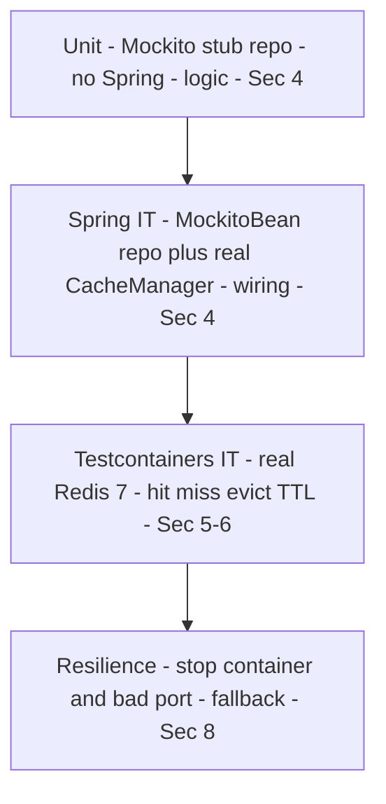

# 010 — Testing and Debugging Cached Services (Boot 4.1 + Java 25)

> Section J of the Spring Redis track: prove the cache works and diagnose it
> when it does not — unit tests, Testcontainers Redis ITs, TTL tests without
> `Thread.sleep`, and connection / key / serialization debugging.
>
> **Stack:** Spring Boot **4.1.0** · Java **25** · Lettuce · Redis **7.x** ·
> JPA (Postgres) + `spring-boot-starter-data-redis` +
> `spring-boot-starter-cache` + Testcontainers + Awaitility.
>
> **Domain:** `com.shop.catalog` — `Product`, `ProductRepository`,
> `ProductService` exactly as in [007](./007-product-catalog-example.md#5-productservice).
> Caches `products` (10 m) and `product-search` (2 m); keys render
> `products::sku-1001` (`<cacheName>::<key>`).
>
> **Convention mirror — verified by reading, not compiling.** Service shapes mirror
> `007 §5`; `CacheConfig` mirrors `007 §8`; YAML mirrors `007 §9`. Snippets were
> **not compiled** — copy into a fresh Boot 4.1.0 module and run `./mvnw test`.
>
> Companion guides: [003](./003-cache-annotations.md) · [004](./004-redis-cache-configuration.md) ·
> [005](./005-cache-key-design.md) · [006](./006-invalidation-and-consistency.md) ·
> [007](./007-product-catalog-example.md).

## Table of Contents

- [1. What you test](#1-what-you-test) · [2. Test pyramid](#2-test-pyramid-for-cache)
- [3. Mock vs real](#3-mock-vs-real--decision-table) · [4. Unit tests](#4-unit-testing-cached-service-logic)
- [5. Testcontainers IT + hit/miss + eviction](#5-testcontainers-redis-it--hitmiss--eviction)
- [6. TTL tests](#6-ttl-tests-with-awaitility) · [7. State cleanup](#7-state-cleanup-between-tests)
- [8. Redis-down tests](#8-redis-down-and-resilience-tests) · [9. Serialization](#9-serialization-debugging)
- [10. Connection](#10-connection-debugging) · [11. Keys](#11-key-debugging)
- [12. CLI + log session](#12-cli--log-verification-session) · [13. Dependencies](#13-test-dependencies)
- [14. Pitfalls (GOLD)](#14-pitfalls-gold) · [15. Interview Q&A](#15-interview-qa) · [16. Resources](#16-resources)

---

## 1. What you test

A cached service has **two behaviors** needing **different harnesses**:

| Behavior | Example | Harness |
|---|---|---|
| Business logic | missing SKU → throw; `updatePrice` sets price | Plain Mockito, no Spring |
| Cache behavior | 2nd read skips body; delete evicts; entry expires | Spring context + real Redis |

> **`@Cacheable` does nothing without a Spring proxy.** `new ProductService(mock)`
> executes the body every time, so `verify(repo, times(1))` after two direct calls
> **fails by design**. Hit/miss assertions belong in a Spring IT, never in a unit test.

Annotation semantics: [003](./003-cache-annotations.md); TTL/serializer wiring: [004](./004-redis-cache-configuration.md).

---

## 2. Test pyramid for cache

Many fast unit tests, fewer Spring ITs, very few chaos tests.



Cost order top-down: `U` in ms, no Docker; `S` starts a context, no Docker;
`T` starts Redis + Postgres (seconds); `R` breaks connections (slowest — keep 1–2).
Strategy background: [Testing with Spring Boot](../spring-testing/001-testing-with-spring-boot.md);
resilience patterns: [Spring Cloud testing](../spring-cloud/012-testing.md).

---

## 3. Mock vs real — decision table

| Question | Use | Why |
|---|---|---|
| Throw on missing SKU? Persist new price? | Mockito stub, no Spring | Body logic only, ms (§4) |
| 2nd `getProductBySku` skips repo? | Testcontainers Redis IT | Needs proxy + `RedisCacheManager` (§5) |
| `deleteProduct` evicts item + search? | Testcontainers Redis IT | Needs real `DEL` fan-out (§5) |
| Entry expires after TTL? | Redis IT + Awaitility | Needs real expiry (§6) |
| Value deserializes as `Product`? | Redis IT | Needs real codec (§9) |
| Behavior when Redis is down? | Stop-container / bad-port test | Needs real failure (§8) |
| Wiring (`@EnableCaching`, names) right? | Any Spring context test | Plain unit never loads it (§4) |

Rule: **logic → mock; caching → real Redis.** Hit/miss against `ConcurrentMap`
proves Spring works, not your Redis config — keep `spring.cache.type=redis` in cache ITs ([004](./004-redis-cache-configuration.md)).

---

## 4. Unit testing cached service logic

`@MockitoBean` note (verified against Boot 3.4+ docs and this repo's `001-testing-with-spring-boot.md`,
which still shows the old `@MockBean`): since Boot **3.4**,
`org.springframework.boot.test.mock.mockito.MockitoBean` replaces `@MockBean`
(deprecated in 3.4, removed on the 4.x line). **Plain unit tests need neither** —
use vanilla `@Mock`/`MockitoExtension`. Reserve `@MockitoBean` for Spring context tests.

```java
package com.shop.catalog.service;

import com.shop.catalog.exception.ProductNotFoundException;
import com.shop.catalog.model.Product;
import com.shop.catalog.repository.ProductRepository;
import java.math.BigDecimal;
import java.util.Optional;
import org.junit.jupiter.api.Test;
import org.junit.jupiter.api.extension.ExtendWith;
import org.mockito.InjectMocks;
import org.mockito.Mock;
import org.mockito.junit.jupiter.MockitoExtension;
import static org.assertj.core.api.Assertions.assertThat;
import static org.assertj.core.api.Assertions.assertThatThrownBy;
import static org.mockito.Mockito.verify;
import static org.mockito.Mockito.when;

@ExtendWith(MockitoExtension.class)
class ProductServiceLogicTest {
    @Mock ProductRepository repository;
    @InjectMocks ProductService service;

    private Product sample() {
        return new Product("sku-1001", "Trail Sneakers", "footwear", new BigDecimal("79.99"), 50);
    }

    @Test
    void returnsProductWhenFound() {
        when(repository.findBySku("sku-1001")).thenReturn(Optional.of(sample()));
        assertThat(service.getProductBySku("sku-1001").getSku()).isEqualTo("sku-1001");
        verify(repository).findBySku("sku-1001");
    }

    @Test
    void throwsWhenMissing() {
        when(repository.findBySku("sku-nope")).thenReturn(Optional.empty());
        assertThatThrownBy(() -> service.getProductBySku("sku-nope"))
                .isInstanceOf(ProductNotFoundException.class).hasMessageContaining("sku-nope");
    }

    @Test
    void updatePricePersistsNewPrice() {
        Product p = sample();
        when(repository.findBySku("sku-1001")).thenReturn(Optional.of(p));
        when(repository.save(p)).thenReturn(p);
        assertThat(service.updatePrice("sku-1001", new BigDecimal("69.99")).getPrice())
                .isEqualByComparingTo("69.99");
        verify(repository).save(p);
    }
}
```

This class asserts **no** call counts across two reads, no TTL, no key format (§5–§6).
Spring wiring smoke test (Boot 4.1 spelling — never `@MockBean`):

```java
@SpringBootTest(properties = "spring.cache.type=simple")
class ProductServiceWiringTest {
    @MockitoBean ProductRepository repository; // org.springframework.boot.test.mock.mockito.MockitoBean
    @Autowired ProductService service;
    @Autowired CacheManager cacheManager;

    @Test
    void contextCachesThroughProxy() {
        when(repository.findBySku("sku-1001")).thenReturn(Optional.of(
                new Product("sku-1001", "Trail Sneakers", "footwear", new BigDecimal("79.99"), 50)));
        service.getProductBySku("sku-1001");
        service.getProductBySku("sku-1001"); // hit: body skipped via proxy
        assertThat(cacheManager.getCache("products").get("sku-1001")).isNotNull();
    }
}
```

`type=simple` proves annotation wiring only, not Redis serialization. Slice placement:
[Testing with Spring Boot](../spring-testing/001-testing-with-spring-boot.md).

---

## 5. Testcontainers Redis IT — hit/miss + eviction

Full context, real Redis 7 + Postgres. `@ServiceConnection` wires the container into
`spring.data.redis.*` — no hardcoded ports. Always call the **injected proxied service**,
keep `spring.cache.type=redis`, and combine **call counts** (`verify`) with
**redis-cli** probes (comments; run live in §12). Key design: [005](./005-cache-key-design.md);
eviction semantics: [006](./006-invalidation-and-consistency.md).

```java
package com.shop.catalog;

import com.redis.testcontainers.RedisContainer;
import com.shop.catalog.model.Product;
import com.shop.catalog.repository.ProductRepository;
import com.shop.catalog.service.ProductService;
import java.math.BigDecimal;
import java.util.List;
import org.junit.jupiter.api.BeforeEach;
import org.junit.jupiter.api.Test;
import org.springframework.beans.factory.annotation.Autowired;
import org.springframework.boot.test.context.SpringBootTest;
import org.springframework.boot.test.mock.mockito.MockitoSpyBean;
import org.springframework.boot.testcontainers.service.connection.ServiceConnection;
import org.springframework.cache.CacheManager;
import org.springframework.data.domain.PageImpl;
import org.springframework.data.domain.PageRequest;
import org.springframework.data.redis.core.RedisTemplate;
import org.testcontainers.containers.PostgreSQLContainer;
import org.testcontainers.junit.jupiter.Container;
import org.testcontainers.junit.jupiter.Testcontainers;
import org.testcontainers.utility.DockerImageName;
import static org.assertj.core.api.Assertions.assertThat;
import static org.mockito.ArgumentMatchers.any;
import static org.mockito.Mockito.times;
import static org.mockito.Mockito.verify;
import static org.mockito.Mockito.when;
import java.util.Optional;

@SpringBootTest
@Testcontainers
class ProductCacheIT {
    @Container @ServiceConnection(name = "redis")
    static RedisContainer redis = new RedisContainer(DockerImageName.parse("redis:7-alpine"));
    @Container @ServiceConnection
    static PostgreSQLContainer<?> postgres = new PostgreSQLContainer<>("postgres:16-alpine");

    @MockitoSpyBean ProductRepository repository; // wraps real bean: body runs, calls counted
    @Autowired ProductService service;
    @Autowired CacheManager cacheManager;
    @Autowired RedisTemplate<String, Object> redisTemplate;

    @BeforeEach
    void setUp() {
        cacheManager.getCache("products").clear();
        cacheManager.getCache("product-search").clear();
        redisTemplate.getConnectionFactory().getConnection().serverCommands().flushDb();
        Product p = new Product("sku-9001", "Cache Boots", "footwear", new BigDecimal("120.00"), 10);
        when(repository.findBySku("sku-9001")).thenReturn(Optional.of(p));
        when(repository.save(any(Product.class))).thenAnswer(i -> i.getArgument(0));
        when(repository.findByCategory(any(), any())).thenReturn(
                new PageImpl<>(List.of(p), PageRequest.of(0, 20), 1));
    }

    @Test
    void twoCallsHitRepositoryOnce() {
        service.getProductBySku("sku-9001"); // miss: GET nil -> SELECT -> SETEX 600 json
        service.getProductBySku("sku-9001"); // hit: GET json, no SELECT
        verify(repository, times(1)).findBySku("sku-9001");
        assertThat(redisTemplate.hasKey("products::sku-9001")).isTrue();
        // redis-cli: GET 'products::sku-9001' -> {"@class":"...Product",...}
        // redis-cli: TTL 'products::sku-9001' -> (integer) 5xx
    }

    @Test
    void cacheEvictForcesReloadOnNextRead() {
        service.getProductBySku("sku-9001");
        verify(repository, times(1)).findBySku("sku-9001");
        service.deleteProduct("sku-9001"); // @Caching fan-out evict (item + search)
        assertThat(redisTemplate.hasKey("products::sku-9001")).isFalse();
        service.getProductBySku("sku-9001");
        verify(repository, times(2)).findBySku("sku-9001"); // evict -> miss -> body ran again
    }

    @Test
    void priceUpdateRefreshesItemAndClearsSearch() {
        service.getProductBySku("sku-9001");
        service.search("footwear", 0, 20);
        assertThat(redisTemplate.hasKey("product-search::footwear:0:20")).isTrue();
        service.updatePrice("sku-9001", new BigDecimal("99.99")); // @CachePut + evict search
        assertThat(redisTemplate.hasKey("products::sku-9001")).isTrue();
        assertThat(redisTemplate.hasKey("product-search::footwear:0:20")).isFalse();
        assertThat(service.getProductBySku("sku-9001").getPrice()).isEqualByComparingTo("99.99");
    }
}
```

No `com.redis.testcontainers.RedisContainer` on your Testcontainers version? Use
`GenericContainer` + same image + `@ServiceConnection(name = "redis")` (the
[007 §13](./007-product-catalog-example.md#13-testcontainers-it) spelling). With `--requirepass`,
set `SPRING_DATA_REDIS_PASSWORD` to match.

---

## 6. TTL tests with Awaitility

Rules: (1) **never `Thread.sleep`** — poll Redis with
`await().atMost(...).until(...)`; (2) **short TTL 1–2 s** in a dedicated
`@TestConfiguration`, never production 10 m; (3) assert **key absence**, not exact
timing; (4) **bound every wait** (`atMost(10s)`, poll `100ms`); (5) **one TTL test
per cache**. Precedence under test: [004](./004-redis-cache-configuration.md).

```java
package com.shop.catalog;

import com.redis.testcontainers.RedisContainer;
import com.shop.catalog.model.Product;
import com.shop.catalog.repository.ProductRepository;
import com.shop.catalog.service.ProductService;
import java.math.BigDecimal;
import java.time.Duration;
import java.util.Map;
import java.util.Optional;
import java.util.concurrent.TimeUnit;
import org.junit.jupiter.api.BeforeEach;
import org.junit.jupiter.api.Test;
import org.springframework.beans.factory.annotation.Autowired;
import org.springframework.boot.test.context.SpringBootTest;
import org.springframework.boot.test.context.TestConfiguration;
import org.springframework.boot.test.mock.mockito.MockitoBean;
import org.springframework.boot.testcontainers.service.connection.ServiceConnection;
import org.springframework.cache.CacheManager;
import org.springframework.cache.annotation.EnableCaching;
import org.springframework.context.annotation.Bean;
import org.springframework.context.annotation.Primary;
import org.springframework.data.redis.cache.RedisCacheConfiguration;
import org.springframework.data.redis.cache.RedisCacheManager;
import org.springframework.data.redis.connection.RedisConnectionFactory;
import org.springframework.data.redis.core.RedisTemplate;
import org.springframework.data.redis.serializer.GenericJackson2JsonRedisSerializer;
import org.springframework.data.redis.serializer.RedisSerializationContext;
import org.springframework.data.redis.serializer.StringRedisSerializer;
import org.testcontainers.junit.jupiter.Container;
import org.testcontainers.junit.jupiter.Testcontainers;
import org.testcontainers.utility.DockerImageName;
import static org.awaitility.Awaitility.await;
import static org.mockito.Mockito.when;

@SpringBootTest
@Testcontainers
class ProductTtlIT {
    @Container @ServiceConnection(name = "redis")
    static RedisContainer redis = new RedisContainer(DockerImageName.parse("redis:7-alpine"));

    @TestConfiguration @EnableCaching
    static class ShortTtlConfig {
        @Bean @Primary
        CacheManager shortTtlCacheManager(RedisConnectionFactory cf) {
            RedisCacheConfiguration defs = RedisCacheConfiguration.defaultCacheConfig()
                    .entryTtl(Duration.ofSeconds(2)).disableCachingNullValues()
                    .serializeKeysWith(RedisSerializationContext.SerializationPair
                            .fromSerializer(new StringRedisSerializer()))
                    .serializeValuesWith(RedisSerializationContext.SerializationPair
                            .fromSerializer(new GenericJackson2JsonRedisSerializer()));
            return RedisCacheManager.builder(cf).cacheDefaults(defs)
                    .withInitialCacheConfigurations(Map.of("products", defs,
                            "product-search", defs.entryTtl(Duration.ofSeconds(1)))).build();
        }
    }

    @MockitoBean ProductRepository repository;
    @Autowired ProductService service;
    @Autowired CacheManager cacheManager;
    @Autowired RedisTemplate<String, Object> redisTemplate;

    @BeforeEach
    void setUp() {
        cacheManager.getCache("products").clear();
        when(repository.findBySku("sku-1001")).thenReturn(Optional.of(
                new Product("sku-1001", "Trail Sneakers", "footwear", new BigDecimal("79.99"), 50)));
    }

    @Test
    void entryExpiresAfterShortTtl() {
        service.getProductBySku("sku-1001");
        await().atMost(3, TimeUnit.SECONDS)
                .until(() -> Boolean.TRUE.equals(redisTemplate.hasKey("products::sku-1001")));
        await().atMost(10, TimeUnit.SECONDS).pollInterval(100, TimeUnit.MILLISECONDS)
                .until(() -> !Boolean.TRUE.equals(redisTemplate.hasKey("products::sku-1001")));
    }
}
```

---

## 7. State cleanup between tests

Same Redis + same context leak across tests. Clean **both** layers in `@BeforeEach`:

```java
@BeforeEach
void setUp() {
    repository.deleteAll();                          // Postgres rows
    cacheManager.getCache("products").clear();       // item entries (same DEL path as evict)
    cacheManager.getCache("product-search").clear(); // aggregates — the classic leak
    redisTemplate.getConnectionFactory().getConnection().serverCommands().flushDb(); // orphans
    repository.save(new Product("sku-9001", "Cache Boots", "footwear", new BigDecimal("120.00"), 10));
}
```

Prefer `clear()` (a typo'd name NPEs loudly — the point); add `flushDb()` for raw-template
keys and post-failure orphans, never as the only cleanup (it hides wrong-name bugs).
Clear **every** cache the service touches; seed **after** clearing.

---

## 8. Redis-down and resilience tests

Contract: **reads degrade to the DB (or a documented exception) — never hang.**
Isolate chaos tests in their own class; stopped-container state leaks.

```java
@Test
void readFailsFastWhenRedisStops() {
    service.getProductBySku("sku-9001"); // warm while Redis is up
    redis.stop();                        // chaos: kill Redis
    org.assertj.core.api.Assertions.assertThatThrownBy(
            () -> service.getProductBySku("sku-9001")).isInstanceOf(RuntimeException.class);
}
```

Bad port from the start (no container; fast refused-connection, not a 60 s hang):

```java
import org.junit.jupiter.api.Test;
import org.springframework.test.context.DynamicPropertySource;
import org.springframework.test.context.DynamicPropertyRegistry;

class ProductRedisDownIT {
    @DynamicPropertySource
    static void deadPort(DynamicPropertyRegistry r) {
        r.add("spring.data.redis.host", () -> "127.0.0.1");
        r.add("spring.data.redis.port", () -> "6399");
        r.add("spring.data.redis.timeout", () -> "1s");
    }
}
```

Timeout/retry policy lives in production YAML (§10); remote-call chaos siblings:
[Spring Cloud testing](../spring-cloud/012-testing.md).

---

## 9. Serialization debugging

Assumes the `GenericJackson2JsonRedisSerializer` pair from [004](./004-redis-cache-configuration.md).

| Symptom | Cause | Fix |
|---|---|---|
| `LinkedHashMap cannot be cast to Product` | JSON without type info (plain Jackson/String value serializer) | `GenericJackson2JsonRedisSerializer` (embeds `@class`), or typed `Jackson2JsonRedisSerializer<>(Product.class)` |
| `Java 8 date/time type Instant not supported` | `ObjectMapper` lacks `JavaTimeModule` (`updatedAt`) | Register module + disable timestamps (below) |
| `\xac\xed...` binary in `GET` | JDK default (no value serializer) | Set key/value/hash serializers; flush once |

```java
ObjectMapper mapper = new ObjectMapper();
mapper.registerModule(new JavaTimeModule()); // com.fasterxml.jackson.datatype.jsr310.JavaTimeModule
mapper.disable(SerializationFeature.WRITE_DATES_AS_TIMESTAMPS);
GenericJackson2JsonRedisSerializer codec = new GenericJackson2JsonRedisSerializer(mapper);
```

Reproduce first: write via `service`, `GET` raw JSON, assert `"@class"` + ISO-8601
`updatedAt` present. Absent `@class` ⇒ serializer pair wrong, not the test.

---

## 10. Connection debugging

Probe in order before touching code:

| Symptom | Probe | Property / fix |
|---|---|---|
| `Unable to connect to localhost:6379` | `docker ps`; `redis-cli -p 6379 PING` | `spring.data.redis.host/port`; Compose needs `REDIS_HOST=redis` |
| `NOAUTH` / `WRONGPASS` | `redis-cli -a <pw> PING` | `spring.data.redis.password=${REDIS_PASSWORD}`; must match `--requirepass` |
| Hang on first call | `redis-cli --latency`; check timeout | `spring.data.redis.timeout=2000ms`; dead-port tests use `1s` |
| `GET` nil but health UP | `redis-cli -n 0 DBSIZE` vs `-n 1 DBSIZE` | `spring.data.redis.database=0` |
| Works locally, fails in Docker | `getent hosts redis` in app container | `REDIS_HOST: redis` on `cm-network` ([007 §10](./007-product-catalog-example.md#10-docker-composeyml)) |

```yaml
spring:
  data.redis: {host: ${REDIS_HOST:localhost}, port: 6379, password: ${REDIS_PASSWORD:rootroot}, database: 0, timeout: 2000ms}
  cache.type: redis
```

---

## 11. Key debugging

Zero hit rate + Redis UP ⇒ expected key ≠ written key:

```yaml
logging.level:
  org.springframework.cache.interceptor.CacheInterceptor: TRACE
  org.springframework.data.redis.cache.RedisCache: DEBUG
```

```text
TRACE CacheInterceptor — Computed cache key 'sku-1001' ... caches=[products]
DEBUG RedisCache      — Cache 'products' miss for key 'sku-1001'
```

Compare with `--scan` (never `KEYS` outside local):

```bash
redis-cli -a rootroot -n 0 --scan --pattern 'products*' | head -20
redis-cli -a rootroot -n 0 --scan --pattern 'product-search*' | head -20
```

| TRACE | SCAN | Meaning |
|---|---|---|
| `sku-1001` / `products` | `products::sku-1001` | Correct (`::` separator) |
| `footwear:0:20` | `product-search::footwear:0:20` | Correct compound key ([005](./005-cache-key-design.md)) |
| `SimpleKey []` on search | colliding `SimpleKey []` entries | Missing `key = "#category + ':' + #page + ':' + #size"` |
| SCAN empty | nothing under `products*` | Put never ran: exception, missing `@EnableCaching`, or `this.` self-invocation ([003](./003-cache-annotations.md)) |

---

## 12. CLI + log verification session

Manual pass mirroring the ITs (`REDIS_PASSWORD=rootroot docker compose up -d`):

```bash
redis-cli -a rootroot -n 0 MONITOR   # terminal 1: every command the app issues
curl -s -X POST http://localhost:8085/api/v1/products -H 'Content-Type: application/json' \
  -d '{"sku":"sku-1001","name":"Trail Sneakers","category":"footwear","price":79.99,"stock":50}'
curl -s http://localhost:8085/api/v1/products/sku-1001 | python3 -m json.tool  # miss: GET nil -> SETEX
redis-cli -a rootroot -n 0 GET 'products::sku-1001'     # {"@class":"...Product",...}
redis-cli -a rootroot -n 0 TTL 'products::sku-1001'     # (integer) 5xx, counting down
curl -s http://localhost:8085/api/v1/products/sku-1001 | python3 -m json.tool  # hit: GET only, TTL NOT reset
curl -s -X PUT http://localhost:8085/api/v1/products/sku-1001/price \
  -H 'Content-Type: application/json' -d '{"price":69.99}' | python3 -m json.tool
redis-cli -a rootroot -n 0 --scan --pattern 'product-search*'  # empty — fan-out cleared
```

```text
DEBUG ProductService — cache miss: loading product sku-1001 from DB  # request 1 only
DEBUG RedisCache     — Cache 'products' miss for key 'sku-1001'       # request 1 only
# request 2: neither line — hit short-circuits before the body
```

Request 2 still logging `cache miss`? Work §11 (key mismatch) before §10 — a connected
client with the wrong key looks exactly like a miss. Flow trace: [007 §11](./007-product-catalog-example.md#11-request-flow-trace).

---

## 13. Test dependencies

Additions to the [007 §2](./007-product-catalog-example.md#2-dependencies) POM:

```xml
<dependency><groupId>org.springframework.boot</groupId><artifactId>spring-boot-starter-test</artifactId><scope>test</scope></dependency>
<dependency><groupId>org.testcontainers</groupId><artifactId>junit-jupiter</artifactId><scope>test</scope></dependency>
<dependency><groupId>com.redis.testcontainers</groupId><artifactId>testcontainers-redis</artifactId><version>1.6.5</version><scope>test</scope></dependency>
<dependency><groupId>org.awaitility</groupId><artifactId>awaitility</artifactId><scope>test</scope></dependency>
```

No `testcontainers-redis`? Fall back to `GenericContainer`/`redis:7-alpine`
([007 §13](./007-product-catalog-example.md#13-testcontainers-it)). Docker is required for
`@Testcontainers` classes only — `*LogicTest` stays offline (`./mvnw -Dtest='*LogicTest' test`).

---

## 14. Pitfalls (GOLD)

!!! warning "GOLD — cache testing and debugging pitfalls (read before shipping)"
    - **Hits without Spring** — `new ProductService(mock)` never consults the cache; use the proxy (§4 vs §5).
    - **`@MockBean` in Boot 4.1** — gone; use `MockitoBean`/`MockitoSpyBean` or compilation fails.
    - **`Thread.sleep` TTL** — flakes under CI jitter; Awaitility poll + `atMost` bound (§6).
    - **Production TTL in tests** — overlay 1–2 s `@TestConfiguration`, never 10 m (§6).
    - **Leaking `product-search`** — clear every cache or tests pass solo, fail in suite (§7).
    - **Testing `simple` not `redis`** — green suite, untested serializer (§5).
    - **`LinkedHashMap` / `Instant` crash** — type-info + `JavaTimeModule` (§9).
    - **`KEYS` in prod** — `SCAN` only ([005](./005-cache-key-design.md)).
    - **Wrong DB/host** — `GET` nil + health UP is usually `database`/`REDIS_HOST`, not eviction (§10).
    - **No `@EnableCaching` in slice** — every call a silent miss (§11).

---

## 15. Interview Q&A

**Q1. Why can a plain Mockito test never verify `@Cacheable` hits?**
A: Caching is a Spring AOP proxy (`CacheInterceptor`). Without the proxy the body runs every call; two service calls need a Spring context + real `CacheManager` to verify as one repo call (§5).

**Q2. `@MockBean` vs `@MockitoBean` in Boot 4.1?**
A: Boot 3.4 deprecated `@MockBean`/`@SpyBean` for `@MockitoBean`/`@MockitoSpyBean`; old ones are gone on 4.x. Plain units use vanilla `@Mock`; Spring tests use `@MockitoBean`, call-count tests `@MockitoSpyBean` (§4). More: [Testing with Spring Boot](../spring-testing/001-testing-with-spring-boot.md).

**Q3. Why Awaitility over `Thread.sleep` for TTL, and the anti-flake rules?**
A: `sleep` asserts wall-clock, not Redis state. `await().atMost(10s).until(!hasKey)` polls real expiry with a fail-fast bound. Rules: 1–2 s overlay, assert absence, bound waits, one TTL test per cache (§6).

**Q4. `LinkedHashMap` reads + `Instant` codec crash — cause?**
A: Values lack Jackson type info (fix: `GenericJackson2JsonRedisSerializer`) and the cache mapper lacks `JavaTimeModule` for `updatedAt` (fix: register it, disable timestamps). Both in the `RedisCacheConfiguration` pair ([004](./004-redis-cache-configuration.md)); probes in §9.

**Q5. What do Redis-down tests prove?**
A: §8 proves the fallback contract: stopped container / dead port asserts DB fallback or fast failure — never a hang. Properties under test: `host`/`port`/`password`/`timeout` (§10); distributed siblings: [Spring Cloud testing](../spring-cloud/012-testing.md).

---

## 16. Resources

**This track:** [003](./003-cache-annotations.md) (semantics, `sync`) · [004](./004-redis-cache-configuration.md) (serializers, TTL, `::`) · [005](./005-cache-key-design.md) (`SCAN`, compound keys) · [006](./006-invalidation-and-consistency.md) (refresh vs evict, fan-out) · [007](./007-product-catalog-example.md) (service, `CacheConfig`, YAML, Compose, trace, base IT).

**Testing guides:** [Testing with Spring Boot](../spring-testing/001-testing-with-spring-boot.md) (`@MockitoBean`, slices, Testcontainers) · [Spring Cloud testing](../spring-cloud/012-testing.md) (resilience patterns).

**Official docs:** [Spring Data Redis — Cache](https://docs.spring.io/spring-data-redis/reference/redis-and-spring/cache.html) · [Boot — Caching](https://docs.spring.io/spring-boot/reference/io/caching.html) · [Framework — Cache Abstraction](https://docs.spring.io/spring-framework/reference/integration/cache.html) · [Testcontainers + `@ServiceConnection`](https://docs.spring.io/spring-boot/reference/testing/testcontainers.html) · [Awaitility](https://github.com/awaitility/awaitility) · [Redis 7](https://redis.io/docs/latest/)
