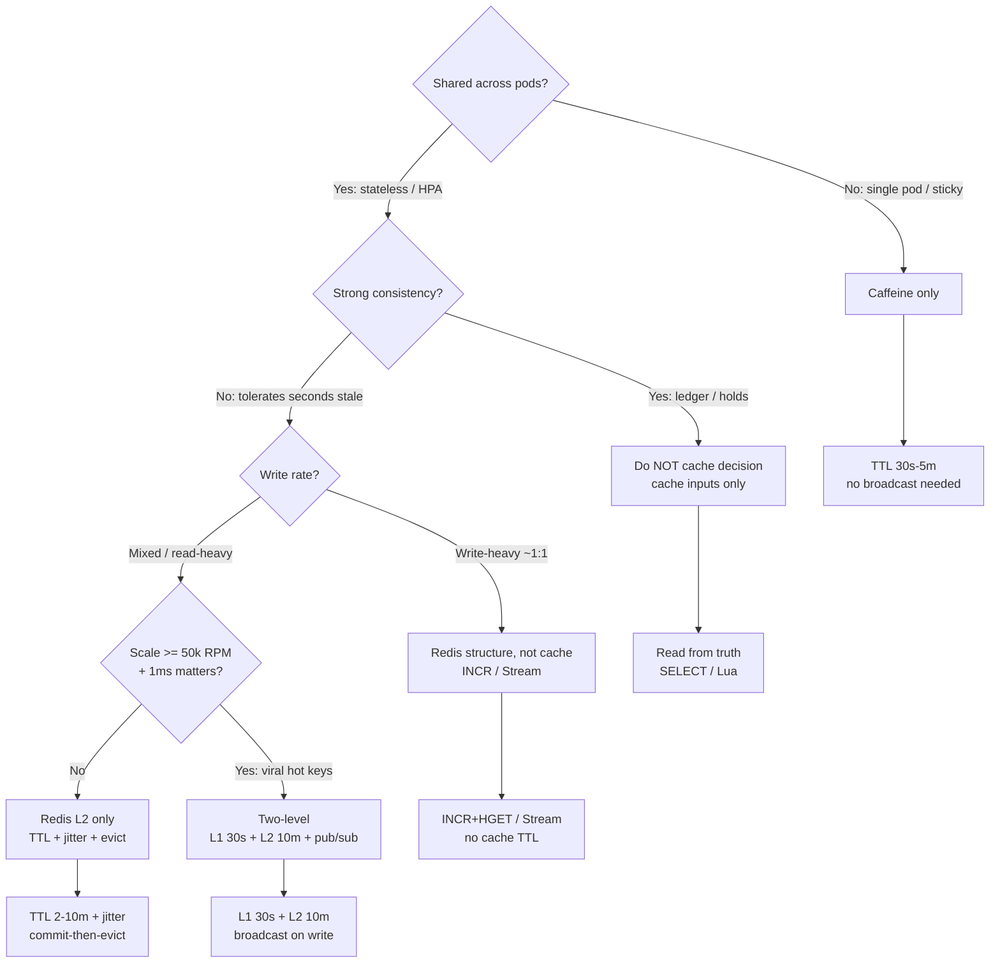

# 011 — Performance Tradeoffs: When Caching Wins, Costs, and Hurts (Boot 4.1 + Java 25, Lettuce, Redis 7)

> Section K of the Spring Redis track: the honest cost/benefit of caching — DB-load and
> latency wins with numbers, the 7 costs you pay, workload fit, when caching hurts,
> Caffeine vs Redis vs two-level, and 3 verdict scenarios.
>
> Companion guides: [001 — Cache Fundamentals](./001-spring-cache-fundamentals.md) ·
> [006 — Invalidation and Consistency](./006-invalidation-and-consistency.md) ·
> [009 — Advanced Production](./009-advanced-production.md) ·
> [012 — Architecture and System Design](./012-architecture-system-design.md) ·
> [Redis Introduction](./redis.md) ([Sentinel](./redis.md#redis-sentinel) ·
> [Cluster](./redis.md#redis-cluster) · [TLS](./redis.md#tls-support) ·
> [Security](./redis.md#redis-security) · [Replication and HA](./redis.md#replication-and-high-availability)).
>
> **Stack:** Spring Boot **4.1.0** · Java **25** · Lettuce (default) · Redis **7.x** ·
> Caffeine **3.x** (in-process L1). Domain: product-catalog (`products`, `products:search`).
> All latency numbers below are **illustrative sketches**, not benchmarks — measure your p50/p95/p99.

## Table of Contents

- [1. Wins: why we cache](#1-wins-why-we-cache)
- [2. Costs: what caching charges you](#2-costs-what-caching-charges-you)
- [3. Workload matrix: which workload gets which cache](#3-workload-matrix-which-workload-gets-which-cache)
- [4. When caching HURTS: do not cache](#4-when-caching-hurts-do-not-cache)
- [5. Caffeine vs Redis vs two-level](#5-caffeine-vs-redis-vs-two-level)
- [6. Two-level pattern: Caffeine L1 + Redis L2 + pub/sub](#6-two-level-pattern-caffeine-l1--redis-l2--pubsub)
- [7. Decision tree: which cache](#7-decision-tree-which-cache)
- [8. Scenarios with verdicts](#8-scenarios-with-verdicts)
- [Pitfalls (GOLD)](#pitfalls-gold)
- [Interview Q&A](#interview-qa)
- [Resources](#resources)

---

## 1. Wins: why we cache

Caching pays in exactly two currencies: **fewer DB queries** and **lower read latency**.
If neither matters for an endpoint, do not cache it.

### 1.1 DB-load win: hit ratio is a divider

```text
db_rpm = total_rpm × (1 − hit_ratio)
```

Numbers sketch at **10 000 RPM** ingress (steady state, warmed cache):

| Hit ratio | DB RPM | Reads absorbed | What it feels like |
|---|---|---|---|
| 0% (no cache) | 10 000 | 0 | Postgres sizes for peak; pool exhaustion risk |
| 50% | 5 000 | 5 000 | Helps, but DB still scales with traffic |
| 80% | 2 000 | 8 000 | Connection pressure drops visibly |
| **95%** | **500** | **9 500** | **20× fewer DB reads; small pool suffices** |
| 99% | 100 | 9 900 | DB sees only misses + writes; tail risk is stampede |

The headline case: `10 000 RPM × (1 − 0.95) = 500 DB RPM`. A 10k-RPM problem becomes a
500-RPM problem — **DB load scales with miss rate, not traffic**. Connections, CPU, replica
lag, and p99 flatten while Redis absorbs the fan-out. 10k RPM ≈ 167 RPS: at 20 ms/query the
endpoint holds ~4 conns without cache vs < 1 at 95% hit (pools in
[009](./009-advanced-production.md#7-pooling-lettuce)); freed DB CPU goes to uncacheable writes.

> Measure ratio per region, not globally ([009](./009-advanced-production.md#11-hit-ratio)).
> A 95% average can hide a 40% ratio on the endpoint that kills the DB.

### 1.2 Latency win: illustrative tier table

Same AZ, small (~1 KB JSON) value, warmed JVM:

| Tier | Typical p50 (illustrative) | What you pay | Notes |
|---|---|---|---|
| Postgres (indexed PK lookup) | ~20 ms | Connection + parse + buffer + network | Grows with load, joins, cold buffers |
| Redis `GET` (Lettuce, multiplexed) | ~1 ms | 1 RTT + RESP + serde | Sub-ms possible; TLS/cross-AZ adds 1–3 ms |
| Caffeine (in-process) | ~0.05 ms (50 µs) | Hash lookup + object ref | No I/O; often just pointer + `equals` |

Speedup sketch: **DB → Redis ≈ 20×, Redis → Caffeine ≈ 20×, DB → Caffeine ≈ 400×.**
Each level removes a network hop and a serialization step. Tier placement in the
abstraction → provider → infrastructure stack is in [001](./001-spring-cache-fundamentals.md).

### 1.3 Read-heavy scaling: why caches scale reads and DBs do not

- **Reads fan out, writes serialize.** 50 pods share one Redis keyspace; Postgres still
  serializes writes through WAL + locks. Adding pods scales cache capacity for free but adds
  DB connections ([009](./009-advanced-production.md#20-scaling)).
- **Shared keyspace compounds.** One Redis key serves all pods, so hit ratio rises with
  traffic — while in-process-only caches give N pods × cold start = N miss storms
  ([006](./006-invalidation-and-consistency.md)).
- **Hot keys stop melting the DB.** One viral SKU at 90% of reads never reaches Postgres at
  95%+ hit; without cache that SKU alone sets your DB size (shields in
  [009](./009-advanced-production.md#16-hot-keys)). **Tail latency flattens** from
  load-dependent (DB lock waits, buffer misses) to flat — until the cache itself saturates,
  which is why SLOs belong in [012](./012-architecture-system-design.md).

Rule of thumb: **cache when reads:writes ≥ 10:1, data tolerates seconds of staleness, and
rebuild cost > cache cost.** Below ~5:1, invalidation churn usually eats the win (§4).

---

## 2. Costs: what caching charges you

Quote these 7 costs before adding any cache.

### 2.1 Network RTT vs in-process

Caffeine is a method call; Redis is a round trip (~0.3–1 ms same-AZ per `GET`, +1–3 ms
cross-AZ/TLS). That RTT dominates tiny fast queries — a 0.4 ms lookup cached at 1.2 ms RTT is
a slowdown (§4.3). Mitigations: same AZ/VPC, multiplexed Lettuce (no per-request connect),
pipeline bulk fills, Caffeine front for hottest keys (§6). Topology/`ReadFrom` trade-offs:
[Redis Cluster](./redis.md#redis-cluster) and [009](./009-advanced-production.md#8-sentinel-vs-cluster).

### 2.2 Serde CPU + payload size

Redis stores bytes. Every write serializes, every hit deserializes (Boot 4.1 default:
`GenericJackson2JsonRedisSerializer`). Small (~1 KB) product JSON: negligible. Medium
(10–100 KB): Jackson CPU shows in flame graphs — binary codec or compression above ~4 KB.
Large (>100 KB): never inline on the request path; compress, chunk (32–64 KB pages +
manifest), or relocate blobs to object storage and cache URL + metadata
([009](./009-advanced-production.md#17-large-objects)). Eviction math: 1 M × 1 KB ≈ 1 GB;
1 M × 100 KB ≈ 100 GB — payload sets RAM, not just latency.

### 2.3 Memory duplication: app + Redis

Two-level stores each value twice: per-JVM heap + shared Redis RAM (8 pods × 10k × 2 KB ≈
160 MB heap duplicated vs ~20 MB single Redis copy). Bound both: Caffeine `maximumSize` +
`expireAfterWrite`; Redis `maxmemory` + `maxmemory-policy` (`allkeys-lru` for cache-only
nodes). Every key needs a TTL — TTL-less keys under `volatile-*` are an OOM path
([009](./009-advanced-production.md#10-memory-and-eviction)). Drop L1 when heap pressure or
consistency cost exceeds the RTT saved (§5).

### 2.4 Stale / invalidation complexity

The cache is a copy; the DB is the truth. Each region buys: key design, eviction on every
write path, commit-then-evict ordering (never in-TX refresh), TTL + jitter as self-heal
bound, reconciler for lost evictions — the bulk of [006](./006-invalidation-and-consistency.md).
A 5-min TTL on prices means 5 min of wrong prices after every update unless eviction is exact.
Teams that skip invalidation testing ship stale reads, not performance.

### 2.5 Infra cost: Redis HA is not free

A surviving cache needs database-grade care: 3-node Sentinel (quorum 2) or Cluster, replicas,
RDB/AOF sizing, TLS + ACLs, VPC endpoints, dashboards, runbooks — 3× RAM + ops + failover
testing ([Sentinel](./redis.md#redis-sentinel), [Cluster](./redis.md#redis-cluster),
[009](./009-advanced-production.md#9-ha-and-failover)). If the dataset fits per-JVM and loss is
tolerable (reference data rebuilt at boot), Caffeine-only can be cheaper than Redis HA (§5).

### 2.6 Cold start: empty cache thunders

Every deploy, flush, failover, or TTL avalanche starts at 0% hit: 10k RPM × cold keyspace =
10k DB RPM instantly. Defenses ([009](./009-advanced-production.md)): `sync=true`
single-flight (one DB load per key — size thread pools for blocked followers), probabilistic
early refresh + TTL jitter (never one TTL per generation), best-effort warmer that never fails
boot, staggered deploys. SLO time-to-95%-hit after deploy in
[012](./012-architecture-system-design.md).

### 2.7 Failure modes: cache as a dependency

Redis adds outage rows — slow (failover/GC → tail explosion), down (breaker → full DB load),
evicting (memory pressure → ratio collapse), recovering (cold + stale mix). Each needs a
behavior: 200–500 ms command timeouts, 1 s pool-borrow cap, breaker to DB, async eviction
retry, reconciler — full matrix in [009](./009-advanced-production.md#21-degradation-matrix).
If the service cannot serve from DB when Redis is down, the cache is load-bearing: fund its
SLO like a database.

---

## 3. Workload matrix: which workload gets which cache

| Workload | Example | Cache? | Which tier? | TTL sketch | Why |
|---|---|---|---|---|---|
| **Read-heavy** (≥10:1) | Product detail, category pages | ✅ Yes | Redis L2; Caffeine L1 for top-100 hot keys | L2 10 min + jitter; L1 30 s | Biggest §1 win; DB flattened; seconds of staleness OK |
| **Read-write mixed** (~2:1–10:1) | Prices with hourly edits, CMS pages | ✅ Yes, with exact eviction | Redis + commit-then-evict / `@CachePut` on full-entity saves | 2–5 min + jitter | Win survives iff every write path evicts ([006](./006-invalidation-and-consistency.md)) |
| **Write-heavy** (~1:1) | Stock ticks, counters, ledger entries | ❌ Usually no; counter pattern | Redis **structure** (`INCR`, Stream), not `@Cacheable` | No cache TTL — durable key + read model | Churn exceeds hit value; scenario B §8 |
| **Ephemeral** (seconds-lived) | JWT blacklist, OTP, rate-limit buckets | ✅ Yes | Redis with native `EX`/`PX` | Seconds–minutes (OTP 5 min, blacklist = token remainder) | Expiry is the feature; scenario C §8 |
| **Large-object** (>100 KB) | Search pages, PDFs, blobs | ⚠️ Chunk / relocate, never inline | Compressed chunks or object storage + Redis manifest/URL | 10–30 min manifest; blob per lifecycle | Inline poisons p99 + eviction; [009 §17](./009-advanced-production.md#17-large-objects) |
| **Session** | Cart, prefs, JWT claims cache | ✅ Yes, if shared across pods | Redis (shared) multi-pod; Caffeine only if sticky/single pod | Session lifetime (e.g. 30 min sliding) | In-JVM sessions break under HPA; Redis keeps app stateless ([009 §20](./009-advanced-production.md#20-scaling)) |

Short TTLs (30 s L1 / 1–5 min L2) for human-edited data; longer (10–60 min) for nightly-built
reference data; jitter ±20% everywhere. Negative markers get 30–60 s, evicted on create —
full rules in [006](./006-invalidation-and-consistency.md) and
[009](./009-advanced-production.md#3-avalanche-defense).

---

## 4. When caching HURTS: do not cache

### 4.1 Write-heavy invalidation churn

At ~1:1 with a 60 s TTL the entry rarely survives to its second hit — you pay serde + RTT +
machinery for ~0% effective ratio plus stampede risk on every evict, while DB *and* Redis take
full load. Signal: `evictions ≈ inserts`, ratio flat, Redis CPU climbing. Fix: stop caching the
mutable cell; cache a longer-horizon aggregate, or switch to a Redis-native write model
(`INCR`/`HINCRBY`, Streams) where Redis is the record — scenario B §8.

### 4.2 Strong-consistency needs

Ledger balances, seat holds, single-stock claims, authz: stale copies are bugs, not wins.
Caching promises eventual freshness bounded by TTL + eviction + broadcast + replica lag. If the
contract is "next read reflects the write, every pod," the cache cannot keep it without
synchronous invalidation (which reintroduces the latency you removed). Cache the *inputs*,
decide from truth (`SELECT … FOR UPDATE`, Redis Lua with fencing). No-XA ordering in
[006](./006-invalidation-and-consistency.md).

### 4.3 Tiny fast queries where RTT > DB time

A 0.3–0.5 ms PK lookup from a warm buffer pool beats a 1 ms Redis RTT — caching makes p50
*worse* while adding serde, memory, ops. Culprits: status-by-id lookups, flags, enums on a
Hikari-warmed pool. Rule: if `db_p50 < redis_p50 + serde`, skip Redis (a pod-safe Caffeine
micro-cache at 0.05 ms may still win). §1.2 is the decision input, not decoration.

### 4.4 Unbounded cardinality

Caches assume bounded, repeatable keyspaces. `traceId`/`requestId`, per-ms search strings,
unvalidated free-text SKUs never hit twice — they pollute (ratio < 20%, key count explodes,
eviction pegged) and march Redis to `maxmemory`. Fixes: request identity never in keys (MDC/OTel
instead, [009](./009-advanced-production.md#13-tracing)); validate + normalize; Bloom or 30–60 s
negative cap for garbage; `allkeys-lru` so pollution evicts itself. Key design in
[001](./001-spring-cache-fundamentals.md).

---

## 5. Caffeine vs Redis vs two-level

| Dimension | Caffeine (L1, in-process) | Redis (L2, distributed) | Two-level (L1 + L2) |
|---|---|---|---|
| **Latency (p50 illustr.)** | ~0.05 ms, no I/O | ~1 ms, 1 RTT + serde | Hot 0.05 ms; warm 1 ms; miss 20 ms |
| **Consistency** | Per-pod; stale across pods till TTL/broadcast | Shared; stale till TTL/evict | L1 × L2 windows stack; needs broadcast |
| **Invalidation** | Local `invalidate()`; trivial | `DEL` / TTL / outbox fan-out ([006](./006-invalidation-and-consistency.md)) | L2 evict + pub/sub → L1 evict per pod |
| **Ops burden** | None (library) | Sentinel/Cluster, TLS, ACLs, runbooks ([009](./009-advanced-production.md)) | Both + broadcast channel + drift monitoring |
| **Scale** | Per-pod; pods × heap; no shared ratio | Shared keyspace; coherent cross-pod | Best read scaling; worst complexity |
| **Failure mode** | Pod restart = cold L1 (small blast radius) | Redis down = full DB load unless breaker sized | L1 masks blips; long outage still → DB |
| **Use when** | Single pod/sticky, reference data, hot-key shield, tiny-fast queries | Stateless multi-pod, sessions, ephemeral keys, 10k+ RPM reads | Viral catalog 50k+ RPM where 1 ms × billions matters |

Guideline: **start Redis-only; add Caffeine for proven hot keys with a broadcast plan.**
Two-level without pub/sub is N divergent caches — fine only when seconds of cross-pod
staleness are contractually OK (listings, not prices). Below: the full version with broadcast.

---

## 6. Two-level pattern: Caffeine L1 + Redis L2 + pub/sub

**Caffeine L1 30 s** (per-pod shield) fronting **Redis L2 10 min + jitter** (shared), with
**Redis pub/sub** invalidations so every pod drops its L1 copy on writes. TTLs bound worst-case
staleness when a fire-and-forget broadcast drops — the reason L1 stays short.

```java
package com.example.shop.config;

import com.github.benmanes.caffeine.cache.Cache;
import com.github.benmanes.caffeine.cache.Caffeine;
import java.time.Duration;
import org.springframework.context.annotation.Bean;
import org.springframework.context.annotation.Configuration;
import org.springframework.data.redis.cache.RedisCacheConfiguration;
import org.springframework.data.redis.connection.RedisConnectionFactory;
import org.springframework.data.redis.core.StringRedisTemplate;
import org.springframework.data.redis.listener.ChannelTopic;
import org.springframework.data.redis.listener.RedisMessageListenerContainer;
import org.springframework.data.redis.listener.adapter.MessageListenerAdapter;
import org.springframework.data.redis.serializer.GenericJackson2JsonRedisSerializer;
import org.springframework.data.redis.serializer.RedisSerializationContext;

@Configuration
public class TwoLevelCacheConfig {
    public static final String INVALIDATE_CHANNEL = "catalog:invalidate";
    public static final Duration L1_TTL = Duration.ofSeconds(30);
    public static final Duration L2_TTL = Duration.ofMinutes(10);

    @Bean // L1: 30 s shield, bounded heap. Restart loss is fine — L2 repopulates.
    public Cache<String, Object> l1Caffeine() {
        return Caffeine.newBuilder().maximumSize(10_000)
                .expireAfterWrite(L1_TTL).recordStats().build();
    }

    @Bean // L2: 10 min shared copy. Jitter configured per cache region.
    public RedisCacheConfiguration l2Defaults() {
        return RedisCacheConfiguration.defaultCacheConfig().entryTtl(L2_TTL)
                .disableCachingNullValues().serializeValuesWith(RedisSerializationContext
                        .SerializationPair.fromSerializer(new GenericJackson2JsonRedisSerializer()));
    }

    @Bean // Broadcast fabric: L2 evict publishes SKU here; every pod's L1 drops it.
    public RedisMessageListenerContainer invalidateListener(
            RedisConnectionFactory factory, MessageListenerAdapter adapter) {
        var container = new RedisMessageListenerContainer();
        container.setConnectionFactory(factory);
        container.addMessageListener(adapter, new ChannelTopic(INVALIDATE_CHANNEL));
        return container;
    }

    @Bean
    public MessageListenerAdapter invalidateAdapter(L1InvalidationHandler handler) {
        return new MessageListenerAdapter(handler, "onInvalidate");
    }

    @Bean
    public StringRedisTemplate stringRedisTemplate(RedisConnectionFactory factory) {
        return new StringRedisTemplate(factory);
    }
}
```

```java
package com.example.shop.service;

import com.github.benmanes.caffeine.cache.Cache;
import com.example.shop.config.TwoLevelCacheConfig;
import org.springframework.cache.annotation.Cacheable;
import org.springframework.data.redis.core.StringRedisTemplate;
import org.springframework.stereotype.Component;
import org.springframework.stereotype.Service;
import org.springframework.transaction.event.TransactionPhase;
import org.springframework.transaction.event.TransactionalEventListener;

@Component // Every pod runs one; pub/sub keeps siblings coherent.
public class L1InvalidationHandler {
    private final Cache<String, Object> l1;
    public L1InvalidationHandler(Cache<String, Object> l1) { this.l1 = l1; }
    public void onInvalidate(String sku) { l1.invalidate("products::" + sku); }
}

@Service
public class TwoLevelProductService {
    private final Cache<String, Object> l1;
    private final ProductRepository products;
    private final StringRedisTemplate redis;

    public TwoLevelProductService(Cache<String, Object> l1,
            ProductRepository products, StringRedisTemplate redis) {
        this.l1 = l1; this.products = products; this.redis = redis;
    }

    // Read: L1 (0.05 ms) → L2 @Cacheable (1 ms) → DB (20 ms, backfills both).
    @SuppressWarnings("unchecked")
    @Cacheable(cacheNames = "products", key = "#sku") // L2 via RedisCacheManager
    public Product getBySku(String sku) {
        String l1Key = "products::" + sku;
        var cached = (Product) l1.getIfPresent(l1Key);
        if (cached != null) return cached;
        Product fresh = products.findBySku(sku).orElseThrow();
        l1.put(l1Key, fresh);
        return fresh;
    }

    // Write: commit DB first, evict L2 + broadcast AFTER_COMMIT (never in-TX refresh).
    @TransactionalEventListener(phase = TransactionPhase.AFTER_COMMIT)
    public void onPriceUpdated(PriceUpdatedEvent event) {
        l1.invalidate("products::" + event.sku());                    // local pod now
        redis.delete("products::" + event.sku());                     // shared L2 now
        redis.convertAndSend(TwoLevelCacheConfig.INVALIDATE_CHANNEL,  // siblings next
                event.sku());
    }
}
```

Why 30 s / 10 min: a dropped broadcast self-heals in ≤30 s; a lost `DEL` self-heals in
≤10 min. Never lengthen L1 past what a stale-price incident review would accept. Ordering,
outbox fan-out, and negative-cache bounds: [006](./006-invalidation-and-consistency.md);
stampede and hot-key shields: [009](./009-advanced-production.md).

---

## 7. Decision tree: which cache



Apply top-down per endpoint; re-apply at 10× traffic. Cross-pod sessions take the "Yes"
branch ([009](./009-advanced-production.md#20-scaling)); ephemeral keys skip the tree, use `EX` (§3).

---

## 8. Scenarios with verdicts

### Scenario A — Product page at 50k RPM (read-heavy catalog)

50 000 RPM (~833 RPS), 98% reads, merchandiser-edited prices, 5 s staleness OK on listings.
Postgres buckles above ~8k RPM on this join.

**Verdict: two-level — Caffeine L1 30 s + Redis L2 10 min + pub/sub broadcast (§6).**
L1 absorbs the top-100 keys at 0.05 ms (≈80% of hits never leave the JVM); L2 shares the tail
at 95%+ combined ratio, so the DB sees ~2 500 RPM instead of 50 000. Broadcast keeps edits
coherent in seconds; 30 s L1 bounds dropped messages; `sync=true` + jitter survives evict
storms. Redis-only suffices to ~10k RPM — two-level wins because at 50k RPM the RTT itself is
the bottleneck. Warm before launch, alert per-key
([009](./009-advanced-production.md#11-hit-ratio)), SLO recovery in
[012](./012-architecture-system-design.md).

### Scenario B — Live inventory counter (write-heavy, must not oversell)

Decrement per order, increment per cancel, thousands of concurrent writers; never sell unit #0
twice. Reads (availability badge) are secondary.

**Verdict: do NOT `@Cacheable` — Redis atomic structure as the real-time record.**
Caching the count means every order evicts what reads cached (§4.1 churn, ~0% effective ratio,
oversell in the stale window). `DECRBY`/`INCRBY` or Lua check-and-decrement executes atomically,
returns the remainder in one RTT; Postgres (via outbox) stays the reconciled ledger. Reads take
the Redis value directly, or a 1–2 s L1 where the badge tolerates it. Atomic ops: [Redis](./redis.md);
ordering + reconciler: [006](./006-invalidation-and-consistency.md);
fencing: [009](./009-advanced-production.md#6-distributed-locking).

### Scenario C — User-session JWT blacklist (ephemeral, distributed logout)

Moderate reads (auth filter per request), rare writes (logout/ban); must reach all pods in
≤ seconds; entries die with the token.

**Verdict: Redis L2 only with native expiry — no Caffeine, no `@Cacheable` copy.**
`SET blacklist:<jti> 1 EX <remainder>` makes expiry server-side and exact — no sweeper, no
window past token death. Logout in a per-pod L1 without broadcast is a security hole; with
broadcast it is over-engineering for a flag byte. Reads are one `EXISTS` (~1 ms); add a 5–10 s
L1 only if the threat model signs the delay. Stateless reasoning:
[009](./009-advanced-production.md#20-scaling); expiry mechanics: [Redis](./redis.md).

---

## Pitfalls (GOLD)

!!! warning "GOLD — performance tradeoff pitfalls (read before shipping)"
    - **Caching without measuring** — no per-region ratio + p95 before/after; delete unproven regions.
    - **Caching tiny fast queries** — RTT + serde slower than the 0.4 ms DB hit; §4.3 check first.
    - **Write-heavy `@Cacheable`** — evictions ≈ inserts, ratio flat, both systems loaded; use structures.
    - **Strong-consistency data in TTL copies** — stale balance/hold is a bug; decide from truth.
    - **Unbounded keyspace** — `traceId`/free-text keys pollute, ratio < 20%, `maxmemory` pegged.
    - **L1 without broadcast** — siblings diverge for full L1 TTL; pub/sub or accept-and-document.
    - **One TTL per generation** — co-expiry avalanche; jitter every region ±20%.
    - **TTL-less keys with `volatile-*`** — unevictable growth → OOM; TTL on every key.
    - **>100 KB inline values** — p99 + eviction granularity destroyed; compress/chunk/relocate.
    - **Cold start untested** — deploy = thunder; warmer + `sync` + staggered rollout required.
    - **No Redis-down drill** — pool too small, DB falls over on first blip; breaker + sizing + drill.
    - **Global ratio hiding a dead region** — alert per `cache==`, not per instance.
    - **L1/L2 key-shape drift** — `products::sku` vs `products:sku` splits broadcast; one builder, tested.

---

## Interview Q&A

**Q1. High hit ratio (98%) but p95 still slow — how?**
Ratio counts *whether* you hit, not *what the hit costs*: (1) large payloads — 200 KB values
deserialize slowly even on hit (§2.2); (2) Redis far away — cross-AZ/TLS RTT beats DB time on
tiny queries (§2.1, §4.3); (3) serde mismatch — reflective Jackson on hot path; (4) hot-slot
saturation — one Cluster slot pegs while ratio looks healthy (split keys, replica reads,
[009 §16](./009-advanced-production.md#16-hot-keys)); (5) 98% L2 ratio with 0% L1 — every
request still pays 1 ms RTT. Split metrics (L1/L2 ratio, bytes, serde, RTT), then optimize the
costly hit, not the ratio.

**Q2. 10k RPM endpoint, DB at 100% — what ratio gets you safe, and what else must hold?**
`db_rpm = 10k × (1 − h)`: 90% → 1 000, 95% → 500, 99% → 100. Size Postgres for miss load +
writes, then verify: per-region ratio, TTL + jitter, `sync=true`/single-flight, pools sized for
one miss-generation, eviction on every write path ([006](./006-invalidation-and-consistency.md)).
Ratio without correctness is fast staleness — SLO it in [012](./012-architecture-system-design.md).

**Q3. Caffeine vs Redis — when is each one wrong?**
Caffeine is wrong when correctness spans pods (sessions, multi-pod catalog without broadcast).
Redis is wrong when one pod suffices and RTT exceeds DB time (tiny fast queries), or HA cost
exceeds value (rebuildable heap-fit data). Two-level is wrong without broadcast, or when L1 GC
pauses exceed the RTT saved. Tree §7; fundamentals [001](./001-spring-cache-fundamentals.md).

**Q4. Price stale 10 minutes after an edit — which tradeoff did you mis-set?**
L2 TTL (10 min) became the consistency bound because eviction missed: skipped `DEL`, key-shape
mismatch, evict-before-commit repopulate, or L1 held a copy with no broadcast (§6). Check `TTL`
(old vs fresh), `MONITOR` for the `DEL`, then the `AFTER_COMMIT` publish. Lesson: long TTL
without exact eviction buys latency with correctness — shorten TTL or fix the write path
([006](./006-invalidation-and-consistency.md)).

**Q5. Design the 50k-RPM product page and defend L1 + L2 over Redis-only.**
Redis-only at 833 RPS pays 833 RTTs/s + serde and saturates one slot on viral SKUs; L1 30 s
keeps top-100 hits at 0.05 ms while L2 10 min shares the tail at 95%+ (DB ≈ 2.5k RPM).
Broadcast on `AFTER_COMMIT` bounds staleness to seconds; 30 s L1 bounds dropped messages;
jitter + `sync` + warmer survive storms. Cost: duplicated memory, channel, drift monitoring
([009](./009-advanced-production.md)). Below ~10k RPM, Redis-only — RTT is not the bottleneck.

---

## Resources

- Spring Framework — Cache Abstraction (`@Cacheable`, `sync`, `unless`): [docs.spring.io/spring-framework/reference/integration/cache.html](https://docs.spring.io/spring-framework/reference/integration/cache.html)
- Spring Boot — caching + `spring.cache.*` / `spring.data.redis.*`: [docs.spring.io/spring-boot/reference/io/caching.html](https://docs.spring.io/spring-boot/reference/io/caching.html)
- Spring Data Redis — `RedisCacheManager`, pub/sub, serializers: [docs.spring.io/spring-data/redis/reference](https://docs.spring.io/spring-data/redis/reference/)
- Caffeine — `expireAfterWrite`, `maximumSize`, stats: [github.com/ben-manes/caffeine](https://github.com/ben-manes/caffeine)
- Redis — expiration / `SET EX` / pub/sub: [redis.io/docs/latest/commands/expire](https://redis.io/docs/latest/commands/expire/) · [redis.io/docs/latest/commands/set](https://redis.io/docs/latest/commands/set/) · [redis.io/docs/latest/develop/pubsub](https://redis.io/docs/latest/develop/pubsub/)
- This track: [001 — Cache Fundamentals](./001-spring-cache-fundamentals.md) · [006 — Invalidation and Consistency](./006-invalidation-and-consistency.md) · [009 — Advanced Production](./009-advanced-production.md) · [012 — Production Checklist and SLOs](./012-architecture-system-design.md) · [Redis Introduction](./redis.md) ([Sentinel](./redis.md#redis-sentinel) · [Cluster](./redis.md#redis-cluster) · [TLS](./redis.md#tls-support) · [Security](./redis.md#redis-security) · [Replication and HA](./redis.md#replication-and-high-availability))
