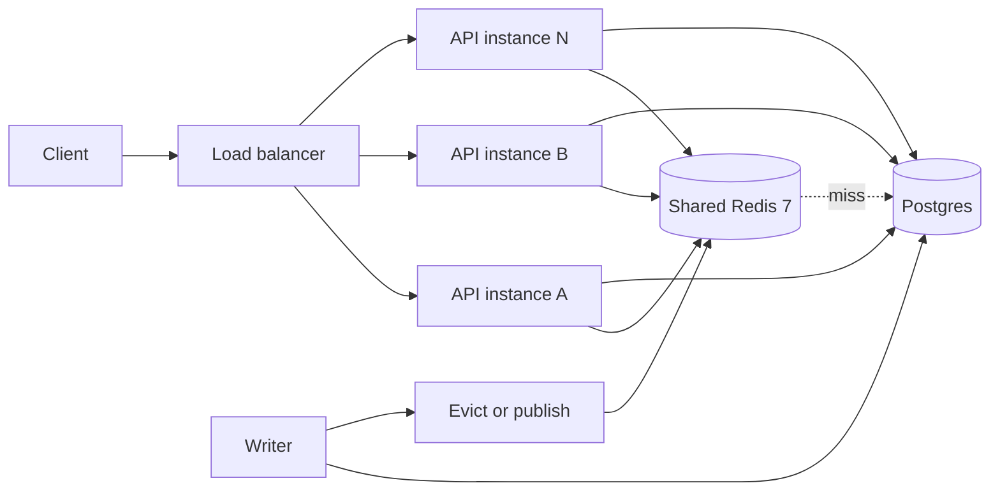
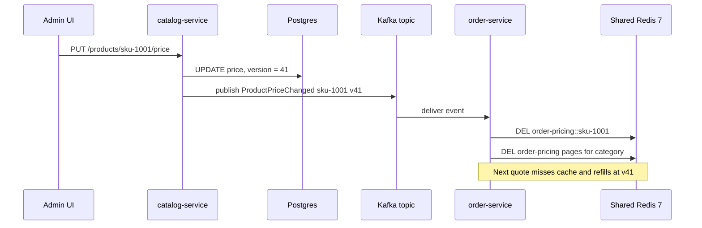
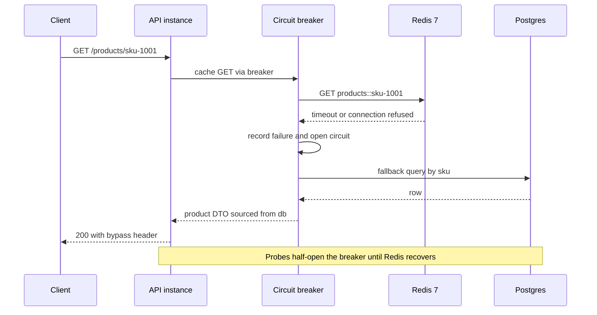

# 012 — Architecture & System Design: Redis Caching for Real Services (Boot 4.1 + Java 25, Lettuce, Redis 7)

> Section L of the Spring Redis track: nine production scenarios as system-design
> answers — requirements, architecture, API contract, key design, data flow, TTL,
> consistency, failure handling, scaling, trade-offs. Read this after the mechanics;
> it tells you **which design to pick and why**.
>
> **Stack:** Spring Boot **4.1.0** · Java **25** · Lettuce · Redis **7.x** ·
> Postgres (system of record) + `spring-boot-starter-data-redis` + `spring-boot-starter-cache`.
>
> **How to use this doc:** each scenario is self-contained (~40 lines). Skim the
> scenario that matches your problem, copy its key/TTL/invalidation triple, then
> follow the cross-links for the full mechanics.
>
> Companion guides: [006](./006-invalidation-and-consistency.md) ·
> [007](./007-product-catalog-example.md) · [009](./009-advanced-production.md) ·
> [011](./011-performance-tradeoffs.md) · [Redis basics](./redis.md).

## Table of Contents

- [How to read these designs](#how-to-read-these-designs) · [Read path (all scenarios)](#read-path-all-scenarios)
- [1. Product API cache — 50k RPM read-heavy](#1-product-api-cache--50k-rpm-read-heavy)
- [2. Employee API cache — low-write HR data](#2-employee-api-cache--low-write-hr-data)
- [3. Reference data — countries/currencies](#3-reference-data--countriescurrencies)
- [4. Query-result cache — search pages](#4-query-result-cache--search-pages)
- [5. Multi-instance shared Redis](#5-multi-instance-shared-redis)
- [6. Multi-tenant caching](#6-multi-tenant-caching)
- [7. Cross-service invalidation](#7-cross-service-invalidation)
- [8. Frequent-change data — 1s price ticks](#8-frequent-change-data--1s-price-ticks)
- [9. Redis outage — degrade to DB](#9-redis-outage--degrade-to-db)
- [Pitfalls (GOLD)](#pitfalls-gold) · [Interview Q&A](#interview-qa) · [Resources](#resources)

---

## How to read these designs

Every scenario uses the same ten slots so you can compare designs in seconds:
requirements + assumptions, architecture, API contract, key design, data flow,
TTL + invalidation, consistency, failure handling, scaling, trade-offs.

Conventions: `<cacheName>::<key>` rendering, `v{n}` version prefix,
`tenant:{id}:` tenant prefix. Snippets mirror the [007 product
service](./007-product-catalog-example.md) — copy into a Boot 4.1.0 module
and run `./mvnw test` to compile-verify.

---

## Read path (all scenarios)



Shared logical Redis; any instance serves any request; misses fall through to
Postgres and backfill. Writers evict (or publish eviction) within the staleness bound.

---

## 1. Product API cache — 50k RPM read-heavy

**Requirements + assumptions.** `GET /products/{sku}` at ~50k RPM (~830 RPS),
read:write ≈ 100:1, p99 < 50 ms, stale ≤ 10 min OK, ~1M SKUs, ~2 KB value.
DB caps at ~5k QPS — cache must absorb ≥ 95% of reads.

**Architecture.** Stateless replicas → Lettuce multiplexed connections → Redis
Cluster (3 masters) → Postgres. Cache-aside reads; write-through/invalidate
on admin writes. No request pinning.

**API contract.**

| Endpoint | Cache behavior |
|---|---|
| `GET /api/v1/products/{sku}` | `@Cacheable("products")` key `#sku`, TTL 10 min |
| `PUT /api/v1/products/{sku}` | `@CachePut("products")` refresh in place |
| `DELETE /api/v1/products/{sku}` | `@CacheEvict("products")` + clear `product-search` |

**Key design.** `products::sku-1001` → JSON. Flat key, O(1), cluster-safe
(no cross-slot ops). No hashtags unless Lua touches item + search together.

**Data flow.** Hit: GET → deserialize → 200 (~2 ms). Miss: Postgres → `SETEX
600` → 200 (~40 ms). Herd guard: `@Cacheable(sync = true)` per-key mutex.

**TTL + invalidation.** TTL 10 min bounds staleness; admin write refreshes the
item and evicts matching `product-search::*` pages. Never ship no-TTL entries.

**Consistency.** Bounded eventual: ≤ 10 min on missed evict, ~0 on clean write
path. `Cache-Control: max-age=60` adds a CDN layer inside the same bound.

**Failure handling.** Redis timeout (250 ms budget) → fall through to DB behind
a Resilience4j breaker (see §9). DB slow → 503 + `Retry-After`, never invented data.

**Scaling.** Bottleneck is connections, not bandwidth — Lettuce multiplexes;
size pool ≥ 2× replica count. At 10×: read replicas + Caffeine 30 s near-cache
for top-100 SKUs; shard by SKU hash past 70% cluster memory.

**Trade-offs.** Cache-aside never blocks writes; cost is slow first miss (warm
top SKUs, §3) + ~2 ms on admin writes. Worth it — reads pay the bills.
Mechanics: [007](./007-product-catalog-example.md).

---

## 2. Employee API cache — low-write HR data

**Requirements + assumptions.** `GET /employees/{id}` at ~200 RPM, writes a few
per day, but stale HR data is a **correctness** issue (payroll, access).
Writer needs read-your-write; readers tolerate ≤ 1 min stale. PII rules apply.

**Architecture.** Same cache-aside shape as §1, single primary + replica is
enough. All writes go through the API (no direct DB edits) so every mutation
passes the eviction point. Audit log each write.

**API contract.**

| Endpoint | Cache behavior |
|---|---|
| `GET /api/v1/employees/{id}` | `@Cacheable("employees")` key `#id`, TTL 15 min |
| `PUT /api/v1/employees/{id}` | `@CacheEvict("employees")`, reload on next read |
| `GET /api/v1/employees?dept=` | 60 s TTL or **not cached** (correctness first) |

**Key design.** `employees::e-04217` → JSON, PII fields encrypted (KMS envelope).
Never log raw IDs at INFO. No compound list keys — listings bypass cache.

**Data flow.** Hit → 200. Miss → Postgres → cache 15 min. Write → tx update →
evict **after commit in the same request** → respond from committed entity.

**TTL + invalidation.** TTL is a backstop only; synchronous write-path eviction
is the guarantee. Dept listings get 60 s or no cache so transfers show fast.

**Consistency.** Read-your-write for the mutator; item reads exact after evict.
Document the split: item = exact, list = ≤ 60 s stale.

**Failure handling.** Redis down → bypass to DB (HR volume is tiny, DB absorbs
it). Never serve post-TTL stale to "stay fast" — fail slow, not wrong. See §9.

**Scaling.** Volume never stresses Redis; scale on **tenancy** — per-tenant
prefixes when HR splits by subsidiary (§6). `maxmemory-policy noeviction` so
PII is never silently dropped.

**Trade-offs.** Evict-on-write + short list TTL costs a few DB reads/min and ~5
ms per write — negligible here, buys correctness. Do not reuse the §1 long-TTL
playbook for HR data. Semantics: [006](./006-invalidation-and-consistency.md).

---

## 3. Reference data — countries/currencies

**Requirements + assumptions.** `GET /reference/countries|currencies`: < 500
rows, read constantly, change monthly. Stale ≤ 24 h fine. Only real risk is
cold-start herd (every instance misses at deploy).

**Architecture.** Cache-aside + **eager warm on startup** (`ApplicationRunner`
loads both lists once) + 24 h TTL. Single writer (admin import); readers never
touch DB in steady state.

**API contract.**

| Endpoint | Cache behavior |
|---|---|
| `GET /api/v1/reference/countries` | `@Cacheable("reference")` key `'countries'`, TTL 24 h |
| `GET /api/v1/reference/currencies` | `@Cacheable("reference")` key `'currencies'`, TTL 24 h |
| `POST /api/v1/reference/reload` | `@CacheEvict(allEntries=true)` + rewarm (admin) |

**Key design.** `reference::countries`, `reference::currencies` — one static key
per dataset. Version the payload (`{"v":3,"rows":[...]}`) for instant rollback.

**Data flow.** Startup: Postgres → `SETEX 86400`. Steady state: always a hit.
Import: write Postgres → evict `reference::*` → rewarm synchronously → 200 only
after rewarm (callers never see an empty list).

**TTL + invalidation.** 24 h TTL bounds worst case; explicit evict + rewarm is
the live path. Jitter rewarm 0–30 s per instance so replicas never hammer DB.

**Consistency.** Snapshot consistency: all readers see the same frozen list
until reload; skew ≤ jitter window (~30 s) during reload only.

**Failure handling.** Redis down → local fallback (Caffeine copy, or classpath
snapshot for countries). DB down at boot → boot from snapshot + alert. These
endpoints must never 500 on a cache miss.

**Scaling.** One key per dataset, single Redis string each. At 10× add
`Cache-Control: max-age=3600` and let the CDN carry reads.

**Trade-offs.** Warm-on-boot costs ~1 s and couples boot to DB/Redis — mitigated
by snapshot fallback. Payoff: zero steady-state DB load, zero cold spikes.
See [009](./009-advanced-production.md).

---

## 4. Query-result cache — search pages

**Requirements + assumptions.** `GET /products/search?category=&q=&page=&size=`:
thousands of combos, ~10 KB per page, rows change hourly. Stale ≤ 5 min OK.
Danger is unbounded key growth (bot crawling page 847 must not fill Redis).

**Architecture.** Cache-aside per **compound versioned key**, 2 min TTL,
`product-search` isolated from `products` items. Cache pages 0–9 only; deeper
pages bypass cache.

**API contract.**

| Endpoint | Cache behavior |
|---|---|
| `GET /api/v1/products/search?...` | `@Cacheable("product-search")` compound key, TTL 2 min |
| Any product write | Evict affected `product-search::*` (category-scoped) |

```java
@Cacheable(value = "product-search", key = "#v + ':' + #category + ':' + #page + ':' + #size")
public Page<ProductDto> search(String v, String category, int page, int size) { ... }
```

**Key design.** `product-search::v3:footwear:0:20` — `v3` bump = instant global
invalidation without `KEYS`. Normalize params (lowercase/trim/default sort) or
duplicates double the keyspace.

**Data flow.** Hit → 200 (~3 ms). Miss → JPA query → store 120 s. Write → evict
item + `product-search::v3:<category>:*` via bounded `SCAN COUNT 100`; bulk
reindex → bump `v3→v4`.

**TTL + invalidation.** 2 min TTL self-cleans (primary); targeted evict is the
freshness fast path; version bump is the bulk escape hatch. Never `KEYS *`.

**Consistency.** Pages ≤ 2 min eventual; item detail (§1) is authoritative when
page and detail disagree (document this).

**Failure handling.** Flash-sale herd → `sync=true` per compound key + DB
`statement_timeout` 2 s. On OOM, pages die first — item keys must survive.

**Scaling.** Cap keeps keyspace in low tens of thousands. At 10×: scheduler
rewarms top-100 searches every 90 s; cap `size` ≤ 50 so pages stay small.

**Trade-offs.** Memory + brief page/item skew for latency. Beats uncached search
at 50k RPM, which melts Postgres. See [006](./006-invalidation-and-consistency.md).

---

## 5. Multi-instance shared Redis

**Requirements + assumptions.** 3–12 replicas, round-robin LB, **no sticky
sessions**, rolling deploys one pod at a time, zero-downtime cached-JSON schema
changes. Any replica serves any request identically.

**Architecture.** All replicas → one logical Redis (Cluster or Sentinel). No
authoritative per-pod state; optional Caffeine L1 (≤ 30 s) as latency trim only.
Deploy: `maxUnavailable: 0`, `maxSurge: 1`.

**API contract.** Endpoints unchanged (§1–§4) + **version discipline**: payloads
carry `v`; readers tolerate `v-1` during rollout (old writes `v2`, new `v3`).

**Key design.** Prefix versioned shapes: `products::v3:sku-1001`. Dual-write both
shapes for one TTL window, or only **add** optional fields (forward-compatible).
Delete old shapes after `2 × TTL`.

**Data flow.** Request lands anywhere → shared hit (warmed by whichever pod).
Rolling update: new pod starts already-hot → old pods drain. Zero per-deploy
cold penalty — the reason to share.

**TTL + invalidation.** Keep TTLs ≤ 10 min during migration weeks so old shapes
drain fast. Ship eviction logic in **both** old and new code for the window.

**Consistency.** Same Redis → identical bounds cluster-wide. L1 (if any) ≤ 30 s
and **off** for HR/correctness endpoints (§2) — 12-pod L1 skew is invisible
until payroll notices.

**Failure handling.** Cluster failover (~s): Lettuce topology refresh + retry
once, in-flight falls back to DB (§9 breaker). Pod crash loses nothing.

**Scaling.** Pods scale freely; watch `connected_clients` + bus traffic. Past
~20 pods / multi-AZ: per-AZ read replicas + `READONLY` GET routing.

**Trade-offs.** Shared Redis is one logical dependency (outage hits all — hence
§9) but buys hot deploys and no sticky hacks. Prefer shared + fallback-to-DB.
See [009](./009-advanced-production.md).

---

## 6. Multi-tenant caching

**Requirements + assumptions.** SaaS, hundreds of tenants, per-tenant visibility
and pricing. Tenant A must never see tenant B's price. Traffic skew 100× (whales
vs trials). Offboard must provably purge (GDPR).

**Architecture.** One shared Redis, **tenant-prefixed keys** (option A below).
Tenant id from JWT at the edge → `TenantContext` → key generator. Never from a
spoofable query param.

**API contract.**

| Endpoint | Cache behavior |
|---|---|
| `GET /api/v1/{tenant}/products/{sku}` | Key includes tenant |
| `DELETE /api/v1/admin/tenants/{id}/cache` | Purge `tenant:{id}:*` (offboard) |

**Key design — pick one:**

| Option | Shape | Isolation | Cost |
|---|---|---|---|
| **A. Tenant-key prefix (default)** | `tenant:acme:products::sku-1` | Logical, needs discipline | One Redis; purge = scan |
| B. Key tag / hash-tag | `tenant:{acme}:products::sku-1` | Co-located per slot | Same ops, better locality |
| C. Separate logical DB | DB index per tenant | Weak, Cluster forbids | Avoid; audit-hostile |

Default **A**; add hashtag (B) on Cluster for Lua/multi-key co-location. C
blocks your Cluster path — avoid C entirely.

**Data flow.** Auth filter sets `TenantContext` → prefixed cache-aside. Unknown
tenant → 401/404 **before** cache touch. Offboard → `SCAN tenant:{id}:*` +
`UNLINK` + verify 0 keys.

**TTL + invalidation.** Same TTLs as §1/§4, always tenant-scoped so one tenant's
write never clears another's pages. Whales get TTL overrides when justified.

**Consistency.** Per-tenant bounds = single-tenant bounds; cross-tenant
consistency is a non-goal. Privacy > freshness: on doubt, evict, don't serve.

**Failure handling.** Whale stampede → per-tenant `sync=true` + per-tenant DB-fill
rate limit (whale miss must not starve minnows). Outage fallback (§9) stays
tenant-scoped: every DB query carries the tenant predicate.

**Scaling.** Prefix purge is O(tenant keys) — fine for hundreds; past ~10k track
counts in `tenant:{id}:meta` or shard whales to dedicated clusters by prefix.

**Trade-offs.** Prefix purge is a seconds-long scan, not atomic — guard with a
`purging:{tenant}` flag forcing DB reads meanwhile. Per-tenant clusters = hard
isolation at 10× ops cost, for regulated whales only.

---

## 7. Cross-service invalidation

**Requirements + assumptions.** Catalog-service owns products; order-service
caches snapshots for quotes. Catalog write visible in order-service ≤ 30 s. No
direct HTTP evict (coupling + cascade risk). Kafka is the shared backbone.

**Architecture.** Catalog writes Postgres → `ProductPriceChanged(sku, version)` →
order-service evicts its own `order-pricing::*`. Each service owns its keyspace;
events carry identity + version, never full payloads.



**API contract.** Catalog `PUT /products/{sku}/price` → 200 + async event.
Order `POST /quotes` reads `order-pricing::{sku}` (TTL 5 min); miss refills from
catalog API, never from the event body.

**Key design.** Separate namespaces: catalog `products::*`, order
`order-pricing::*`. Consumer ignores `version <= cached.version` (idempotent).

**Data flow.** Tx outbox (event row in same DB tx, relay publishes) → consumer
`DEL`s keys → optional top-SKU rewarm → commit offset after evict (at-least-once
DEL is safe: idempotent).

**TTL + invalidation.** 5 min TTL backstops Kafka lag; events make the common
case seconds. Lag alert > 10 s; DLQ + replay for poison events.

**Consistency.** Bounded eventual ≤ 30 s (5 min on total Kafka loss). Quotes stamp
`priceVersion: v41` so disputes resolve by version. Catalog never blocks on consumers.

**Failure handling.** Kafka down → catalog still writes (outbox buffers); order
rides TTL, then DB reads + `stale-risk: true` past the SLO. Crash → replay from
offset; double-delivery harmless.

**Scaling.** Partition key = `sku` preserves per-product order; scale consumers
by partitions. Event volume = write volume — watch lag, not throughput.

**Trade-offs.** Outbox + schema + lag monitoring vs direct RPC — buys decoupled
deploys, downtime survival, audit trail. With < 2 consumers and no Kafka, use
Redis Pub/Sub `PUBLISH invalidate:sku-1001`. See [006](./006-invalidation-and-consistency.md).

---

## 8. Frequent-change data — 1s price ticks

**Requirements + assumptions.** Ticks every ~1 s × 10k symbols; quotes at 20k
RPM. Caching each tick is pointless (expires before reuse) and harmful (10k
SET/s + permanent stale). Callers need a **current-enough quote**, not ticks.

**Architecture.** Tick ingest → aggregator holds latest **in memory** (not Redis)
→ flushes 2 s **snapshots** to Redis → quote API serves snapshots. Live clients
use push (SSE/WebSocket); pollers use snapshots. Two lanes.

**API contract.**

| Endpoint | Cache behavior |
|---|---|
| `GET /api/v1/quotes/{symbol}` | `quotes::AAPL` snapshot, TTL 2 s — never raw tick |
| `GET /api/v1/quotes/{symbol}/history` | OHLC buckets, TTL 60 s (immutable past) |
| `WS /stream/quotes` | Push per tick (live lane, bypass cache) |

**Key design.** `quotes::AAPL` → `{"px":192.44,"ts":…}` (2 s TTL).
`ohlc::AAPL:1m:{epochMin}` → sealed minute bar (1 h TTL, never evicted).
Never `price::tick::{n}` — write-only garbage.

**Data flow.** Tick → in-memory latest → 2 s pipelined flush (`MSETEX`) → API
cache-aside on snapshots. History sealed at minute close, written once. Push lane
tick → socket, independent of Redis lag.

**TTL + invalidation.** Snapshot TTL 2 s *is* the freshness promise; next flush
overwrites (no evict). History immutable → long TTL, no evict path. Flush stall >
4 s → snapshots expire → fallback to aggregator RPC.

**Consistency.** Poller lag ≤ 2 s + jitter; `ts` in payload lets callers measure
it. Tick-exact lives only on push. Document both guarantees on the endpoint.

**Failure handling.** Aggregator down → snapshots expire → 503 + `Retry-After: 1`
(never freeze a tradable price). Redis down → proxy aggregator rate-limited.
Push backpressure: drop + resync, never queue ticks.

**Scaling.** 10k symbols / 2 s = 5k SET/s — one primary handles it pipelined;
reads ~100% cached. At 10×: shard by symbol hash, MessagePack payloads, or cache
top-N liquid symbols only.

**Trade-offs.** Deliberate 0–2 s poller staleness buys 20k RPM survival; exactness
exists only on push. Caching the aggregate cuts writes several-fold with an
honest SLA. Streams option: [009](./009-advanced-production.md).

---

## 9. Redis outage — degrade to DB

**Requirements + assumptions.** Redis down (failover, partition, OOM, bad deploy)
must not be a full outage. Targets: ≤ 0.1% monthly budget hit, p99 ≤ 2× normal
degraded, no manual recovery stampede. DB sized for **brief** full traffic.

**Architecture.** Lettuce fail-fast timeouts → Resilience4j breaker on cache
layer → fallback chain Redis → Postgres → 503. Breaker state drives dashboards
and autoscale.



**API contract.** Same endpoints + `X-Cache-Status: bypass` (and where safe
`X-Degraded: true`). Writes keep working (DB is truth). Document degraded headers
in OpenAPI so clients poll less.

**Key design.** No key changes — size the **socket budget**: connect 500 ms, read
250 ms, 1 retry. Slow Redis is worse than dead Redis; timeouts make it cleanly dead.

**Data flow.** Breaker open → skip Redis, query DB, return **without backfill**
(no writes to a sick Redis). Half-open 5% probes; close on success.

**TTL + invalidation.** Freeze TTLs through the outage; accept one window of wider
staleness on return instead of mass-evicting (mass evict = self-stampede). Rewarm
§3 reference data first.

**Consistency.** Degraded reads are **fresher** (DB-direct) — advertise "slower but
current". §8-style snapshots gate to 503 instead of serving frozen prices.

**Failure handling.** Breaker: 50% over 20 calls, open 30 s, 5 half-open probes.
Bulkhead fallback concurrency (e.g. 200) + `statement_timeout` 2 s so DB survives.
Shed with 503 + `Retry-After` before killing Postgres.

**Scaling.** DB at 5% normally → plan 100% for 15 min (pool + read replica ready).
Chaos-test quarterly: kill Redis in staging, measure p99 + DB CPU.

**Trade-offs + SLO table.** Breaker/bulkhead/headers complexity for availability —
always worth it on read-heavy paths.

| SLO | Normal | Degraded (Redis down) | Breach action |
|---|---|---|---|
| Availability | 99.95% | ≥ 99.5% | Page if < 99.5% / 10 min |
| p99 read | < 50 ms | < 100 ms | Autoscale API + DB replica |
| Freshness | Per-scenario TTL | Fresher (DB-direct) | Advertise it |
| Recovery | — | Hot cache ≤ 2 × TTL | Rewarm ref-data first |

Runbook + metrics (`cache.hit`, `breaker.state`): [009](./009-advanced-production.md)
and gates in [011](./011-performance-tradeoffs.md).

---

## Pitfalls (GOLD)

1. **Caching the tick, not the quote.** 1 s ticks expire before reuse while burning
   SET/s — cache the 2 s aggregate (§8), push the live lane. If TTL < reuse interval,
   do not cache the value.
2. **`KEYS *` eviction.** Blocks the event loop; on 1M keys it stalls everyone. Use
   category `SCAN COUNT 100` + `UNLINK`, or version bumps (§4) with zero Redis touch.
3. **One TTL for everything.** 10 min products on HR rows (§2) or 24 h on search
   pages (§4) turns tuning into incidents. TTL is a business promise — set per scenario.
4. **Sticky sessions + shared Redis.** Pinning "for warmth" buys nothing (warmth lives
   in Redis) and breaks rolling deploys (§5). Keep any-to-any routing.
5. **Tenant-less keys.** Shared `products::sku` leaks prices across tenants the first
   hit (§6). Prefix first; test tenant B against tenant A's warmed cache, assert a miss.
6. **Write-then-publish without outbox.** Crash between commit and publish drops the
   invalidation (§7). Outbox + relay, idempotent `DEL`, offset-after-evict.
7. **No breaker on the cache path.** Hung Redis holds threads until everything 503s —
   including data safe in Postgres. Cache calls get the tightest timeouts (§9).
8. **Mass evict on recovery.** Clearing "to be safe" when Redis returns is a
   self-stampede (§9). Refill lazily; rewarm only reference data (§3).

---

## Interview Q&A

**Q1. "50k RPM on a product API — walk me through your caching design."**
Cache-aside on shared Cluster, `products::sku` 10 min TTL, `sync=true` per-key
mutex, write-through on admin writes, CDN `max-age=60`. DB sized for 5% misses;
Lettuce multiplexing; top-100 near-cache at 10×. Bound 10 min, ~0 on write path (§1).

**Q2. "Catalog writes in one service, cached reads in another — how to stay
consistent without coupling?"**
Tx outbox → `ProductPriceChanged(sku, version)` on Kafka → order-service `DEL`s its
own `order-pricing::*`, offset after evict. 5 min TTL backstops Kafka loss; version
check makes redelivery safe; catalog never blocks (§7). Tiny setup: Redis Pub/Sub.

**Q3. "Prices change every second. Do you cache them?"**
Never the tick — expires before reuse while 10k SET/s burns Redis (§8). Cache the
2 s snapshot (`quotes::SYM`, TTL 2 s) for pollers, push ticks over WS/SSE for live,
seal immutable OHLC buckets. Degraded rule: expire to 503, never freeze a price.

**Q4. "Redis goes down at peak. What does the user see?"**
Same endpoints + `X-Cache-Status: bypass`, p99 ≤ 2× (§9). Breaker (50%/20 calls)
shifts to DB-direct (fresher, slower); bulkhead caps fallback so Postgres survives.
Recovery refills lazily, ref-data first. SLO: ≥ 99.5% through the incident.

---

## Resources

- Spring Framework reference — caching abstraction (`@Cacheable`, `@CachePut`, `@CacheEvict`):
  <https://docs.spring.io/spring-framework/reference/integration/cache.html>
- Spring Data Redis reference (Boot 4.1, Lettuce, Redis 7):
  <https://docs.spring.io/spring-data-redis/docs/current/reference/html/>
- Lettuce 6.x wiki (topology refresh, pipelining, Cluster):
  <https://github.com/lettuce-io/lettuce-core/wiki>
- Redis 7 docs — expiry, `SCAN` vs `KEYS`, eviction, Cluster spec:
  <https://redis.io/docs/latest/>
- Resilience4j — circuit breaker + bulkhead:
  <https://resilience4j.readme.io/docs/circuitbreaker>
- Kleppmann, *Designing Data-Intensive Applications*, Ch. 5–6 — consistency framing for §7/§9.

**Track cross-links** (mechanics behind each scenario): invalidation semantics →
[006](./006-invalidation-and-consistency.md) · runnable product service →
[007](./007-product-catalog-example.md) · Cluster, metrics, streams →
[009](./009-advanced-production.md) · pre-deploy gates →
[011](./011-performance-tradeoffs.md) · client/driver basics →
[Redis basics](./redis.md).
