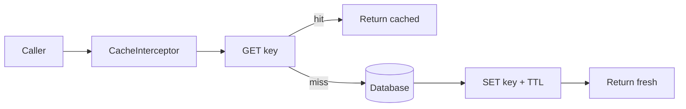
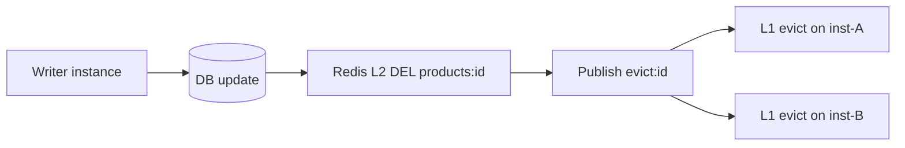
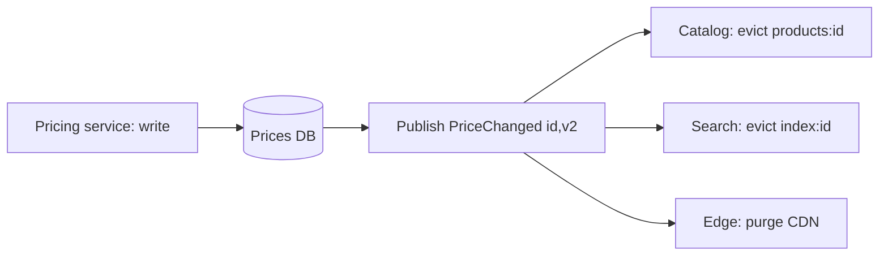

# 013 — Spring Cache + Redis Interview Questions

> **Baseline:** Spring Boot **4.1** + Java **25** + Spring Framework **7.x** + Redis **7.x**.
> Client: **Lettuce** (default in `spring-boot-starter-data-redis`). Assumes you have read
> `./001-spring-cache-fundamentals.md` through `./009-advanced-production.md`.
> This is **Section M** — 24 interview questions with short answers, deeper context, and follow-ups.

## How to use this guide

- **Beginner (Q1–Q6):** can you use the abstraction correctly?
- **Intermediate (Q7–Q14):** can you debug it when it misbehaves?
- **Advanced / Senior (Q15–Q24):** can you run it in production across instances, failures, and tenants?
- Each question has: (1) interview-ready answer, (2) deeper explanation, (3) code/diagram where useful,
  (4) scenario/trade-off, (5) follow-up for the interviewer to go deeper.
- All **8 required scenarios** are embedded and marked with `Scenario:`.

---

### Beginner

#### Q1. What is Spring Cache?

**Interview-ready answer:** Spring Cache is a declarative caching abstraction — you annotate methods with
`@Cacheable` / `@CachePut` / `@CacheEvict` and enable it once with `@EnableCaching`, and Spring's
`CacheInterceptor` handles lookup/store/eviction around your method. Your business code never calls Redis
or Caffeine directly. The actual storage is pluggable via a `CacheManager` provider.

**Deeper:** The abstraction (`Cache`, `CacheManager`, `KeyGenerator`, `CacheResolver`) answers *when and
what* to cache; the provider answers *where and how* bytes are stored. That split is why you can develop
against `ConcurrentMapCacheManager` or Caffeine and switch to `RedisCacheManager` in production with no
service-code change. The interception is AOP-proxy based, so only external bean calls are cached
(see Q11). Full layer diagram in `./001-spring-cache-fundamentals.md`.

```java
@Service
public class ProductService {
    @Cacheable(value = "products", key = "#id")
    public Product getById(String id) {
        return repo.findById(id).orElseThrow();
    }
}
```

**Scenario / trade-off:** Greenfield catalog service — start with the abstraction + Caffeine for speed of
development, move to Redis when a second instance appears. Trade-off: the abstraction hides provider
limits (no TTL semantics in `ConcurrentMapCache`, no search in Redis) — you still must learn the provider.

**Follow-up:** If `@Cacheable` never touches the network, which component does — and what does it send?

---

#### Q2. What do `@Cacheable`, `@CachePut`, `@CacheEvict`, `@Caching`, `@CacheConfig` each do?

**Interview-ready answer:** `@Cacheable` runs the method only on cache miss and stores the result;
`@CachePut` always runs the method and overwrites the entry; `@CacheEvict` removes entries (one key or
`allEntries`); `@Caching` groups several of those on one method; `@CacheConfig` sets shared defaults
(cache names, key generator) at class level. The key verb test is: skip-if-present, always-run,
remove, group, defaults.

**Deeper:** The confusion that fails interviews is `@Cacheable` vs `@CachePut` (see Q8): one is
read-through, the other is write-through refresh. `@CacheEvict(beforeInvocation = true)` clears even when
the method throws — useful for invalidation that must not be skipped on failure. `@Caching` exists because
Java annotations are not repeatable in the caching namespace, so grouped evict+put needs a container.

```java
@CacheConfig(cacheNames = "products")
@Service
public class ProductService {

    @Cacheable(key = "#id")
    public Product get(String id) { return repo.findById(id).orElseThrow(); }

    @CachePut(key = "#p.id")
    public Product update(Product p) { return repo.save(p); }

    @Caching(evict = {
        @CacheEvict(key = "#id"),
        @CacheEvict(value = "product-lists", allEntries = true)
    })
    public void delete(String id) { repo.deleteById(id); }
}
```

**Scenario / trade-off:** `update()` that returns `void` combined with `@CachePut` silently caches `null`
— prefer `@CacheEvict` there or make the method return the entity. Rule of thumb: `@CachePut` only on
methods that return the fresh value.

**Follow-up:** Why can't you put two `@CacheEvict` annotations directly on one method — and what does
`@Caching` compile to?

---

#### Q3. What is the role of `CacheManager` (and `CacheResolver`)?

**Interview-ready answer:** `CacheManager` is the provider SPI: given a cache name it returns a `Cache`
backed by real storage (map, Caffeine, Redis). At startup Boot auto-configures one (`RedisCacheManager`
when Redis is on the classpath); at runtime the interceptor asks it for the `Cache` on every cached call.
`CacheResolver` is the rarer override — it lets you pick the manager or cache set dynamically per
invocation instead of the static `value = "products"`.

**Deeper:** One `CacheManager` can serve many cache names with per-cache TTL/serialization tuned in
`RedisCacheConfiguration` (see `./004-redis-cache-configuration.md`). Multiple managers (e.g., Caffeine
for hot reference data + Redis for shared catalog) require a `CacheResolver` or `CompositeCacheManager`
plus explicit `cacheManager = "caffeineManager"` on annotations. If no `Cache` matches, Boot fails fast
rather than silently skipping the cache.

```java
@Bean
RedisCacheManager cacheManager(RedisConnectionFactory f) {
    RedisCacheConfiguration defaults = RedisCacheConfiguration.defaultCacheConfig()
        .entryTtl(Duration.ofMinutes(10))
        .disableCachingNullValues();
    return RedisCacheManager.builder(f).cacheDefaults(defaults).build();
}
```

**Scenario / trade-off:** Two managers without a resolver → ambiguous injection and the wrong TTL on the
wrong data. Trade-off of `CompositeCacheManager`: flexible routing, but every new cache name must exist in
one of the delegates or resolution fails.

**Follow-up:** When would you reach for a custom `CacheResolver` instead of just naming the manager?

---

#### Q4. Redis vs Caffeine — when do you pick which?

**Interview-ready answer:** Caffeine is an in-process, heap-local cache: sub-microsecond hits, no network,
but each instance has its own copy and memory is bounded by the JVM. Redis is a shared, out-of-process
store: millisecond hits over TCP, but every instance sees the same data and it survives restarts.
Use Caffeine for single-instance or rarely-changing reference data; use Redis the moment you have two
instances or need shared invalidation.

**Deeper:** The real axis is *consistency vs latency*. Caffeine needs broadcast invalidation (Redis
pub/sub, Kafka) to stay coherent across instances; Redis gives coherence for free but adds serialization
+ network per hit. The production sweet spot is often two-level (L1 Caffeine short TTL + L2 Redis longer
TTL — see `./009-advanced-production.md`), at the cost of two TTLs and two invalidation paths to reason
about.

| | Caffeine | Redis |
|---|---|---|
| Hit latency | ~ns–µs, no I/O | ~0.5–2 ms + serde |
| Shared across instances | No | Yes |
| Survives restart | No | Yes (RDB/AOF) |
| Invalidation | Local or broadcast | `DEL` / pub-sub once |

**Scenario / trade-off:** Feature flags read 10k rps on 4 instances — Caffeine with 30 s TTL gives speed
with bounded staleness; pricing data shared across instances must live in Redis or instances diverge.

**Follow-up:** Sketch the read path of an L1+L2 cache — on L1 miss do you populate L1 from L2 synchronously?

---

#### Q5. Cache hit vs cache miss — what actually happens on each path?

**Interview-ready answer:** On a `@Cacheable` call the interceptor builds the key and asks the `Cache` for
it: a **hit** returns the stored value and the method body never runs; a **miss** runs the method, stores
its return value (unless `unless` vetoes it), then returns it. Hit cost is one Redis `GET` + deserialization;
miss cost is `GET` + database call + `SET`.

**Deeper:** Interviewers want the miss-penalty arithmetic: if hit rate `h`, hit latency `Lh`, miss latency
`Lm`, average latency ≈ `h·Lh + (1−h)·Lm`. A 95% hit rate with 1 ms hits and 120 ms misses still averages
~7 ms — misses dominate. Logging hit/miss counters (Micrometer `cache.gets` with `result=hit|miss`) is how
you prove the cache is earning its keep rather than assuming it.



**Scenario / trade-off:** Dashboard "cache enabled" but p99 unchanged — check the hit ratio first; a 20%
hit ratio means the key space is too volatile or TTL too short, and the cache is pure overhead.

**Follow-up:** How would you measure hit ratio per cache name in production with Micrometer + Prometheus?

---

#### Q6. What is TTL, and how do you choose one?

**Interview-ready answer:** TTL (time-to-live) is how long an entry stays valid before Redis expires it;
after expiry the next read is a miss that reloads from the source. Configure it per cache with
`RedisCacheConfiguration.entryTtl(...)` and Boot properties. Short TTLs (seconds–minutes) bound staleness
for volatile data; long TTLs (hours) suit reference data, paired with explicit eviction on writes.

**Deeper:** TTL is your cheapest consistency mechanism — it caps worst-case staleness without any
invalidation plumbing. Randomize ("jitter") TTLs on hot keyspaces so thousands of keys don't expire in
the same second and stampede the database (see Q15). Remember Redis expiry is lazy + periodic: memory is
reclaimed asynchronously, so `DBSIZE` may briefly over-count.

```java
RedisCacheConfiguration products = RedisCacheConfiguration.defaultCacheConfig()
    .entryTtl(Duration.ofMinutes(10).plusSeconds(ThreadLocalRandom.current().nextInt(120)));
```

```properties
spring.cache.redis.time-to-live=10m
```

**Scenario / trade-off:** Product price cached 1 h but marketing changes prices every 5 min → either drop
TTL to 1 min (more DB load) or keep 10 min + evict on price-update events (more plumbing, fresher reads).

**Follow-up:** Why add jitter to TTLs, and what failure does synchronized expiry cause?

---

### Intermediate

#### Q7. `condition` vs `unless` — what's the difference, and when does each run?

**Interview-ready answer:** Both are SpEL guards, but `condition` is evaluated **before** the method runs and
can skip caching entirely (neither lookup nor store), while `unless` is evaluated **after** the method
returns and can only veto the store — the method always executes. Use `condition` on the input
(`#id != null`), `unless` on the output (`#result == null`).

**Deeper:** The classic use: `condition = "#id != null and #id.length() > 0"` avoids polluting the cache
with junk keys, and `unless = "#result == null"` keeps misses for absent rows from being cached (or the
inverse — cache nulls deliberately, see Q10). Because `unless` runs post-invocation it can reference
`#result`; referencing `#result` in `condition` is a startup-visible SpEL error. Both support full SpEL
against `#root.args`, `#p0`, method params, and beans via `@beanName`.

```java
@Cacheable(value = "products", key = "#id",
    condition = "#id != null",
    unless = "#result == null || #result.discontinued")
public Product get(String id) { return repo.findById(id).orElse(null); }
```

**Scenario / trade-off:** Caching admin-preview renders alongside public pages — `condition =
"!#preview"` keeps draft content out of the shared cache without a second method. Over-complex SpEL hurts
readability; beyond two predicates extract a `CacheResolver` or a small predicate bean.

**Follow-up:** What happens if your `condition` references `#result` — when do you find out, and why?

---

#### Q8. `CachePut` vs `Cacheable` — and scenario: "which one refreshes without evicting?"

**Interview-ready answer:** `Cacheable` is read-through: on hit the method is skipped, on miss the result is
stored. `CachePut` is write-through refresh: the method **always runs** and its return value overwrites the
entry — no eviction needed. So "refresh the entry with the new DB state after an update, without a
delete-then-miss" is `@CachePut` on the update method keyed identically to the `@Cacheable` read.

**Deeper:** The trap is key symmetry: `@Cacheable(key="#id")` on `get` and `@CachePut(key="#p.id")` on
`update` must resolve to the same key or you maintain two entries forever. `@CachePut` on a `void` method
caches `null` (or fails on `disableCachingNullValues`), so only annotate methods that return the fresh
state. For bulk updates that don't return every affected row, `@CacheEvict(allEntries=true)` is safer than
N speculative puts.

> **Scenario (required):** *"After a product update, how do you refresh the cache without evicting?"*
> Put `@CachePut(value="products", key="#result.id")` on `updateProduct()` returning the saved entity —
> the write path repopulates the exact key the read path uses. Eviction would also work but forces the next
> reader to pay a miss.

```java
@Cacheable(value = "products", key = "#id")
public Product get(String id) { return repo.findById(id).orElseThrow(); }

@CachePut(value = "products", key = "#result.id")
public Product update(Product p) { return repo.save(p); } // always runs, overwrites
```

**Scenario / trade-off:** High-write catalog (price ticks every second) — `@CachePut` per tick hammers
Redis writes; better to evict + lazy reload, or debounce puts. Low-write catalog — `@CachePut` keeps reads
at hit latency forever.

**Follow-up:** Your `@CachePut` and `@Cacheable` keys drift apart — what symptom do you see, and how do you
prove it with `redis-cli`?

---

#### Q9. Key generation + SpEL — how are keys built, and what goes wrong?

**Interview-ready answer:** By default Spring builds a `SimpleKey` from all method arguments; explicit
`key = "#productId"` (SpEL) is the norm for readable, stable Redis keys. The final Redis key is
`<prefix>::<cacheName>::<key>` with `StringRedisSerializer` on keys by convention. What goes wrong:
overloaded args producing collisions, `toString()`-based keys that change across deploys, and SpEL typos
that fail at runtime, not compile time.

**Deeper:** Key design rules live in `./005-cache-key-design.md`: include tenant + version segments for
multi-tenancy and schema evolution, hash long composite keys, keep cardinality bounded (user-id keyspaces
explode; paginated-query keyspaces explode faster). Custom `KeyGenerator` beans centralize the scheme when
dozens of methods share it. Always verify with `redis-cli SCAN` — if you can't predict the key by reading
the annotation, the design is wrong.

```java
@Cacheable(value = "products", key = "'v2:'.concat(#tenant).concat(':').concat(#id)")
public Product get(String tenant, String id) { return repo.find(tenant, id); }
```

**Scenario / trade-off:** `getOrders(user, filter)` keyed on the whole `filter` object → unbounded keyspace
and 5% hit ratio. Trade-off: key on `(userId, filter.hash())` with short TTL — bounded space, slightly
stale pages.

**Follow-up:** Your Redis holds 4M keys under `orders::*` and hit ratio is 12% — is that a key-design or a
TTL problem, and how do you tell?

---

#### Q10. JSON vs JDK serialization — and scenario: "deserialization failure after a deploy, how do you fix it?"

**Interview-ready answer:** `GenericJackson2JsonRedisSerializer` stores human-readable JSON with a `@class`
type hint — debuggable, cross-language, but breaks if you rename/move classes or change Jackson config.
JDK serialization stores opaque blobs tied to `serialVersionUID` — brittle across JVM versions and
unreadable in `redis-cli`. Prefer JSON everywhere (Boot 4 default), keep DTOs stable, and version cache
names (`products:v2`) when shapes change.

**Deeper:** The failure mode: deploy N+1 renames `com.shop.Product` → `com.shop.catalog.Product`; old JSON
entries carry `"@class":"com.shop.Product"` and Jackson throws `InvalidTypeIdException` on every hit —
cache is poisoned until TTL or flush. Fixes in order: (1) bump the cache name/prefix to cut over cleanly,
(2) set a tolerant `ObjectMapper` (or `JsonTypeInfo` with aliases) during migration, (3) flush the affected
keyspace as a last resort. Never "fix" it by catching the exception per-hit — that converts every read
into a logged miss.

> **Scenario (required):** *"Reads worked yesterday, and after today's deploy every cached read throws a
> deserialization error."* Diagnosis: type hint in stored JSON no longer resolves. Immediate fix: point the
> service at a fresh cache name (`products:v3`) or `DEL` the poisoned keyspace; proper fix: versioned cache
> names in the key design so shape changes never reuse a keyspace.

```java
RedisCacheConfiguration cfg = RedisCacheConfiguration.defaultCacheConfig()
    .serializeKeysWith(RedisSerializationContext.SerializationPair.fromSerializer(new StringRedisSerializer()))
    .serializeValuesWith(RedisSerializationContext.SerializationPair
        .fromSerializer(new GenericJackson2JsonRedisSerializer(objectMapper)))
    .prefixCacheNameWith("shop:prod:"); // + version inside cache name: "products:v2"
```

**Scenario / trade-off:** Polyglot readers (Java writer, Go reader) force plain JSON without Java type
hints — but then `@Cacheable` can't polymorphically restore subtypes. Trade-off: separate plain-JSON cache
for cross-service payloads, typed JSON for internal method caches.

**Follow-up:** Why is flushing the whole Redis a bad "fix" for one poisoned keyspace — what do you do instead?

---

#### Q11. Null caching — should you cache `null`, and scenario: "Cacheable executing every time"?

**Interview-ready answer:** By default Spring does not cache `null` (`disableCachingNullValues` is the Boot
sensible default), so a miss for an absent row re-hits the database on every call — expensive under
penetration (see Q15). Caching nulls (sentinel empty value, short TTL) converts repeated absent-row
lookups into cheap hits. The cost is staleness: a row created 1 s after you cached "absent" stays invisible
until that short TTL expires.

**Deeper:** Two distinct "executes every time" causes: (a) nulls not cached — method runs, returns null,
nothing stored, repeat; (b) **self-invocation** — `this.getProduct()` inside the same bean bypasses the
AOP proxy so no caching happens at all, for null or non-null results. Diagnose (a) with a hit-ratio of ~0
on a key you expect to hit; diagnose (b) by checking whether the call goes through the injected proxy
(self-inject the bean or extract the cached method to another bean).

> **Scenario (required):** *"`@Cacheable` method executes every time — cache never hits."* Checklist:
> 1. Is `@EnableCaching` present and the method `public` on a Spring bean? 2. Is the call self-invoked
> (`this.`)? Move it behind the proxy. 3. Does the method return `null` with null-caching disabled? Either
> cache a sentinel with short TTL or accept DB hits. 4. Is the key unstable (random UUID, whole filter
> object)? Stabilize it. 5. Is TTL ~0 or eviction racing the read? Check config.

```java
// Self-invocation bypasses the proxy — getById() caching is SKIPPED here:
public Product refresh(String id) { return this.getById(id); } // BUG

// Fix: call through the proxy
@Service
public class CatalogFacade {
    private final ProductService products; // injected proxy
    public Product refresh(String id) { return products.getById(id); } // cached
}
```

**Scenario / trade-off:** Absent-row lookups at 2k rps (scrapers probing IDs) — cache a tombstone 60 s and
DB load collapses; but a legitimately created product hides for up to 60 s. Mitigate by evicting the
tombstone in the create path.

**Follow-up:** How do you distinguish "nulls not cached" from "self-invocation" using only metrics + one
`redis-cli` command?

---

#### Q12. What does `sync = true` do, and when is it dangerous?

**Interview-ready answer:** `sync = true` on `@Cacheable` makes concurrent misses for the same key collapse:
one thread loads, the rest block on the key's monitor until the value arrives — a built-in single-flight
against stampedes. It only works for a single cache, no `unless`, and the loading thread must not re-enter
the same key. It's dangerous when the loader is slow or calls back into the cached method (thread-pool
starvation, deadlock) or when combined with multiple caches.

**Deeper:** `sync=true` is a local JVM lock, not a distributed lock — on 4 instances, 4 threads (one per
instance) still hit the DB simultaneously. So it blunts single-instance thundering herds but does not
replace a Redis distributed lock / probabilistic early-refresh for fleet-wide spikes (see Q15). Never wrap
a 5 s downstream call with `sync=true` on a 50-thread pool: 50 concurrent distinct-key misses each holding
a thread still exhaust the pool; `sync` only dedupes identical keys.

```java
@Cacheable(value = "products", key = "#id", sync = true)
public Product get(String id) {
    return repo.findById(id).orElseThrow(); // one loader per key per JVM
}
```

**Scenario / trade-off:** Flash-sale page, 1 hot key, 2k threads — `sync=true` turns 2000 DB hits into ~1
per instance. Trade-off: the 1999 waiters hold request threads; with a 3 s loader + 200-thread pool, a
handful of distinct slow keys still queue dangerously. Pair with timeouts, not blind trust.

**Follow-up:** With `sync=true` on 8 instances behind a load balancer, how many DB loads happen per cold key — and why?

---

#### Q13. `RedisTemplate` vs the cache abstraction — when do you use each?

**Interview-ready answer:** The abstraction (`@Cacheable` + `CacheManager`) is for method-result caching
with declarative TTL/eviction — least code, standard semantics. `RedisTemplate` / `RedisClient` is direct
Redis access for anything that isn't method caching: counters, locks, leaderboards, sessions, streams,
Lua scripts, pub/sub. If you find yourself hand-rolling get-compute-set with `RedisTemplate` for a pure
method cache, you probably wanted `@Cacheable`.

**Deeper:** They compose: `@Cacheable` for the catalog read path, `RedisTemplate` for the rate limiter and
distributed lock beside it (see `./008-redistemplate-direct-access.md`). Serialization must be consistent
across both — a JSON-serialized cache entry and a JDK-serialized template value under the same key is a
deserialization bug waiting for a deploy. Boot 4.1 auto-configures both `RedisTemplate` and the cache
manager from the same connection factory; customize serializers once and share the `ObjectMapper`.

```java
// Abstraction: declarative method cache
@Cacheable("products") public Product get(String id) { ... }

// Direct access: not a method cache — atomic counter + TTL
public boolean tryAcquire(String key, Duration ttl) {
    Boolean ok = redisTemplate.opsForValue().setIfAbsent(key, "1", ttl);
    return Boolean.TRUE.equals(ok);
}
```

**Scenario / trade-off:** "Cache the top-10 list" — `@Cacheable` with 60 s TTL is simpler than a manually
maintained sorted set; but a live leaderboard with per-member scores needs `ZADD` via `RedisTemplate` —
the abstraction has no sorted-set semantics.

**Follow-up:** Give one feature you cannot implement with `@Cacheable` alone that forces `RedisTemplate` — and why?

---

#### Q14. Stale reads after an update — scenario: "updated the DB but readers still see old data"?

**Interview-ready answer:** The write path didn't invalidate or refresh the exact key the read path uses —
different key expression, missing `@CacheEvict`, or the update went through a different service that
doesn't know the key. Fix by making the write path evict/put the identical key (`key = "#result.id"`)
in the same transaction boundary, or publish an invalidation event the readers consume.

**Deeper:** Systematic debugging: (1) `redis-cli GET <predicted-key>` — is the stale value actually there?
(2) Compare the writer's key expression vs the reader's — SpEL drift (`#id` vs `#p.id`) is the #1 cause.
(3) Check TTL: is it 1 h on data that changes every minute? (4) Multi-instance: did the write evict only
the local Caffeine L1 while Redis L2 still serves stale? (5) Was the eviction inside a rolled-back
transaction (see Q17)? Full invalidation playbook in `./006-invalidation-and-consistency.md`.

> **Scenario (required):** *"I updated the row, but GET still returns the old JSON for minutes."*
> Most likely the writer and reader disagree on the key, or TTL is long with no eviction on write. Repro:
> read key via `redis-cli`, run the update, re-read key — if unchanged, the write path never touched it.
> Fix the key symmetry first, then add `@CacheEvict`/`@CachePut` (single service) or a pub/sub + message
> invalidation (multi-service, see Q24).

```java
// Reader and writer MUST agree on the key:
@Cacheable(value = "products:v2", key = "#id") Product get(String id) { ... }
@CacheEvict(value = "products:v2", key = "#p.id") void update(Product p) { ... }
```

**Scenario / trade-off:** Synchronous evict-on-write gives immediate freshness but couples write latency to
Redis; async event invalidation keeps writes fast but opens a seconds-wide stale window. Pick by product
need: prices → sync; recommendations → async.

**Follow-up:** The eviction runs but readers still see stale data for 30 s — name two architectures where
that is expected behavior.

---

### Advanced / Senior

#### Q15. Stampede, penetration, avalanche — definitions and fixes?

**Interview-ready answer:** **Stampede** (thundering herd): one hot key expires and N threads reload it at
once. **Penetration**: requests for nonexistent keys bypass the cache on every hit and hammer the DB.
**Avalanche**: many keys expire simultaneously (or Redis dies) and the whole miss wave hits the DB.
Fixes: `sync=true` + distributed single-flight for stampedes; null/tombstone caching + Bloom filter for
penetration; jittered TTLs + circuit breaker + fallback for avalanches.

**Deeper:** Layer the defenses because each fixes a different hole: jitter spreads natural expiry;
single-flight (local `sync=true`, fleet-wide Redis `SET NX` lock or Redisson) collapses coincident
misses; Bloom filter rejects known-absent keys before the DB; breakers + cached-stale fallback keep the
site up when Redis itself is the casualty. Size the Bloom filter for your key cardinality and accept its
false-positive rate explicitly (~1%). Details in `./009-advanced-production.md`.

> **Scenario (required):** *"Traffic spike at 09:00, hot key expired, DB connection pool exhausted."*
> That is a stampede: expiry coincided with peak. Immediate: pre-warm the key, add jitter to its TTL.
> Durable: `sync=true` per instance + `SET NX` single-flight across instances so one loader refreshes
> while others wait or serve slightly-stale. Prove it with a load test that expires the key mid-spike and
> counts DB queries (should be ~instances, not ~requests).

```java
// Fleet-wide single-flight sketch (simplified; production: Redisson/lock + stale-serve)
public Product getWithSingleFlight(String id) {
    Product cached = (Product) redisTemplate.opsForValue().get("products:" + id);
    if (cached != null) return cached;
    if (Boolean.TRUE.equals(redisTemplate.opsForValue().setIfAbsent("lock:" + id, "1", Duration.ofSeconds(5)))) {
        try {
            Product fresh = repo.findById(id).orElse(null);
            redisTemplate.opsForValue().set("products:" + id, fresh, Duration.ofMinutes(10));
            return fresh;
        } finally { redisTemplate.delete("lock:" + id); }
    }
    return staleOrWait(id); // serve stale copy or brief retry
}
```

**Scenario / trade-off:** Serving slightly-stale during reload trades absolute freshness for survival —
correct for catalogs, unacceptable for balances. Choose per domain, not per framework default.

**Follow-up:** Your Bloom filter says "absent" but the row exists — what happened, and which parameter
controls how often?

---

#### Q16. Multi-instance consistency — how do two instances avoid serving different data?

**Interview-ready answer:** With pure Redis caching they can't diverge: both read the same key, so an
eviction or overwrite is instantly visible to all instances. Divergence appears the moment you add a local
L1 (Caffeine) or an in-memory copy — then instance A evicts locally while instance B keeps serving stale.
Fix with Redis pub/sub (or a message bus) broadcasting invalidations that every instance applies to its L1.

**Deeper:** The pattern: write path updates DB → `DEL`/overwrites Redis L2 → publishes `evict(products:id)`
→ each instance's subscriber clears its Caffeine L1 entry. Ordering matters: publish after the L2 change
commits, and make subscribers idempotent (re-applying an evict is harmless). For strong guarantees add a
short L1 TTL (30–60 s) as a backstop so a dropped message self-heals. See `./006-invalidation-and-consistency.md`
and `./009-advanced-production.md`.



**Scenario / trade-off:** 4 instances, L1 60 s, no broadcast — worst-case 60 s cross-instance skew. Adding
pub/sub cuts skew to ~ms but adds an operational dependency (subscriber lag, redelivery). If the business
can't tolerate even that, drop L1 for that keyspace and read Redis directly.

**Follow-up:** The invalidation message arrives *before* the L2 `DEL` commits — what stale state results, and how do you order it correctly?

---

#### Q17. Transactions + cache atomicity — can `@Transactional` and `@CacheEvict` go out of sync?

**Interview-ready answer:** Yes — by default `@CacheEvict` runs when the method returns, but the DB
transaction may not have committed yet (commit happens at proxy exit, ordering dependent), so a concurrent
reader can reload the old row into the just-evicted key. Worse, if the transaction rolls back after the
eviction, you evicted for a write that never happened. The fix is transaction-aware eviction: defer the
cache operation until after successful commit.

**Deeper:** Options in order of preference: (1) perform eviction in an `afterCommit` callback
(`TransactionSynchronization.afterCommit` / `@TransactionalEventListener(phase = AFTER_COMMIT)`), (2) put
the cache operation on a separate non-transactional facade method invoked after commit, (3) accept
best-effort with short TTL as the backstop. Never interleave `RedisTemplate` multi/exec with DB
transactions and assume atomicity — they are two systems with no shared commit.

```java
@Transactional
public void updatePrice(String id, Money m) {
    repo.updatePrice(id, m);
    TransactionSynchronizationManager.registerSynchronization(new TransactionSynchronization() {
        @Override public void afterCommit() {
            cacheManager.getCache("products:v2").evict(id); // only on real commit
        }
    });
}
```

**Scenario / trade-off:** After-commit eviction adds a small window where readers see pre-commit data —
correct, since the commit isn't durable yet either. The alternative (evict-before-commit) risks readers
repopulating from the uncommitted-old row, which is strictly worse.

**Follow-up:** The transaction rolls back — what does the cache contain under naive `@CacheEvict`, and who pays for it?

---

#### Q18. Cluster / Sentinel failover — what does the client do when Redis topology changes?

**Interview-ready answer:** With **Sentinel**, Lettuce tracks the current primary via sentinel discovery and
re-points writes after a failover (seconds of write errors during election). With **Cluster**, keys are
hashed to 16384 slots across primaries; Lettuce follows `MOVED`/`ASK` redirects, and multi-key ops must
share a slot (hash tags `{...}`). In both, size Lettuce reconnect/retry and add timeouts so failover looks
like a latency blip, not a thread-pool collapse.

**Deeper:** What to configure: Lettuce `topologyRefreshOptions` (periodic + adaptive triggers) so new
primaries are discovered; `spring.redis.sentinel.*` or `spring.redis.cluster.nodes` + `max-redirects`
per environment; read-from-replica (`ReadFrom.REPLICA_PREFERRED`) for read-heavy keyspaces, accepting
replication lag. Cache-stampede risk spikes during failover (all misses at once) — which is why Q15's
single-flight and Q19's fallback exist. Covered in `./002-spring-boot-redis-setup.md` and `./009-advanced-production.md`.

```properties
spring.redis.sentinel.master=mymaster
spring.redis.sentinel.nodes=s1:26379,s2:26379,s3:26379
spring.redis.lettuce.topology-refresh-enabled=true
spring.redis.timeout=2s
```

**Scenario / trade-off:** Cluster with keys `cart:{userA}:items` and `coupon:{userA}` in one `MGET` → cross-slot
error. Fix with hash tags `cart:{userA}:items` + `coupon:{userA}:x` so both hash on `userA`, at the cost of
concentrating one user's keys on one slot (fine) — versus splitting and doing two round trips.

**Follow-up:** During a Sentinel failover, do cache reads fail, writes fail, or both — and for roughly how long?

---

#### Q19. Hot keys — one key gets 80% of traffic, what breaks and how do you fix it?

**Interview-ready answer:** In Cluster the whole key lives on one slot/one node, so that node saturates on
CPU/NIC while others idle, and every client pays the full round trip for identical bytes. Fixes: short-TTL
local L1 (Caffeine) in front of Redis so instances absorb the heat; key splitting (`hotkey:{n}` replicas
read round-robin, writer fans out); and shrinking the value (IDs + batch fetch instead of a 2 MB blob).

**Deeper:** Diagnose with `redis-cli --hotkeys` / `INFO commandstats` (or Lettuce metrics): one key with
orders-of-magnitude more `GET`s. L1 with 5–10 s TTL typically removes 90%+ of the heat with a bounded stale
window — the cheapest fix and usually sufficient. Splitting is for when even Redis-node CPU is the ceiling
(celebrity key during a final): write N replicas, clients pick one at random, invalidation deletes all N.
Compression helps NIC but not slot concentration — don't confuse the two.

```java
@Cacheable(value = "hot", key = "#id") // L1 Caffeine 10 s in a two-level setup
public Product getHot(String id) { return l2RedisOrDb(id); }
```

**Scenario / trade-off:** World-cup-final key at 100k rps — L1 5 s TTL per instance turns 100k Redis GET/s
into ~instances/5s DB-or-L2 fills. Trade-off: a price change takes up to 5 s to propagate; pair with
explicit L1 evict on write if the domain can't wait.

**Follow-up:** How do you confirm a key is "hot" versus "just popular" — which two numbers decide, and what threshold triggers splitting?

---

#### Q20. Large objects — 2 MB values, slow serialization, Redis memory pressure?

**Interview-ready answer:** Large values hurt three times: network per hit, (de)serialization CPU per hit,
and Redis memory/fragmentation. Fix by caching less: store IDs + fetch details in bulk, paginate, compress
(small win), or split the blob (header cached hot, body lazy). Keep any single value comfortably under
~100 KB; above 1 MB redesign the keyspace, don't tune the serializer.

**Deeper:** The math that convinces: 2 MB × 500 rps = 1 GB/s of Redis egress + Jackson CPU on every app
instance — no serializer choice survives that. Reference data in `./005-cache-key-design.md`: hash long
keys, shard lists, never cache unbounded query results. If the blob is genuinely needed whole (rendered
page), cache the rendered bytes with a long TTL + explicit eviction, and serve via CDN rather than
per-request Redis GETs.

```java
// Instead of caching List<5000 OrderLines>, cache page windows:
@Cacheable(value = "order-lines", key = "#orderId + ':' + #page")
public List<OrderLine> page(String orderId, int page) { return repo.page(orderId, page, 200); }
```

**Scenario / trade-off:** Product with 500 variants cached as one 3 MB JSON — every PDP view pays 3 MB.
Split into `product:{id}:header` (hot, small) + `product:{id}:variants:{n}` (lazy pages): 95% of views need
only the header.

**Follow-up:** Compression halves the bytes but p99 barely moves — what does that tell you about where the time goes?

---

#### Q21. Redis unavailable — scenario: "cache cluster is down, does the site stay up?"

**Interview-ready answer:** Only if you designed for it: caching must be a performance optimization, never a
correctness dependency — every cached read needs a source-of-truth fallback (the DB call the method already
makes). Wrap the cache path with timeouts + a circuit breaker; on Redis failure, open the breaker, serve
from DB (degraded, slower), and fail safe rather than failing the request. Never let a cache exception
propagate as a 500 when the DB could have answered.

**Deeper:** Concretely: Lettuce command timeout ~2 s max (never unbounded), breaker (Resilience4j) on the
cache client with a DB-fallback, dashboards on breaker state + miss ratio (100% misses = cache down, not
"cold"). Writes during outage skip population but must not corrupt: no partial `SET`s retried blindly.
Recovery needs a warm-up plan — cold restart without pre-warming replays Q15's stampede, so warm top keys
before closing the breaker or close it gradually.

> **Scenario (required):** *"Redis is down — do we serve errors or slow pages?"* Slow pages: breaker opens,
> requests fall through to the DB, autoscaling absorbs the load, alerts fire on breaker-open + DB-pool
> saturation. The outage review then asks why the breaker threshold and DB headroom were sized for 0%
> cache hits — that capacity math is the senior part.

```java
@Bean
Customizer<RedisCacheManager.RedisCacheManagerBuilder> timeouts() {
    return b -> b.cacheDefaults(RedisCacheConfiguration.defaultCacheConfig()
        .entryTtl(Duration.ofMinutes(10)));
}
// + Resilience4j @CircuitBreaker(name = "redis", fallbackMethod = "loadFromDb")
//   on the manual RedisTemplate paths; @Cacheable paths rely on short
//   spring.redis.timeout + errorHandler that logs and proceeds to the method.
```

**Scenario / trade-off:** Fail-open (serve DB) risks DB overload during a long outage; fail-fast (return
error for cacheable-but-noncritical content like recommendations) sheds load. Tier by criticality: prices
fail-open, recommendations fail-fast with empty state.

**Follow-up:** The breaker closes after recovery and the DB immediately saturates — what step did the recovery runbook miss?

---

#### Q22. High hit ratio + poor latency — scenario: "99% hits but p99 is terrible"?

**Interview-ready answer:** Hit ratio measures *whether* you hit, not *what the hit costs* — 99% hits of
2 MB values with JSON deserialization + TLS + cross-AZ hops is still slow. Profile the hit path: value
size, serialization CPU, network (payload × round trips, chatty N+1 cache reads), and Redis-side latency
(slow commands elsewhere, fork, eviction). Usually the fix is smaller values, fewer round trips (pipelining/
batch), or a local L1 — not a higher TTL.

**Deeper:** Debug ladder: (1) `redis-cli --latency` + `SLOWLOG` — is Redis itself slow (blocked by
`KEYS`/big `HGETALL`/fork)? (2) Client metrics — time in `GET` vs time in deserialization? Jackson on a
2 MB graph can dwarf the network. (3) Access pattern — 1 request = 40 sequential `GET`s? Pipeline or
restructure to one key. (4) Topology — app in `eu-west`, Redis in `us-east`? 99% hits across 80 ms RTT is
still 80 ms. Hit ratio above ~95% with bad p99 almost always means the value or the round trips are the
problem, not the ratio.

> **Scenario (required):** *"Dashboard shows 99% hit ratio, users report 800 ms p99."* Don't raise TTL —
> measure the hit cost. Typical culprits in order: oversized values (see Q20), N+1 cache fan-out per
> request, cross-region Redis, deserialization of deep object graphs. Fix verified by client-side timer
> metrics split into `redis-get` vs `deserialize` vs `fan-out-count`.

```java
// N+1 cache reads (slow) -> single bulk read (fast):
// before: for (id : ids) cache.get(id);            // 40 round trips
// after:  redisTemplate.opsForValue().multiGet(keys); // 1 round trip
```

**Scenario / trade-off:** Adding L1 Caffeine masks the oversized-value problem (fast hits, huge heap) —
acceptable as triage, but heap pressure and GC pauses become the next p99. Fix the value shape regardless.

**Follow-up:** `SLOWLOG` is clean and values are 2 KB, but p99 is still bad — name the next two places you look.

---

#### Q23. Multi-tenant design — scenario: "design caching for a multi-tenant microservice"?

**Interview-ready answer:** Isolate by construction, not discipline: every key embeds the tenant
(`{tenant}:{cache}:{id}` or a per-tenant key prefix via a `CacheResolver`), so tenant A can never read
tenant B's entry even on a code bug. Then tier policy per tenant: per-tenant TTLs/quotas for noisy-neighbor
control, per-tenant eviction on offboarding, and metrics/labels per tenant for chargeback and hot-tenant
detection.

**Deeper:** Three isolation levels, pick deliberately: (a) **shared Redis, prefixed keys** — cheapest, relies
on prefix correctness (enforce via a single `KeyGenerator`/`CacheResolver`, never hand-concatenated keys);
(b) **separate logical DBs** (`SELECT 0..15`) — weak isolation, no memory quotas, avoid; (c) **separate
Redis/cluster per tier** — true noisy-neighbor + compliance isolation for enterprise tenants, at
operational cost. Add per-tenant TTL overrides (config map, not code), a key-count/cardinality guard per
tenant, and an offboarding runbook (`SCAN + DEL` by prefix, with `UNLINK` for large keyspaces). Cross-link:
key layout `./005-cache-key-design.md`, per-cache config `./004-redis-cache-configuration.md`.

> **Scenario (required):** *"SaaS platform, 500 tenants, one noisy tenant evicts everyone's hot keys."*
> Diagnosis: shared keyspace + shared memory with no per-tenant bounds. Fix: tenant-prefixed keys +
> per-tenant TTL/quota policy + hot-tenant dashboard; escalate the top tenant to a dedicated Redis (or
> dedicated cache names with reserved memory) while the shared pool keeps SLOs for the rest.

```java
@Component
public class TenantCacheResolver implements CacheResolver {
    private final RedisCacheManager manager;
    public TenantCacheResolver(RedisCacheManager m) { this.manager = m; }
    @Override
    public Collection<? extends Cache> resolveCaches(CacheOperationInvocationContext<?> ctx) {
        String tenant = TenantContext.current(); // e.g. "acme"
        return ctx.getOperation().getCacheNames().stream()
            .map(n -> manager.getCache(tenant + ":" + n))
            .toList();
    }
}
```

**Scenario / trade-off:** Per-tenant dedicated Redis gives blast-radius isolation but multiplies cost and
ops (500 instances is absurd — tier into shared/enterprise pools). Most SaaS lands on shared-with-prefix
+ 2–3 capacity tiers.

**Follow-up:** A developer bypasses the resolver with a hand-built `RedisTemplate` key — what single code-review rule prevents cross-tenant leaks?

---

#### Q24. Cross-service invalidation — who evicts when the writer isn't the reader?

**Interview-ready answer:** The service that owns the data publishes a domain/invalidation event on write
(Kafka/Redis pub-sub); every caching service subscribes and evicts (or refreshes) the affected keys. Never
let service B write directly into service A's cache keys — ownership of the keyspace stays with the reader,
ownership of the truth stays with the writer, and events bridge them.

**Deeper:** Event design: publish entity identity + version (`ProductPriceChanged{id, version, ts}`), not the
full object — subscribers decide evict-vs-reload and can ignore out-of-order versions. Make handlers
idempotent and keyed exactly like the read path (reuse the same key-builder bean on both sides). For
read-heavy fan-out, prefer evict + lazy reload over push-the-value (push couples availability and ordering
to every consumer). For strong-enough freshness add short TTLs as the backstop for lost messages. See
`./006-invalidation-and-consistency.md`.



```java
@KafkaListener(topics = "pricing.price-changed")
public void onPriceChanged(PriceChanged e) {
    cacheManager.getCache("products:v2").evict(e.productId());
    cacheManager.getCache("price-cards").evict(e.productId());
}
```

**Scenario / trade-off:** Sync RPC invalidation ("call catalog to evict, then commit") is simpler to reason
about but couples deploys and adds write latency + partial-failure modes. Async events decouple but open a
seconds-wide stale window — acceptable for search facets, not for fraud flags (those go sync or very short TTL).

**Follow-up:** Two price-change events arrive out of order (v3 before v2) and the handler evicts on both — is the cache correct, and when would it not be?

---

## Resources

- Series: `./001-spring-cache-fundamentals.md` (abstraction, AOP, providers) ·
  `./002-spring-boot-redis-setup.md` (Lettuce, Sentinel/Cluster, properties) ·
  `./003-cache-annotations.md` (`@Cacheable/@CachePut/@CacheEvict`, SpEL, `sync`) ·
  `./004-redis-cache-configuration.md` (TTL, serializers, per-cache tuning) ·
  `./005-cache-key-design.md` (namespaces, versioning, cardinality) ·
  `./006-invalidation-and-consistency.md` (eviction, TX, cross-instance) ·
  `./007-product-catalog-example.md` (end-to-end example) ·
  `./008-redistemplate-direct-access.md` (`RedisTemplate`, Lua, locks, streams) ·
  `./009-advanced-production.md` (stampede, hot keys, L1+L2, outages) ·
  `./010-distributed-locks.md` · `./011-observability-and-tuning.md` · `./012-testing-and-chaos.md`
- Spring docs: [Cache Abstraction](https://docs.spring.io/spring-framework/reference/integration/cache.html) ·
  [Spring Data Redis](https://docs.spring.io/spring-data/redis/reference/) ·
  [Boot Cache + Redis properties](https://docs.spring.io/spring-boot/appendix/application-properties/index.html#application-properties.cache)
- Redis docs: [Expiry](https://redis.io/docs/latest/develop/data-types/#expiring-keys) ·
  [Cluster slots](https://redis.io/docs/latest/operate/oss_and_stack/management/scaling/) ·
  [Sentinel failover](https://redis.io/docs/latest/operate/oss_and_stack/management/sentinel/) ·
  [Hotkeys / latency](https://redis.io/docs/latest/operate/oss_and_stack/management/optimization/latency/)
- Further: Baeldung [Spring Cache tutorial](https://www.baeldung.com/spring-cache-tutorial) ·
  Caffeine [wiki](https://github.com/ben-manes/caffeine/wiki) · Resilience4j
  [CircuitBreaker](https://resilience4j.readme.io/docs/circuitbreaker)

## What to read next

- Debugging a miss? Re-read `./003-cache-annotations.md` (SpEL/`sync`) then `./005-cache-key-design.md`.
- Stale or inconsistent? `./006-invalidation-and-consistency.md` end to end.
- Pre-prod hardening? `./009-advanced-production.md` checklist (single-flight, breaker, warm-up, chaos).
- Need the full map? `./index.md` hub.
